# MyProductionFlow 사용 설명서

MyProductionFlow는 공장 생산 라인, 물류 창고, 서비스 창구, 교통 시스템의 흐름을 **블록을 끌어다 놓고 이어서** 만들고, 시뮬레이션해서 **2D와 3D 애니메이션**으로 보며 병목을 찾는 프로그램입니다. 세 가지 시뮬레이션 방법을 한 모델에서 함께 씁니다.

| 방법 | 쓰임 | 블록 |
|---|---|---|
| **이산 사건 (Discrete Event)** | 부품·고객·차량·열차·보행자가 공정을 하나씩 거쳐 가는 흐름 | 공정 21 · 설비 21 · 운반 18 · 창고 12 · 교통 11 · 철도 7 · 보행자 10 |
| **시스템 다이내믹스 (SD)·유체** | 재고·인구·자금·액체처럼 쌓이고 흐르는 양, 피드백 | SD 6 (저량·흐름·변수·매개변수·조회 테이블·평활) · 유체 7 (탱크·배관·밸브·펌프 …) |
| **에이전트 기반 (ABM)** | 움직이며 상태가 바뀌는 개체들 (감염병, 입소문), 셀 자동자 | 에이전트 집단 · 소비자 · 군중 · 셀 격자 · 생명 게임 |

모두 **12개 분류, 136종 블록**과 분석·표시 9종, 배치 9종이 있습니다. 실행 후에는 **분석·개선** 탭이 문제점과 해결 방안을 보여 줍니다.

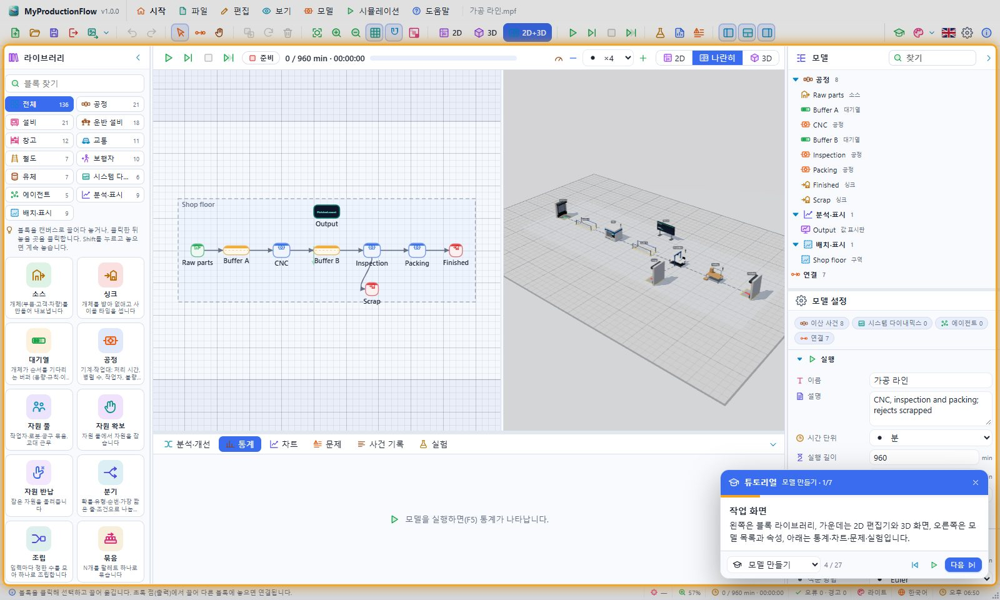

## 1. 화면 구성

- **메뉴 막대** — 시작 · 파일 · 편집 · 보기 · 모델 · 시뮬레이션 · 도움말. 오른쪽 끝에 창 단추가 있고, 막대를 끌면 창이 움직입니다.
- **도구 모음** — 새로 만들기·열기·저장, 실행 취소, 선택·연결·화면 이동 도구, 복제·회전·삭제, 확대, 격자, 2D/나란히/3D, 실행 단추, 실험·보고서·모델 검사, 패널 켜고 끄기, 튜토리얼·테마·언어·설정·정보. 창이 좁으면 남는 단추는 **»** 메뉴로 갑니다.
- **라이브러리 (왼쪽)** — 모든 블록이 분류별로 있습니다. 검색하거나 분류를 고릅니다.
- **실행 막대 (가운데 위)** — 실행·한 사건씩·정지·끝까지, 상태, 모델 시간과 시계, 진행 막대, 사건 수, 속도, 2D/나란히/3D 전환.
- **2D 편집기와 3D 화면 (가운데)** — 2D에서 모델을 그리고, 3D에서 같은 모델을 입체로 봅니다. 둘 사이 경계를 끌어 비율을 바꿉니다.
- **모델 목록과 속성 (오른쪽)** — 위는 블록 목록(분류별), 아래는 선택한 블록의 속성입니다. 아무것도 선택하지 않으면 **모델 설정**이 나옵니다.
- **하단 패널** — 통계 · 차트 · 문제 · 사건 기록 · 실험.
- **상태 표시줄** — 알림, 선택 수, 포인터 위치(m), 확대 비율, 모델 시간, 문제 수, 테마, 언어, 시계.

## 2. 시작하기

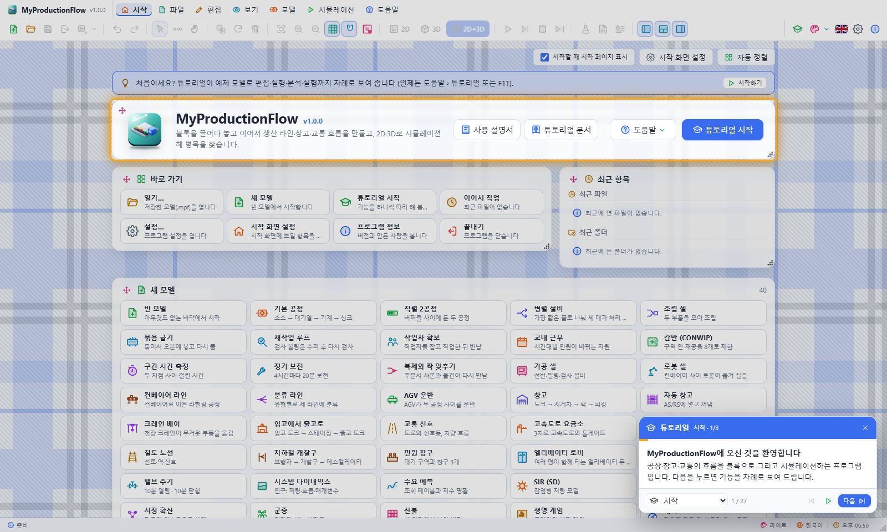

시작 화면에서 **새 모델**(템플릿 40개) 또는 **예제 모델** 40개 중 하나를 고릅니다. 예제는 열자마자 **F5**로 실행됩니다.

**템플릿 40개** — 빈 모델 · 기본 공정 · 직렬 2공정 · 병렬 설비 · 조립 셀 · 묶음 굽기 · 재작업 루프 · 작업자 확보 · 교대 근무 · 칸반(CONWIP) · 구간 시간 측정 · 정기 보전 · 복제와 짝 맞추기 · 가공 셀 · 로봇 셀 · 컨베이어 라인 · 분류 라인 · AGV 운반 · 창고 · 자동 창고 · 크레인 베이 · 입고에서 출고로 · 교통 신호 · 고속도로 요금소 · 버스 노선 · 철도 노선 · 지하철 개찰구 · 민원 창구 · 엘리베이터 로비 · 탱크 채우고 비우기 · 밸브 주기 · 시스템 다이내믹스 · 수요 예측 · SIR(SD) · 에이전트 · 시장 확산 · 군중 · 산불 · 생명 게임 · 대시보드.

| 예제 분류 | 예제 |
|---|---|
| 제조 (9) | 가공 라인 · 조립 라인 · 작업자 공유 잡숍 · 병입 라인 · 교대 근무 · 칸반 생산 라인 · 예방 보전 가공 셀 · 도장 공장 · 전자 조립 |
| 물류·창고 (7) | 창고 입출고 · 크로스도킹 · AGV 공장 물류 · 공급망 재고(SD) · 자동 창고 센터 · 이커머스 풀필먼트 · 컨테이너 항만 |
| 서비스 (6) | 은행 창구 · 응급실 · 공항 보안 검색 · 세차장 · 레스토랑 · 콜센터 |
| 교통·철도·보행자 (7) | 교차로 신호 · 주차장 · 고속도로 톨게이트 · 철도 노선 · 지하철역 · 경기장 퇴장 · 버스 전용 차로 |
| 시스템 다이내믹스·유체 (6) | 신제품 확산(Bass) · 포식자–피식자 · 인력 계획 · 정수 처리장 · 배합 공정 · 재고 정책 |
| 에이전트·하이브리드 (5) | 감염병 확산(SIR) · 제품 입소문 · 하이브리드(SD 수요 → 생산) · 산불 확산 · 생명 게임 |

## 3. 그래픽으로 모델 만들기

### 3.1 블록 놓기

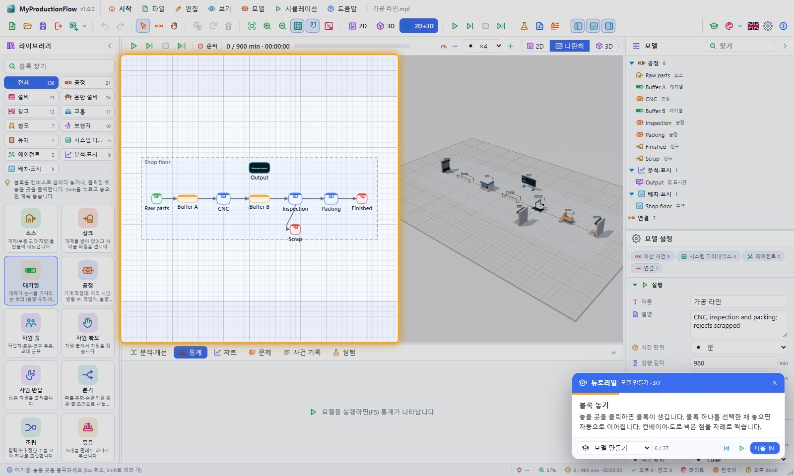

- 라이브러리의 카드를 **캔버스로 끌어다 놓거나**, 카드를 **클릭한 뒤 놓을 곳을 클릭**합니다. **Shift**를 누른 채 클릭하면 같은 블록을 계속 놓습니다. **Esc**로 그만둡니다.
- 블록 하나를 선택한 채 새 블록을 놓으면 **자동으로 이어집니다** (Ctrl+Z로 취소).
- **컨베이어 · 도로 · 벽**은 점을 차례로 클릭하고 **두 번 클릭** 또는 **Enter**로 끝냅니다. Shift를 누르면 직각으로 그립니다.
- 블록은 **0.5 m 격자**에 맞춰집니다 (설정에서 바꿈, **Alt**를 누르고 끌면 맞추지 않음).

### 3.2 연결하기

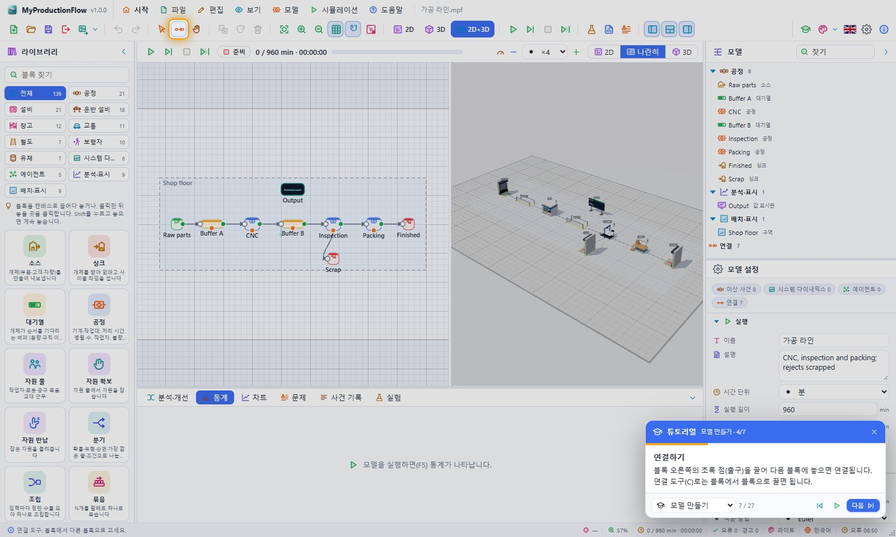

- 블록 오른쪽의 **초록 점(출구)** 을 끌어 다음 블록(또는 그 입구)에 놓습니다.
- **연결 도구(C)** 로는 블록에서 블록으로 끌면 됩니다.
- 출구가 둘인 블록: **대기열**의 아래 주황 점은 *최대 대기를 넘긴 개체*, **공정**의 아래 주황 점은 *불량품* 출구입니다.
- 시스템 다이내믹스: 저량 → 흐름(비움), 흐름 → 저량(채움)은 **물질 흐름**(파이프)으로, 그 밖의 SD 연결은 **영향 화살표**(점선)로 이어집니다.
- 연결선을 끌면 **꺾은 점**이 생기고, 꺾은 점을 끌어 옮깁니다. 연결선 오른쪽 클릭 › *연결선 곧게*.

### 3.3 선택·이동·편집

- 클릭으로 선택, **Shift/Ctrl+클릭**으로 더하기, 빈 곳을 끌어 **사각형 선택** (왼→오: 완전히 들어간 것, 오→왼: 걸친 것).
- 끌어서 이동, **화살표 키**로 조금씩(Shift: 5 m), **R** 90° 회전, **Ctrl+D** 복제, **Delete** 삭제, Ctrl+C/V 복사·붙여넣기, **F2** 또는 두 번 클릭으로 이름 바꾸기.
- 여러 개를 고르면 속성 패널에서 **맞춤·간격 같게**를 씁니다.
- 컨베이어·도로·벽은 선택한 뒤 **점을 끌어** 모양을 바꾸고, 선분을 **두 번 클릭**해 점을 더하고, 점을 **오른쪽 클릭**해 지웁니다. 구역·에이전트 집단·차트 판은 모서리를 끌어 크기를 바꿉니다.
- **3D 화면에서도** 블록을 클릭해 고르고, 선택한 블록을 끌어 바닥 위에서 옮길 수 있습니다.
- 휠로 확대·축소, 가운데 단추나 **Space+끌기**로 화면 이동, **Ctrl+0** 전체 보기.

### 3.4 속성

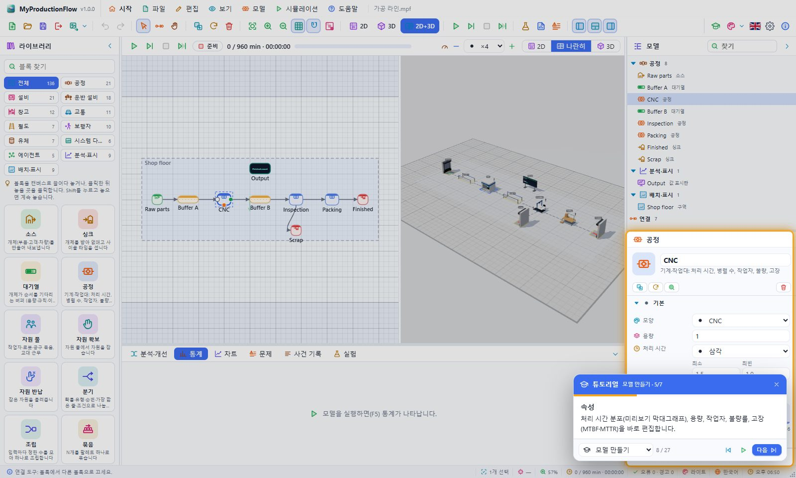

블록을 고르면 오른쪽 아래에 속성이 나옵니다. 값을 바꾸면 바로 모델에 들어가고 실행 취소할 수 있습니다.

- **분포** — 고정값, 균등, 삼각, 정규, 지수, 로그정규, 얼랑, 감마, 와이블, 베타, 포아송, 경험적(값·비율), 식. 아래에 **표본 막대그래프와 평균**이 미리 보입니다.
- **식** — `Queue1.length * 2`, `if(Stock1 > 100, 1, 0)`, `0.35 + sinwave(0.2, 720, t)` 처럼 씁니다. 쓸 수 있는 이름은 입력할 때 목록으로 나옵니다.
- **목록** — 개체 유형(이름·색·비율), 일정표(시작·끝·값), 상태(이름·색), 전이(출발→도착, 종류, 값).
- **위치·크기** — X, Y, 회전, 폭·깊이, 경로 길이와 통과 시간.

### 3.5 블록 종류

| 분류 | 블록 |
|---|---|
| **공정 (21)** | 소스 · 싱크 · 대기열 · 공정 · 자원 풀 · 자원 확보 · 자원 반납 · 분기 · 조립 · 묶음 · 묶음 풀기 · 게이트 · 속성 지정 · 지연 · **복제** · **짝 맞추기** · **제한 구역 시작/끝**(CONWIP·칸반) · **시간 측정 시작/끝** · **정기 보전** |
| **설비 (21)** | CNC 가공기 · 선반 · 밀링기 · 드릴 프레스 · 프레스 · 사출 성형기 · 오븐·경화로 · 건조기 · 도장 부스 · 용접 로봇 · 레이저 절단기 · 절단기 · 연삭기 · 3D 프린터 · 조립 작업대 · 검사대 · 시험대 · 라벨러 · 포장기 · 세척기 · 키팅 작업대 |
| **운반 설비 (18)** | 컨베이어 · 롤러 컨베이어 · 슈트 · 운반차 · 지게차 무리 · AGV 무리 · 견인 열차 · 천장 크레인 · 드론 무리 · 로봇 · 수직 리프트 · 턴테이블 · 분류기 · 분기 장치 · **합류** · 팔레타이저 · 디팔레타이저 · 축적 버퍼 |
| **창고 (12)** | 랙 · 도크 · 자동 창고(AS/RS) · 플로 랙 · 바닥 적치 · 냉장 창고 · 입고 도크 · 출고 도크 · 피킹 스테이션 · 포장 스테이션 · 스테이징 레인 · 품질 보류 |
| **교통 (11)** | 도로 · 신호등 · 주차장 · 차량 발생 · 차량 소멸 · 고속도로 · 버스 정류장 · 톨게이트 · 주유소 · 횡단보도 · 교차 합류 |
| **철도 (7)** | 철도 선로 · 열차 발생 · 열차 소멸 · 역 승강장 · 분기기 · 철도 신호 · 조차장 |
| **보행자 (10)** | 보행자 발생 · 보행자 퇴장 · 보행 통로 · 에스컬레이터 · 서비스 창구 · 대기 구역 · 개찰구 · 보안 검색 · 엘리베이터 · 좌석 구역 |
| **유체 (7)** | 탱크(용량) · 배관 · 밸브(열림/닫힘 주기) · 펌프 · 공급원 · 배출 · 혼합 탱크 |
| **시스템 다이내믹스 (6)** | 저량(용량 선택) · 흐름 · 변수 · 매개변수 · **조회 테이블**(x→y 그래프 함수) · **지수 평활**(SMOOTH) |
| **에이전트 (5)** | 에이전트 집단 · 소비자 집단 · 군중 · **셀 격자**(이웃 규칙) · 생명 게임 |
| **분석·표시 (9)** | 값 표시판 · 게이지 · 카운터 · 진행 막대 · 시계열 차트 · 막대 · 영역 · 원 · 히스토그램 |
| **배치·표시 (9)** | 구역 · 사무 구역 · 벽 · 울타리 · 바닥 표시선 · 기둥 · 출입문 · 나무 · 글자 |

설비·운반·창고·교통·철도·보행자 블록은 공정·컨베이어·운반차·랙 같은 기본 동작 위에 모양·기본값을 갖춘 **실제 설비**입니다. 속성은 기본 동작과 같고(처리 시간·용량·고장·불량 …) 2D·3D에서 각자의 모양으로 보입니다.

주요 속성:

| 블록 | 주요 속성 |
|---|---|
| 소스 | 도착 간격 분포 / 도착률 식(포아송) / 시간대별 도착률, 묶음 도착, 최대 수, 유형 섞기, 모양, 출구가 막히면 기다림·버림 |
| 대기열 | 용량, FIFO·LIFO·우선순위·무작위, 최대 대기(넘으면 아래 출구) |
| 공정(설비) | 모양 34가지, 병렬 수, 처리 시간, 자원 풀·필요 수, 유형 변경 준비, 불량률, 고장(MTBF·MTTR), 시간당 비용 |
| 복제 / 짝 맞추기 | 사본 수·유형·색 / 같은 유형끼리, 용량 |
| 제한 구역 | 구역 안 최대 개체 수 (끝 블록이 시작 블록을 가리킴) |
| 정기 보전 | 대상 설비, 간격 분포, 보전 시간 분포, 첫 시각 |
| 컨베이어·도로·선로·통로 | 경로, 속도, 간격, 폭, 쌓임형, 차로 수 |
| 운반차 | AGV·지게차·카트·드론·크레인·견인차, 대수, 속도, 싣기·내리기, 직각/직선 경로, 대기소 복귀 |
| 랙·창고 | 칸·단, 보관 시간, 넣기·꺼내기, 꺼내는 순서 |
| 신호등 | 녹·황·적색, 시작 지연, 통과 간격 |
| 탱크·밸브 | 용량, 초기값 / 열림·닫힘 시간 |
| 조회 테이블·평활 | 입력 식, x·y 값 / 입력, 지연 시간, 초기값 |
| 에이전트·셀 격자 | 수·속도 / 열·행·이웃(8방향·4방향)·가장자리, 상태, 초기 비율, 전이(비율·시간·접촉·이웃 수·조건) |
| 표시판 | 식, 숫자·게이지·막대·카운터, 최소·최대 |

### 3.6 식에서 쓰는 이름

| 이름 | 뜻 |
|---|---|
| `time`, `t` | 현재 모델 시간 |
| `Stock1`, `Rate` | SD 요소 (이름은 공백 없이 글자로 시작) |
| `Queue1.length`, `Queue1.waitTime` | 대기열 길이, 평균 대기 |
| `CNC.utilization`, `CNC.busy`, `CNC.contents` | 공정 가동률, 가동 중 수, 내용물 |
| `Sink1.count`, `Sink1.cycleTime`, `Sink1.throughput` | 완료 수, 평균 사이클, 처리량 |
| `Crew.utilization`, `Crew.idle` | 자원 풀 |
| `Rack1.fill`, `Gate1.open` | 랙 채움률, 게이트 열림(1/0) |
| `Town.Infected`, `Town.count` | 에이전트 상태별 수 |

함수: `min max abs sqrt exp ln log pow sin cos round floor ceil clamp if step(높이, 시작) pulse ramp sinwave random() uniform(a,b) normal(m,s) exponential(m) triangular(a,c,b) poisson(m)`. 분기의 조건과 속성 지정의 우선순위에서는 개체의 `priority`, `age`, `size`도 씁니다.

### 3.7 모델 검사

편집할 때마다 모델을 검사해 **문제** 탭에 보여 줍니다: 연결 안 된 출구, 틀린 식이나 모르는 이름, 없는 자원 풀, 맞지 않는 수량·비율, 점이 모자란 경로, 상태도 오류 등. 오류가 있으면 실행하지 않습니다. 줄을 클릭하면 그 블록으로 갑니다. **F8**로 직접 검사합니다.

## 4. 실행과 애니메이션

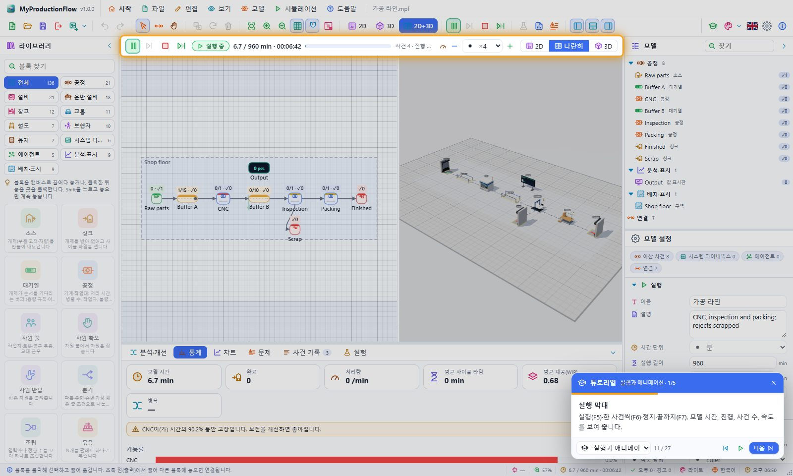

| 단추 | 키 | 하는 일 |
|---|---|---|
| 실행 / 일시정지 | F5 | 실시간 애니메이션으로 실행 |
| 한 사건씩 | F6 | 다음 사건 하나만 처리 |
| 정지 | Shift+F5 | 처음으로 (결과는 통계에 남음) |
| 끝까지 | F7 | 애니메이션 없이 끝까지 빠르게 (진행 창, 취소 가능) |
| 속도 | `[` `]` | 1초에 진행할 모델 시간 (×0.1 … ×5000) |

- **2D** — 개체가 대기열 칸, 공정 안, 컨베이어 위, 랙 칸에서 움직입니다. 블록 위쪽 띠가 상태 색(가동 초록 · 유휴 노랑 · 막힘 주황 · 고장 빨강), 아래에 가동률 막대, 위에 내용물/용량·처리 수가 나옵니다. **가동률 열지도**(도구 모음)를 켜면 블록 전체가 가동률 색이 됩니다. 블록에 포인터를 올리면 실시간 수치가 뜹니다.
- **3D** — 같은 모델이 공장·창고·도로 장면으로 보입니다. 상자·팔레트·차량·사람, AGV·지게차·드론, 작업자(가동 중 초록 조끼), 상태 표시등, 신호등, 탱크(저량 높이), 표시판. 왼쪽 끌기 회전, 오른쪽 끌기 이동, 휠 확대, 보기 › 3D 시점(등각·위·앞·옆).
- 실행 중에는 구조를 바꿀 수 없습니다. **SD 매개변수**는 속성 패널의 슬라이더로 실행 중에 바꿉니다.
- 블록을 선택하면 **실시간 통계**(가동률, 대기, 처리량, 고장 횟수 …)가 속성 위에 나옵니다.

## 5. 분석·개선, 통계·차트·보고서

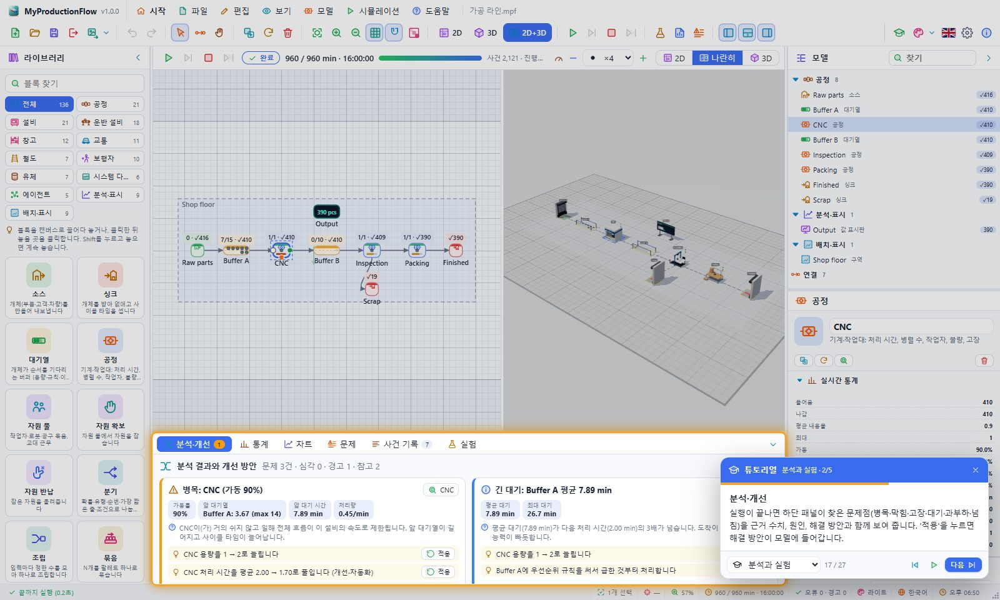

**분석·개선** 탭 — 실행이 끝나면 자동으로 열리고, 실행 중에도 실시간으로 바뀝니다. 찾은 문제마다 카드 하나:

- **제목과 심각도** — 심각(빨강) · 경고(주황) · 참고(파랑), 문제가 없으면 초록 "큰 문제가 없습니다".
- **근거 수치** — 가동률, 앞 대기열 길이·대기 시간, 막힘·고장 비율, 이탈·손실 수, 채움률 등.
- **원인** — 왜 그런지 한 문장으로.
- **해결 방안** — 여러 개. 매개변수로 바꿀 수 있는 것은 **적용** 단추가 있어 누르면 모델에 들어갑니다(실행 취소 가능). **다시 실행**으로 효과를 확인합니다.

| 찾는 문제 | 해결 방안 예 |
|---|---|
| 병목 (가동 85% 이상) | 용량 +1, 처리 시간 15% 단축, 준비 시간 절반, 병렬 설비, 자원·차량 추가 |
| 막힘 (다음 단계가 못 받음) | 뒤 버퍼 1.5배, 버퍼 추가, 다음 단계 강화 |
| 고장 | 수리 시간 절반, 고장 간격 2배(예방 보전), 앞뒤 버퍼 |
| 불량 | 불량률 절반, 앞 공정에서 일찍 검사 |
| 대기열 증가·긴 대기 | 다음 설비 용량 +1, CONWIP로 재공 제한, 투입 조절, 우선순위 |
| 이탈·손실 | 최대 대기 1.5배, 서비스 강화, 버리지 말고 기다리기 |
| 자원·운반 부족 / 과잉 | 인원·차량 ±1, 속도 25% 향상, 교대 일정 |
| 보관 공간 부족 | 칸 30% 추가, 보관 시간 단축 |
| 라인 불균형 · 대기가 대부분 · 재공 누적 | 작업 재분배, 재공 상한, 당김 방식 |
| 탱크 넘침·고갈 | 용량 1.5배, 유입·유출 조절 |

모델 검사의 **문제** 탭에도 문제마다 고치는 방법이 함께 나옵니다.

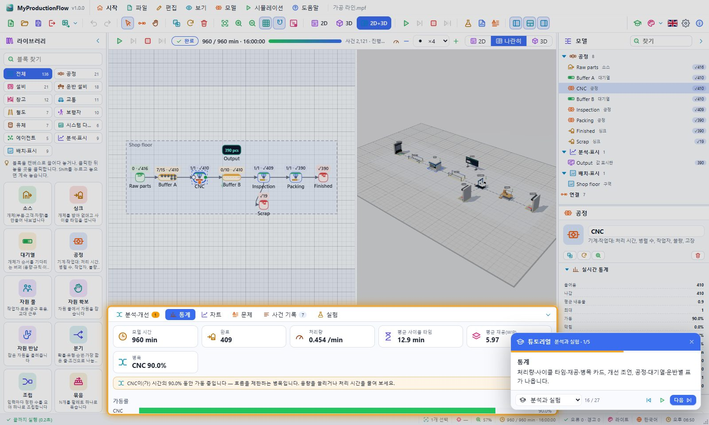

- **통계** — 모델 시간, 완료, 처리량, 평균 사이클 타임, 평균 재공(WIP), **병목**(가장 바쁜 설비), 손실, 비용 카드. 그 아래 **조언**(병목, 막힘, 고장, 긴 대기열, 손실, 이탈)과 가동·막힘·고장 비율 막대, 공정·대기열·소스와 싱크·운반과 보관·SD·에이전트 표.
- **차트** — 모델에 넣은 차트, 재공과 완료, **공정 상태 타임라인**(간트), 사이클 타임 분포. **차트 추가…** 로 원하는 값(쉼표로 여러 개)을 그립니다. 연필로 편집, ×로 삭제.
- **사건 기록** — 고장·수리·이탈·워밍업·오류와 알림.
- **보고서 (Ctrl+R)** — 설정·결과·조언·표·차트를 한 쪽에. 인쇄, HTML 저장, CSV 저장.
- **내보내기** — 2D/3D 그림(PNG), 통계 CSV, 시계열 CSV, 실험 CSV, 보고서 HTML.
- **워밍업** — 모델 설정의 워밍업 시간이 지나면 통계를 다시 시작합니다 (빈 상태에서 시작하는 영향을 없앰).

## 6. 실험

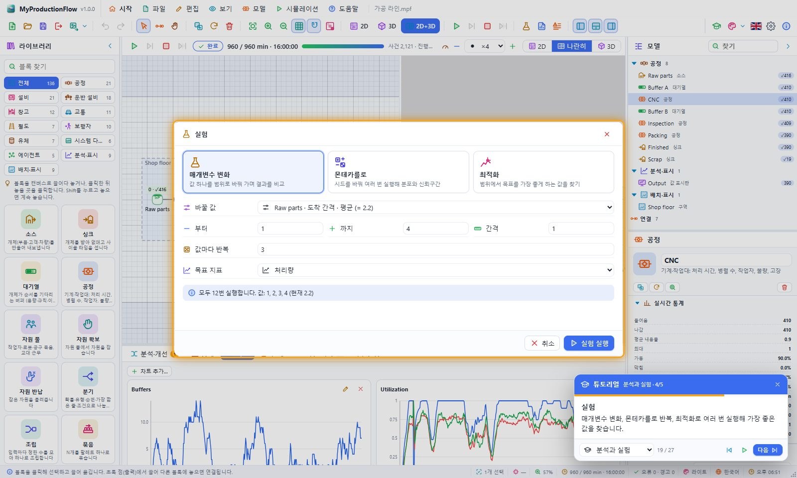

**시뮬레이션 › 실험… (Ctrl+Shift+X)**

| 종류 | 하는 일 |
|---|---|
| 매개변수 변화 | 블록 속성이나 분포 모수 하나를 범위(부터·까지·간격)로 바꾸며 값마다 여러 번 실행해 목표 지표를 비교 |
| 몬테카를로 | 시드만 바꿔 N번 실행 → 평균, 95% 신뢰구간, 최소·최대, 분포 |
| 최적화 | 범위에서 목표(처리량 최대화, 사이클 최소화 …)를 가장 좋게 하는 값을 찾음 |

결과는 하단 **실험** 탭에 차트와 표로 나오고, **최적 값을 모델에 적용**할 수 있습니다. 목표 지표는 처리량·완료 수·평균 사이클·평균 재공·비용·손실과 모든 `블록.지표`, SD 이름, 에이전트 상태입니다.

## 7. 시스템 다이내믹스와 에이전트

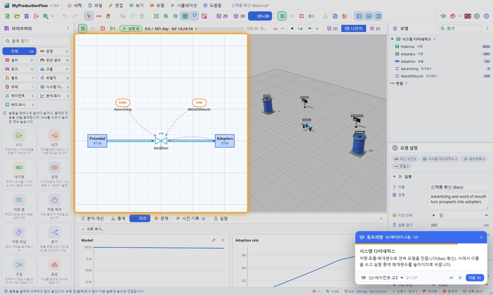

- **저량**은 쌓이는 양(초기값), **흐름**은 저량을 채우거나 비우는 비율 식, **변수**는 계산값, **매개변수**는 상수입니다. 모델 설정에서 SD 시간 간격과 적분 방법(오일러, 룽게–쿠타 4)을 고릅니다.
- 이산 사건과 섞기: 소스의 도착률을 SD 식으로(`Demand`), SD 흐름에서 공정 지표를 읽기(`Production.busy / 4.6`). 예제 **하이브리드**를 보세요.

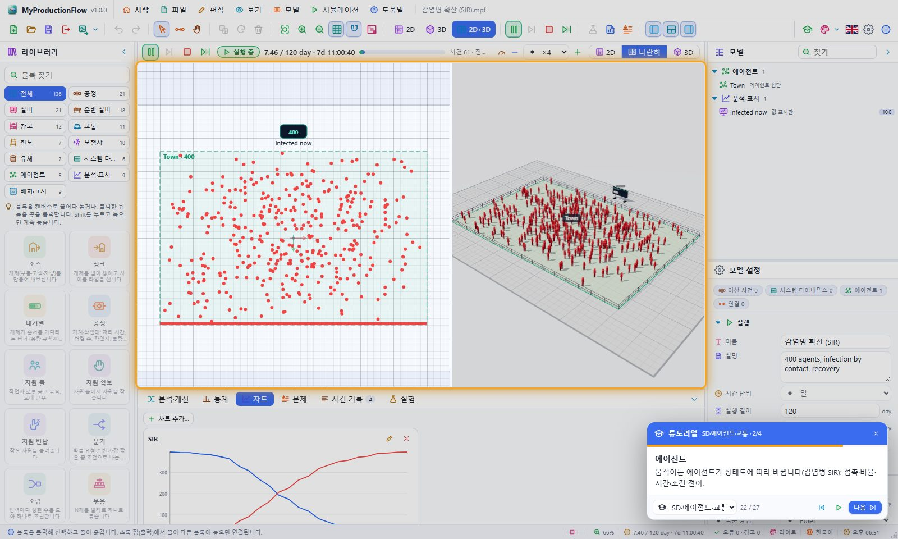

- **셀 격자**는 칸마다 상태가 있고 이웃 수에 따라 바뀝니다(산불·생명 게임). 전이에 '이웃 수가 범위 안이면/밖이면'이 더 있습니다.
- **에이전트 집단**은 사각형 영역 안에서 움직이는 에이전트들입니다. 상태(이름·색), 초기 비율(`S:0.98, I:0.02` 또는 수), 전이:
  - **비율** — 단위 시간당 비율로 무작위 전이
  - **시간** — 그 상태에 머문 시간이 지나면
  - **접촉** — 반경 안의 상대 상태 에이전트 수 × 전이율
  - **조건** — 식이 참이면
- 상태별 수는 `집단.상태` 로 식과 차트에 씁니다.

## 8. 파일

- 모델은 **.mpf** (JSON 텍스트) 파일입니다. Windows 탐색기에서 두 번 클릭하면 열립니다(파일 연결). 창으로 끌어다 놓아도 열립니다.
- 저장 Ctrl+S, 다른 이름 Ctrl+Shift+S, 열기 Ctrl+O, 최근 파일·폴더, 모델 닫기 Ctrl+W.
- 설치 폴더의 `samples/`(한국어), `samples/en/`(영어)에 예제 파일이 있습니다.

## 9. 설정

**설정 (Ctrl+,)**: 일반(언어, 세션 복원, 시계), 시작 화면, 테마(어두운 20 · 밝은 20 · 사용자 정의), 글꼴, 배경, **시뮬레이션**(기본 화면, 격자 맞춤 간격, 격자·포트·이름·연결선 표시, 가동률 열지도, 자동 검사, 3D 그림자·이름표·품질, 새 모델의 시간 단위, 기본 속도), 최근 기록, 단축키.

## 10. 단축키

| 키 | 하는 일 | 키 | 하는 일 |
|---|---|---|---|
| V / C / H | 선택 / 연결 / 화면 이동 | F5 / Shift+F5 | 실행·일시정지 / 정지 |
| R | 90° 회전 | F6 / F7 | 한 사건 / 끝까지 |
| F2 | 이름 바꾸기 | F8 | 모델 검사 |
| Delete | 삭제 | Ctrl+R | 보고서 |
| Ctrl+D | 복제 | Ctrl+Shift+X | 실험 |
| Ctrl+Z / Y | 실행 취소 / 다시 | Ctrl+1 / 2 / 3 | 2D / 3D / 나란히 |
| 화살표 | 조금씩 이동 | Ctrl+0 | 전체 보기 |
| G | 격자 | [ / ] | 느리게 / 빠르게 |
| Ctrl+N / O / S | 새로 / 열기 / 저장 | F11 | 튜토리얼 |
| Ctrl+Shift+L | 언어 | F1 | 프로그램 정보 |

## 11. 문제가 생기면

- **실행이 안 됨** — 하단 **문제** 탭의 오류(빨강)를 고치세요.
- **개체가 쌓이기만 함** — 출구가 연결되지 않았거나 다음 단계가 너무 느립니다. 통계의 병목·막힘 조언을 보세요.
- **3D가 안 보임** — 그래픽 드라이버가 WebGL을 지원해야 합니다. 설정에서 3D 품질을 *빠르게*로 낮춰 보세요.
- 오류가 나면 자세한 내용이 창으로 뜨고 복사할 수 있습니다. 문의: SHKWON (knix008@naver.com).
