# MySimulator User's Guide

MySimulator brings signal processing, dynamics and control, statistics and machine learning, Monte Carlo and optimisation together in one **node pipeline**. Start from nodes that make data (sources), join processing and analysis nodes with links, and show the results with chart and KPI nodes. One ▶ runs "data in → preprocessing → simulation → results" in order.

The same screen runs in a web browser and as a desktop app on Windows, macOS and Linux. A Rust engine does the computing — native on the desktop, WebAssembly in the browser, with the same results. Nodes that run Python scripts, external programs or read files from disk run in the desktop app only.

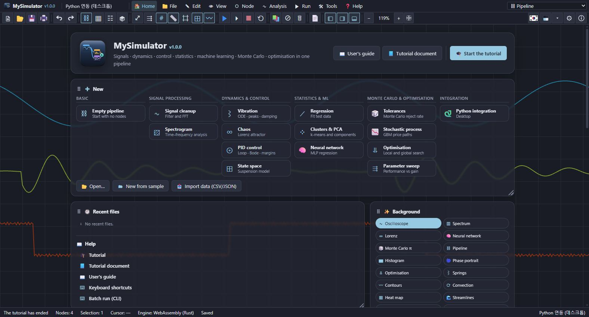

## 1. The screen

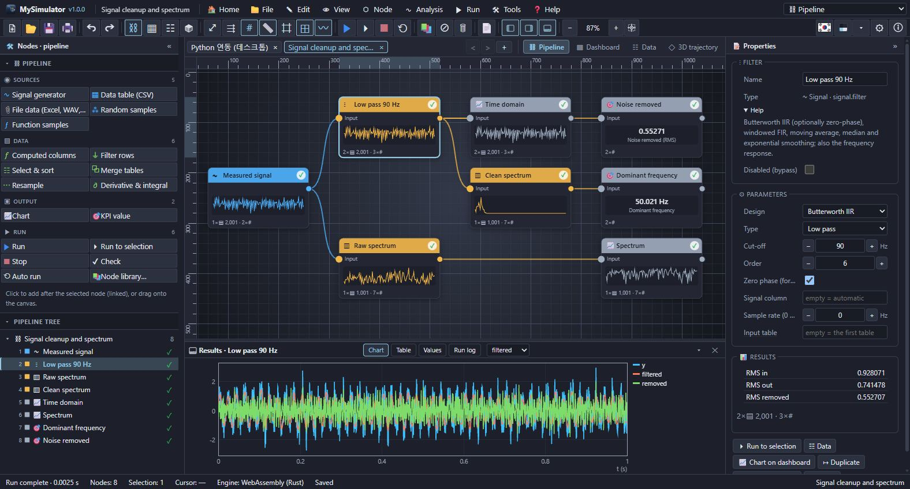

| Area | Contents |
| --- | --- |
| Menu bar | Home · File · Edit · View · Node · Analysis · Run · Tools · Help, the workbench selector on the right. On the desktop the program name, version and window buttons sit in this row too. |
| Toolbar | New, open, save, print; undo; the views; fit, auto arrange, grid, previews; run, run to selection, stop, auto run; node library, disable, delete; report; the panel buttons and zoom. Language (flag), theme, settings and about at the right end. |
| Left panel | Top: the workbench's **node palette**. Bottom: the **pipeline tree** (execution order, state marks). |
| Middle | Document tabs and the view switch (Pipeline · Dashboard · Data · 3D trajectory), the view below. |
| Result panel | The selected node's chart, table, values and the run log. Drag its edge to resize. |
| Right panel | The selected node's name, help, presets, parameters and result values; with nothing selected, the pipeline settings and the last run. |
| Status bar | State, node count, selection, cursor, engine (native/WebAssembly), Python, saved state, file path. |

Fold panels with « », hide them with ✕, bring them back from the View menu or the toolbar.

### State marks

The marks in the tree and at the top right of every node show the last run.

| Mark | Meaning |
| --- | --- |
| ✓ | done |
| ⚠ | done with warnings (shown in the property panel) |
| ✕ | failed (red border; the error shows under the node and in the property panel) |
| – | skipped because an input failed |
| ◔ | this node or one before it changed after the run — run again to update |
| ⊘ | disabled (the input passes through) |
| ○ | not run yet |

## 2. Building a pipeline

### Adding nodes

- **Click in the palette**: the node goes to the right of the selected node and is linked to it. With nothing selected it lands in the middle of the view.
- **Drag from the palette**: drop it where you want (not linked).
- **Node and Analysis menus**: every node, by area.
- **Node library** (Ctrl+K, or double-click empty space): search all 54 nodes, read their help, inputs and parameters, and add one.
- **Drag an output port onto empty space**: the node library opens and the node you pick is linked to that output.

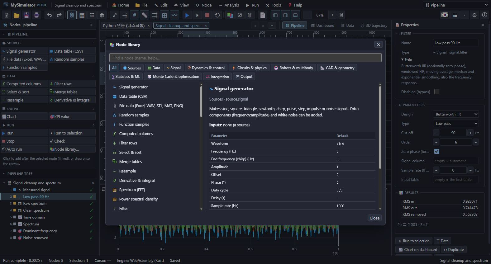

### Links

Drag a node's output port (●, right) onto another node's input port (left). Dropping on a node's body links its first free input. An input takes one link (a new link replaces the old one) and links cannot form a loop. Drag a linked input port away to move the link elsewhere, or drop it on empty space to remove it. You can also click a link and press Delete.

Inputs marked "(optional)" — the ODE's u, the PID's r, correlation's b, the Python node's input — need not be linked.

### Selecting and moving

| Action | Result |
| --- | --- |
| Click a node | select (Shift/Ctrl+click adds or removes) |
| Drag a node | move (all selected nodes move together; snap to grid uses 20 units) |
| Drag on empty space | pan (a hand cursor over empty space) |
| Shift/Ctrl+drag on empty space | box selection (added to the selection) |
| Drag with the middle or right button, Space+drag | pan |
| Wheel | zoom at the cursor |
| Double-click a node | open its results in the data view |
| Right click | the menu of the node, link or canvas |

The View menu and the toolbar turn the **grid** (5 × 5 cells per major line, the spacing follows the zoom), the **rulers** (top and left, with the cursor and the selection), **snap to grid** and **chart grid lines** on and off.

Edit menu: copy and paste (with the links between the copied nodes), duplicate, delete, rename (F2), disable (Ctrl+E), disconnect, auto arrange (Ctrl+L, columns by order). Every change can be undone (Ctrl+Z) and redone (Ctrl+Y).

### Parameters

Edit them in the property panel. Number fields apply on Enter or when you leave the field, step with − + and ↑ ↓, and accept expressions such as `2*pi`, `1e-3` or `1,5` (decimal comma).

- **Columns**: column fields suggest the columns the upstream node produced in the last run. Multi-column fields toggle columns with the buttons below. Empty means automatic (the first numeric column, or every numeric column).
- **Presets**: typical models for the ODE (mass–spring–damper, pendulum, Van der Pol, Lorenz, predator–prey, SIR, Duffing, RLC, tank, projectile), transfer functions, state space, Monte Carlo, optimisation, curve fit and Python nodes.
- **Help**: an underlined parameter name has a tooltip.

### Expressions

The ODE, computed column, row filter, function, Monte Carlo, optimisation and curve-fit nodes take expressions (Tools › Expression help).

```
y = 2*sin(2*pi*f*t) + 0.5*x^2
x' = v
v' = -k/m*x - c/m*v + F*step(t - 1)
gap = housing - partA - partB
ok = if(T > 80, 0, 1)
```

- Operators `+ - * / ^ %`, comparisons `< <= > >= == !=` (true = 1), `&& || !`, implicit multiplication after a number (`2x`)
- Functions: `sin cos tan asin acos atan atan2 sinh cosh tanh exp ln log10 log2 sqrt cbrt abs sign floor ceil round min max pow hypot clamp step if mod sat deg rad sinc erf gauss`, constants `pi e`
- Spaces and symbols in column names become `_` (`Speed (m/s)` → `Speed`). Computed columns also know `i` (row), `n` (rows), `column_mean`, `column_std`, `column_min`, `column_max`.
- A wrong expression fails only its node, with the reason ("unknown name …", "missing ')' …").

## 3. Running and results

- **▶ Run** (F5): the whole pipeline.
- **⏵ Run to selection** (Ctrl+F5): the selected nodes and their inputs; the results merge into the existing ones.
- **■ Stop** (Shift+F5).
- **Auto run**: runs again 0.7 s after a parameter change.
- **Check**: finds unlinked inputs, loops and unknown nodes before running.

A failed node keeps its error and the nodes after it are skipped; other branches still run. The run log tab lists every node's time (desktop), warnings and errors.

### Result panel and data view

The result panel shows the selected node's results in the **Chart · Table · Values · Run log** tabs; with several tables, pick one next to the tabs. Hover over the chart to read x and y.

The **data view** (view switch › Data, or double-click a node) shows the same results in full — chart, values and the table (up to 1000 rows) — with CSV and JSON export and copying the table (tab separated, pastes into a spreadsheet).

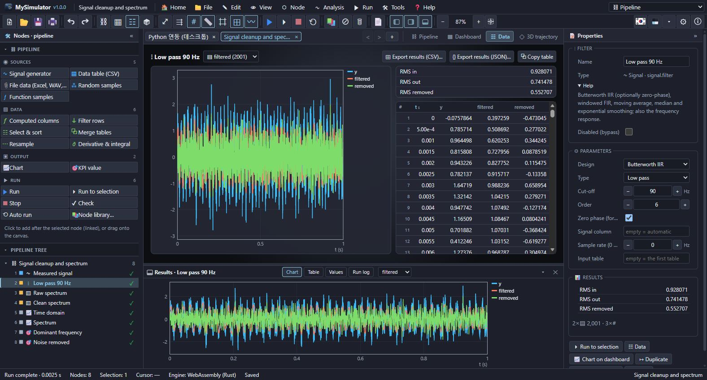

The chart fits the result: a heat map for grids (spectrogram, correlation matrix, prediction map, objective map), horizontal bars for labelled rows (statistics, coefficients, sensitivities), lines against the x column otherwise. An optimisation node's map has the search path drawn on it.

### Dashboard

Collects the **Chart** and **KPI value** nodes on one screen (in canvas order). A KPI shows one value (a result value, or a column with an aggregate) in large type and turns to the alarm colour outside its low/high limits. A chart node sets the type (line · scatter · bar · area · step · heat map · x–y trajectory · table), the table, x and y columns, a colour-by column (scatter), log axes and its dashboard width (1–3 columns). Without chart nodes, "Attach a chart to every end node" makes them at once.

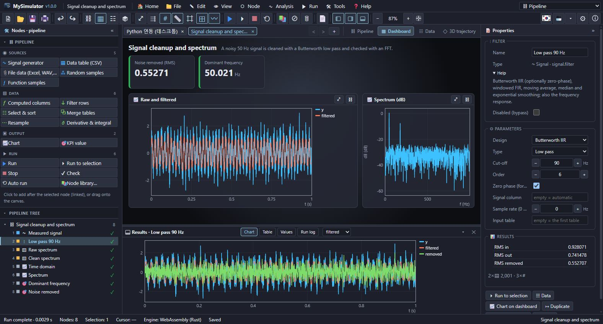

### 3D trajectory

Draws three columns as a 3D curve or points (the Lorenz attractor, phase space, clusters, the surface points of a CAD part). Pick the x, y and z columns, the colour (order or a column) and curve/points in the chips at the top. Drag to orbit, right-drag to pan, wheel to zoom.

A **grid** lies on the floor (the x–y plane): major lines at round data values (1, 2, 5 × 10ⁿ), each cell split 5 × 5; zooming in or out picks a finer or coarser step so the spacing on screen stays about the same. The **axes** (x red, y green, z blue) and tick values follow the same step. The "3D grid" and "3D axes and ticks" chips (View menu, right-click menu) turn them on and off. Point clouds (CAD parts) are drawn at true proportions.

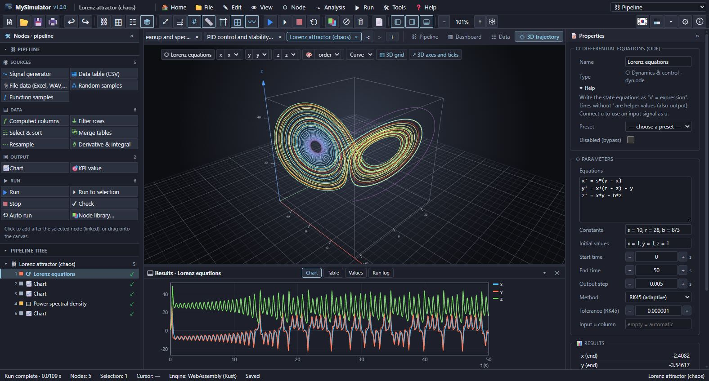

### Report and printing

The **report** gathers the pipeline (nodes and their inputs), every node's values, charts and printed text, warnings and errors. Save it as HTML or print it. The **print** window sets paper, orientation, margins, header, footer, greyscale and what to print (current view, result chart, pipeline, results, run log), with a preview.

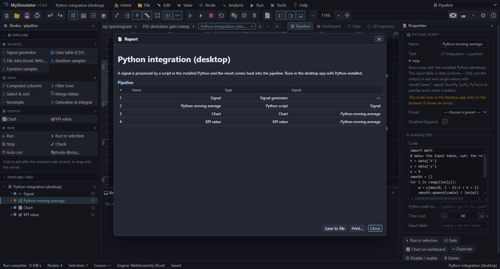

## 4. Nodes

### Sources

| Node | What it does |
| --- | --- |
| Signal generator | Sine, cosine, square, triangle, sawtooth, chirp, pulse, step, impulse, Gaussian noise, DC; extra components (`frequency:amplitude`), white noise, delay, sample rate, duration |
| Data table (CSV) | CSV/TSV/JSON pasted or imported. A text first row is the header, `t (s)` puts the unit in brackets, non-numeric columns become text columns |
| Random samples | Normal, uniform, triangular, log-normal, exponential, Weibull, gamma, beta, Poisson, Bernoulli; several columns |
| Function samples | `name = expression` lines sampled on an interval |
| File data | a file kept inside the pipeline: Excel (.xlsx, choose the sheet), WAV (a column per channel, the sample rate), STL (a triangle table), MATLAB .mat (v5, compressed too), PNG (brightness and RGB grids), CSV, JSON; works in the browser too |

### Data

| Node | What it does |
| --- | --- |
| Computed columns | add or replace columns with `name = expression` |
| Filter rows | keep the rows where a condition holds |
| Select & sort | pick columns, sort, skip and limit rows, set the x axis |
| Merge tables | columns side by side · rows one after the other · b interpolated onto a's x axis |
| Resample | even grid (points or sample rate), linear or cubic |
| Derivative & integral | central-difference derivative, trapezoid running integral |

### Signal processing

| Node | Results |
| --- | --- |
| Spectrum (FFT) | amplitude, dB and phase spectrum; dominant frequency (interpolated), THD, RMS; window, mean removal, zero padding |
| Power spectral density | Welch PSD, total power, peak frequency |
| Wavelets (DWT, CWT) | discrete wavelets (haar, db2–db4, sym4, coif1): multiresolution bands D1 … DL and AL, energy per band, soft or hard threshold denoising (universal threshold), the coefficients; the continuous (Morlet) scalogram |
| Sample-rate change | decimate (Chebyshev anti-alias filter, then keep), downsample, upsample, interp, resample p/q (Kaiser-window filter) |
| Filter | IIR: Butterworth, Chebyshev I (pass-band ripple), Chebyshev II (stop-band attenuation; the cut-off is where the stop band starts), elliptic (Cauer) and Bessel (low/high/band pass, band stop, order 1–12, zero phase), windowed FIR, moving average, median, exponential smoothing; the output, the removed part and the frequency response |
| Spectrogram | STFT time–frequency map (dB) |
| Find peaks | height, prominence and spacing limits, valleys; mean spacing and, for a decaying oscillation, the damping ratio from the log decrement |
| Correlation | normalised cross- or auto-correlation, the lag of the best match |
| Envelope | Hilbert-transform envelope and instantaneous frequency |

### Dynamics and control

| Node | Results |
| --- | --- |
| Differential equations (ODE) | state equations `x' = expression`; lines without `'` are helper values (output columns). Constants, initial values, ode45 (RK45) and ode23 (adaptive), ode15s (TR-BDF2) and ode23s (Rosenbrock) for stiff problems, RK4, Euler, input u. `delay(x, τ)` makes delay equations (dde23). Event lines `expression, falling, stop` (stop there) or `y, falling, v = -0.8*v` (reset states and go on: a bouncing ball), with an events table of times and states |
| Transfer function response | step, impulse or ramp response of num/den (highest power first), poles and zeros, rise time, overshoot, peak, settling time, DC gain |
| Bode & Nyquist | magnitude (dB) and phase, the Nyquist curve, gain and phase margins with their crossovers, bandwidth, closed-loop poles and stability, ultimate gain and period with Ziegler–Nichols PID values; loop gain, time delay |
| PID control loop | a digital PID (derivative filter, derivative on measurement), output saturation with anti-windup, input disturbance, measurement noise, reference input r; r, y, u, e and the performance figures (overshoot, settling, IAE, ISE, ITAE) |
| State-space model | A, B, C, D matrices; step, impulse, sine or free response; outputs and states, eigenvalues, controllability and observability ranks, DC gain |
| Block diagram (Simulink-style) | feedback loops written as `name = expression` or `name = block(input, key=value)` lines, or drawn in the **graphical block editor** ("🧩 Graphical block editor" in the property panel: place blocks from the palette, drag an output port onto an input port, edit settings, click a wire to cut it): integrator, transfer function, PID (saturation), delay, unit delay, zero-order hold, derivative, rate limiter, relay (hysteresis), saturation, dead zone, lookup table, step, sine, square, pulse, ramp, noise, input column, the discrete transfer function `dtf(u, num, den, ts)`, switch, multiportswitch, gain, sum, product, buses `b = mux(a, c)` and `[p, q] = demux(b)`, and the Stateflow-style state machine `chart(states = [off, on], off -> on: T < 19, on -> off: T > 21 && after(60), out = [0, 1])`. Subsystems `subsystem name(u, k = 1) -> y … end` (or `function y = name(u) … end`) are used any number of times, also inside formulas, with their inner signals hidden. Solvers ode1, ode2, ode4. Algebraic loops are found and reported |
| Root locus | the closed-loop poles of num/den as K grows (rlocus), the critical gain and crossing frequency, breakaway points, asymptotes; continuous (s) or discrete (z) |
| State feedback & estimator design | LQR (lqr, dlqr), Kalman filter (lqe), pole placement (place, acker; controller or observer): gains, the Riccati solution, closed-loop poles, the response from x0 or the estimation error |
| Model conversion & discretisation | tf ↔ zpk ↔ ss, c2d (zoh, foh, Tustin, pole–zero matching), continuous and discrete step responses compared |

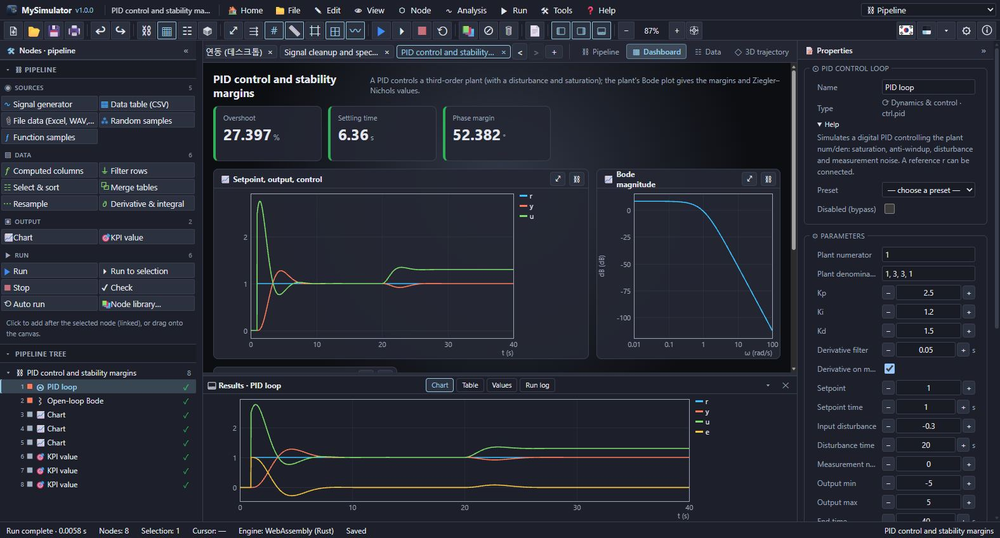

### Circuits and physics

| Node | Results |
| --- | --- |
| Circuit analysis (SPICE/LTspice-style) | solves a netlist by modified nodal analysis with Newton–Raphson. Elements R, C, L, V, I (DC, AC, SIN, PULSE, PWL, `INPUT(column)`), D (IS, N, RS, BV), Q (BJT), M (MOSFET), B (behavioural), E, G, F, H, S, X (subcircuits); cards `.op` `.dc` `.ac` `.tran` `.model` `.subckt` `.param`. The first line is a title, as in SPICE, and `;` starts a comment. Transient, AC, DC sweep and operating-point tables, the −3 dB frequency and peak gain. Hard operating points are found by gmin stepping, source stepping and pseudo-transient continuation |
| Digital logic (Proteus-style) | event-driven gate simulation: gate delays, D, JK and T flip-flops, latches, counters, shift registers, clock and pattern inputs, bus values, and **microcontrollers** (an 8-bit CPU: 16 registers, 8-pin output and input ports, assembly firmware `program … end` run with the circuit, one instruction per clock); timing diagram, truth table (minterms), transitions, frequency and narrowest pulse per signal, glitch warnings |
| 3D finite elements (parts) | a part made with the CAD feature tree, meshed into hexahedra (incompatible modes: no locking in bending), in linear elasticity, **natural frequencies (modal: the number of modes and the mode shown; a frequency table and the mode shape)** or steady heat conduction: fixed faces or boxes, loads, gravity, temperature, convection, flux and sources (power = W), probes; a coloured (exaggerated) surface in the 3D view, the middle slice, the largest displacement, von Mises stress, reactions and safety factor, or temperatures and heat flows |
| 2D flow CFD (Fluent/COMSOL-style) | incompressible Navier–Stokes (staggered grid, projection method) with heat transfer and buoyancy (natural convection): domain, fluid properties and gravity, wall (sliding), slip, inlet (parabolic profile) and outlet sides with temperatures, round and rectangular obstacles (with temperatures); speed, pressure, vorticity, stream function and temperature maps, centre lines, arrows, drag, lift and Cd of obstacles, flow rates, wall heat and Nusselt numbers, Reynolds and Rayleigh numbers |
| Frames and trusses (SAP2000/Ansys beam-style) | 3D beams (axial, bending, torsion) and truss members; materials (steel, aluminium, wood, concrete …), sections (rectangle, pipe, box or given properties), fixed, pinned, roller or per-DOF supports, node loads, distributed loads and self-weight; node displacements, member forces (N, Vy, Vz, T, My, Mz), reactions, the largest stress and safety factor, the **linear buckling load factor** (of the whole frame, and Euler for each truss bar), the original and deformed shape in the 3D view |
| 2D finite elements (Ansys/COMSOL-style) | quadratic triangles for heat conduction (steady and transient), electrostatics and plane stress: material regions, holes (boundary nodes fitted to the outline), sources, fixed value, flux, convection, fixed, displacement, traction and pressure boundaries, probes; heat maps of temperature, potential, stress and displacement, the middle line, heat flow, charge or reactions per boundary, capacitance, safety factor |

### Robots and multibody

| Node | Results |
| --- | --- |
| Mobile robot (Gazebo/Webots-style) | a 2D world with walls, boxes and round obstacles; a differential-drive robot (speed and acceleration limits, collisions), lidar (with noise), bumper, odometry drift. The controller sets `v` and `w` from values such as `gap_angle` (the open direction allowing for the robot's size), `nearest` and `front`. Waypoints, time to goal, path length, collisions, minimum clearance; a map of walls, path and goals |
| 3D rigid-body physics engine | collisions of spheres, boxes and capsules (separating-axis test, friction, restitution), ball, hinge (motor, torque limit) and distance joints, springs and damping, forces over time, static bodies and the ground; sequential impulses. Trajectories, orientations, energy, joint angles and torques. **The scene plays back in the 3D view** (▶ play, rewind, time slider, speed) |
| Robot arm multibody dynamics | M(q)q̈ + C + G = τ of a planar serial arm (1–8 rod links, a payload) by RK4: free motion (pendulum, double pendulum), joint targets with PID (gravity compensation, torque limits), tip paths by inverse kinematics; joint angles, speeds and torques, the tip, energy conservation and the poses |

### CAD and geometry

| Node | Results |
| --- | --- |
| Part and mass properties (SolidWorks-style) | a feature tree (`base`, `add`, `cut`, `intersect`) of boxes, cylinders, cones, spheres and tori with linear and circular patterns, mirrors and rotation about z; materials (steel, aluminium, titanium, copper, brass, ABS, PLA … or a density). Volume, mass, centre of gravity, inertia tensor and principal moments, the volume after each feature, a thickness map and 3D surface points. With an STL triangle table on the input: the exact mass properties of the mesh (and its surface area) |

### Statistics and ML

| Node | Results |
| --- | --- |
| Descriptive statistics | count, mean, standard deviation, min, quartiles, max, skewness, kurtosis, missing — per column |
| Histogram | counts, density, cumulative, normal fit, KS distance and its 5 % critical value |
| Regression | linear, polynomial (0–12), exponential, power, logarithmic, multiple linear; coefficients, standard errors, t, R², adjusted R², RMSE, fit, residuals, curve, formula |
| Correlation matrix | Pearson or Spearman, the strongest pair |
| k-means clustering | k-means++ with restarts, standardisation; a cluster column, centroids, inertia, silhouette |
| Principal components | scores, loadings, explained variance (scree) |
| Hypothesis test | t-tests (one-sample, two-sample, Welch, paired), F test of variances, one- and two-way ANOVA, χ² independence and goodness of fit, Jarque–Bera, rank sum and signed rank: statistic, p, decision and confidence interval |
| Support vector machine | SMO, linear, RBF and polynomial kernels, several classes (one against the rest), text class names, accuracy, confusion matrix, decision regions |
| Decision tree | CART classification (Gini) and regression, max depth and min leaf size, the rules as text, feature importance |
| Neural network (MLP) | regression or classification; hidden layers, tanh/ReLU/sigmoid, Adam, batches, L2, test fraction; loss curves, a prediction column, R² or accuracy and confusion matrix, a prediction curve for one feature or a prediction map for two |

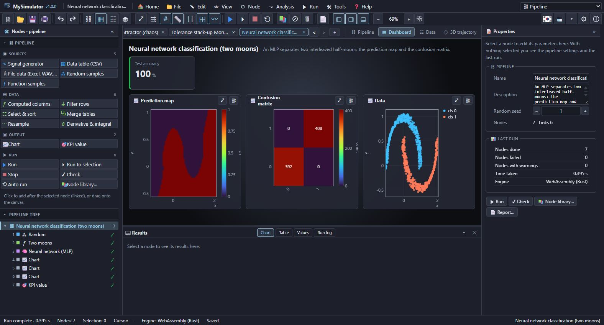

### Monte Carlo and optimisation

| Node | Results |
| --- | --- |
| Monte Carlo simulation | inputs `name ~ distribution(…)`, outputs `name = expression`; random or Latin hypercube sampling; samples, statistics (mean, std, p5, p50, p95), sensitivity of the first output (rank correlation and share of variance), convergence of the mean with its 95 % band, the probability of a condition (Wilson interval) |
| Stochastic process | geometric Brownian motion, random walk, Ornstein–Uhlenbeck, jumps; paths and quantile bands, final values, maximum drawdown, VaR |
| Linear & integer programming | linear objective and constraints (linprog, two-phase simplex); `int` variables by branch and bound (intlinprog); slack and shadow prices |
| Nonlinear equation solver | systems (fsolve) and single equations (fzero) by Levenberg–Marquardt; residuals and convergence history |
| Optimisation | variables `x: low .. high = start`, constraints `g(x) <= 0`, `>=`, `=` (penalty), minimise or maximise; Nelder–Mead, differential evolution (global), BFGS, genetic algorithm (ga), particle swarm (particleswarm), simulated annealing (simulannealbnd), pattern search (patternsearch); history, optimum, and for two variables the objective map with the search path |
| Curve fit | a model formula `a*exp(-b*x) + c` with start values; Levenberg–Marquardt; parameters, standard errors, 95 % intervals, R², fitted curve, formula |
| Parameter sweep | re-runs the pipeline with another node's numeric parameter over a range (linear or log) or a list and collects a result value (or a column aggregate) of a metric node; two parameters give a map |
| Discrete-event process (AnyLogic/FlexSim-style) | source → queue → station (n servers, capacity) → routes by probability → sink; utilisation, waiting time, queue length and losses per station, throughput, time in system, queues over time |

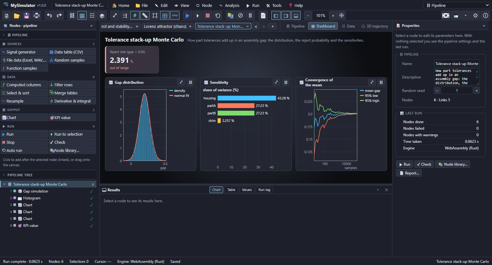

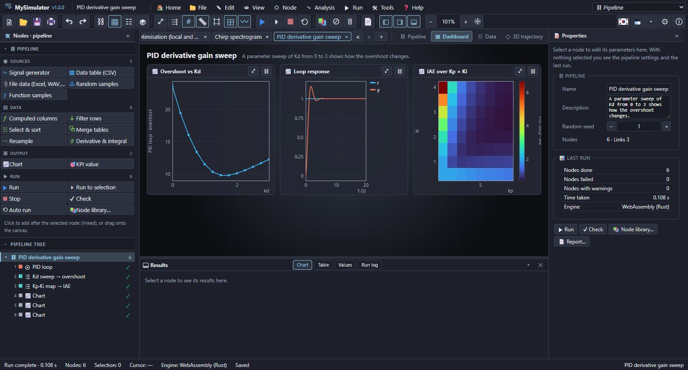

### Integration

| Node | What it does (desktop) |
| --- | --- |
| Python script | runs code with the installed Python |
| External program | runs a command-line tool, replacing `{in}`, `{out}`, `{dir}` |
| Read file | reads CSV, TSV, JSON, Excel, WAV, STL, MAT or PNG at every run |
| Write file | writes the input table as CSV, JSON or a MATLAB .mat (v5) file and passes it on |
| MyHeatManager heat study (built-in engine) | MyHeatManager's solver is built in, so `.myheat` models (conduction, convective flow, phase change, thermal stress …) run with no other program (web and desktop). The model is kept in the node or read from a path; the field (temperature, stress, flow …) comes back as a table and a heat map with the temperature range, probes, energy balance and per-body and per-boundary values |

Relative paths start at the folder of the saved pipeline file.

### Output

| Node | What it does |
| --- | --- |
| Chart | a dashboard chart (the input passes through) |
| KPI value | one value with alarm limits |

## 5. MATLAB scripts

The **MATLAB script** node runs the MATLAB/Octave language in a built-in interpreter: no MATLAB installation is needed, and the web and desktop apps give the same results.

```matlab
% The input table's columns t and y arrive as column vectors (the whole table as the structure data)
[b, a] = butter(4, 0.2);
yf = filtfilt(b, a, y);
plot(t, y); hold on; plot(t, yf); title('filtered'); legend('raw', 'filtered');
rmsNoise = std(y - yf)
```

- The language: matrices and complex numbers, `:`, `end` and logical indexing, arrays that grow and shrink (`A(:, 2) = []`), strings, cells (`c{i}`, `c{:}`), structures and structure arrays (`s(2).f`), function handles and anonymous functions, `function` blocks in the script (varargin, nargin, several outputs), `if/elseif/else`, `for`, `while`, `switch`, `try/catch`, `break/continue/return` and command syntax (`hold on`).
- About 400 built-in functions: array construction and shape, math (complex aware), sums, means, extremes, sorting and finding, linear algebra (`\`, `inv`, `det`, `eig`, `svd`, `qr`, `lu`, `chol`, `expm`, `null`, `pinv`), polynomials (`polyfit`, `roots`, `conv`), interpolation and integration (`interp1`, `spline`, `pchip`, `interp2`, `trapz`, `integral`), ODEs (`ode45`, `ode23`, `ode15s`, `ode23s`, `deval`), optimisation (`fzero`, `fminbnd`, `fminsearch`, `fsolve`), signals (`fft`, `ifft`, `filter`, `filtfilt`, `butter`, `cheby1`, `cheby2`, `ellip`, `freqz`, `xcorr`, windows), control (`lqr`, `dlqr`, `lqe`, `care`, `dare`, `place`, `ctrb`, `obsv`), statistics (`std`, `var`, `median`, `cov`, `corrcoef`, `histcounts`, `normcdf`, `tcdf`, `ttest`), strings (`sprintf`, `fprintf`, `num2str`, `strsplit`, `strjoin`, `strcmp` …), cells and structures (`cellfun`, `arrayfun`, `struct`, `fieldnames` …) and files (`load`/`save` .mat, `readmatrix`, `writematrix` — desktop).
- Results: figures drawn with `plot`, `scatter`, `bar`, `stairs` … become tables (with their titles and legend names), `surf`, `mesh`, `contour` and `imagesc` become grids, ready for chart nodes. Workspace numbers become results, vectors and matrices tables, text, cells and structures the result text (variables left as they came in are skipped; "Variables to export" picks some). The command window (`disp`, `fprintf`, lines without a semicolon) is in the result text.
- Not supported: arithmetic on arrays of three or more dimensions (N-d arrays read from files are split into pages), class definitions (classdef), regular expressions, graphics handle properties (set/get) and toolbox objects (tf objects and the like — use the control and signal nodes instead).

## 6. Python and external programs

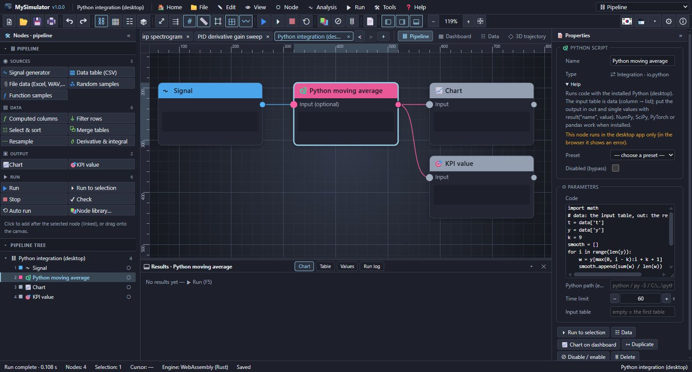

A **Python script** node's code gets:

```python
# data   : the input table, column name → list of values (numbers as float)
# columns: the column names
# out    : fill it with the result table (column → list, numpy arrays or a pandas DataFrame)
# result("name", value): one result value
import numpy as np
y = np.array(data['y'])
out['t'] = data['t']
out['smooth'] = np.convolve(y, np.ones(25) / 25, mode='same')
result('max', out['smooth'].max())
print('done')       # printed text becomes the node's text output
```

- Python is looked for as `py -3`, `python`, `python3` (check it in Tools › Python integration); the node's "Python path" can name the interpreter.
- NumPy, SciPy, pandas, PyTorch and others can be imported when they are installed in that Python.
- Input column names arrive without units (`t (s)` → `data['t']`).
- Going past the time limit, or ■ Stop, ends the process. On an error the last lines of Python's traceback become the node's error.

The **External program** node wraps a commercial solver's batch mode or an in-house tool. `{in}` in the arguments becomes the input CSV path, `{out}` the result CSV path and `{dir}` the work folder; without `{out}` the standard output is read as the result table. For example:

```
program:   python
arguments: solver_wrapper.py --input {in} --output {out}
```

Security: before a pipeline with Python or external program nodes runs for the first time in a tab, the programs it would run are listed and you are asked to allow them. Allow it only for files you trust.

### MyCircuit, LTspice and MyHeatManager

- A **MyCircuit project (.mycircuit)** opens as a circuit analysis node: MyCircuit's own netlist builder (included) writes the SPICE netlist, and MyCircuit's probes come along. This works in the browser too.
- **MyCircuit's "Export SPICE" (.cir)** and LTspice-style netlists (.cir, .net, .sp) open as they are, with subcircuits, `.model` cards, B sources, BJTs and MOSFETs. ICs without a model (a 555, microcontrollers) are left out, as MyCircuit does.
- The **MyHeatManager heat study** node carries MyHeatManager's solver: `.myheat` models open without MyHeatManager installed, in the browser too (File › Open, or the node's file button).

## 7. Batch runs (command line)

Runs pipelines without a window (Tools › Batch run).

```
MySimulator --batch pipeline.mysim [more pipelines…] [options]
  --out <dir>                  write the results into this folder (default: next to the pipeline)
  --set <node>.<param>=<value> change a parameter before the run (node id or name, repeatable)
  --only <node>[,<node>…]      write only these nodes' results
  --quiet                      print errors only
```

Results: `<name>.summary.json` (every node: ok/error, warnings, result values, tables), `<name>.<node>.<table>.csv`, `<name>.<node>.<grid>.png`. Exit code 0 = every node ran, 2 = a node failed, 1 = bad arguments. Use it in scripts, CI and overnight jobs to run the same pipeline under other conditions.

`automation.mysim` in the samples folder is a complete example: it reads a measurement file from disk, removes the trend in Python, filters and finds peaks, and writes the cleaned CSV back.

## 8. Files

| Format | Use |
| --- | --- |
| `.mysim` | a pipeline (JSON: nodes, links, parameters, places, settings) |
| `.csv` `.tsv` `.txt` | open, drop or import → a data table node |
| `.json` | when not a pipeline, data (column → array, or an array of row objects) → a data table node |
| `.xlsx` `.wav` `.stl` `.mat` `.png` | open or import → a file data node (the file is kept in the pipeline); the desktop Read file node reads it from disk at every run |
| `.cir` `.net` `.sp` | a SPICE netlist → a circuit analysis node |
| `.mycircuit` | a MyCircuit project → a circuit analysis node (converted by MyCircuit's netlist builder) |
| `.myheat` | a MyHeatManager model → a heat study node (the model is kept, the built-in engine solves it) |

Export: the selected node's results as CSV (a table, a grid or the values) or JSON, all results as one CSV (sections headed `# node / table`), the current view as PNG, the chart picture, the report as HTML.

## 9. Samples

| Sample | Area |
| --- | --- |
| MATLAB scripts: ODE, filter, curve fit | ode45, butter, filtfilt, fft, polyfit, spline, integral, figures → charts |
| Simulink and Stateflow | subsystems, buses, a state machine (after), discrete transfer function and switch |
| Control design | root locus, LQR, Kalman filter, c2d |
| Hypothesis tests, SVM, decision tree, wavelets | t-test, ANOVA, SVM decision regions, CART, db4 denoising |
| Linear and integer programming, nonlinear equations | linprog (shadow prices), intlinprog, fsolve, genetic algorithm |
| Signal cleanup and spectrum | Butterworth filter, FFT, KPIs |
| Chirp spectrogram | STFT, PSD, instantaneous frequency |
| Damped vibration and damping ratio | ODE, peaks (log decrement), FFT, phase portrait |
| Lorenz attractor | chaotic ODE, 3D trajectory, PSD |
| PID control and stability margins | PID loop, Bode plot, margins, KPIs |
| PID derivative gain sweep | 1-D and 2-D parameter sweeps |
| Quarter-car suspension | state space, eigenvalues, FFT |
| Regression of test data | CSV, statistics, quadratic fit, residual histogram, correlation |
| Clustering and PCA | k-means, PCA |
| Neural network regression / classification | MLP, loss curves, prediction map, confusion matrix |
| Tolerance stack-up Monte Carlo | reject rate, sensitivity, convergence |
| Price paths (GBM) | quantile bands, VaR |
| Optimisation | Nelder–Mead, differential evolution, objective maps and paths |
| Nonlinear curve fit | Levenberg–Marquardt, confidence intervals |
| Epidemic SIR and a transmission sweep | ODE input, sweep |
| Block diagrams | cruise control and a motor speed loop (Simulink-style, graphical editor) |
| Production line discrete-event simulation | station utilisation, queues, throughput |
| Circuit analysis | RC filter Bode plot, BJT amplifier, CMOS inverter, subcircuit op-amp, buck converter, a signal-driven circuit |
| MyCircuit circuits | three netlists exported by MyCircuit, as they are |
| Digital logic and microcontrollers | traffic-light MCU with a crossing button, PWM MCU, counter timing diagram, full adder truth table |
| 2D finite elements | plate temperature, stress concentration at a hole, a bar warming up |
| 3D finite elements | heat sink temperature, L bracket stress and safety factor |
| Flow CFD | lid-driven cavity (Re 100), forced convection from a heated cylinder |
| Structures | portal frame, Warren truss, natural frequencies of a cantilever |
| 3D physics engine | a motor-driven vehicle, Newton's cradle, a box tower (3D playback) |
| Robots | an obstacle-avoiding mobile robot, an arm drawing a circle |
| CAD | mass properties of a flange and a spoked wheel, 3D surface |
| MyHeatManager heat studies | a chip with a heat sink, a wall over a day (built-in engine) |
| Sound file analysis | spectrum, spectrogram and filter of a WAV file |
| Python integration | Python script (desktop) |

## 10. Customizing and settings

- **Theme**: the theme button steps to the next theme of the same kind; ▾ opens the 20 dark and 20 light themes. Settings › Custom theme sets colours one by one.
- **Language**: the flag button switches Korean ↔ English; menus, node names, help and samples follow.
- **Settings**: general (language, workbench, auto run, ask on close), font, start page (20 backgrounds, speed, transparency), editor (grid, snap, node previews, help open, colour map), panels (width, result panel height), recent files.

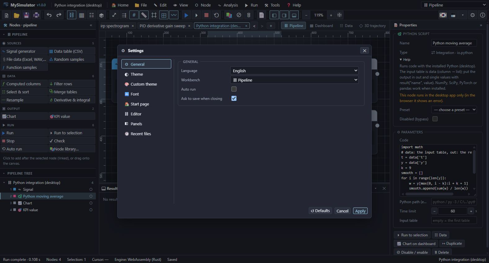

## 11. Keyboard shortcuts

| Keys | Command | Keys | Command |
| --- | --- | --- | --- |
| Ctrl+N | New pipeline | F5 | Run |
| Ctrl+O | Open | Ctrl+F5 | Run to selection |
| Ctrl+S | Save | Shift+F5 | Stop |
| Ctrl+Shift+S | Save as | Ctrl+K | Node library |
| Ctrl+P | Print | Ctrl+L | Auto arrange |
| Ctrl+W | Close tab | Ctrl+E | Disable / enable |
| Ctrl+Z / Ctrl+Y | Undo / redo | F2 | Rename |
| Ctrl+C / Ctrl+V | Copy / paste | Delete | Delete |
| Ctrl+D | Duplicate | Ctrl+A | Select all |
| 1 · 2 · 3 · 4 | Pipeline · dashboard · data · 3D | F | Fit all |
| + / − / Ctrl+0 | Zoom in / out / 100 % | G | Grid |
| F11 | Full screen | F1 | User's guide |
| Esc | Clear the selection, close menus | Space+drag | Pan |

## 12. Installing

- **Windows**: `MySimulator-Setup-1.0.0.exe`, installed for the current user (no administrator rights). When an earlier installation exists you are asked whether to remove it completely and reinstall, and whether to delete the user data (settings, recent files, window place). Saved `.mysim` files are never deleted. `.mysim` files open with MySimulator.
- **macOS**: `MySimulator-1.0.0-<arch>.dmg`; **Linux**: `.deb`, `.rpm`, `.AppImage`.
- **Web**: put the `dist/` of `npm run build:web` on any static web server; it runs on the WebAssembly engine in the browser (without the Python, external program and file nodes).

## 13. Troubleshooting

| Symptom | Fix |
| --- | --- |
| A node says "the input … is not connected" | link that input port. |
| "unknown name …" | a column or constant that does not exist; check the column names in the result panel's table tab. |
| An ODE says "the step size became too small" | the problem is stiff or the solution blows up; raise the tolerance or use RK4 with a small step. |
| Neural network "training diverged" | lower the learning rate. |
| Python node "Python 3 was not found" | install Python 3 or give the node's "Python path". |
| Python or file nodes fail in the browser | run the pipeline in the desktop app. |
| Results marked ◔ | the node changed after the run; run again or turn auto run on. |
