# MySimulator 사용 설명서

MySimulator 는 신호 처리, 동역학과 제어, 통계와 머신러닝, 몬테카를로와 최적화를 **노드 파이프라인** 하나로 묶어 실행하는 통합 시뮬레이션 도구입니다. 데이터를 만드는 노드(소스)에서 시작해 처리·해석 노드를 연결선으로 잇고, 차트와 KPI 노드로 결과를 보입니다. ▶ 한 번이면 "데이터 입력 → 전처리 → 시뮬레이션 → 결과" 가 차례로 실행됩니다.

웹 브라우저와 Windows · macOS · Linux 데스크톱 앱에서 같은 화면으로 동작합니다. 계산은 Rust 엔진이 합니다 — 데스크톱은 네이티브, 웹은 WebAssembly 이며 결과는 같습니다. Python 스크립트와 외부 프로그램, 디스크의 파일을 쓰는 노드는 데스크톱 앱에서만 실행됩니다.

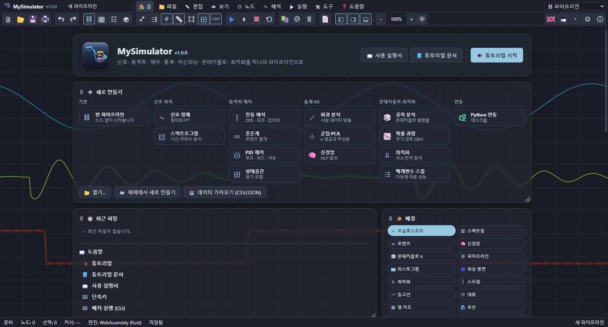

## 1. 화면 구성

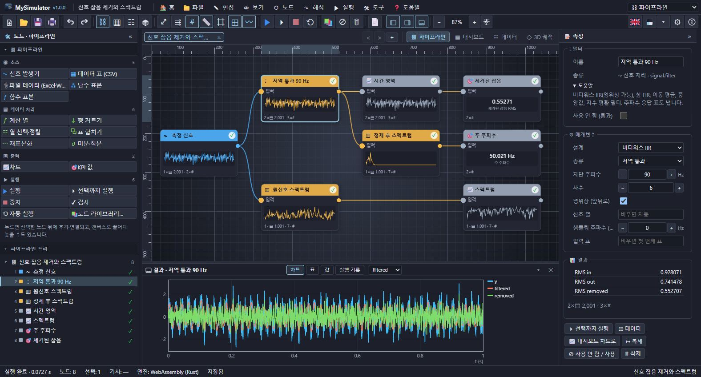

| 영역 | 내용 |
| --- | --- |
| 메뉴 막대 | 홈 · 파일 · 편집 · 보기 · 노드 · 해석 · 실행 · 도구 · 도움말, 오른쪽에 작업대 선택. 데스크톱에서는 프로그램 이름·버전과 창 단추도 이 줄에 있습니다. |
| 도구 막대 | 새로 만들기·열기·저장·인쇄, 실행 취소, 보기 전환, 전체 보기·자동 정렬·격자·미리보기, 실행·선택까지 실행·중지·자동 실행, 노드 라이브러리·사용 안 함·삭제, 보고서, 패널 단추, 확대 배율. 오른쪽 끝에 언어(국기)·테마·설정·정보. |
| 왼쪽 패널 | 위: 작업대의 **노드 팔레트**. 아래: **파이프라인 트리**(실행 순서, 상태 표시). |
| 가운데 | 문서 탭과 보기 전환(파이프라인 · 대시보드 · 데이터 · 3D 궤적), 그 아래 보기. |
| 결과 패널 | 선택한 노드의 차트 · 표 · 값 · 실행 기록. 경계를 끌어 높이를 바꿉니다. |
| 오른쪽 패널 | 선택한 노드의 이름, 도움말, 프리셋, 매개변수, 결과 값. 아무것도 고르지 않으면 파이프라인 설정과 마지막 실행 요약. |
| 상태 막대 | 상태, 노드 수, 선택, 커서, 엔진(네이티브/WebAssembly), Python, 저장 여부, 파일 경로. |

패널은 « » 로 접고, ✕ 로 숨기며, 보기 메뉴나 도구 막대 단추로 다시 보입니다.

### 상태 표시

트리와 노드 오른쪽 위의 표시는 마지막 실행의 결과입니다.

| 표시 | 뜻 |
| --- | --- |
| ✓ | 성공 |
| ⚠ | 성공, 경고 있음 (속성 패널에 경고가 보입니다) |
| ✕ | 실패 (노드 테두리가 빨갛고, 오류가 노드 아래와 속성 패널에 보입니다) |
| – | 입력이 실패해서 건너뜀 |
| ◔ | 실행 뒤에 이 노드나 앞 노드가 바뀜 — 다시 실행하면 갱신 |
| ⊘ | 사용 안 함 (입력을 그대로 넘김) |
| ○ | 아직 실행하지 않음 |

## 2. 파이프라인 만들기

### 노드 추가

- **팔레트에서 누르기**: 노드가 선택한 노드의 오른쪽에 추가되고 자동으로 연결됩니다. 아무것도 고르지 않았으면 화면 가운데에 놓입니다.
- **팔레트에서 끌어 놓기**: 원하는 자리에 놓습니다(연결 안 함).
- **노드 메뉴 · 해석 메뉴**: 모든 노드가 분야별로 있습니다.
- **노드 라이브러리**(Ctrl+K, 빈 곳을 두 번 누르기): 노드 54종을 검색하고 설명·입력·매개변수를 본 뒤 추가합니다.
- **출력 포트를 빈 곳으로 끌기**: 노드 라이브러리가 열리고, 고른 노드가 그 출력에 연결됩니다.

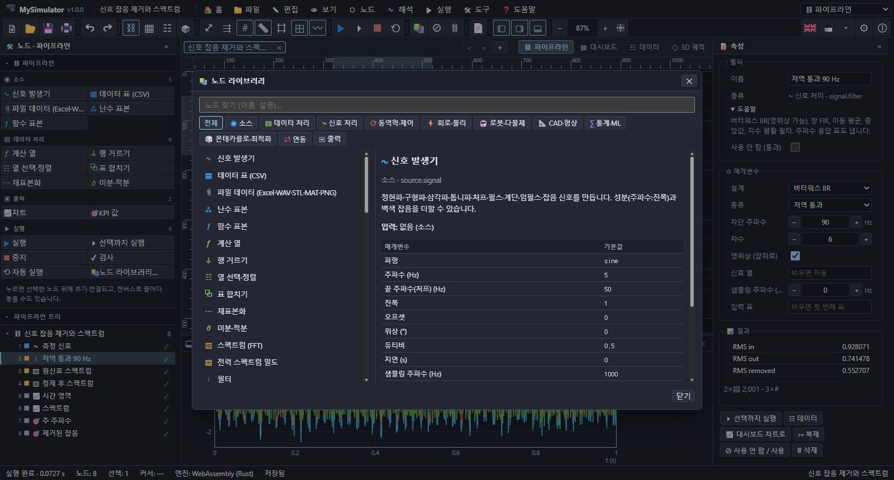

### 연결

노드 오른쪽의 출력 포트(●)를 끌어 다른 노드 왼쪽의 입력 포트에 놓습니다. 노드 몸통에 놓으면 비어 있는 첫 입력에 연결됩니다. 입력 하나에는 연결 하나만 들어가고(새 연결이 옛 연결을 대신합니다), 순환 연결은 만들 수 없습니다. 연결된 입력 포트를 끌어내면 연결을 다른 곳으로 옮기거나, 빈 곳에 놓아 지웁니다. 연결선을 눌러 고른 뒤 Delete 로 지울 수도 있습니다.

입력 포트 이름에 "(선택)" 이 붙은 것(ODE 의 u, PID 의 r, 상관의 b, Python 의 입력)은 연결하지 않아도 됩니다.

### 선택과 이동

| 동작 | 결과 |
| --- | --- |
| 노드 누르기 | 선택 (Shift/Ctrl+누르기: 선택에 더하거나 빼기) |
| 노드 끌기 | 이동 (선택된 노드가 함께 움직임; 격자에 맞추기를 켜면 20 단위) |
| 빈 곳 끌기 | 화면 이동 (빈 곳에서는 손 모양 커서) |
| Shift·Ctrl+빈 곳 끌기 | 상자로 여러 개 선택 (지금 선택에 더함) |
| 가운데·오른쪽 단추 끌기, Space+끌기 | 화면 이동 |
| 휠 | 커서 위치를 중심으로 확대·축소 |
| 노드 두 번 누르기 | 데이터 보기로 결과 열기 |
| 오른쪽 누르기 | 노드·연결·빈 곳의 메뉴 |

보기 메뉴와 도구 막대에서 **격자**(굵은 선마다 5×5 칸, 확대하면 간격이 바뀜), **눈금자**(위·왼쪽, 커서와 선택 표시), **격자에 맞추기**, **차트 격자선**을 켜고 끕니다.

편집 메뉴: 복사·붙여넣기(선택한 노드 사이의 연결도 함께), 복제, 삭제, 이름 바꾸기(F2), 사용 안 함(Ctrl+E), 연결 끊기, 자동 정렬(Ctrl+L, 연결 순서대로 열을 맞춤). 모든 변경은 실행 취소(Ctrl+Z)·다시 실행(Ctrl+Y)됩니다.

### 매개변수

속성 패널에서 고칩니다. 숫자 칸은 Enter 나 다른 칸으로 옮길 때 적용되고, − + 단추와 ↑ ↓ 키로 바꾸며, `2*pi`, `1e-3`, `1,5`(소수점 쉼표) 같은 식도 받습니다.

- **열 고르기**: 열 이름 칸은 앞 노드가 마지막 실행에서 낸 열을 제안합니다. 여러 열 칸은 아래 단추로 열을 켜고 끕니다. 비우면 자동(첫 숫자 열, 또는 모든 숫자 열)입니다.
- **프리셋**: ODE(질량-스프링-댐퍼, 진자, 반데르폴, 로렌츠, 포식자-피식자, SIR, 더핑, RLC, 물탱크, 포물선), 전달함수, 상태공간, 몬테카를로, 최적화, 곡선 맞춤, Python 노드에 대표 모델이 있습니다.
- **도움말**: 매개변수 이름에 밑줄이 있으면 마우스를 올려 설명을 봅니다.

### 수식

ODE, 계산 열, 행 거르기, 함수 표본, 몬테카를로, 최적화, 곡선 맞춤 노드는 수식을 받습니다(도구 › 수식 도움말).

```
y = 2*sin(2*pi*f*t) + 0.5*x^2
x' = v
v' = -k/m*x - c/m*v + F*step(t - 1)
gap = housing - partA - partB
ok = if(T > 80, 0, 1)
```

- 연산자 `+ - * / ^ %`, 비교 `< <= > >= == !=`(참 = 1), `&& || !`, 숫자 뒤 암묵 곱(`2x`)
- 함수: `sin cos tan asin acos atan atan2 sinh cosh tanh exp ln log10 log2 sqrt cbrt abs sign floor ceil round min max pow hypot clamp step if mod sat deg rad sinc erf gauss`, 상수 `pi e`
- 열 이름의 공백·기호는 `_` 로 바뀝니다(`Speed (m/s)` → `Speed`). 계산 열에서는 `i`(행 번호), `n`(행 수), `열_mean`, `열_std`, `열_min`, `열_max` 도 씁니다.
- 틀린 식은 그 노드만 실패하고 "unknown name …", "missing ')' …" 처럼 이유를 보입니다.

## 3. 실행과 결과

- **▶ 실행**(F5): 파이프라인 전체를 실행합니다.
- **⏵ 선택까지 실행**(Ctrl+F5): 선택한 노드와 그 입력만 실행하고, 결과를 기존 결과에 합칩니다.
- **■ 중지**(Shift+F5): 실행을 멈춥니다.
- **자동 실행**: 매개변수를 바꾸면 0.7 초 뒤 다시 실행합니다.
- **검사**: 실행 전에 연결 안 된 입력, 순환, 알 수 없는 노드를 찾습니다.

실패한 노드는 오류를 남기고 그 뒤 노드는 건너뜁니다. 다른 가지는 계속 실행됩니다. 실행 기록 탭에 노드별 시간(데스크톱), 경고, 오류가 있습니다.

### 결과 패널과 데이터 보기

결과 패널은 선택한 노드의 결과를 **차트 · 표 · 값 · 실행 기록** 탭으로 보입니다. 표가 여럿이면 탭 옆에서 고릅니다. 차트에 마우스를 올리면 x · y 값을 읽습니다.

**데이터 보기**(보기 전환 › 데이터, 노드 두 번 누르기)는 같은 결과를 크게 — 차트, 결과 값, 표(1000행까지) — 보이고, CSV · JSON 내보내기와 표 복사(탭 구분, 엑셀에 붙여넣기)가 있습니다.

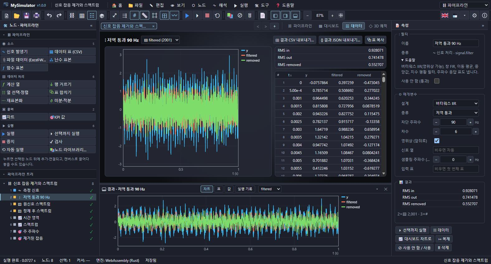

차트는 결과에 맞게 고릅니다: 격자(스펙트로그램, 상관 행렬, 예측 지도, 목적 함수 지도)는 열 지도, 이름이 붙은 행(통계, 계수, 민감도)은 가로 막대, 나머지는 x 열에 대한 선. 최적화 노드의 지도에는 탐색 경로가 겹쳐 그려집니다.

### 대시보드

**차트**와 **KPI 값** 노드를 한 화면에 모읍니다(캔버스 위치 순서). KPI 는 값 하나(결과 값 이름, 또는 열과 집계)를 크게 보이고, 하한·상한을 벗어나면 경보 색이 됩니다. 차트 노드에서 종류(선 · 산점 · 막대 · 면적 · 계단 · 열 지도 · x–y 궤적 · 표), 표, x · y 열, 색 구분 열(산점도), 로그 축, 대시보드 폭(1–3 칸)을 정합니다. 차트 노드가 없으면 "끝 노드마다 차트 붙이기" 로 한 번에 만듭니다.

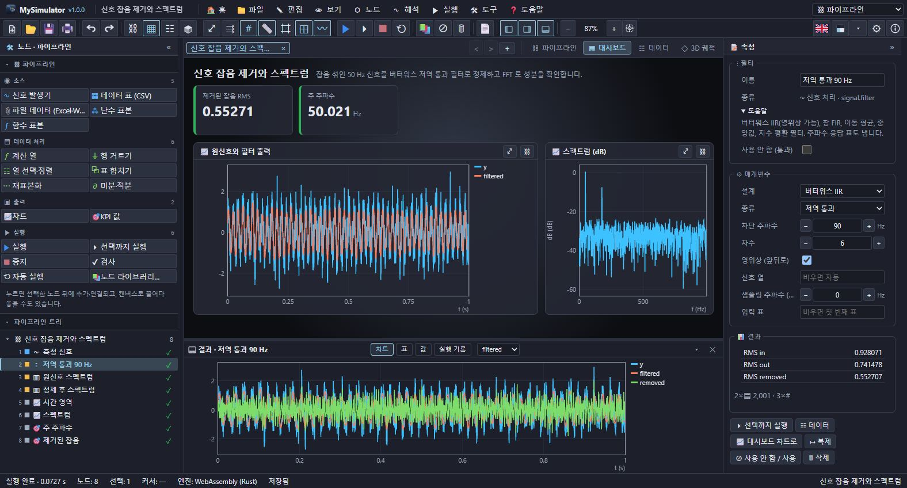

### 3D 궤적

세 열을 3D 곡선이나 점으로 그립니다(로렌츠 끌개, 위상 공간, 군집, CAD 부품의 표면 점). 위의 칩에서 x · y · z 열, 색(순서 또는 열), 곡선/점을 고릅니다. 끌어서 돌리고, 오른쪽 단추로 옮기고, 휠로 확대합니다.

바닥(x–y 평면)에 **격자**가 깔립니다. 굵은 선은 데이터 값이 1·2·5 단위로 떨어지는 곳에, 그 사이는 5×5 칸으로 나뉘고, 확대·축소하면 화면에서 간격이 거의 같도록 단위가 바뀝니다. **축**(x 빨강, y 초록, z 파랑)과 눈금 값도 같은 단위를 따릅니다. 칩의 "3D 격자" · "3D 축·눈금" 단추(보기 메뉴, 오른쪽 단추 메뉴)로 켜고 끕니다. 점 구름(CAD 부품)은 세 축을 같은 비율로 그립니다.

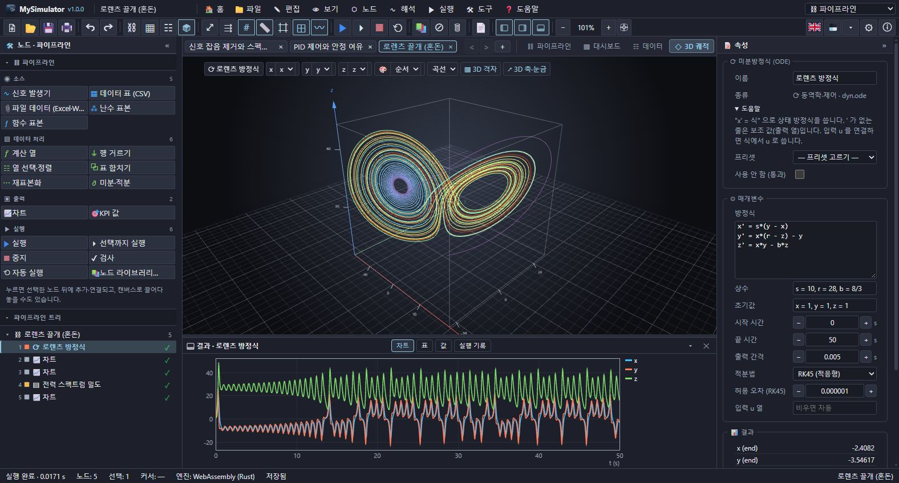

### 보고서와 인쇄

**보고서**는 파이프라인 구성(노드와 입력), 노드별 결과 값·차트·출력 글, 경고와 오류를 모읍니다. HTML 로 저장하거나 인쇄합니다. **인쇄** 창에서 용지·방향·여백·머리글·바닥글·흑백과 인쇄할 내용(현재 보기 그림, 결과 차트, 파이프라인, 결과, 실행 기록)을 고르고 미리 봅니다.

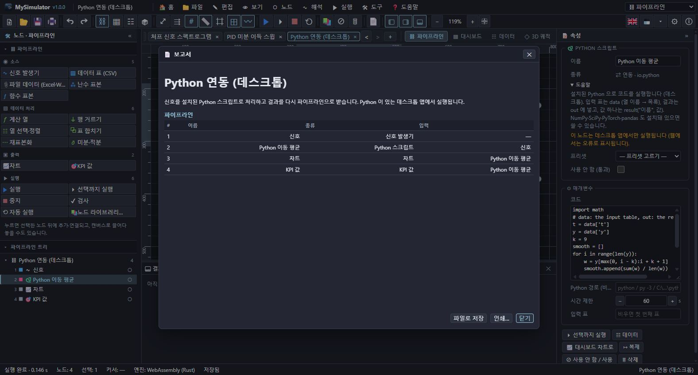

## 4. 노드 목록

### 소스

| 노드 | 하는 일 |
| --- | --- |
| 신호 발생기 | 정현파·코사인·구형파·삼각파·톱니파·처프·펄스·계단·임펄스·가우스 잡음·직류. 추가 성분(`주파수:진폭`), 백색 잡음, 지연, 샘플링 주파수, 길이 |
| 데이터 표 (CSV) | 붙여넣거나 파일에서 가져온 CSV/TSV/JSON. 첫 줄이 문자면 머리글, `t (s)` 처럼 괄호 안은 단위, 숫자가 아닌 열은 글자 열 |
| 난수 표본 | 정규·균등·삼각·로그정규·지수·와이블·감마·베타·포아송·베르누이, 열 여러 개 |
| 함수 표본 | 구간에서 `이름 = 식` 여러 줄을 표본화 |
| 파일 데이터 | 파이프라인 안에 담은 파일: Excel(.xlsx, 시트 선택), WAV(채널별 열, 표본율), STL(삼각형 표), MATLAB .mat(v5, 압축 포함), PNG(밝기·RGB 격자), CSV·JSON. 웹에서도 됩니다 |

### 데이터 처리

| 노드 | 하는 일 |
| --- | --- |
| 계산 열 | `이름 = 식` 으로 열 추가·교체 |
| 행 거르기 | 조건이 참인 행만 |
| 열 선택·정렬 | 열 고르기, 정렬, 건너뛰기·최대 행, x 축 지정 |
| 표 합치기 | 열 붙이기 · 행 붙이기 · b 를 a 의 x 축에 보간 |
| 재표본화 | 고른 간격(점 수 또는 샘플링 주파수), 선형·3차 보간 |
| 미분·적분 | 중앙 차분 미분, 사다리꼴 누적 적분 |

### 신호 처리

| 노드 | 결과 |
| --- | --- |
| 스펙트럼 (FFT) | 진폭·dB·위상 스펙트럼, 주 주파수(보간), THD, RMS. 창 함수, 평균 제거, 0 채우기 |
| 전력 스펙트럼 밀도 | Welch PSD, 총 전력, 피크 주파수 |
| 필터 | 버터워스 IIR(저역·고역·대역 통과·대역 저지, 1–12차, 영위상), 창 FIR, 이동 평균, 중앙값, 지수 평활. 필터 출력·제거된 성분·주파수 응답 표 |
| 스펙트로그램 | STFT 시간-주파수 지도(dB) |
| 피크 찾기 | 높이·돌출도·간격 조건, 골 찾기. 평균 간격, 감쇠 진동이면 대수 감쇠율로 감쇠비 |
| 상관 | 정규화 교차·자기 상관, 최대 상관의 지연 |
| 포락선 | 힐베르트 변환 포락선과 순간 주파수 |

### 동역학·제어

| 노드 | 결과 |
| --- | --- |
| 미분방정식 (ODE) | `x' = 식` 상태 방정식, `'` 없는 줄은 보조 값(출력 열). 상수, 초기값, RK45(적응형)·RK4·오일러, 입력 u |
| 전달함수 응답 | num/den(높은 차수부터)의 계단·임펄스·램프 응답, 극점·영점, 상승 시간·오버슈트·피크·정착 시간·DC 이득 |
| 보드·나이퀴스트 | 크기(dB)·위상, 나이퀴스트 곡선, 이득·위상 여유와 교차 주파수, 대역폭, 폐루프 극점·안정, 궁극 이득·주기와 지글러-니콜스 PID 값. 루프 이득, 시간 지연 |
| PID 제어 루프 | 디지털 PID(미분 필터, 측정값 미분), 출력 포화와 와인드업 방지, 입력 외란, 측정 잡음, 기준 r 입력. r·y·u·e, 성능 지표(오버슈트·정착·IAE·ISE·ITAE) |
| 상태공간 모델 | A·B·C·D 행렬, 계단·임펄스·정현·자유 응답, 출력과 상태, 고유값, 가제어·가관측 계수, DC 이득 |
| 블록 다이어그램 (Simulink 형) | `이름 = 식` 또는 `이름 = 블록(입력, 키=값)` 줄로, 또는 **그래픽 블록 편집기**(속성 패널의 "🧩 그래픽 블록 편집기": 팔레트에서 블록을 놓고 출력 포트를 입력 포트로 끌어 연결, 블록 설정 수정, 연결선을 눌러 끊기)로 피드백 루프를 그립니다. 적분기, 전달함수, PID(포화), 지연, 단위 지연, 영차 유지, 미분, 기울기 제한, 릴레이(히스테리시스), 포화, 데드존, 룩업 표, 계단·정현·구형·펄스·램프·잡음, 입력 열. 대수 루프는 찾아서 알려 줍니다 |

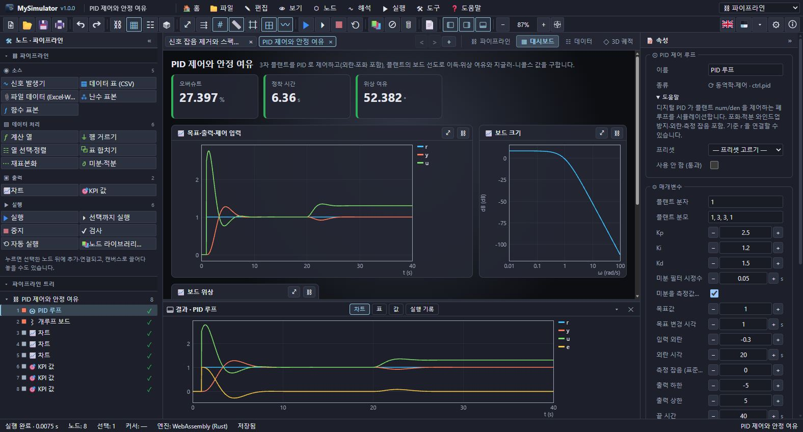

### 회로·물리

| 노드 | 결과 |
| --- | --- |
| 회로 해석 (SPICE·LTspice 형) | 넷리스트를 수정 절점 해석과 뉴턴-랩슨으로 풉니다. 소자 R · C · L · V · I(DC, AC, SIN, PULSE, PWL, `INPUT(열)`) · D(IS, N, RS, BV) · Q(BJT) · M(MOSFET) · B(식 전원) · E · G · F · H · S · X(부회로). 카드 `.op` `.dc` `.ac` `.tran` `.model` `.subckt` `.param`. 첫 줄은 SPICE 처럼 제목, `;` 는 주석. 과도·주파수·DC 스윕·동작점 표, −3 dB 주파수, 최대 이득. 어려운 동작점은 gmin·전원 단계·의사 과도 해석으로 찾습니다 |
| 디지털 논리 (Proteus 형) | 사건 구동 게이트 시뮬레이션: 게이트 지연, D·JK·T 플립플롭, 래치, 카운터, 시프트 레지스터, 클록·패턴 입력, 버스 값, 그리고 **마이크로컨트롤러**(8비트 CPU: 레지스터 16개, 출력·입력 포트 8핀, 어셈블리 펌웨어 `program … end` 를 회로와 함께 클록마다 실행). 타이밍도, 진리표(최소항), 신호별 천이·주파수·가장 좁은 펄스, 글리치 경고 |
| 유한요소 해석 3D (부품) | CAD 와 같은 특징 트리로 만든 부품을 육면체 요소(비적합 모드, 굽힘 잠김 없음)로 나눠 선형 탄성, **고유진동수(모달: 모드 수·보일 모드, 진동수 표와 모드 모양)** 또는 정상 열전도. 면·상자 고정, 하중, 중력, 온도·대류·열유속·열원(power = W), 탐침. 3D 보기의 색칠된 (변형 과장) 표면, 가운데 단면, 최대 변위·von Mises·반력·안전율 또는 온도·열 흐름 |
| 유동 해석 CFD 2D (Fluent·COMSOL 형) | 비압축성 나비에-스토크스(엇갈림 격자, 투영법)와 열 전달·부력(자연대류). 영역·유체 물성·중력, 네 변의 벽(움직이는 벽)·미끄럼·유입(포물선 분포)·유출 경계와 온도, 원·사각 장애물(온도). 속도·압력·와도·유선 함수·온도 지도, 중심선, 화살표, 장애물 항력·양력·Cd, 유량, 벽 열 흐름과 누셀트 수, 레이놀즈·레일리 수 |
| 골조·트러스 해석 (SAP2000·Ansys 보 형) | 3D 보(축력·굽힘·비틀림)와 트러스 부재, 재료(강철·알루미늄·목재·콘크리트 …), 단면(사각·파이프·상자·직접 입력), 고정·핀·롤러·자유도 지정 지지, 절점 하중·분포 하중·자중. 절점 변위, 부재력(N·Vy·Vz·T·My·Mz), 반력, 최대 응력과 안전율, **선형 좌굴 하중 배수**(골조 전체와 트러스 부재별 오일러), 3D 보기의 원래·변형 모양 |
| 유한요소 해석 2D (Ansys·COMSOL 형) | 2차 삼각형 요소로 열전도(정상·과도), 정전기장, 평면 응력. 재료 영역, 구멍(경계 절점을 윤곽선에 맞춤), 열원, 고정 값·열유속·대류·고정·변위·견인·압력 경계, 탐침. 온도·전위·응력·변위 열 지도, 중앙선, 경계별 열 흐름·전하·반력, 정전 용량, 안전율 |

### 로봇·다물체

| 노드 | 결과 |
| --- | --- |
| 이동 로봇 (Gazebo·Webots 형) | 벽·상자·원 장애물이 있는 2D 세계, 차동 구동 로봇(속도·가속도 한계, 충돌), 라이다(잡음), 범퍼, 오도메트리 오차. 제어기는 식으로 `v` · `w` 를 정하고 `gap_angle`(로봇 폭을 고려한 빈 방향) · `nearest` · `front` 같은 값을 씁니다. 경유점, 도착 시간, 경로 길이, 충돌 수, 최소 여유. 지도(벽·경로·목표) |
| 3D 강체 물리 엔진 | 구·상자·캡슐의 충돌(분리축 시험, 마찰·반발), 볼·힌지(모터·토크 한계)·거리 조인트, 스프링·감쇠, 시간에 따른 힘, 고정 물체와 바닥. 순차 충격량 해법. 궤적·자세·에너지·조인트 각도와 토크. **3D 보기에서 장면 재생**(▶ 재생·되감기·시간 막대·배속) |
| 로봇 팔 다물체 동역학 | 평면 직렬 팔(막대 링크 1–8개, 끝 하중)의 M(q)q̈ + C + G = τ 를 RK4 로. 자유 운동(진자·이중 진자), 관절 목표 PID(중력 보상, 토크 한계), 끝점 경로(역기구학). 관절각·속도·토크, 끝점, 에너지 보존, 자세 그림 |

### CAD·형상

| 노드 | 결과 |
| --- | --- |
| 부품 형상·질량 특성 (SolidWorks 형) | 특징 트리(`base` · `add` · `cut` · `intersect`)로 상자·원기둥·원뿔·구·토러스를 더하고 빼며 선형·원형 패턴, 대칭, z 축 회전. 재료(강·알루미늄·티타늄·구리·황동·ABS·PLA … 또는 밀도). 부피, 질량, 무게중심, 관성 텐서와 주관성 모멘트, 특징별 부피, 두께 지도, 3D 표면 점. 입력에 STL 삼각형 표를 연결하면 메시의 정확한 질량 특성(표면적 포함) |

### 통계·ML

| 노드 | 결과 |
| --- | --- |
| 기술 통계 | 열마다 개수·평균·표준편차·최소·사분위·최대·왜도·첨도·결측 |
| 히스토그램 | 도수·밀도·누적, 정규 맞춤, KS 거리와 5 % 임계값 |
| 회귀 분석 | 선형·다항(0–12차)·지수·거듭제곱·로그·다중 선형. 계수·표준오차·t, R²·조정 R²·RMSE, 맞춤·잔차·곡선, 식 |
| 상관 행렬 | 피어슨·스피어먼, 가장 강한 쌍 |
| k-평균 군집 | k-means++ 와 재시작, 표준화, 군집 열, 중심, 관성, 실루엣 |
| 주성분 분석 | 점수, 적재값, 설명 분산(스크리) |
| 신경망 (MLP) | 회귀 또는 분류, 은닉층, tanh·ReLU·sigmoid, Adam, 배치, L2, 검증 비율. 손실 곡선, 예측 열, R² 또는 정확도·혼동 행렬, 1특징이면 예측 곡선·2특징이면 예측 지도 |

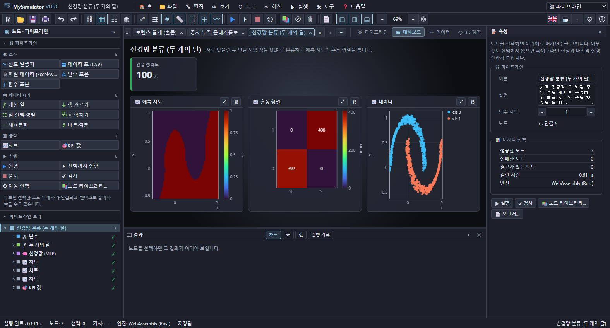

### 몬테카를로·최적화

| 노드 | 결과 |
| --- | --- |
| 몬테카를로 시뮬레이션 | 입력 `이름 ~ 분포(…)`, 출력 `이름 = 식`. 무작위 또는 라틴 하이퍼큐브. 표본, 통계(평균·표준편차·p5·p50·p95), 첫 출력에 대한 민감도(순위 상관과 분산 기여), 평균의 수렴과 95 % 구간, 조건 확률(윌슨 구간) |
| 확률 과정 | 기하 브라운 운동·랜덤 워크·오른슈타인-울렌벡, 점프. 경로와 분위수 띠, 최종값, 최대 낙폭, VaR |
| 최적화 | 변수 `x: 하한 .. 상한 = 시작`, 제약 `g(x) <= 0` · `>=` · `=`(벌점), 최소화·최대화. 넬더-미드, 차분 진화(전역), BFGS. 이력, 최적점, 2변수면 목적 함수 지도와 경로 |
| 곡선 맞춤 | 모델식 `a*exp(-b*x) + c` 와 시작값. 레벤버그-마쿼트. 매개변수·표준오차·95 % 구간, R², 맞춤 곡선, 식 |
| 매개변수 스윕 | 다른 노드의 숫자 매개변수를 범위(선형·로그) 또는 목록으로 바꿔 가며 다시 실행하고, 측정 노드의 결과 값(또는 열과 집계)을 모읍니다. 두 매개변수면 지도 |
| 이산 사건 공정 (AnyLogic·FlexSim 형) | 소스 → 대기열 → 작업장(서버 n대, 용량) → 확률 경로 → 싱크. 작업장별 가동률·대기 시간·대기열 길이·손실, 처리량, 시스템 체류 시간, 시간에 따른 대기열 |

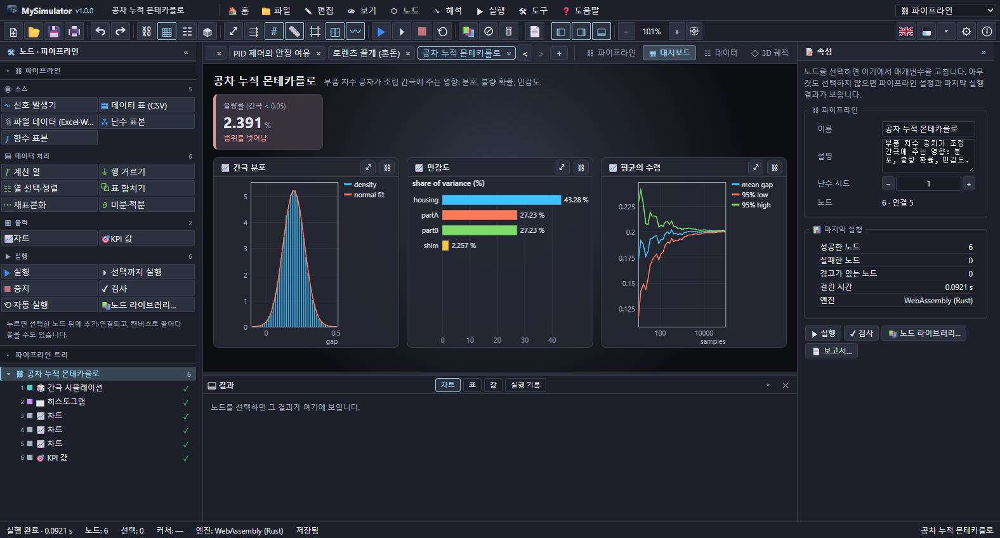

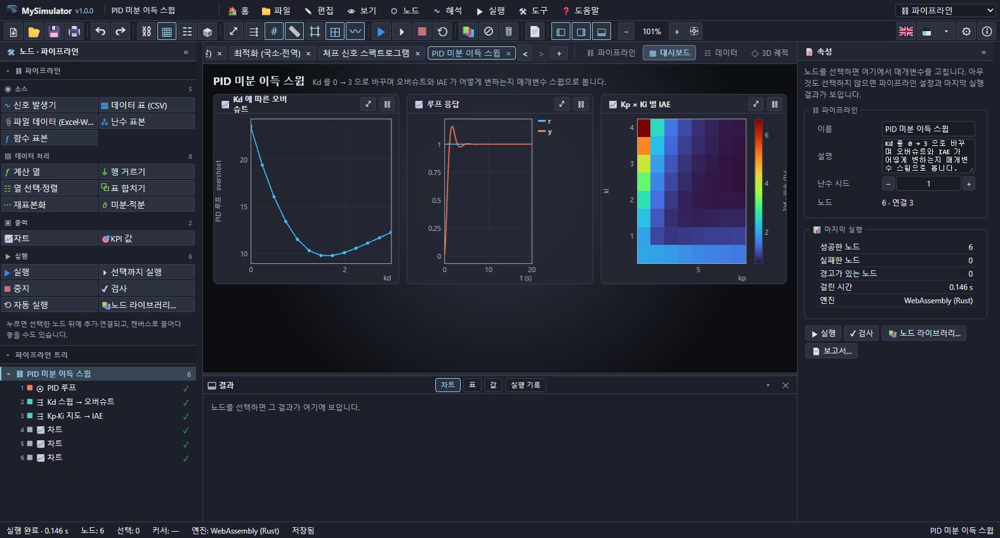

### 연동

| 노드 | 하는 일 (데스크톱) |
| --- | --- |
| Python 스크립트 | 설치된 Python 으로 코드를 실행 |
| 외부 프로그램 | 명령줄 도구 실행, `{in}` · `{out}` · `{dir}` 치환 |
| 파일 읽기 | CSV · TSV · JSON · Excel · WAV · STL · MAT · PNG 를 실행할 때마다 읽기 |
| 파일 쓰기 | 입력 표를 CSV 또는 JSON 으로 쓰고 그대로 전달 |
| MyHeatManager 열 해석 (내장 엔진) | MyHeatManager 의 해석 엔진이 들어 있어 다른 프로그램 없이 `.myheat` 모델(전도·대류 유동·상변화·열응력 …)을 풉니다(웹·데스크톱). 모델은 노드에 담거나 경로로 읽고, 필드(온도·응력·유속 …) 표와 열 지도, 최고·최저 온도, 탐침, 에너지 수지, 물체·경계별 값을 받습니다 |

상대 경로는 저장된 파이프라인 파일의 폴더 기준입니다.

### 출력

| 노드 | 하는 일 |
| --- | --- |
| 차트 | 대시보드 차트(입력을 그대로 전달) |
| KPI 값 | 값 하나와 경보 범위 |

## 5. Python 과 외부 프로그램 연동

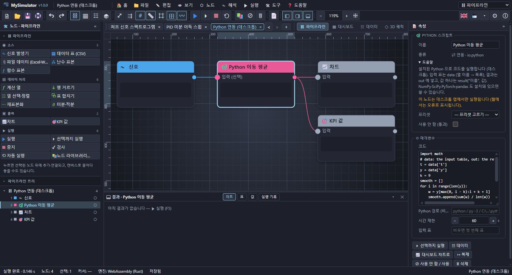

**Python 스크립트** 노드의 코드는 다음을 받습니다.

```python
# data   : 입력 표, 열 이름 → 값 목록 (숫자는 float)
# columns: 열 이름 목록
# out    : 결과 표를 채웁니다 (열 이름 → 목록, numpy 배열 또는 pandas DataFrame)
# result("이름", 값): 결과 값 하나
import numpy as np
y = np.array(data['y'])
out['t'] = data['t']
out['smooth'] = np.convolve(y, np.ones(25) / 25, mode='same')
result('max', out['smooth'].max())
print('done')       # print 출력은 노드의 결과 글
```

- Python 은 `py -3`, `python`, `python3` 순으로 찾습니다(도구 › Python 연동에서 확인). 노드의 "Python 경로" 에 실행 파일을 직접 줄 수도 있습니다.
- NumPy · SciPy · pandas · PyTorch 등은 그 Python 에 설치돼 있으면 `import` 해서 씁니다.
- 입력 표의 열 이름은 단위 없이 넘어갑니다(`t (s)` → `data['t']`).
- 시간 제한을 넘거나 ■ 중지하면 프로세스를 끝냅니다. 오류가 나면 Python 의 마지막 오류 줄이 노드 오류로 보입니다.

**외부 프로그램** 노드는 상용 솔버의 배치 실행이나 사내 도구를 감쌉니다. 인자의 `{in}` 은 입력 CSV, `{out}` 은 결과 CSV, `{dir}` 은 작업 폴더 경로로 바뀝니다. `{out}` 이 없으면 표준 출력을 결과 표로 읽습니다. 예:

```
program:   python
arguments: solver_wrapper.py --input {in} --output {out}
```

보안: Python·외부 프로그램 노드가 있는 파이프라인은 탭에서 처음 실행할 때 실행할 프로그램 목록을 보이고 허락을 묻습니다. 믿을 수 있는 파일일 때만 허락하십시오.

### MyCircuit · LTspice · MyHeatManager

- **MyCircuit 프로젝트(.mycircuit)** 를 열면 MyCircuit 의 넷리스트 생성기(같이 들어 있음)로 SPICE 넷리스트를 만들어 회로 해석 노드가 됩니다. MyCircuit 에서 정한 탐침도 옮겨 옵니다. 웹에서도 됩니다.
- **MyCircuit 의 "SPICE 내보내기"(.cir)** 와 LTspice 형 넷리스트(.cir · .net · .sp)는 그대로 열립니다. 부회로, `.model`, B 전원, BJT · MOSFET 이 들어 있어도 됩니다. 모델이 없는 IC(555, 마이크로컨트롤러)는 MyCircuit 처럼 빠집니다.
- **MyHeatManager 열 해석** 노드에는 MyHeatManager 의 해석 엔진이 들어 있습니다. MyHeatManager 를 설치하지 않아도, 웹에서도 `.myheat` 모델을 엽니다(파일 › 열기 또는 노드의 파일 고르기).

## 6. 배치 실행 (명령줄)

창 없이 파이프라인을 실행합니다(도구 › 배치 실행).

```
MySimulator --batch pipeline.mysim [다른 파이프라인…] [옵션]
  --out <폴더>                 결과를 이 폴더에 (기본: 파이프라인 옆)
  --set <노드>.<매개변수>=<값>  실행 전에 매개변수 바꾸기 (노드 id 또는 이름, 여러 번)
  --only <노드>[,<노드>…]       이 노드들의 결과만 쓰기
  --quiet                      오류만 출력
```

결과: `<이름>.summary.json`(노드마다 성공/오류, 경고, 결과 값, 표 목록), `<이름>.<노드>.<표>.csv`, `<이름>.<노드>.<격자>.png`. 종료 코드 0 = 모든 노드 성공, 2 = 실패한 노드 있음, 1 = 잘못된 인자. 같은 파이프라인을 조건만 바꿔 여러 번 돌리는 스크립트나 CI, 야간 작업에 씁니다.

예제 폴더의 `automation.mysim` 은 디스크의 측정 파일을 읽어 Python 으로 추세를 빼고, 필터와 피크 찾기를 거쳐 정제한 CSV 를 다시 쓰는 전체 자동화 예입니다.

## 7. 파일

| 형식 | 쓰임 |
| --- | --- |
| `.mysim` | 파이프라인 (JSON: 노드, 연결, 매개변수, 위치, 설정) |
| `.csv` `.tsv` `.txt` | 열기·끌어 놓기·가져오기 → 데이터 표 노드 |
| `.json` | 파이프라인이 아니면 데이터(열 이름 → 배열, 또는 행 객체 배열) → 데이터 표 노드 |
| `.xlsx` `.wav` `.stl` `.mat` `.png` | 열기·가져오기 → 파일 데이터 노드(파일을 파이프라인 안에 담음). 데스크톱의 파일 읽기 노드는 디스크에서 매번 읽습니다 |
| `.cir` `.net` `.sp` | SPICE 넷리스트 → 회로 해석 노드 |
| `.mycircuit` | MyCircuit 프로젝트 → 회로 해석 노드 (MyCircuit 의 넷리스트 생성기로 변환) |
| `.myheat` | MyHeatManager 모델 → MyHeatManager 열 해석 노드 (모델을 담음, 내장 엔진으로 풂) |

내보내기: 선택 노드의 결과 CSV(표, 격자, 또는 값) · JSON, 모든 결과 CSV(한 파일, `# 노드 / 표` 머리줄로 구분), 그림 PNG(현재 보기), 차트 그림, 보고서 HTML.

## 8. 예제

| 예제 | 분야 |
| --- | --- |
| 신호 잡음 제거와 스펙트럼 | 버터워스 필터, FFT, KPI |
| 처프 신호 스펙트로그램 | STFT, PSD, 순간 주파수 |
| 감쇠 진동과 감쇠비 추정 | ODE, 피크(대수 감쇠율), FFT, 위상 평면 |
| 로렌츠 끌개 | 혼돈 ODE, 3D 궤적, PSD |
| PID 제어와 안정 여유 | PID 루프, 보드 선도, 여유, KPI |
| PID 미분 이득 스윕 | 1·2차원 매개변수 스윕 |
| 1/4 차량 현가 | 상태공간, 고유값, FFT |
| 실험 데이터 회귀 분석 | CSV, 기술 통계, 2차 회귀, 잔차 히스토그램, 상관 |
| 군집 분석과 PCA | k-평균, PCA |
| 신경망 회귀 · 분류 | MLP, 손실 곡선, 예측 지도, 혼동 행렬 |
| 공차 누적 몬테카를로 | 불량률, 민감도, 수렴 |
| 주가 경로 시뮬레이션 | GBM, 분위수 띠, VaR |
| 최적화 | 넬더-미드, 차분 진화, 목적 지도와 경로 |
| 비선형 곡선 맞춤 | 레벤버그-마쿼트, 신뢰 구간 |
| 감염병 SIR 과 전파율 스윕 | ODE 입력, 스윕 |
| 블록 다이어그램 | 정속 주행·모터 속도 루프 (Simulink 형, 그래픽 편집기) |
| 생산 라인 이산 사건 | 작업장 가동률, 대기열, 처리량 |
| 회로 해석 | RC 필터 보드 선도, BJT 증폭기, CMOS 인버터, 부회로 연산 증폭기, 벅 컨버터, 신호로 구동하는 회로 |
| MyCircuit 회로 | MyCircuit 이 내보낸 넷리스트 세 개를 그대로 |
| 디지털 논리와 마이크로컨트롤러 | 보행자 버튼 신호등 MCU, PWM MCU, 카운터 타이밍도, 전가산기 진리표 |
| 유한요소 2D | 판의 온도, 구멍 주위 응력 집중, 막대 가열 |
| 유한요소 3D | 방열판 온도, L 브래킷 응력과 안전율 |
| 유동 해석 CFD | 덮개 구동 공동(Re 100), 가열 원기둥의 강제대류 |
| 구조 해석 | 문형 골조, 워런 트러스, 외팔보 고유진동수 |
| 3D 물리 엔진 | 모터 바퀴 차량, 뉴턴의 요람, 상자 탑 (3D 재생) |
| 로봇 | 장애물 피하는 이동 로봇, 원 그리는 팔 |
| CAD | 플랜지·스포크 휠의 질량 특성, 3D 표면 |
| MyHeatManager 열 해석 | 칩과 방열판, 하루 동안의 벽 (내장 엔진) |
| 소리 파일 분석 | WAV 파일의 스펙트럼·스펙트로그램·필터 |
| Python 연동 | Python 스크립트 (데스크톱) |

## 9. 꾸미기와 설정

- **테마**: 도구 막대의 테마 단추는 같은 계열의 다음 테마로, ▾ 는 다크 20 · 라이트 20 목록을 엽니다. 설정 › 사용자 테마에서 색을 하나씩 정합니다.
- **언어**: 국기 단추로 한국어 ↔ English. 메뉴, 노드 이름·도움말, 예제가 함께 바뀝니다.
- **설정**: 일반(언어, 작업대, 자동 실행, 닫을 때 묻기), 글꼴, 시작 화면(배경 20종, 속도, 투명도), 편집 화면(격자, 격자에 맞추기, 노드 미리보기, 도움말 펼치기, 색 지도), 패널(폭, 결과 패널 높이), 최근 파일.

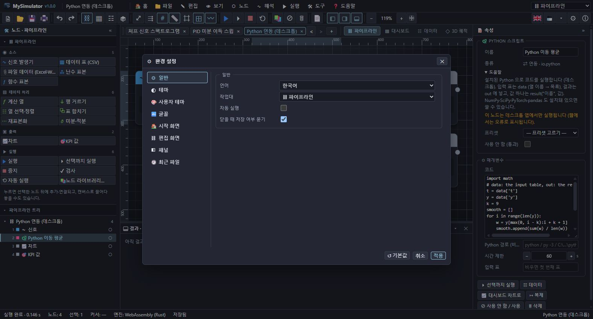

## 10. 단축키

| 단축키 | 명령 | 단축키 | 명령 |
| --- | --- | --- | --- |
| Ctrl+N | 새 파이프라인 | F5 | 실행 |
| Ctrl+O | 열기 | Ctrl+F5 | 선택까지 실행 |
| Ctrl+S | 저장 | Shift+F5 | 중지 |
| Ctrl+Shift+S | 다른 이름으로 저장 | Ctrl+K | 노드 라이브러리 |
| Ctrl+P | 인쇄 | Ctrl+L | 자동 정렬 |
| Ctrl+W | 탭 닫기 | Ctrl+E | 사용 안 함 / 사용 |
| Ctrl+Z / Ctrl+Y | 실행 취소 / 다시 실행 | F2 | 이름 바꾸기 |
| Ctrl+C / Ctrl+V | 복사 / 붙여넣기 | Delete | 삭제 |
| Ctrl+D | 복제 | Ctrl+A | 모두 선택 |
| 1 · 2 · 3 · 4 | 파이프라인 · 대시보드 · 데이터 · 3D | F | 전체 보기 |
| + / − / Ctrl+0 | 확대 / 축소 / 100 % | G | 격자 |
| F11 | 전체 화면 | F1 | 사용 설명서 |
| Esc | 선택 해제, 메뉴 닫기 | Space+끌기 | 화면 이동 |

## 11. 설치

- **Windows**: `MySimulator-Setup-1.0.0.exe`. 사용자 계정에 설치되며 관리자 권한이 필요 없습니다. 이전 설치가 있으면 완전히 지우고 다시 설치할지, 사용자 데이터(설정, 최근 파일, 창 위치)를 지울지 묻습니다. 저장한 `.mysim` 파일은 지우지 않습니다. `.mysim` 파일은 MySimulator 로 열립니다.
- **macOS**: `MySimulator-1.0.0-<arch>.dmg`, **Linux**: `.deb` · `.rpm` · `.AppImage`.
- **웹**: `npm run build:web` 의 `dist/` 를 아무 정적 웹 서버에 올립니다. 브라우저 안의 WebAssembly 엔진으로 실행됩니다(Python·외부 프로그램·파일 노드 제외).

## 12. 문제 해결

| 증상 | 해결 |
| --- | --- |
| 노드가 "the input … is not connected" | 그 입력 포트에 연결하십시오. |
| "unknown name …" | 수식에 없는 열·상수 이름. 결과 패널의 표 탭에서 열 이름을 확인하십시오. |
| ODE 가 "the step size became too small" | 강성 문제이거나 해가 발산합니다. 허용 오차를 키우거나 RK4 와 작은 간격을 쓰십시오. |
| 신경망 "training diverged" | 학습률을 낮추십시오. |
| Python 노드 "Python 3 was not found" | Python 3 을 설치하거나 "Python 경로" 를 지정하십시오. |
| 웹에서 Python/파일 노드가 실패 | 데스크톱 앱에서 실행하십시오. |
| 결과가 ◔ 표시 | 실행 뒤 바뀐 노드입니다. 다시 실행하거나 자동 실행을 켜십시오. |
