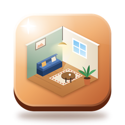
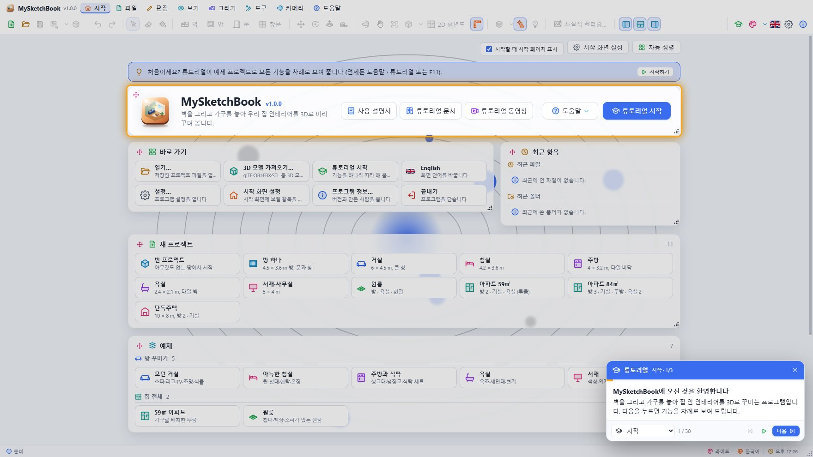
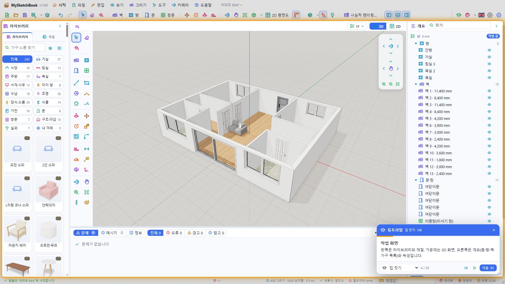
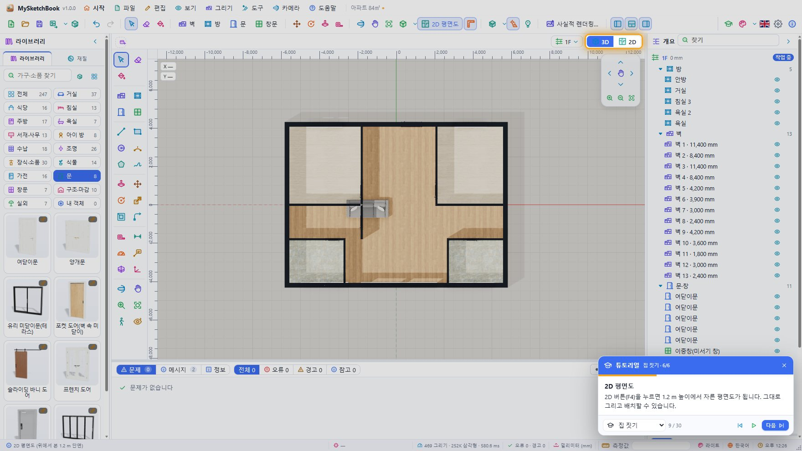
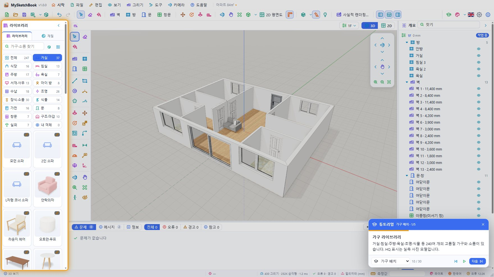
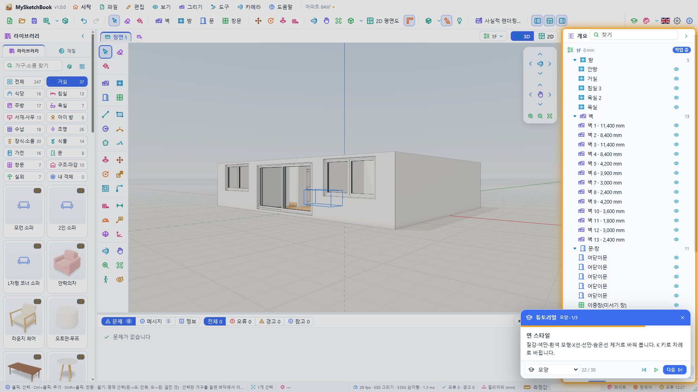
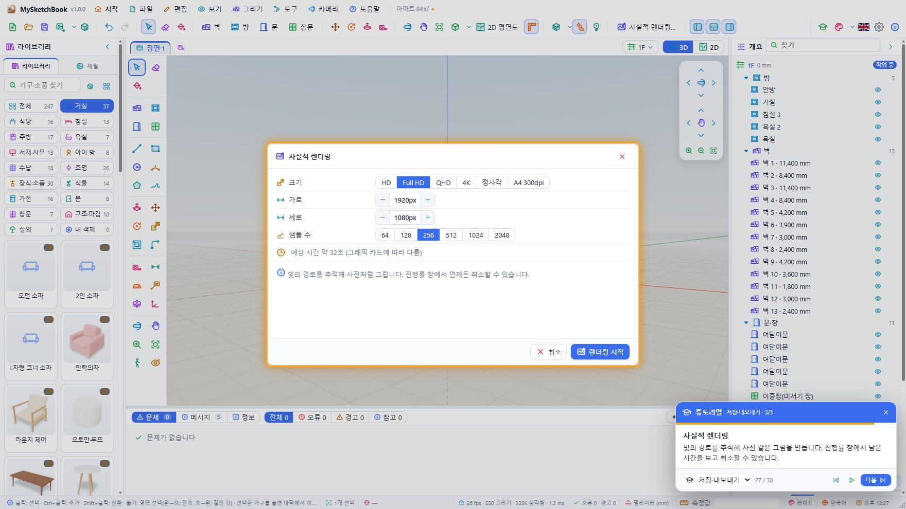

# MySketchBook

Windows · macOS · Linux · 웹에서 쓰는 **집 안 인테리어 배치와 SketchUp 스타일 3D 모델링** 프로그램입니다. 벽·문·창·방을 그려 집을 만들고, 고품질 가구와 소품을 끌어다 놓고, 재질을 칠하고, SketchUp처럼 면을 밀고 당겨 직접 모델링합니다. 2D 평면도와 3D 화면, 장면·층·태그·단면, 햇빛과 그림자, 경로 추적(path tracing) 사실적 렌더링, 3D 모델 가져오기/내보내기를 제공합니다. vanilla JavaScript + three.js(Vite) 화면과 Tauri 2(Rust) 데스크톱 셸로 만들었습니다.



- 버전: 1.0.0
- 사용법: [doc/UsersGuide.md](doc/UsersGuide.md) (English: [doc/UsersGuide.en.md](doc/UsersGuide.en.md)) — 앱 안에서는 **도움말 › 사용 설명서**
- 튜토리얼 문서: [doc/Tutorial.html](doc/Tutorial.html) (English: [doc/Tutorial.en.html](doc/Tutorial.en.html)) — 앱 안에서는 **도움말 › 튜토리얼 문서**
- 구조(개발자용): [ARCHITECTURE.md](ARCHITECTURE.md), 모듈 계약: [CONTRACT.md](CONTRACT.md), 모델링 커널: [src/modeling/README.md](src/modeling/README.md)

## 화면

| | |
|---|---|
|  |  |
| 시작 화면 — 템플릿·예제·최근 파일 | 작업 화면 — 라이브러리 · 도구 모음 · 3D 화면 · 개요/속성 · 하단 패널 |
|  |  |
| 2D 평면도 (1.2 m 높이 단면) | 가구 라이브러리 (매개변수 모델 + Poly Haven 고품질 모델) |
|  |  |
| 스타일 탭 — 면 스타일·배경·환경 조명 | 사실적 렌더링 설정 |

그림은 튜토리얼을 웹 버전에서 실행하며 찍은 것입니다 (`npm run tutorial:docs`).

## 주요 기능

### 집 짓기

- **벽** — 점을 차례로 클릭해 벽을 잇고, 끝점·중점·벽 위·축 방향·정렬 추론에 맞춥니다. 길이를 입력하고 Enter(`2400`, `2.4m`, `8'`), 화살표 키로 축 고정, Shift로 방향 고정. 벽이 만나는 곳은 자동으로 마이터(45°) 또는 맞댐으로 이어집니다.
- **방** — 벽으로 둘러싸인 곳을 한 번 클릭하면 바닥이 생기고 면적(㎡·평)이 계산됩니다. 빈 곳에서는 꼭짓점을 차례로 찍어 만듭니다. 바닥재·천장 재질, 천장 표시.
- **문과 창** — 여닫이·양개·미닫이 유리·포켓·바니·프렌치·현관·접이 문 8종, 여닫이·오르내리·미서기·고정·들창·베이·지붕창 7종. 벽 위를 클릭하면 벽에 구멍을 뚫고 들어가며 벽을 따라 미끄러집니다. 폭·높이·바닥에서 높이·위치·경첩 방향·여는 쪽.
- **층** — 층 추가, 층별 바닥 높이·층 높이, 작업 층 고르기(보기 탭 오른쪽의 층 칩), 층 숨기기.
- **템플릿 11종** — 빈 프로젝트 · 방 하나 · 거실 · 침실 · 주방 · 욕실 · 서재 · 원룸 · 아파트 59㎡ · 아파트 84㎡ · 단독주택. **예제 7종** — 모던 거실 · 아늑한 침실 · 주방과 식탁 · 욕실 · 서재 · 가구를 배치한 59㎡ 아파트 · 원룸.

### 가구 배치

- **라이브러리 247개** — 크기·재질·옵션을 바꿀 수 있는 **매개변수 모델 125개**(16개 분류: 거실 · 식당 · 침실 · 주방 · 욕실 · 서재 · 아이 방 · 수납 · 조명 · 장식 · 식물 · 가전 · 문 · 창문 · 구조·마감 · 실외)와 **Poly Haven CC0 고품질 실측 모델 122개**(HQ 표시). 이름 검색(한국어/영어), 카드 크기 3단계.
- 카드를 클릭하고 놓을 곳을 클릭하거나 화면으로 끌어다 놓기. 벽 가까이 놓으면 **등을 벽에 붙여** 놓고, 벽 장식은 벽면에, 천장 조명은 천장에, 작은 소품은 탁자 위에 놓입니다. `[` `]`로 90°(Shift: 15°) 회전.
- 속성 패널에서 위치·회전·배율과 **치수와 옵션**(예: 소파의 폭·좌석 수·깊이·천·다리·팔걸이·쿠션), **부분별 재질 바꾸기**, 다른 항목으로 바꾸기, 좌우 대칭, 바닥에 내려놓기.
- **내 3D 모델 가져오기** — glTF/GLB · OBJ(+MTL) · FBX · STL · Collada(DAE) · 3DS · PLY · 3MF · USDZ. 단위(자동·mm·cm·m·in·ft)와 위쪽 축(자동·Y·Z)을 고르고, 작은 부품을 합쳐 빠르게 그립니다. 가져온 모델은 **라이브러리 › 내 객체**에 들어가고 프로젝트 파일에 함께 저장됩니다. (.skp는 비공개 형식이라 SketchUp에서 DAE/glTF로 내보낸 뒤 가져옵니다.)

### 재질

- **재질 105종**(나무 · 바닥재 · 패브릭 · 가죽 · 석재 · 타일 · 벽 마감 · 금속 · 유리 · 페인트 · 플라스틱 · 세라믹 · 카펫 · 식물 · 기타), 이 가운데 다수는 Poly Haven CC0 PBR 텍스처(색·법선·거칠기·AO, 실제 크기로 반복).
- **페인트 통** — 벽 한쪽 면, 바닥·천장, 가구의 한 부분, 모델링한 면(앞/뒤)을 클릭해 칠합니다. Alt+클릭은 스포이트. 내 재질 만들기(색·거칠기·금속성).

### SketchUp 스타일 모델링

- **붙는 형상(sticky geometry)** — 선·사각형·원·호·다각형·자유선이 닫히면 면이 생기고, 면을 가로지르는 선은 면을 나눕니다.
- **밀기/당기기**(관통하면 구멍), **오프셋**, **경로 따라가기**(Follow Me), **이동/회전/크기 조절**(Ctrl 복사, `x5` · `/5` 배열), **그룹**과 그룹 편집, 분해.
- **솔리드 도구**(합치기 · 빼기 · 교집합, manifold-3d), **면 교차**, **모서리 부드럽게**, 지우개(모서리·면 단위).
- **추론 엔진** — 끝점 · 중점 · 중심 · 교차점 · 모서리 위 · 면 위 · 빨강/초록/파랑 축 · 평행 · 수직, 화살표 키 축 고정, Shift 추론 고정.
- **측정값 상자**(SketchUp의 VCB) — 도구가 움직이는 중에 숫자를 치면 바로 들어갑니다: 길이 `2400`, 사각형 `1200,800`, 각도 `45`, 배율 `1.5`, 변의 수 `6s`, 배열 `x5`.

### 보기와 표현

- 궤도 · 이동 · 확대(가운데 버튼·오른쪽 버튼 끌기·휠), 전체 보기, 표준 보기 7방향, 원근/평행 투영, **2D 평면도**(F4), **걷기**(W A S D, 벽에 부딪히면 멈춤), 둘러보기.
- **면 스타일 6가지** — 질감 · 색만 · 흰색 모형 · X선 · 선만 · 숨은선 제거 (K로 차례로), 모서리 선, 배경(하늘과 땅 · 흰색 · 어두운 색 · HDRI 환경 사진), **환경 조명 HDRI 8종**, 노출, 조명 켜기(램프가 실제로 빛을 냄).
- **햇빛과 그림자** — 날짜·시각·위도·경도·북쪽 각도, 도시 9곳. 그림자 해상도 3단계.
- **장면**(보기 탭, PageUp/PageDown), **태그**(보이기/숨기기), **단면**(면을 클릭해 자르기), 치수 · 글 표시 · 줄자 안내선 · 각도기.
- **표시 품질** — 빠르게 · 균형 · 고품질, 구석 음영(AO), 계단 현상 제거, 최대 프레임, 해상도 배율, 성능 표시(FPS·그리기 호출·삼각형).

### 출력

- **.msk 프로젝트** — ZIP 하나에 프로젝트(JSON), 썸네일, 가져온 모델이 모두 들어갑니다. Windows 탐색기에서 두 번 클릭하면 열립니다(파일 연결).
- **그림으로 저장** — HD · Full HD · QHD · 4K · 정사각 · A4 300dpi 또는 최대 7680 × 4320, PNG(투명 배경) · JPEG · WebP. **평면도 그림**(3000 × 2000 PNG).
- **사실적 렌더링**(F9) — three-gpu-pathtracer로 경로 추적, 샘플 64~2048, 예상 시간, 진행률 창에서 남은 시간·취소, 결과를 PNG로 저장.
- **3D 내보내기** — GLB · glTF · OBJ · STL · PLY · USDZ, 선택한 것만 GLB로.

### 그 밖에

- **하단 패널** — 문제(벽보다 넓은 문, 겹친 문·창, 방 밖의 가구, 떠 있는 가구, 겹친 가구 …) · 메시지(알림과 오류 기록) · 정보(층·면적·구성·화면 통계).
- 실행 취소/다시 실행(100단계), 잘라내기·복사·붙여넣기·복제, 숨기기·잠금, 개요(층 › 방·벽·문·창·가구·모델) 검색.
- 한국어/영어, 테마 40가지(어두운 20 · 밝은 20) + 사용자 정의 테마, 글꼴·확대, 움직이는 배경 20종·배경 이미지, 시작 화면 카드 배치.
- 튜토리얼(8장 30단계, F11), 사용 설명서·튜토리얼 문서 창(장 이동·찾기·인쇄), 튜토리얼 동영상 창.

## 요구 사항

- Node.js 22 이상 (이 PC는 24에서 확인), npm
- 데스크톱 실행/빌드: Rust(stable)와 [Tauri 2 준비물](https://tauri.app/start/prerequisites/) — Windows는 WebView2와 MSVC 빌드 도구, macOS는 Xcode 명령줄 도구, Linux는 `libwebkit2gtk-4.1`·`libgtk-3` 개발 패키지
- WebGL 2를 지원하는 그래픽 카드 (사실적 렌더링은 GPU가 클수록 빠릅니다)
- 웹 버전: 최신 Edge · Chrome · Firefox · Safari

## 실행 방법

```bash
npm install          # 의존성 설치
npm run assets       # Poly Haven CC0 라이브러리(모델·텍스처·HDRI, 약 300 MB)를 library/ 에 내려받기
npm start            # 데스크톱 앱 (개발 모드, 수정이 바로 반영됨)
npm run dev          # 웹 버전 (Vite, http://127.0.0.1:5480)
npm test             # 모든 테스트
```

- `npm run assets`는 한 번만 하면 됩니다(이 저장소에는 이미 받아 두었습니다). 이미 받은 파일은 건너뛰고, 중간에 끊겨도 이어서 받습니다. 일부만: `npm run assets -- --only models` (models · textures · hdri). 라이브러리가 없어도 앱은 실행되며, 매개변수 가구와 단색 재질만 보입니다.
- `npm start`는 5480 포트를 다른 프로그램이 쓰고 있으면 127.0.0.1과 ::1 모두에서 비어 있는 다음 포트를 골라 Vite와 `tauri dev`를 띄웁니다. 다른 프로그램의 서버를 다시 쓰거나 끄지 않습니다.
- `npm run dev`는 고정 포트 5480을 씁니다(`vite.config.js`). 포트를 바꾸려면 `npx vite --port 5490`.

### 테스트

| 명령 | 내용 |
|---|---|
| `npm test` | 모든 범주를 실행하고 범주별 결과와 요약 표를 보여 줍니다 (`test-results/results.json`) |
| `npm run test:quick` | 창·브라우저 없이 빠른 범주만 |
| `npm run test:unit` | JS 단위 테스트 + Rust 단위 테스트 |
| `npm run test:e2e` | 웹(헤드리스 Edge/Chrome) + 데스크톱(디버그 exe) E2E |
| `node --test test/unit/*.test.js` | 모델링 커널·벽·라이브러리·입출력 단위 테스트만 |
| `node --test test/static/docs.test.js` | 문서 검사 (두 설명서의 장 구성, 단축키 표, 링크, 튜토리얼 단계 수) |

### 빌드

| 명령 | 결과 |
|---|---|
| `npm run build:win` | Windows 설치 파일 `MySketchBook-Setup-1.0.0.exe` (NSIS, 한국어/영어, 현재 사용자 설치) |
| `npm run build:mac` | macOS `MySketchBook-1.0.0-<arch>.dmg` (macOS에서) |
| `npm run build:linux` | Linux `.deb` · `.rpm` · `.AppImage` (Linux에서) |
| `npm run build:all` | 지금 OS에서 만들 수 있는 설치 파일 모두 |
| `npm run build:web` | 웹 버전 `dist/` (라이브러리도 `dist/library/`로 복사) — 아무 정적 웹 서버로 올립니다. 확인: `npm run preview` |
| `npm run build:docs` | 사용 설명서·튜토리얼 HTML (`doc/`, `public/doc/`) |
| `npm run tutorial:docs` | 튜토리얼 각 단계 화면 캡처(한국어·영어) 후 문서 다시 만들기 |
| `npm run tutorial:video` | 튜토리얼 자동 재생을 녹화한 `doc/video/MySketchBook-Tutorial.mp4` (ffmpeg 필요) |
| `npm run samples` | 예제 프로젝트 `samples/*.msk` 다시 만들기 |
| `npm run build:icons` | 아이콘(앱·.msk 파일) 다시 만들기 |

Tauri는 교차 빌드를 하지 않으므로 각 OS의 설치 파일은 그 OS에서 만듭니다. 만든 설치 파일은 `release/`와 프로젝트 루트에 복사됩니다. 설치 파일에는 라이브러리(`library/`), 문서(`doc/`), 예제(`samples/`)가 리소스로 들어갑니다.

## 폴더 구성

```
MySketchBookMultiOSV10/
├─ index.html            앱 페이지 (주 창 · 팝업 창 · 문서 창이 모두 이 페이지)
├─ src/
│  ├─ main.js            진입점: 주 창 / 팝업 / 문서 보기 창 고르기
│  ├─ app.js             주 창: 명령·메뉴·툴바·단축키, 패널, 파일, 가져오기/내보내기, 렌더링
│  ├─ popup.js           팝업 창(메뉴·설정·확인·진행률·정보 …), popups-3d.js: 3D 전용 팝업
│  ├─ viewer.js          사용 설명서·튜토리얼 문서·동영상 창
│  ├─ engine/            문서 모델·실행 취소, 3D 화면(viewport), 장면 구성(builder), 벽, 재질, 검사, 렌더링, 템플릿, 예제, .msk
│  ├─ modeling/          SketchUp식 모델링 커널 (붙는 형상, 밀기/당기기, 추론, 솔리드)
│  ├─ tools/             도구: tools.js(선택·배치·벽·방·이동 …), modeling.js(선·사각형·밀기/당기기 …), snap.js
│  ├─ library/           카탈로그, 분류, 매개변수 가구(parametric/), 내려받은 모델·텍스처(assets.js), HDRI(environments.js)
│  ├─ io/                3D 가져오기(import.js)·내보내기(export.js)·형식 목록(formats.js)
│  ├─ ui/                패널 HTML, 시작 화면, 튜토리얼, 썸네일, 배경 애니메이션
│  ├─ domain/            설정, 최근 파일, 경로, 도움말 문서 정보
│  ├─ platform/          데스크톱(Tauri)/웹 차이: 파일 대화상자, 팝업 창, IndexedDB
│  └─ i18n/              한국어·영어 문자열 (ko3d.js · en3d.js · extra3d.js가 3D 화면 문구)
├─ src-tauri/            Rust: 파일 입출력·진행률, 팝업·문서 창, 글꼴, 창 위치, 여러 실행, 설치 훅(windows/hooks.nsh)
├─ library/              CC0 모델·텍스처·HDRI (npm run assets, git에 넣지 않아도 됨) + LICENSES.md
├─ samples/              예제 프로젝트 .msk (한국어/영어)
├─ doc/                  사용 설명서(UsersGuide.md · UsersGuide.en.md), 생성된 HTML 문서, tutorial/images/ 튜토리얼 화면
├─ public/               웹 빌드에 그대로 들어가는 파일 (public/doc/ = doc/ 복사본 (HTML과 그림))
├─ scripts/              start · build · build-docs · tutorial-capture · fetch-assets · make-samples · render-icons · test · dev-port
├─ test/                 unit/ · static/ · e2e/ (웹·데스크톱) · installer/ · fixtures/
├─ tools/                개발용 페이지 (라이브러리 미리보기, 에셋 검사)
└─ assets/               앱·파일 아이콘 원본
```

## 라이선스와 출처

- 프로그램: © SHKWON (knix008@naver.com).
- `library/`의 3D 모델 122개, 텍스처 34세트, HDRI 8개는 모두 [Poly Haven](https://polyhaven.com)의 자료이며 **CC0 1.0 (퍼블릭 도메인)** 입니다. 상업적 이용·수정·재배포에 출처 표시가 필요 없지만, 만든 분들을 [library/LICENSES.md](library/LICENSES.md)에 하나하나 적어 두었습니다. 모델은 GLB로 바꾸고 원점을 바닥 가운데로 맞추고 텍스처를 1024 px 이하로 줄였을 뿐 다른 것은 바꾸지 않았습니다.
- 사용한 오픈 소스: three.js, three-mesh-bvh, three-gpu-pathtracer, manifold-3d, fflate, Tauri (각 패키지의 라이선스를 따릅니다).
