# MySketchBook User's Guide

MySketchBook lets you draw walls, doors, windows and rooms to build a home, furnish it with furniture and props, and model in 3D the SketchUp way by pushing and pulling faces. It runs as a desktop app on Windows, macOS and Linux and in a web browser, with the same screen everywhere.

This guide uses the exact names of the menus, buttons and panels. Menu paths are written like **File › Export › Save as picture…**. `Ctrl` in shortcuts is `⌘` on macOS. If you are new, follow the [tutorial](Tutorial.en.html) (F11) first: in 8 chapters and 30 steps it shows every feature in turn.

## 1. Getting started

### 1.1 Installing and starting

- **Windows** — run `MySketchBook-Setup-<version>.exe`. The language chosen in the installer (Korean/English) is the language the program starts in. It installs for the current user, so no administrator rights are needed. When MySketchBook is already installed, the installer asks first whether to remove it and install again, and whether to delete the earlier user data (settings, recent files …).
- **macOS** — open the `.dmg` and drag MySketchBook into Applications.
- **Linux** — `.deb` (Debian/Ubuntu), `.rpm` (Fedora …) or `.AppImage`.
- **Web** — open the address where the web version (`dist/`) is served in Edge, Chrome, Firefox or Safari. Saving and opening use the browser's file dialogs (or a download).

Installing associates `.msk` files with MySketchBook: double-click one in Explorer or Finder to open it. The 3D view uses WebGL 2, so keep the graphics driver up to date.

### 1.2 The start page

The **start page** appears when the program starts. The **Start** button at the left of the menu bar (or `Ctrl+Shift+H`) shows and hides it at any time; the project you are working on stays open.

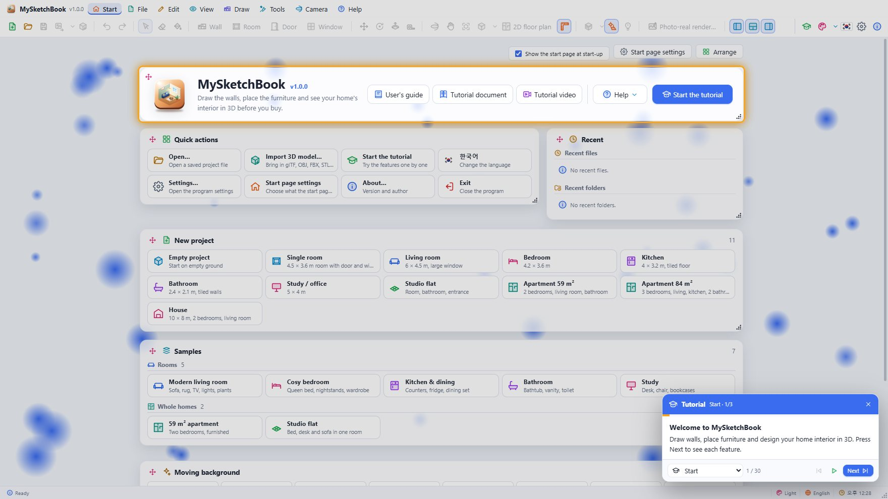

The start page is a board of cards over a moving background.

| Card | Contents |
|---|---|
| Top (title) | **User's guide** · **Tutorial document** · **Tutorial video** buttons, the **Help** menu, **Start the tutorial** |
| **Quick actions** | Open… · Import 3D model… · Start the tutorial · language (English/한국어) · Settings… · Start page settings · About… · Exit |
| **Recent** | Recent files and recent folders. Click to open (a folder opens the Open dialog there), ✕ removes an entry, **Clear all** |
| **New project** | 11 templates (table below) |
| **Samples** | Furnished sample projects: **Rooms** (Modern living room · Cosy bedroom · Kitchen & dining · Bathroom · Study) and **Whole homes** (59 m² apartment · Studio flat) |
| **Moving background** | 20 background animations, Change moving background, Background image…, Motion speed, Card opacity, Random at start, Auto change |

- Move a card by the handle (✥) at its top left and resize it by its bottom-right corner (double-click the corner to fit the content). **Arrange** puts the cards back in their first arrangement.
- Turn off **Show the start page at start-up** at the top and the program starts straight into a **Single room** template project.
- **Start page settings** chooses whether the recent files, recent folders, samples and moving background cards and the tutorial banner are shown.
- The first start shows the **Welcome window**: Start the tutorial, the apartment template (59 m²), or Later. **Help › Welcome window** opens it again.

### 1.3 Templates and samples

| Template | Contents |
|---|---|
| Empty project | Start on empty ground |
| Single room | 4.5 × 3.6 m room with door and window |
| Living room | 6 × 4.5 m, large window |
| Bedroom | 4.2 × 3.6 m |
| Kitchen | 4 × 3.2 m, tiled floor |
| Bathroom | 2.4 × 2.1 m, tiled walls |
| Study / office | 5 × 4 m |
| Studio flat | Room, bathroom, entrance |
| Apartment 59 m² | 2 bedrooms, living room, bathroom |
| Apartment 84 m² | 3 bedrooms, living, kitchen, 2 bathrooms |
| House | 10 × 8 m, 2 bedrooms, living room |

Templates come with walls (25 cm exterior walls, 12 cm partitions, 2.4 m high), doors, windows and rooms already drawn, so you can start furnishing at once. **File › New from template…** lists them too. Samples open with room names in the current language.

## 2. The screen

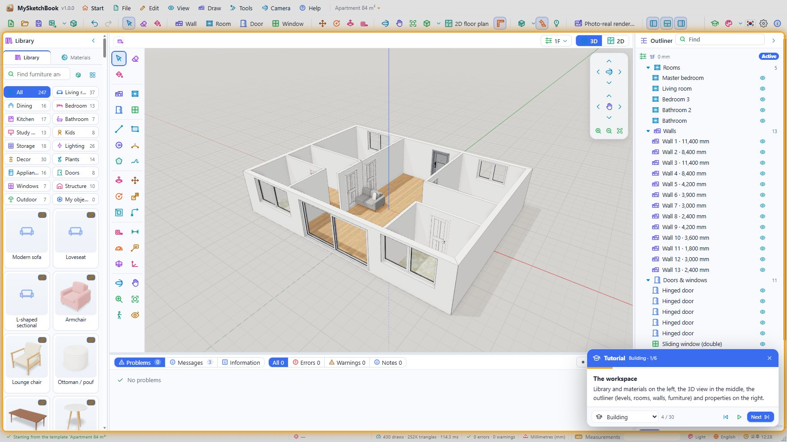

| Where | Name | What it does |
|---|---|---|
| Top | **Menu bar** | Program name and version, project name (● when modified), Start · File · Edit · View · Draw · Tools · Camera · Help. On the desktop it is also the title bar (drag to move the window, double-click to maximise, minimise/maximise/close at the right end) |
| Below it | **Toolbar** | Common commands (2.2) |
| Left | **Library / Materials** panel | Furniture and prop cards, material swatches |
| Left, inside | **Tool palette** | Tools grouped like SketchUp's large tool set (2.3) |
| Centre, top | **Scene tabs**, **level chip**, **3D / 2D** switch | Saved viewpoints, the working level, the 3D view and the 2D floor plan |
| Centre | **3D view** | The model. The **Navigation** pad at its top right (orbit and pan arrows, zoom in, zoom out, zoom extents) |
| Centre, bottom | **Bottom panel** | Problems · Messages · Information (2.6) |
| Right | **Outliner** + **Properties · Styles · Shadows · Tags · Scenes · Levels** tabs | The model's contents and the properties of the selection (2.5) |
| Bottom | **Status bar** | Hints and notices, selection count, cursor position, performance, problem count, units, the **Measurements** box (2.7) |

Drag the borders between panels to change the width of the left and right panels and the height of the bottom panel; the border between the outliner and the tabs below it can be dragged too. The ‹ › buttons in the panel headers (or `Ctrl+Shift+1` / `Ctrl+Shift+2`, `Ctrl+J`) collapse and expand them; a collapsed panel stays as a narrow strip at the edge that expands it again when clicked. On the desktop the grip at the bottom-right corner resizes the window.

### 2.1 Menus

| Menu | Items |
|---|---|
| **File** | New project · New from template… · Open… · Start page · Recent files… · Recent folders · Clear all recent files and folders · Save · Save as… · Import 3D model… · **Export** ▸ (Save as picture… · Photo-real render… · Floor plan picture (.png) · glTF binary (.glb) · glTF (.gltf) · Wavefront OBJ (.obj) · STL (.stl, 3D printing) · PLY (.ply) · USDZ (.usdz, AR) · Selection only as .glb) · Close project · Exit |
| **Edit** | Undo · Redo · Cut · Copy · Paste · Duplicate · Delete · Select all · Clear selection · **Rotate & mirror** ▸ (Rotate 90° clockwise · Rotate 90° counter-clockwise · Mirror · Drop to floor) · **Hide & lock** ▸ (Hide · Unhide all · Lock · Unlock) · Make group · Explode · Delete all guides |
| **View** | **Standard views** ▸ (Iso · Top · Front · Back · Left · Right · Bottom) · Perspective · 2D floor plan · **Face style** ▸ · **Show** ▸ (Rulers · Dimensions · Scale bar · Grid · Axes · Edges · Shadows · Lights on · Performance (FPS, triangles) · Library panel · Outliner & properties · Bottom panel · Status bar) · **Display quality** ▸ (Fast · Balanced · High) · **Scenes** ▸ (Add scene · Previous scene · Next scene) · **Appearance** ▸ (Random theme · Choose theme · Switch language · Change moving background · Background image… · Turn background off) |
| **Draw** | Wall · Room · Door · Window · Add level · **Shapes** ▸ (Line · Rectangle · Circle · Arc · Polygon · Freehand) |
| **Tools** | Select · Eraser · Paint bucket · **Modify** ▸ (Push/Pull · Move · Rotate · Scale · Offset · Follow Me) · **Solid tools** ▸ (Union · Subtract · Intersect · Intersect faces · Soften edges) · **Measure & annotate** ▸ (Tape measure · Dimension · Protractor · Text label · Axes · Delete all guides) · **Section** ▸ (Section plane · Sections on/off · Delete all sections) · Check now · Show problems · Show messages · Photo-real render… · Settings… |
| **Camera** | Orbit · Pan · Zoom · Zoom extents · Zoom to selection · Walk · Standard views ▸ · Perspective · 2D floor plan · Add scene · Previous scene · Next scene |
| **Help** | Welcome window · Tutorial · Tutorial document · Tutorial video · User's guide · Keyboard shortcuts… · Settings… · About… |

Menu items show their shortcut at the right; items that cannot be used right now are dimmed. On the desktop menus open as small windows of their own.

**Right-click menus**

- On a thing in the model: Cut · Copy · Duplicate · Delete, the commands of its kind (furniture: Rotate 90° · Mirror · Drop to floor · Replace with… · Reset materials / wall: Split wall · Flip wall direction / model: Edit group · Explode · Solid tools / door or window: Replace with…), Move · Rotate · Scale, Hide · Lock · Unlock, Zoom to selection.
- On empty space: Paste · Select all · Zoom extents · Standard views · Perspective · 2D floor plan · Face style · Show · Add scene · Save as picture… · Photo-real render….
- On a library card: Place · Replace the selected furniture with this. On a material swatch: Paint with this · Apply to the selected walls/rooms.
- Outliner rows, problems and messages in the bottom panel, the status bar and text boxes (Cut · Copy · Paste · Select all) have menus of their own.

### 2.2 Toolbar

From the left, the toolbar has these groups. Hover a button for its name, shortcut and description.

| Group | Buttons |
|---|---|
| File | New project · Open · Save · **Save as picture** (its ▾ = the Export menu) · Import 3D model |
| Edit | Undo · Redo |
| Select | Select · Eraser · Paint bucket |
| Building | **Wall** · **Room** · **Door** · **Window** |
| Modify | Move · Rotate · Push/Pull · Tape measure |
| Camera | Orbit · Pan · Zoom extents · **Iso** (▾ = view direction) · **2D floor plan** · Rulers · Dimensions · Scale bar |
| Look | **Cycle face style** (▾ = Choose face style) · Shadows · Lights on |
| Output | **Photo-real render…** |
| Panels | Library panel · Bottom panel · Outliner & properties |
| Right | Tutorial · Random theme (▾ = Choose theme) · Switch language (flag) · Settings · About |

The window's minimum width follows the toolbar, so the toolbar is never cut off.

### 2.3 Tool palette

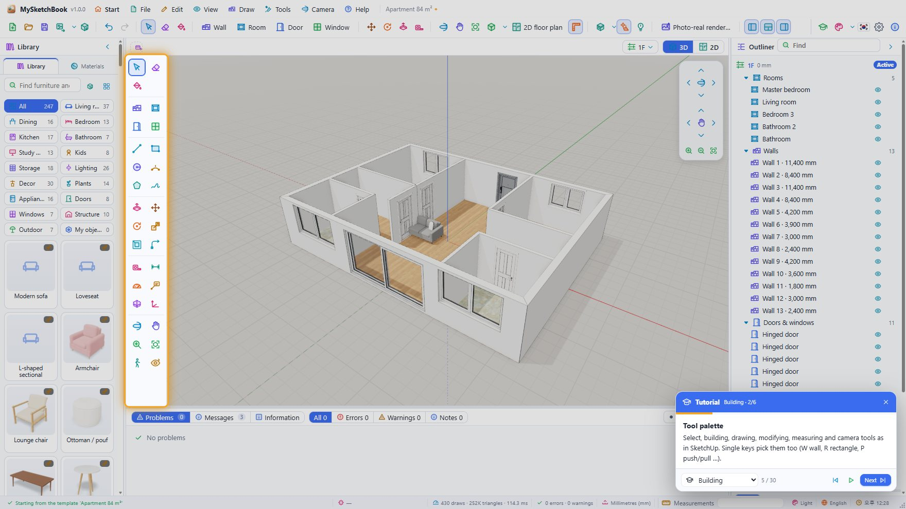

The tool palette at the left of the 3D view has six groups. A single key picks a tool too (in brackets).

| Group | Tools |
|---|---|
| Select | Select (`Space`) · Eraser (`E`) · Paint bucket (`B`) |
| Building | Wall (`W`) · Room (`Shift+R`) · Door · Window |
| Draw | Line (`L`) · Rectangle (`R`) · Circle (`C`) · Arc (`A`) · Polygon (`Shift+P`) · Freehand |
| Modify | Push/Pull (`P`) · Move (`M`) · Rotate (`Q`) · Scale (`S`) · Offset (`F`) · Follow Me |
| Measure & annotate | Tape measure (`T`) · Dimension (`D`) · Protractor · Text label · Section plane · Axes |
| Camera | Orbit (`O`) · Pan (`H`) · Zoom (`Z`) · Zoom extents (`Shift+Z`) · Walk · Look around |

When a tool is chosen, the left of the status bar explains how to use it. `Esc` cancels what is in progress; press it again to go back to the Select tool.

> The **Axes** tool is not ready yet: choosing it says "This tool is not available yet" and goes back to the Select tool.

### 2.4 Left panel: Library and Materials

- **Library** tab — the search box (English and Korean names and tags), the Import 3D model button, the card size button (small · medium · large), the category chips (All · Living room · Dining · Bedroom · Kitchen · Bathroom · Study & office · Kids · Storage · Lighting · Decor · Plants · Appliances · Doors · Windows · Structure · Outdoor · My objects, each with its count) and the cards. **HQ** marks a photo-scanned model (Poly Haven); the ruler mark is a parametric model whose size and materials can be changed. See [chapter 5](#5-furnishing).
- **Materials** tab — the material you paint with (the brush), the Paint bucket button, the search box, **+** (New material), the category chips (Wood · Flooring · Fabric · Leather · Stone · Tile · Wall finish · Metal · Glass · Paint · Plastic · Ceramic · Carpet & rug · Plant · Other) and the swatches. See [chapter 6](#6-materials-and-the-paint-bucket).

### 2.5 Right panel: Outliner and the editor tabs

The **Outliner** lists every level with its **Rooms · Walls · Doors & windows · Furniture & props · Models**.

- Click a row to select it, `Ctrl`+click to add, `Shift`+click to toggle; double-click shows it in the view.
- The eye icon at the end of a row hides and shows it; locked things carry a padlock.
- Click a group's header to collapse or expand it; click a level's header to make it the **Active** level.
- The **Find** box at the top filters by name.

The tabs below:

| Tab | Contents |
|---|---|
| **Properties** | Size, materials and position of the selection (nothing selected: the project's name, units, total room area and contents). Chapters 4–5 describe each kind |
| **Styles** | Face style, edges, lights on, background, environment light, exposure, display quality (chapter 9) |
| **Shadows** | Show shadows, time, date, latitude, longitude, north angle, city (chapter 9) |
| **Tags** | Tags, show/hide, name, count, add and delete (chapter 10) |
| **Scenes** | Scenes: show, rename, update to the current view, delete, add (chapter 10) |
| **Levels** | Levels: active level, name, floor height, storey height, show/hide, delete, add (chapter 10) |

### 2.6 Bottom panel

`Ctrl+J` opens and closes it. It has three tabs.

- **Problems** — the model checks (chapter 15). Filter All · Errors · Warnings · Notes; **Check now** checks again. Clicking a row selects the item and brings it into view.
- **Messages** — the notices and errors the status bar showed for a moment stay here with their time. **Copy messages**, **Clear messages**.
- **Information** — the active level (name, floor height, storey height), area (m² and pyeong, per room), contents (walls, rooms, furniture, doors/windows, models, scenes), display (draw calls, triangles, frame time, FPS), imported models (count, triangles).

### 2.7 Status bar and the Measurements box

From the left: how to use the current tool, or a notice · selection count · cursor position (X, Y, height) · performance (FPS · draw calls · triangles · frame time, while **View › Show › Performance (FPS, triangles)** is on) · problem count (errors · warnings; click for the Problems tab) · units · the **Measurements** box · theme · language · clock.

The **Measurements** box is SketchUp's VCB. While a tool works, just type: the numbers go into the box, and `Enter` applies them (`Esc` clears). The box's label follows the tool: Length · Distance · Angle · Scale · Radius · Dimensions · Offset.

| Input | Meaning |
|---|---|
| `2400` | 2400 in the project's units (2.4 m in a mm project) |
| `2.4m` · `240cm` · `2400mm` | with a unit: that unit |
| `8'` · `8'6` · `96in` · `96"` | feet and inches |
| `1200,800` (or `1200x800`) | a rectangle's width and depth |
| `45` | the angle (°) of Rotate and Protractor |
| `1.5` | the Scale factor |
| `6s` | the sides of a polygon, the segments of a circle |
| `x5` · `*5` · `/5` | right after a Move copy: 5 copies at the same spacing / the span divided in 5 |

## 3. Camera and views

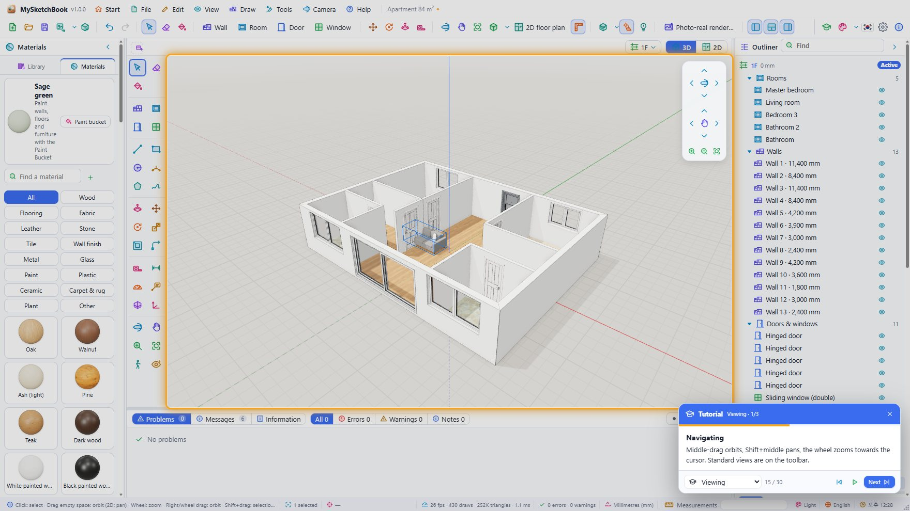

| Action | Mouse | Tool / key |
|---|---|---|
| Orbit | Middle-button drag, right-button drag, or a left drag with the Select tool (default setting) | Orbit `O` + left drag |
| Pan | `Shift` + middle (or right) button drag, or `Alt` + left drag with the Select tool | Pan `H` |
| Zoom | Wheel (towards the cursor) | Zoom `Z` + drag up/down |
| Zoom extents | — | `Shift+Z`, Zoom extents on the Navigation pad |
| Centre on a point | Middle-button double-click | — |
| Zoom to selection | Double-click in the outliner | **Camera › Zoom to selection** |

- Orbit turns around the point under the cursor. The right button orbits only after moving 4 pixels; a plain right click opens the context menu (for laptops without a middle button).
- The **Navigation** pad at the top right of the 3D view: the upper ring orbits (up, down, left, right), the lower ring pans, and below them zoom in, zoom out and zoom extents. Hold a button to keep moving.
- **Standard views** — Iso · Top · Front · Back · Left · Right · Bottom (the toolbar's Iso button and its ▾). Front looks from the +Z side.
- **Perspective** — off gives a parallel (orthographic) view of the same size.
- **2D floor plan** (`F4`, the **3D / 2D** switch above the view) — a parallel view straight down on the active level, cut 1.2 m above its floor with the cut walls filled dark. You can keep drawing walls and placing furniture in it. Orbiting pans in 2D, and the **Rulers** (`Ctrl+Shift+R`) along the top and left show the pointer position.
- **Dimensions** (toolbar · View › Show) — the active level's wall lengths outside the walls like an architectural plan: a chain split at every wall centre line and the overall length behind it. They show in the 2D plan and in 3D (in 3D only on the sides facing the camera), and keep the same size on screen when you zoom. The button turns them on and off.
- **Scale bar** (toolbar · View › Show) — a bar of a round length (10 cm, 1 m, 2 m …) that follows the zoom, and in 2D the drawing scale (1:50 and so on). Drag it anywhere in the view with the mouse; its place is remembered. The button turns it on and off.
- **Walk** — first person at 1.6 m eye height. `W` `A` `S` `D` or `↑` `↓` walk, `←` `→` turn, `Shift` is faster, `Q`/`E` go down and up, dragging with the left button looks around. Walls and furniture stop you.
- **Look around** — drag to turn your head on the spot.

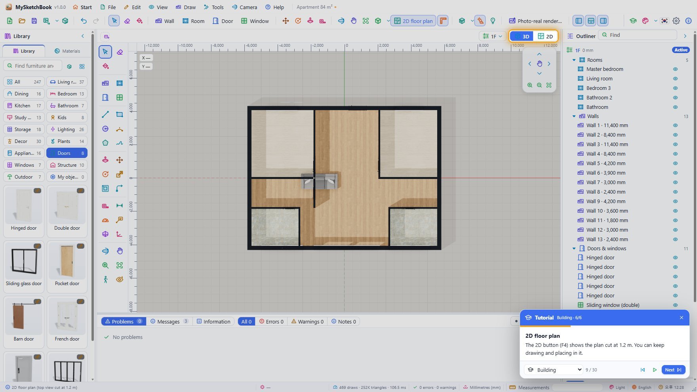

## 4. Building: walls, rooms, doors and windows

### 4.1 Walls

With the **Wall** tool (`W`) click point after point on the floor: the walls follow on from each other.

1. Click the start point.
2. Each further click makes one wall and continues from that point. While drawing you see the wall's thickness outline and its length.
3. An exact length: aim the direction with the mouse, type the length and press `Enter` (`3600`, `3.6m`).
4. Clicking the first point again closes the chain and ends it; a double-click, `Enter` or `Esc` ends it too.

- **Inference**: it snaps to the endpoints, midpoints and sides of other walls, the red (X) and green (Z) axis directions and alignment with other points, and says what it snapped to next to the cursor. With **Snap to grid** on (Settings › 3D view) it also snaps to the grid spacing.
- **Arrow keys**: `→`/`←` lock the red axis, `↑`/`↓` the green axis (press again to release). Holding `Shift` locks the current direction.
- A new wall is as thick as **Settings › 3D view › Default wall thickness** (150 mm by default) and as high as the active level's storey height.
- Walls join by themselves: ends meeting ends are mitred, an end meeting another wall's side butts against it (ends within 1 cm meet).

**Wall properties** (click the wall, **Properties** tab): Name · Length · Thickness · Height · Left face · Right face (materials) · Tag · Hidden · Locked. Changing the length moves the wall's end and the walls joined there follow it. The header buttons and the right-click menu:

- **Split wall** — splits the wall in two at its middle; doors and windows stay on their side.
- **Flip wall direction** — swaps the start and the end; the left and right face materials swap too and the openings stay where they are.

When a wall is moved (Move tool, arrow keys) the ends of the walls joined to it follow, so corners never come apart.

### 4.2 Rooms

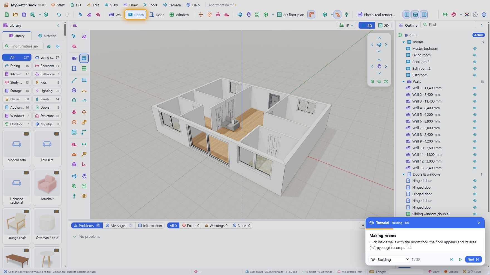

The **Room** tool (`Shift+R`):

- **Click inside walls** — hovering shows the floor it would make in green with its area; a click makes the room.
- **Elsewhere, click its corners in turn** to outline it; click the first point again, double-click or press `Enter` to close it. `Esc` cancels.

A new room is named "Room 1, Room 2 …" and gets an oak floor and a white painted ceiling (the ceiling hidden). A room with the same outline is not made twice.

**Room properties**: Name · Area (m² and pyeong) · Floor · Show ceiling · Ceiling (material) · Hidden · Locked. Moving a room moves its floor outline.

The **Stairs** tool (`Shift+S`, next to the column): pick the type (straight · L with a landing · L with winders · U with a half landing · spiral · curved) and the width (the diameter for a spiral) in the strip over the view, then click the **start** (the middle of the first step) → the **direction** it climbs → (all but straight) the **side it turns to**. The rise reaches the floor above (the level's height on the top level) in equal risers (190 mm at most). When there is a level above, its floor gets the stairwell opening (and the ceiling below too), which follows when the stairs move, change size or are deleted. The stair's properties set the width, tread run, landing depth, the gap of a U stair, the turn angle and diameter of a spiral, the handrail (glass / balusters / none, sides), closed or open risers and a guard rail round the opening above, and show the risers, riser height, going and 2R+G (comfortable at 600–650 mm). The Problems tab reports stairs that do not reach the level above or have under 2 m headroom.

### 4.3 Doors and windows

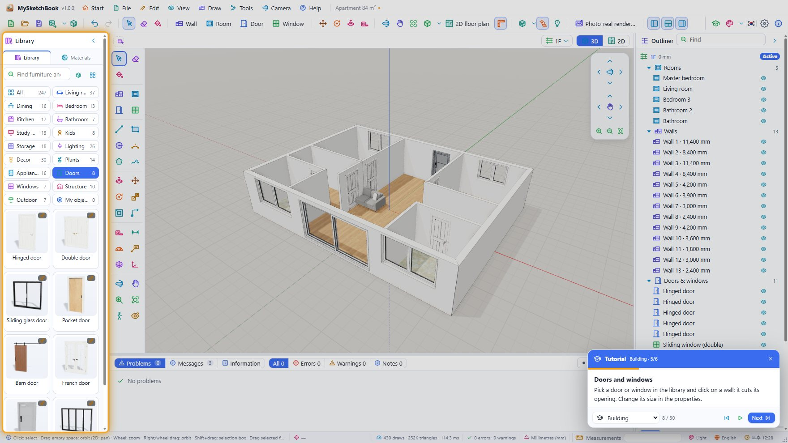

**Door** or **Window** on the toolbar or the tool palette switches the library to Doors (or Windows) and starts placing the first item; pick another card for another door or window.

- 8 doors: Hinged door · Double door · Sliding glass door · Pocket door · Barn door · French door · Entrance door (steel) · Folding door.
- 7 windows: Casement window · Double-hung window · Sliding window (double) · Fixed picture window · Awning window · Bay window · Roof window.

Click on a wall: the door or window cuts its opening in the wall and sits in it. It slides along the wall with the cursor, showing its distance from the wall's start; it does not go into a wall shorter than itself ("Doors and windows go on a wall"). The face you click is the side it opens towards. Windows sit at their usual height above the floor (mostly 0.9 m).

**Door and window properties**: Width · Height · Height above floor · From wall start (distance from the wall's start to the opening's centre) · Swap hinge side · Opens towards (Left face/Right face) · its other dimensions and options (leaves, handles, materials …, depending on the item) · **Replace with…**. Moved with the Move tool or the arrow keys it slides along its wall only.

### 4.4 Drawing in the 2D floor plan

`F4` turns on the 2D floor plan: walls, rooms, doors, windows and furniture work the same on the plan seen from above. Show wall lengths with the Dimension tool, and save the plan as a picture with **File › Export › Floor plan picture (.png)** (chapter 12).

## 5. Furnishing

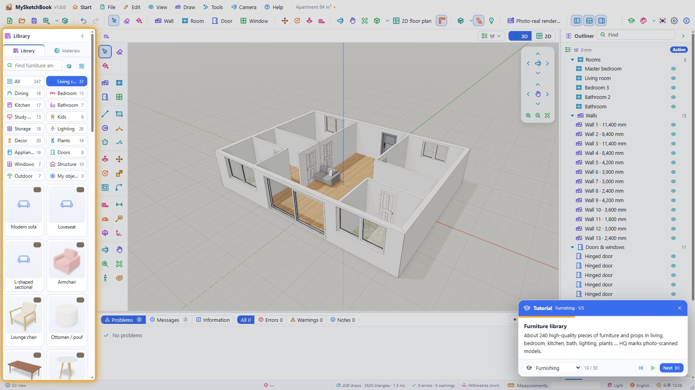

### 5.1 The library

The library has 247 items.

- **125 parametric models** — their dimensions (width, depth, height, seats …) and options (fabric, wood, leg style …) can be changed. They cover all 16 categories (Living room · Dining · Bedroom · Kitchen · Bathroom · Study & office · Kids · Storage · Lighting · Decor · Plants · Appliances · Doors · Windows · Structure · Outdoor).
- **122 high-quality models** (**HQ**) — photo-scanned models from Poly Haven (CC0). They keep their real size; change it with the scale only.
- **My objects** — 3D models you imported (chapter 11).

Hover a card for its name and default size. The search box finds English and Korean names and tags.

### 5.2 Placing

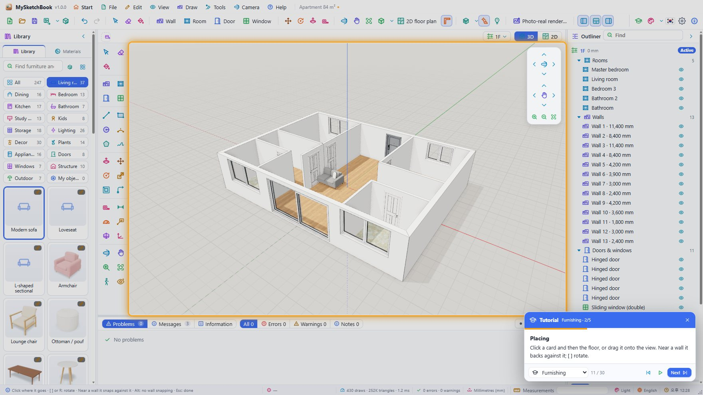

- **Click a card**, then click where it goes in the 3D view. A translucent preview follows the cursor; the place tool keeps placing the same item until `Esc` or another tool.
- **Dragging a card onto the view** places it once.
- **Near a wall** an item turns its back to the wall and touches it. `Alt` turns wall snapping off and on.
- `[` `]` (or `,` `.`, `R`) rotate it by 90° before placing, by 15° with `Shift`.
- Where an item goes depends on it: floor furniture on the floor, pictures, mirrors and sconces on wall faces (at their usual height), ceiling lamps on the ceiling, small props (vases, books …) on top of tables and shelves.
- A placed item is selected right away and shown in the Properties tab.

### 5.3 Selecting and moving

- **Select** (`Space`): click to select, `Ctrl`+click to add, `Shift`+click to toggle, click empty space to clear. Window selection: dragging **left → right** selects what is completely inside, **right → left** also what it touches. By default a left drag orbits the view, so hold `Shift` or `Ctrl` while dragging a window; with **Settings › 3D view › Left-button drag** set to **Selection box (SketchUp)** a plain drag selects.
- **Dragging selected furniture** moves it on the floor directly.
- **Arrow keys** move the selection by 10 cm, by 1 cm with `Shift`.
- For exact moves and turns use the Move and Rotate tools (7.5) or the numbers in Properties.
- **Duplicate** (`Ctrl+D`) puts a copy 30 cm away; **Paste** (`Ctrl+V`) puts it 50 cm away on the active level. Copying a wall copies its doors and windows with it.
- **Delete** (`Delete`), **Hide**, **Lock** (locked things cannot be moved or erased), **Unhide all**.

### 5.4 Furniture properties and options

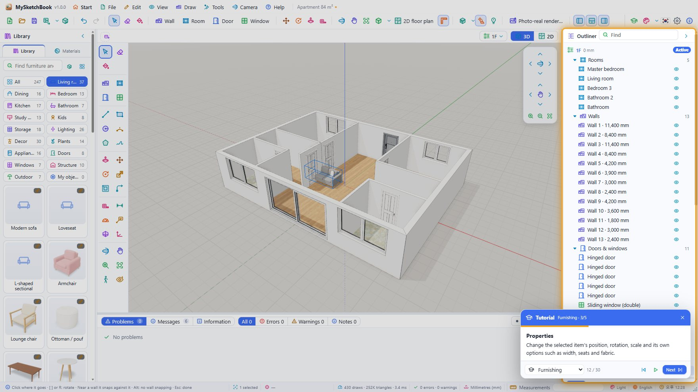

With a piece of furniture selected, the **Properties** tab has three parts.

1. **The item's header** — Name · Item · Size (actual width × height × depth) · X · Height above floor · Z · Rotation (°) · Scale (×) · Tag · Hidden · Locked. Header buttons: Rotate 90° · Mirror · Replace with….
2. **Dimensions & options** — parametric models only. For example the Modern sofa: Width · Seats · Depth · Height · Fabric · Legs · Arms · Cushions · Pillows · Pillow fabric. Lengths are typed in the project's units, counts use the −/+ buttons, materials a material list, choices a drop-down list, on/off a check box. Values are kept within the item's range.
3. **Materials** — every material the item uses (up to 12) appears by part, and each can be swapped for another. **Reset materials** puts them back.

More commands:

- **Replace with…** — a menu of other items of the same category (up to 30); the new one takes the same place and direction. A library card's right-click › **Replace the selected furniture with this** replaces with any item.
- **Mirror** — flips the item to its mirror image.
- **Drop to floor** — sets its height to 0.
- **Rotate 90°** — `Ctrl+]` (clockwise), `Ctrl+[` (counter-clockwise), about the middle of the selection.

## 6. Materials and the Paint bucket

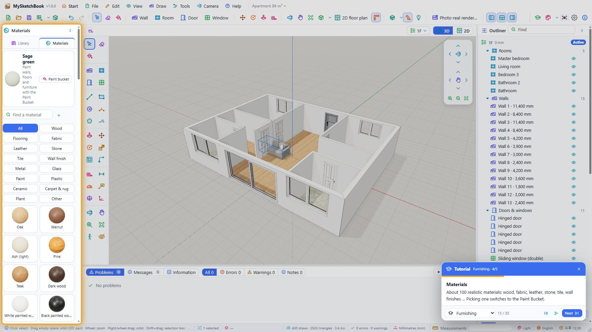

The **Materials** tab has 105 materials in 15 categories. 48 of them (wood, flooring, tiles, stone, wall finishes, fabric, leather …) use Poly Haven photo textures (colour, relief, roughness, shading) repeated at their real size; the others are colour and gloss.

- Clicking a swatch makes it the **brush** and turns on the **Paint bucket**.
- Click with the **Paint bucket** (`B`) on what to paint.
  - Walls: only the clicked **face** (left, right or top) is painted.
  - Rooms: the **floor**, or the **ceiling** (when shown).
  - Furniture, doors and windows: only the clicked **part** (the sofa's fabric only, the legs only …).
  - Modelled faces: the side you see (front or back).
- `Alt`+click is the **eyedropper**: the clicked material becomes the brush.
- **+** (New material): make your own from a Name, Colour, Roughness and Metalness and, if you like, colour / normal / roughness pictures with a tile size (11.3). It is saved in the project file with its pictures and listed under **Other**. Right-click your material's swatch › **Edit material…** to change it.
- A swatch's right-click › **Apply to the selected walls/rooms** paints both faces of the selected walls and the floors of the selected rooms at once.
- The material fields of the Properties tab (a wall's left/right face, a room's floor/ceiling, an item's materials) open a list of fitting materials.

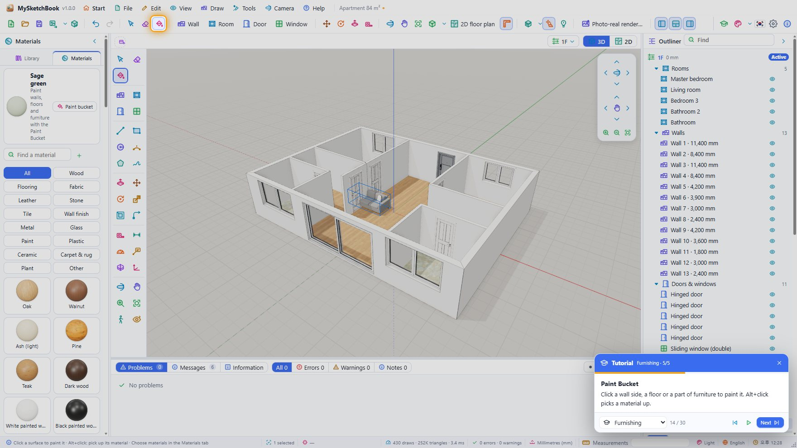

## 7. SketchUp-style modelling

### 7.1 Sticky geometry and groups

Lines and faces drawn with the drawing tools **stick together** as in SketchUp: a closed outline becomes a face, a line across a face splits it in two, and a closed shape drawn inside a face becomes an inner face and a hole. Points closer than 1/100 mm merge.

- What you draw outside a group goes into the level's one **model** (the outliner's "Models" group), where it sticks together.
- **Make group** (`G`) turns the selected model into a group. What you draw afterwards goes into a new model and does not stick to the group.
- **Double-click** a group (or **Edit group**) to edit it: everything you draw goes into the group until `Esc`.
- **Explode** puts a group's geometry back into the level's model, sticky again.
- A model's properties: Name · Component · Height above floor · Tag · Hidden · Locked · Geometry (faces and edges, and the volume in m³ when it is a closed solid).

### 7.2 Inference and axis locks

The drawing tools snap to the **endpoint · midpoint · centre · intersection · on edge · on face · red/green/blue axis · parallel · perpendicular** near the cursor, and show the name (for example "Endpoint", "On red axis") and a dotted line next to the cursor. The bottom and top edges of walls and the guide lines snap too.

- `→` locks the red axis (X), `←` the green axis (Z), `↑`/`↓` the blue axis (up); press again to release.
- Holding `Shift` locks the direction inferred now.
- A shape is drawn in the **plane of the face** under the first click (floor, wall or a model's face); on empty space, on the floor.

### 7.3 Drawing tools

| Tool | How | Measurements box |
|---|---|---|
| **Line** `L` | Click point after point. A closed loop makes a face and starts over. Double-click or `Esc` ends | Length: that long in the current direction |
| **Rectangle** `R` | Click two corners (in the plane of the first click, sides along the axes) | `1200,800` = width, depth |
| **Circle** `C` | Click the centre and the radius (24 segments by default) | Radius · `48s` = segments |
| **Arc** `A` | Click the start, the end and the bulge (12 segments) | — |
| **Polygon** `Shift+P` | Click the centre and the radius (6 sides by default) | Radius · `8s` = sides |
| **Freehand** | Hold and drag to draw; it closes when the end comes near the start | — |

### 7.4 Push/Pull, Offset and Follow Me

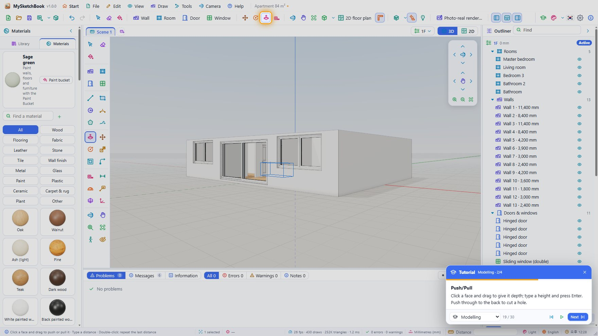

- **Push/Pull** `P` — a face under the cursor turns blue. Click the face, move, and click again (or press, drag and release). Or type a height and press `Enter`. When the cursor touches an endpoint, midpoint or edge of other geometry the height snaps to it.
  - A face of a box whose sides are all square to it stretches (no new faces); otherwise new side faces are made.
  - A rectangle drawn on a wall or a top face pushed in becomes a recess, pulled out a bump. Pushed through to the opposite face it **cuts a hole**.
  - With `Ctrl` held at the click the original face stays and a new one is pulled out.
  - **Double-click** another face to repeat the last distance.
- **Offset** `F` — click a face; moving towards its middle copies its outline inwards, away from it outwards. A typed distance is inwards when positive, outwards when negative. Circles stay circles. Too large: "The offset is too large for this face".
- **Follow Me** — click the profile face, then one edge of a path drawn in the same model (lines and arcs joined end to end, not part of a face). The profile sweeps along the path: mouldings, rails, pipes. A branching or broken path says "The path is not one connected chain".

### 7.5 Move, Rotate and Scale

These tools work on furniture, doors, windows, walls, rooms, models, dimensions and texts. With nothing selected they select what you click.

- **Move** `M` — click a base point, then the destination (or drag and release). It moves on the horizontal plane at the base point's height and snaps to wall endpoints and the axes. `→`/`←` lock the red axis, `↑`/`↓` the green axis. Typing a distance moves by exactly that much; typed right after a move it corrects that move.
  - Holding `Ctrl` at the first click moves a **copy**. Right after copying, `x5` makes more copies until there are 5 at the same spacing, `/5` spreads them evenly between the start and the end (array copy).
  - `Esc` cancels the move.
- **Rotate** `Q` — click the centre, the start direction and the end direction. It snaps every 15° like a protractor's ticks. Or type an angle and press `Enter`; typed while no rotation is in progress, the selection turns by that angle about its own middle. Rotation is about the vertical axis (seen from above).
- **Scale** `S` — for furniture and models. Click and drag: it grows or shrinks evenly from the middle of its base, snapping to steps of 0.1. Or type a factor and press `Enter` (for example `1.5`). `Esc` cancels.

### 7.6 Solid tools and other edits

**Tools › Solid tools** (with models selected):

| Command | Needs | Result |
|---|---|---|
| **Union** | 2 or more models | one solid |
| **Subtract** | exactly 2 models | the model selected second taken away from the first |
| **Intersect** | exactly 2 models | only the overlap remains |
| **Intersect faces** | models | inside each selected model, edges where faces pass through each other; the faces split there |
| **Soften edges** | models | edges whose faces meet at less than 20° become soft (hidden lines, smooth shading) |

Solid tools work only on closed models without holes; otherwise "Not a closed solid". The result goes into the first model and the other models are removed.

**Eraser** `E` — click or drag over what to erase. Furniture, walls, rooms and the like go whole; in models only the **edge** under the cursor (a whole circle or arc) or the **face** goes. Erasing the line that split two faces of one plane joins them again. Locked things are not erased.

## 8. Measuring and annotating

| Tool | How |
|---|---|
| **Tape measure** `T` | Click two points: the distance appears as a notice and a **guide line** (dotted) stays. Other tools snap to guide lines |
| **Dimension** `D` | Click the start, the end and where the dimension line goes. The length is shown in the project's units and follows a change of units |
| **Protractor** | Click the vertex, the first direction and the second: the angle appears as a notice and a 3 m guide line stays along the second direction |
| **Text label** | Click where the label goes and type it. A room proposes its name and area, a wall its length, furniture its name |
| **Section plane** | Click the face to cut along: what is in front of it is cut away (a new section turns the earlier one off) |

- **Delete all guides** — in the **Edit** or **Tools › Measure & annotate** menu.
- **Sections on/off**, **Delete all sections** — in the **Tools › Section** menu.
- Dimensions, texts and guides can be selected, moved and deleted too; edit a text in the Properties tab.

## 9. Styles, shadows, environment, lights and display quality

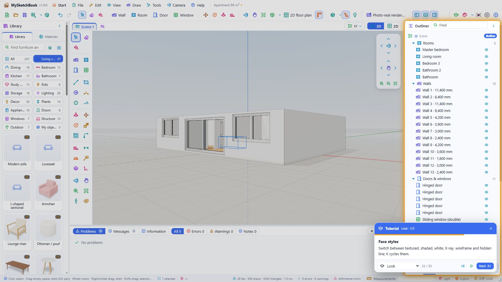

### 9.1 The Styles tab

- **Face style** — Textured (materials and textures) · Shaded (colours, no textures) · White model · X-ray (see-through) · Wireframe · Hidden line. The toolbar's face style button or `K` cycles them; its ▾ chooses one.
- **Edges** — outlines of the objects.
- **Lights on (lamps glow)** — ceiling lights, lamps and other light fittings become real light sources (the toolbar's bulb button).
- **Background** — Sky and ground · White · Dark · Environment photo (HDRI).
- **Environment light** — the Built-in room light, or one of 8 HDRIs (Bright living room (overcast day) · Hotel room · Sea-view suite · Photo studio · Daylight sky · Overcast sky · Sunset · Night). Reflections and ambient light come from the photo; with the background set to "Environment photo (HDRI)" the photo is the background. Photo-real rendering is lit by the same HDRI. **Import my environment…** adds your own HDRI (.hdr, .exr) or panorama picture (11.4).
- **Exposure** — 0.3 to 2.5, shown while you drag.
- **Display quality** group — Display quality · Ambient occlusion · Anti-aliasing · Shadow resolution (9.4).

Styles are saved with each scene (10.1).

### 9.2 The Shadows tab

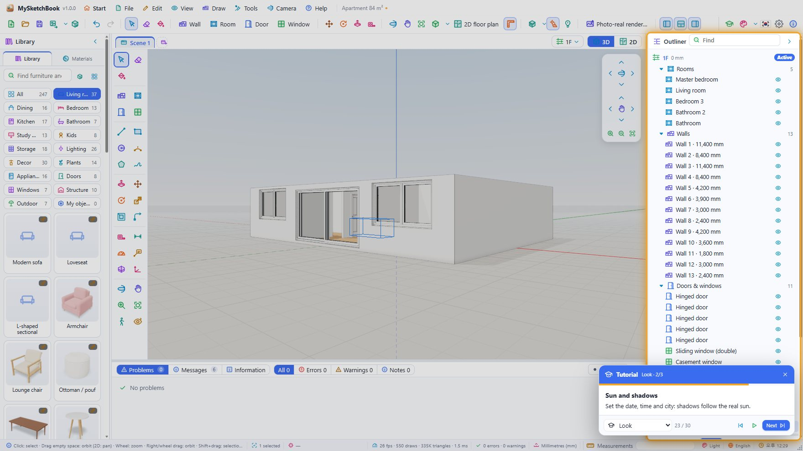

- **Show shadows** — the same as the toolbar's Shadows button.
- **Time** (05:00 to 21:00) and **Date** sliders — the sun and the shadows follow as you drag.
- **Latitude · Longitude** — where the home is. The **City** list (Seoul · Busan · Jeju · Tokyo · New York · London · Paris · Sydney · Singapore) fills in the latitude, longitude and time zone.
- **North angle** — the angle between plan up (−Z) and true north.

### 9.3 View › Show

Turns the rulers, grid, axes (red X, green Z, blue up), edges, shadows, lights, performance display, each panel and the status bar on and off.

### 9.4 Display quality and speed

Choose in **View › Display quality** or the Styles tab.

| Quality | Ambient occlusion | Shadow map | Anti-aliasing |
|---|---|---|---|
| Fast | none | 1024 | none |
| Balanced (default) | yes | 2048 | 4× |
| High | yes | 4096 | 8× |

The view is redrawn **only when something changed**. While the camera moves frames skip ambient occlusion; when it stops, one full-quality frame follows. If frames get slow while moving, the resolution drops a step and comes back when you stop. The other options are in **Settings › 3D view** (chapter 16).

## 10. Scenes, levels and tags

### 10.1 Scenes

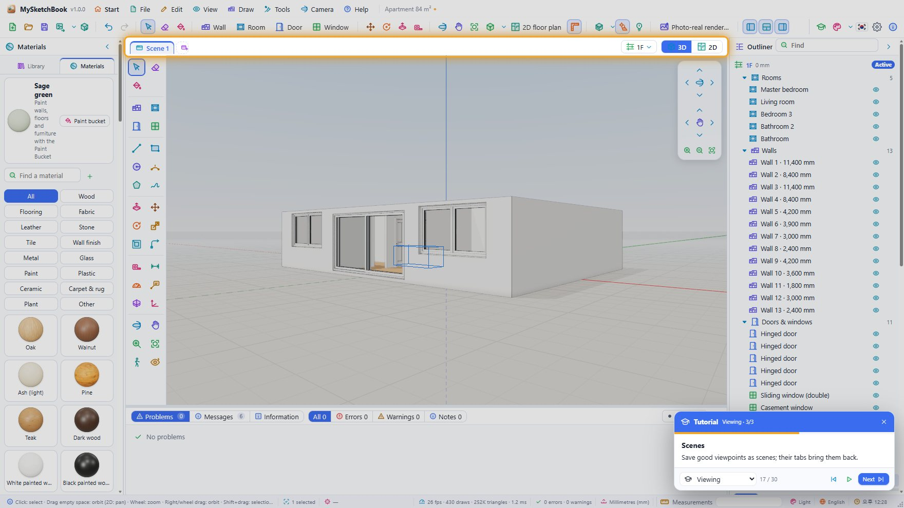

A scene is a saved **viewpoint**: the camera, the style (face style, background …), which tags are visible and whether it is 2D or 3D.

- **+** in the scene tab strip above the 3D view (or **Camera › Add scene**) adds the current view as a scene.
- Click a tab to glide to that scene. `PageUp` / `PageDown` go to the previous and next scene.
- **Scenes** tab: Show this scene · rename · **Update to the current view** · Delete scene.

### 10.2 Levels

- **Add level** (the **Draw** menu, the level chip's menu, + in the Levels tab) adds a level of the same height above the top one ("2F", "3F" …, 25 cm floor slab between) and makes it the active level.
- The **level chip** at the top right of the 3D view chooses the active level. Walls, rooms, furniture and shapes are drawn and placed **on the active level only**, and the 2D plan cuts the active level.
- **Levels** tab: Work on this level · name · Floor height · Storey height · show/hide · Delete level (when there are two or more; its walls, rooms, furniture and models go with it).
- Walls follow the storey height unless given a height of their own.

### 10.3 Tags

Tags work like SketchUp's tags (formerly layers): they show or hide groups of things together.

- **+** in the **Tags** tab adds one; rename it in place. The eye icon shows and hides it; the number at the right counts its things.
- Set a wall's, item's or model's tag in Properties › **Tag**.
- Deleting a tag puts its things back to "Untagged".

## 11. Importing your own 3D models

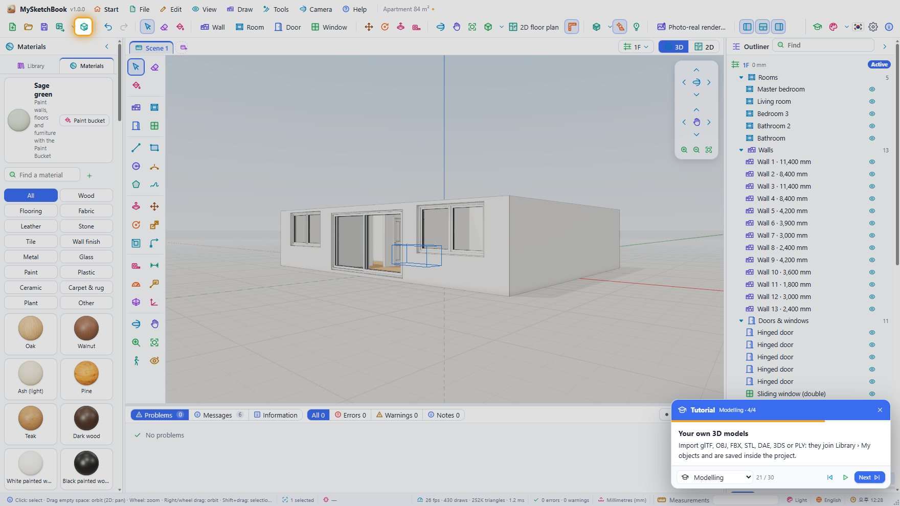

**File › Import 3D model…** (`Ctrl+I`), the import button of the Library, or drop the files on the window.

| Format | Extensions | Notes |
|---|---|---|
| glTF / GLB | `.glb` `.gltf` | Recommended. Pick a `.gltf` with its `.bin` and textures |
| Wavefront OBJ | `.obj` | Pick the `.mtl` and texture pictures with it for materials |
| Autodesk FBX | `.fbx` | |
| Collada | `.dae` | SketchUp's export format |
| STL | `.stl` | 3D printing |
| 3D Studio | `.3ds` | |
| PLY | `.ply` | scans |
| 3MF | `.3mf` | 3D printing |
| USDZ | `.usdz` | |

- In the import window choose the **File units** (Auto · mm · cm · m · in · ft) and the **Up axis** (Auto · Y up · Z up). Auto units pick what makes sense for an interior object from the model's size ("Units guessed as …"); a model larger than 200 m asks you to check the units.
- **Merge small parts (faster)** — models with very many parts are merged per material so they draw fast.
- A progress window shows while importing and can cancel. When done the triangle count is shown, the Library switches to **My objects** and you can place the model at once.
- Imported models are converted to GLB and **stored inside the project file (.msk)**: they come along to another PC. Once placed they move, turn, scale and paint like any other furniture.
- **SketchUp (.skp)** files cannot be read directly (a proprietary format). In SketchUp use **File › Export › 3D Model** to save Collada (.dae) or glTF (.glb) and import that.

### 11.1 Importing floor plans (DXF · SVG · PDF · IFC · Sweet Home 3D · pictures)

**File › Import floor plan…**, **Import floor plan** on the start page, or drop the file on the window. Sample plans are in `samples/plans/` (59 m² and 84 m² apartments, a small office, a two-room house, a PDF drawing, a two-storey house as IFC and Sweet Home 3D files, TIFF and TGA pictures; `node scripts/make-plan-samples.mjs` makes them again). The start page's **2D plan samples** card holds 13 plan pictures drawn in different ways (listing plan · phone photo · colour brochure · CAD print · blueprint · pencil sketch · freehand sketch · fax · dark screen capture · scan; JPG · PNG · WebP · GIF · BMP · TGA · AVIF · TIFF), 8 **plans with interiors** showing furniture and floor finishes (colour plan · furniture line drawing · sales catalogue · watercolour sketch · photo of a print — the furniture is the library models seen from above) and 6 CAD / PDF drawings: click one and it opens through the import, the 2D workbench and the conversion to 3D (pictures come with their real width; **Settings › Start page** hides the card). The pictures are in `samples/plan-images/`; `npm run samples:plans2d` makes them again.

- **DXF / SVG** — walls are found as two lines a wall thickness apart, doors as an arc (radius = door width) with a leaf line, windows as lines across an opening; walls, doors and windows are made, and a room wherever walls close around a space (named after the text inside it). Blocks (INSERT), polylines and arcs are read; the units come from the file's `$INSUNITS` (else a guess from the size) or your choice.
- The import window: **Drawing units**, **Walls drawn as** (Auto · Double lines · Single lines, with the single-line wall thickness), **Wall height**, **Put it** (Replace current level · Add as new level · New project), **Keep other lines as guides**, **Layers to use** (dimension, furniture and hatch layers start off).
- **PDF drawings** — pages drawn with lines (most drawings exported from CAD) are read like a DXF: lines, arcs, texts (Korean too) and PDF layers. With several pages you choose one (each shows its number of lines, or that it is scanned). A PDF has no units, so you set the **Scale 1 :** — read from a "SCALE 1:100", "1/50" or "1:200" text on the drawing, and adjusted when the drawing says "1:100 (A1)" but was printed on a smaller paper (A3). Without a scale it is guessed from the door sizes and **Set the scale with two points after the import** is on (click two points and type the real length: the walls, doors, windows and rooms of that level are scaled to fit). Scanned pages (one picture) are drawn as a picture and come in as an underlay.
- **IFC (BIM: Revit · ArchiCAD · Vectorworks · FreeCAD …)** — the whole building: levels (IfcBuildingStorey, with their heights), walls (thickness and height, joined at their centre lines), doors and windows (in their wall, with width, height and sill; single, double, sliding …), rooms (name and shape of each IfcSpace), stairs and furniture. The units (mm, m, ft) come from the file. Walls that are not straight (curved or bent) are left out and reported; slabs (IfcSlab) are shown by the room floors.
- **Sweet Home 3D (.sh3d)** — levels, walls (curved ones too), doors and windows (in the nearest wall), rooms (name; floor and ceiling colours become new materials), furniture groups and stairs. Files saved by Sweet Home 3D before 5.3 (without Home.xml) cannot be read: open them in Sweet Home 3D and save them again.
- **The building import window** (IFC, Sweet Home 3D) shows the numbers of levels, walls, doors, windows, rooms and furniture (matching a library item / with a model of their own) and asks **Put it** (New project · Add levels to this project), **Furniture** (Library + own models · Library only · None) and **Import rooms**. Furniture becomes the library item of the same name (English, Korean, French, German … and catalogue names) and size, fitted to its size; a piece without one brings its own model from the file (Sweet Home 3D's OBJ …, the IFC shape) into **My objects**. One undo takes it all back.
- **Pictures (PNG · JPG · WebP · BMP · GIF · TIFF · TGA · AVIF · HEIC)** — a TIFF with several pages (scans, faxes) asks for the page; black-and-white, grey and colour TIFFs with the usual compressions are read. HEIC (iPhone photos) comes in where the system can read it (macOS); elsewhere you are asked to save it as JPG or PNG. Pictures lie half-transparent on the floor of the current level (2D and 3D). With **Set the scale with two points** click two points a known distance apart and type the real length (Esc cancels). Then trace with the Wall tool or use **Find walls automatically** (reads the outlines of black lines and filled walls into walls, door gaps and window gaps, then asks whether to keep them).
- With nothing selected, **Entity Info › Plan picture** shows or hides it and sets the opacity, position X/Z, rotation and width (= scale), and has Scale, Find walls and Remove. The picture is saved inside the .msk file.

#### The 2D plan workbench — clean up before 3D

DXF · DWG · SVG · PDF drawings and pictures do not become 3D straight away: they open in the **2D plan workbench** first (**Clean up in 2D before making 3D** in the import window, on by default). The walls, doors, windows and rooms found are shown over the original (the CAD lines or the picture), so what was misread can be fixed before **Convert to 3D**. A floor of the project can be opened there again with **File › Clean up the floor in 2D…** (walls keep their heights and materials, rooms their floor and ceiling finishes).

- **Tools** (toolbar): **Select** (V) — click walls, doors, windows and room names or drag over empty space, then drag them. Dragging a corner of a selected wall moves the walls joined there with it. **Wall** (W) — click to draw one wall after another, double-click or Enter ends (snaps to ends, middles and walls and runs square from the last point; Shift = no snapping). **Door** (D) · **Window** (N) · **Opening** (P) — click on a wall. **Room name** (T) — names the 3D room. **Scale** (M) — click two points of a known distance and type the real length: the plan and the original picture are scaled together. **Pan** (H) — or drag with the middle or right button, or Space + drag. Wheel zooms, F fits, Delete deletes, Ctrl+Z / Ctrl+Y undo / redo.
- **Clean up** (right): **Clean up all** runs these in turn. **Straighten** — turns a tilted plan (a scan or photo) together with its picture so the walls run horizontal and vertical. **Square up** — makes walls within *Square within* of horizontal / vertical exact (corners stay joined). **Join loose ends** — joins wall ends closer than *Join within* into corners and runs ends that stop short on to the wall (T joints). **Merge straight** — merges pieces that continue in one line into one wall. **Remove crumbs** — removes wall pieces shorter than 120 mm. **All walls** sets every wall's thickness at once.
- **Recognise again** — finds the walls, doors and windows in the original again (CAD: auto · two lines · centre line; pictures: auto · walls only (no furniture) · clean picture · scan / photo). For pictures, **auto** reads both the picture with only its walls left (no furniture, floor colours, hatching or text) and the picture as it is, and keeps the result that leaves least to clean up; dark grounds (blueprints, dark mode) are read inverted. Undo brings back your edits.
- **Furniture (pictures)** — in a plan picture that shows furniture, the furniture is found with the walls and turned into library items: beds (single · super single · queen · king by their size), sofas (straight · L-shaped), wardrobes and built-in closets, dressers · bookshelves · TV consoles, nightstands, desks, dining and coffee tables, armchairs, kitchen counters and fridges, toilets · vanities · showers · baths · washing machines, plants and rugs. Their size follows the picture and wall pieces turn their back to the nearest wall. They show as see-through boxes with their names (a tick marks the front); click one to change its **item** (its own category first) and **width / depth**, turn it with **R** / **Shift+R** (or **Turn right / left 90°**), drag it, or press Delete. **Remove all furniture** converts only the walls, doors and windows. A floor cleaned up again in 2D brings its furniture along, with its materials and settings kept.
- A selected wall shows its **length and thickness**; a door or window its **kind** (swing · double · sliding door · window · opening), **width, height and sill**, and doors their **swing side** and **hinge**. Double-click a room name to change it.
- **To check** lists wall ends that are not joined (red circles), very short walls, overlapping walls and openings wider than their wall or on top of each other; click one to go there and select it. Rooms are previewed wherever walls close them, with their area.
- At the bottom choose the **wall height**, **where it goes** (replace this level · add as a new level · new project; for pictures add to this level · replace this level) and **Keep reference lines**, then **Convert to 3D**. One Undo takes it back. A picture stays on the floor as the underlay, with the scale and straightening set in the workbench. **Cancel** changes nothing.

### 11.2 Importing anything (File › Import…)

**File › Import…** (the Import button of the toolbar) picks every importable file in one dialog. Its file types are grouped — **All supported files · MySketchBook projects · 3D models · Floor plans & buildings · Textures (materials) · Environments (sky, HDRI)** — and each chosen file goes where it belongs. **Dropping** files on the window sorts them the same way. The separate commands (Import 3D model · Import floor plan · Import texture · Import environment) still work.

| Kind | Extensions | Goes to |
|---|---|---|
| Project | `.msk` | Opens (12.1) |
| 3D model | `.glb` `.gltf` `.obj` `.fbx` `.dae` `.stl` `.3ds` `.ply` `.3mf` `.usdz` `.usda` `.usdc` `.usd` `.wrl` `.vrml` `.step` `.stp` `.iges` `.igs` `.brep` `.brp` `.3dm` `.amf` `.kmz` `.lwo` `.vtk` `.vtp` `.off` `.pcd` `.xyz` `.zip` (+ `.mtl` `.bin` textures) | My objects (chapter 11) |
| Floor plan | `.dxf` `.dwg` `.svg` `.pdf` | Walls, doors, windows, rooms (11.1) |
| Building | `.ifc` `.sh3d` | Levels, walls, doors, windows, rooms, furniture (11.1) |
| Plan picture | `.png` `.jpg` `.jpeg` `.webp` `.bmp` `.gif` `.tif` `.tiff` `.tga` `.avif` `.heic` `.heif` | Underlay on the floor (11.1) |
| Texture | `.png` `.jpg` `.jpeg` `.webp` `.avif` `.gif` `.bmp` `.tga` `.tif` `.tiff` `.dds` `.ktx2` `.exr` `.hdr` | A new material (11.3) |
| Environment | `.hdr` `.exr` (HDR panoramas), `.jpg` `.png` `.webp` `.avif` (equirectangular panoramas) | Sky and lighting (11.4) |

<!-- When 3D model, plan or building formats are added, list them in the matching row above (as io/formats.js and ui/plan-import.js list them). -->

- A 3D model chosen or dropped together with its `.mtl`, `.bin` and texture pictures imports as one model.
- A picture that can be several things (PNG, JPEG …) asks whether it is a **Floor plan**, a **Material texture** or the **Sky (environment)**. `.hdr` and `.exr` files become environments (use Import texture to make one a texture).
- Files nothing can read are skipped; when there are only such files, the notice lists the formats that can be imported.
- Sample pictures are in `samples/textures/` (a brick set in TGA, PNG and TIFF, DDS tiles, KTX2 terrazzo, EXR marble, WebP oak) and `samples/environments/` (HDR sunset sky, EXR overcast sky, JPEG meadow panorama); `node scripts/make-texture-samples.mjs` makes them again.

### 11.3 Materials from textures

**File › Import texture (material)…**, the Import dialog, dropping, or the **+** (New material) window of the **Materials** tab.

- The material window: Name · Colour (with a texture it is a **Tint** multiplied with the picture; white = the picture as it is) · Roughness · Metalness, and for each of **Colour texture · Normal map · Roughness map** a **Choose…** and **Remove** button, plus **Tile width · Tile height** (the real length one copy of the picture covers, in metres). Choosing a colour texture sets the tile height from the picture's aspect ratio.
- Formats read: PNG · JPEG · WebP · AVIF · GIF · BMP · TGA · TIFF · DDS (DXT/BC compressed) · KTX2 (Basis Universal; the transcoder is built in, no internet needed) · OpenEXR · Radiance HDR.
- Choosing a texture set at once (e.g. `brick_diff.tga` + `brick_nor_gl.png` + `brick_rough.tif`) recognises the normal and roughness maps by suffixes such as `_nor`, `_normal`, `_rough` and makes one material. DirectX-style normal maps (`_nor_dx`) get their green channel flipped.
- With a roughness map the map sets the roughness (the Roughness slider is off).
- The pictures are **saved inside the project file (.msk)**, so the project opens the same on another computer. The material is listed under **Other**; right-click its swatch › **Edit material…** to change its pictures, colour or tile size.

### 11.4 Importing your own environment (sky, HDRI)

**File › Import environment (sky, HDRI)…**, the Import dialog, dropping, or **Import my environment…** in the **Styles** tab of the right panel.

- Use an HDR panorama (`.hdr`, `.exr`) or a 2:1 equirectangular panorama picture (`.jpg`, `.png`, `.webp`, `.avif`).
- After the import it is the **Environment lighting** and the **Background** switches to "Environment photo (HDRI)", so it shows as the sky. Reflections, ambient light and **photo-real rendering** (chapter 13) use the same light.
- The file is **saved inside the project file** and listed as "(my environment)" among the environments. Each project can have its own sky, and it travels with the project.

## 12. Saving, opening and exporting

### 12.1 Project files (.msk)

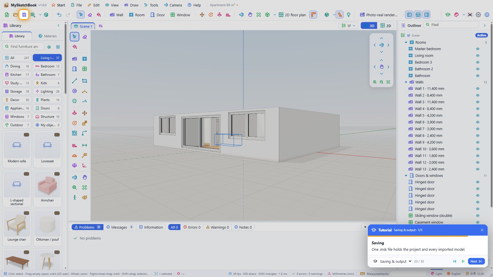

- **Save** (`Ctrl+S`), **Save as…** (`Ctrl+Shift+S`). A `.msk` is one ZIP file holding the project (project.json), a small preview picture and every imported model.
- **Open…** (`Ctrl+O`) takes `.msk` files and 3D models (a 3D model is imported). Dropping a `.msk` on the window opens it too.
- **Recent files…** (`Ctrl+R`), **Recent folders** (the Open dialog in that folder), **Clear all recent files and folders**. Choosing a file that is gone asks whether to remove it from the list.
- One project is open at a time. With unsaved changes, New, Open, Close and Exit first ask **Save / Don't save / Cancel**. The ● next to the project name in the menu bar marks unsaved changes.
- **Close project** (`Ctrl+W`) goes back to the start page.
- On the desktop, **Settings › General › Reopen last files when starting** opens the last file at the next start.
- Web version: saving uses the browser's save dialog (or a download where there is none), and recent files reopen through the file handles the browser remembers (it may ask for permission again).

### 12.2 Save as picture

**File › Export › Save as picture…** (`Ctrl+Shift+E`, the toolbar's picture button):

- **Size**: HD · Full HD · QHD · 4K · Square · A4 300 dpi, or a width of 320 to 7680 and a height of 240 to 4320 px.
- **Format**: PNG · JPEG · WebP. PNG can have a **Transparent background**.
- The current viewpoint is drawn at full quality (shadows, ambient occlusion), whatever the window size.

### 12.3 Floor plan picture

**File › Export › Floor plan picture (.png)** switches to the 2D plan in the Hidden line style, fits everything in, saves a 3000 × 2000 PNG and goes back to the earlier view.

### 12.4 Exporting 3D files

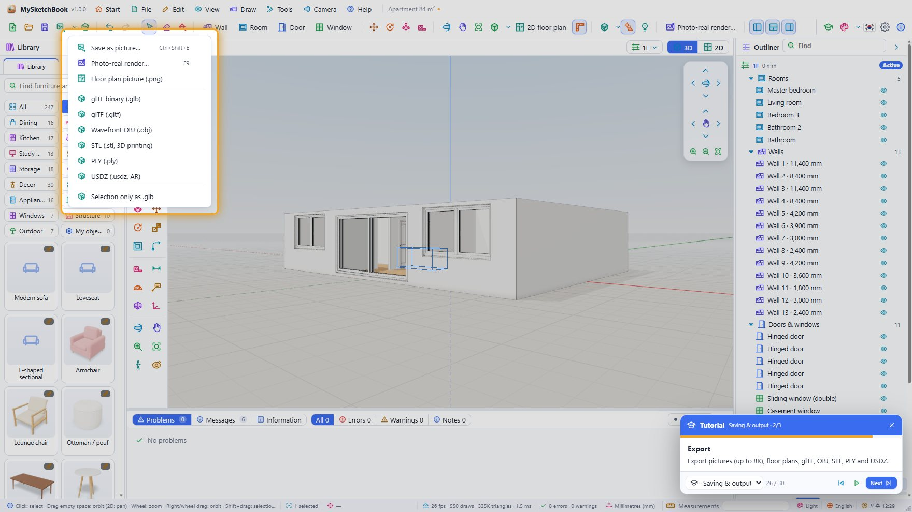

**File › Export** saves the whole model — walls, floors, doors, windows, furniture and models — in metres with Y up as glTF binary (.glb) · glTF (.gltf) · Wavefront OBJ (.obj) · STL (.stl, 3D printing) · PLY (.ply) · USDZ (.usdz, AR). Helpers such as the grid, axes, guides and edge lines are left out. **Selection only as .glb** exports just the selection.

- glTF/GLB carries the materials and textures and opens best in other 3D programs, game engines, SketchUp (with an extension) and Blender.
- OBJ holds the geometry and material names; no `.mtl` file is written.
- USDZ opens in AR Quick Look on iPhone and iPad.

## 13. Photo-real rendering

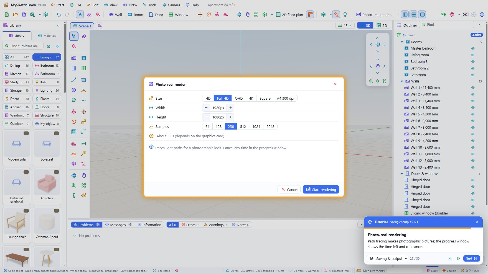

**Photo-real render…** (`F9`, toolbar) traces light paths (path tracing) for a photographic picture.

1. In the render window choose the **Size** (the same presets as Save as picture, width and height) and the **Samples** (64 · 128 · 256 · 512 · 1024 · 2048). An estimated time is shown (it depends on the graphics card).
2. **Start rendering** opens a progress window with "samples done / total · about … s left". **Cancel** stops it at any time; the program stays responsive while rendering.
3. When it is done the result window shows the picture; **Save as PNG…** saves it.

- It uses the current camera and exposure. The light is the **Environment light (HDRI)** chosen in the Styles tab; with the Built-in room light a sky made from the current sky colours lights it. With an HDRI background the photo shows behind.
- More samples mean less noise and more time. Check the framing at 64–128 first, then finish at 512 or more.

## 14. Tutorial and help windows

- **Tutorial** (`F11`, toolbar, start page): 8 chapters, 30 steps that show the features by driving the real program. The card at the bottom right has Previous, Next, Auto play, a chapter list and End (`Esc`). The tutorial works in a sample project of its own and puts your project and settings back when it ends. The [tutorial document](Tutorial.en.html) has every step.
- **User's guide · Tutorial document** — open in a window of their own (a new tab on the web). The bar at the top: go to chapter, 한국어/English, find in the document (`Ctrl+F`, `Enter` next · `Shift+Enter` previous), print, open in the browser. The document follows the program's theme colours.
- **Tutorial video** — a recording of the tutorial's auto play (when made with `npm run tutorial:video`). Chapter marks, playback speed, full screen (`F`), `Space` play/pause, `←`/`→` 5 s.
- **Keyboard shortcuts…** — the Shortcuts tab of Settings.
- **About…** (`F1`) — version, build date, commit, runtime and author.

## 15. Problem checks

A short while after every change (0.4 s) the model is checked; the **Problems** tab of the bottom panel lists the results and the status bar counts them. **Tools › Check now** checks at once.

| Severity | Problem | Meaning and fix |
|---|---|---|
| Error | The opening (…) is wider than its wall (…) | The door or window is wider than the wall is long. Make it narrower or the wall longer |
| Error | The opening goes past the end of its wall | Its position (From wall start) puts it outside the wall. Move it back onto the wall |
| Error | The opening is taller than its wall | Height above floor + height is more than the wall's height |
| Error | The opening overlaps '…' | Two openings of the same wall overlap. Move one |
| Error | Not in the library (…) | The file refers to an item this library does not have (the library was not downloaded, or another version). `npm run assets`, or Replace with… |
| Warning | The wall is very short (under 10 cm) | Probably a stray click. Delete or lengthen it |
| Warning | Not inside any room | The item's centre is not on any room floor of its level (checked only on levels that have rooms) |
| Warning | Overlaps '…' by …% | Two floor items overlap by more than 35%. Rugs, carpets and cushions are not checked |
| Note | Floats … above the floor | A floor item is 3 cm to 60 cm above the floor. **Drop to floor** fixes it |
| Note | Walls but no rooms | A level with walls only. Make floors with the Room tool |

Hidden items are not checked. Click a problem to select and show its item; its right-click menu has **Select and show · Copy · Delete the item**.

## 16. Settings

**Tools › Settings…** or `Ctrl+,`. Changes apply at once and are kept. **Defaults** at the bottom resets every setting.

| Tab | Options |
|---|---|
| **General** | Language (한국어/English) · Reopen last files when starting (desktop) · Ask before deleting elements from the model · Clock on the status bar · Status bar · Last folder used · Start the tutorial |
| **Start page** | Show the start page at start-up · Show the welcome window at start · Show recent files · Recent files shown (1–10) · Show recent folders · Show sample projects · Show the moving background picker · Show the tutorial banner · Start page: Open now |
| **Theme** | Dark 20 · Light 20 · Custom, and System setting (follows the operating system's light/dark). Custom: Use the custom theme · Dark theme · Copy the current theme's colors · 12 colours (Background · Surface · Panel · Text · Dim text · Border · Accent · Text on accent · Striped rows · Chart background · Toolbar · Status bar), with a warning when text would be hard to read |
| **Font** | Font (the fonts installed on the system) · Size (9–28 px) · Weight · Style (Normal/Italic) · Row height · Zoom (50–200%) |
| **Background** | Background (Moving · Image · None) · 20 moving backgrounds · Motion speed · Random background at start · Start page background changes (Off · 15 s · 30 s · 1 min · 2 min · 5 min) · Moving background on the start page only · Background image Choose/Remove · Background opacity · Fit (Fill · Fit · Tile · Center · Stretch) |
| **3D view** | Table below |
| **Recent** | Recent files and folders (missing ones marked), remove one or all |
| **Shortcuts** | The shortcut list (chapter 17) |

The **3D view** tab:

| Group | Option | Default |
|---|---|---|
| Modelling | Units (mm · cm · m · in · ft) — the units of new projects | mm |
| | Default wall height (1.8 to 6 m) | 2.4 m |
| | Default wall thickness (0.05 to 0.6 m) — the thickness of new walls | 0.15 m |
| | Inference (snapping) | on |
| | Snap to grid · Grid spacing (0.05 to 2 m) | off · 0.5 m |
| Display quality and speed | Display quality (Fast · Balanced · High) | Balanced |
| | Anti-aliasing · Ambient occlusion · Show shadows | on |
| | Shadow resolution (Low · Medium · High) | Medium |
| | Frame limit (30 · 60 · 120 · None) | 60 |
| | Resolution (Auto · 75% · 100% · 150% · 200%) | Auto |
| | Performance (FPS, triangles) | on |
| Camera | Left-button drag — Orbit (empty space) · Selection box (SketchUp): whether a drag with the Select tool turns the view (`Alt`: pan, 2D: pan) or draws a selection window | Orbit (empty space) |
| | Field of view (20 to 100°) | 50° |
| | Orbit speed · Zoom speed (20 to 300%) | 100% |
| | Reverse the wheel · Grid · Axes | off · on · on |

> In this version **Default wall height**, **Inference (snapping)**, **Ask before deleting elements from the model** (General) and **Moving background on the start page only** (Background) are stored but not used yet: new walls follow the storey height, inference is always on, and deleting does not ask (Undo brings things back).

A project's own units are changed in the **Properties** tab with nothing selected. Changing them switches dimensions, properties and the Measurements box to those units.

The theme also changes with the toolbar's theme button (random) and its ▾ (dark and light themes in two columns, Edit custom theme…); the language with the flag button or `Ctrl+Shift+L`.

## 17. Keyboard shortcuts

The same list as **Help › Keyboard shortcuts…** (Settings › Shortcuts). Single-key shortcuts are SketchUp's. They do not work while the cursor is in a text box.

### Tools

| Key | Action |
|---|---|
| `Space` | Select |
| `E` | Eraser |
| `B` | Paint bucket |
| `W` | Wall |
| `Shift+R` | Room |
| `Shift+C` | Column |
| `Shift+S` | Stairs |
| `L` | Line |
| `R` | Rectangle |
| `C` | Circle |
| `A` | Arc |
| `Shift+P` | Polygon |
| `P` | Push/Pull |
| `M` | Move |
| `Q` | Rotate |
| `S` | Scale |
| `F` | Offset |
| `T` | Tape measure |
| `D` | Dimension |
| `O` | Orbit |
| `H` | Pan |
| `Z` | Zoom |
| `Shift+Z` | Zoom extents |
| `K` | Cycle face style |
| `G` | Make group |
| `F4` | 2D floor plan |
| `F9` | Photo-real render |

### Mouse and typing

| Key | Action |
|---|---|
| `Middle-button drag` | Orbit (a right-button drag too) |
| `Shift + middle-button drag` | Pan |
| `Mouse wheel` | Zoom (towards the cursor) |
| `Type a number` | Length / angle into the Measurements box (`Enter` applies) |
| `Arrow keys` | Lock to an axis (while drawing) · move the selection 10 cm (Select tool, `Shift`: 1 cm) |
| `Hold Shift` | Lock the inference |
| `Ctrl while moving` | Move a copy |
| `x5 / /5` | Array (right after copying) |
| `[ / ]` | Rotate while placing (90°, `Shift`: 15°) |
| `Alt + click (Paint bucket)` | Pick up a material |
| `W A S D (Walk tool)` | Walk (`Shift` faster, `Q`/`E` down/up) |
| `Esc` | End tool / deselect (ends group editing) |

### Files and editing

| Key | Action |
|---|---|
| `Ctrl+N` | New project |
| `Ctrl+O` | Open |
| `Ctrl+S` | Save |
| `Ctrl+Shift+S` | Save as |
| `Ctrl+R` | Recent files |
| `Ctrl+W` | Close project |
| `Ctrl+I` | Import 3D model |
| `Ctrl+Shift+E` | Save as picture |
| `Ctrl+Z` | Undo |
| `Ctrl+Y` | Redo (`Ctrl+Shift+Z` too) |
| `Ctrl+X / C / V` | Cut · Copy · Paste |
| `Ctrl+D` | Duplicate |
| `Delete` | Delete (`Backspace` too) |
| `Ctrl+A` | Select all |
| `Ctrl+] / [` | Rotate 90° clockwise / counter-clockwise |

### View and window

| Key | Action |
|---|---|
| `PageUp / PageDown` | Previous scene / Next scene |
| `Ctrl+Shift+1 / 2` | Library panel / Outliner & properties |
| `Ctrl+J` | Bottom panel |
| `Ctrl+Shift+R` | Rulers |
| `Ctrl+Shift+L` | Switch language |
| `Ctrl+Shift+H` | Start page |
| `Ctrl+Shift+B` | Change moving background |
| `Ctrl+,` | Settings |
| `F11` | Tutorial |
| `F1` | About |
| `Alt+F4` (macOS `Ctrl+Q`) | Exit |

## 18. Performance tips

- The view is drawn only when it changes, so an idle model costs the graphics card nothing. The status bar's **Performance** display (FPS · draw calls · triangles · frame time) shows what is slow.
- When it is slow, try in this order: **Display quality › Fast**, **Ambient occlusion** off, a lower **Shadow resolution**, **Resolution** 75%, **Frame limit** 30.
- Many copies of the same item share one set of geometry and materials on the graphics card, so they are cheap. An imported model of millions of triangles is not: import with **Merge small parts** on and reduce it in another program if needed.
- In a large home, hide what you do not need right now with **levels** or **tags**.
- Shadows are recomputed only when the scene or the sun changes; dragging the time slider recomputes them continuously.
- Photo-real rendering keeps the graphics card busy for a long time. Plug in a laptop and check the framing with few samples first.
- The desktop app reads and writes files faster than the web version and handles large files better.

## 19. FAQ and troubleshooting

**The library has no HQ models and materials are plain colours.**
The downloaded library (`library/`) is missing. Running from source, fetch it with `npm run assets`; the installed app includes it. Parametric furniture and plain materials work without it.

**I cannot open a SketchUp file (.skp).**
.skp is a proprietary format. In SketchUp use **File › Export › 3D Model** to save .dae or .glb and import that (chapter 11).

**An imported model is far too big or small, or lies on its side.**
Choose the **File units** and the **Up axis** yourself in the import window. Once placed, the scale in Properties or the Scale tool adjust it too.

**An imported OBJ has no colours.**
Pick (or drop) the `.mtl` file and the texture pictures together with the `.obj`.

**A door or window does not go into the wall.**
Click on the wall itself, and the opening must be narrower than the wall is long. The 2D plan makes it easy.

**Clicking inside the walls makes no floor.**
The walls must be completely closed: join them at their endpoints (the "Endpoint" hint). Where they are not closed, click the room's corners with the Room tool instead.

**There is no face to push or pull.**
Push/Pull works on faces made with the drawing tools (models). Change walls with their height and thickness in Properties. Check that the lines closed into a face (the face is filled).

**The solid tools say "Not a closed solid".**
Only closed solids without holes or stray lines work. A model's Geometry in Properties shows "solid … m³" when it is one.

**After the 2D plan the 3D view looks tilted.**
Click **Standard views › Iso** (the toolbar's Iso button) to straighten it.

**Photo-real rendering takes very long.**
Use fewer samples and a smaller size; **Cancel** in the progress window stops it at any time. On a laptop with a small graphics card even Full HD at 256 samples can take minutes.

**The view is black or the 3D view does not show.**
Update the graphics driver; in a browser make sure hardware acceleration is on. A lower **Settings › 3D view › Resolution** helps graphics cards with little memory.

**I closed without saving.**
An unsaved project cannot be brought back; save often with `Ctrl+S`. The undo history (100 steps) ends when the project is closed.

**I want the settings back as they were at first.**
**Settings › Defaults**. On Windows, running the installer again asks whether to delete the user data.

**An error window appeared.**
Its contents (message, details, version) can be copied, and it stays in the **Messages** tab of the bottom panel. Please send them along with your question (SHKWON, knix008@naver.com).
