# MySketchBook 사용 설명서

MySketchBook은 벽·문·창·방을 그려 집을 만들고, 가구와 소품을 배치하고, SketchUp처럼 면을 밀고 당겨 3D로 모델링하는 프로그램입니다. Windows · macOS · Linux 데스크톱 앱과 웹 브라우저에서 같은 화면으로 동작합니다.

이 설명서는 화면의 메뉴·버튼·패널 이름을 그대로 씁니다. 메뉴 경로는 **파일 › 내보내기 › 그림으로 저장…** 처럼 적습니다. 단축키의 `Ctrl`은 macOS에서 `⌘`입니다. 처음이라면 [튜토리얼](Tutorial.html)(F11)을 먼저 따라 해 보세요. 8개 장, 30단계로 모든 기능을 차례로 보여 줍니다.

## 1. 시작하기

### 1.1 설치와 실행

- **Windows** — `MySketchBook-Setup-<버전>.exe`를 실행합니다. 설치 언어(한국어/English)를 고르면 프로그램도 그 언어로 시작합니다. 현재 사용자 계정에 설치되므로 관리자 권한이 필요 없습니다. 이미 설치된 MySketchBook이 있으면 먼저 지우고 다시 설치할지, 예전 사용자 데이터(설정·최근 파일 등)를 지울지 묻습니다.
- **macOS** — `.dmg`를 열고 MySketchBook을 응용 프로그램 폴더로 끌어다 놓습니다.
- **Linux** — `.deb`(Debian/Ubuntu), `.rpm`(Fedora 등) 또는 `.AppImage`.
- **웹** — 웹 버전(`dist/`)을 올린 주소를 Edge · Chrome · Firefox · Safari로 엽니다. 파일 저장·열기는 브라우저의 파일 대화상자(또는 내려받기)를 씁니다.

설치하면 `.msk` 파일이 MySketchBook에 연결되어, 탐색기·Finder에서 두 번 클릭하면 열립니다. 3D 화면은 WebGL 2를 쓰므로 그래픽 카드 드라이버를 최신으로 두면 좋습니다.

### 1.2 시작 화면

프로그램을 켜면 **시작 화면**이 나옵니다. 메뉴 막대 왼쪽의 **시작** 버튼(또는 `Ctrl+Shift+H`)으로 언제든 다시 열고 닫을 수 있으며, 작업 중인 프로젝트는 그대로 남아 있습니다.

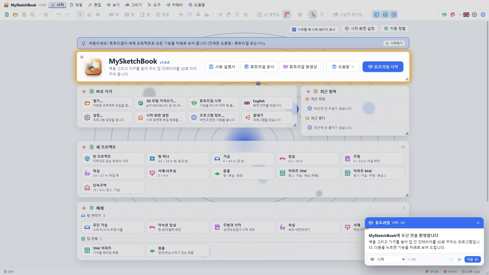

시작 화면은 움직이는 배경 위의 카드로 되어 있습니다.

| 카드 | 내용 |
|---|---|
| 맨 위(제목) | **사용 설명서** · **튜토리얼 문서** · **튜토리얼 동영상** 버튼, **도움말** 메뉴, **튜토리얼 시작** |
| **바로 가기** | 열기… · 3D 모델 가져오기… · 튜토리얼 시작 · 언어(English/한국어) · 설정… · 시작 화면 설정 · 프로그램 정보… · 끝내기 |
| **최근 항목** | 최근 파일과 최근 폴더. 클릭하면 열고(폴더는 그 폴더에서 열기 대화상자), ✕로 목록에서 지우고, **모두 지우기** |
| **새 프로젝트** | 템플릿 11가지 (아래 표) |
| **예제** | 가구까지 배치된 예제 프로젝트: **방 꾸미기**(모던 거실 · 아늑한 침실 · 주방과 식탁 · 욕실 · 서재), **집 전체**(59㎡ 아파트 · 원룸) |
| **움직이는 배경** | 배경 애니메이션 20가지, 움직이는 배경 바꾸기, 배경 이미지…, 움직임 속도, 카드 불투명도, 시작할 때 무작위, 자동 변경 |

- 카드는 왼쪽 위의 손잡이(✥)를 끌어 옮기고, 오른쪽 아래 모서리를 끌어 크기를 바꿉니다(모서리를 두 번 누르면 내용에 맞춤). **자동 정렬**은 처음 배치로 되돌립니다.
- 위쪽의 **시작할 때 시작 페이지 표시**를 끄면 다음부터는 **방 하나** 템플릿 프로젝트로 바로 시작합니다.
- **시작 화면 설정**에서 최근 파일·최근 폴더·예제·움직이는 배경 카드와 튜토리얼 안내 띠를 보일지 정합니다.
- 처음 켤 때는 **시작 안내 창**이 뜹니다: 튜토리얼 시작, 아파트 템플릿(59㎡)으로 시작, 나중에. **도움말 › 시작 안내 창**으로 다시 열 수 있습니다.

### 1.3 템플릿과 예제

| 템플릿 | 내용 |
|---|---|
| 빈 프로젝트 | 아무것도 없는 땅에서 시작 |
| 방 하나 | 4.5 × 3.6 m 방, 문과 창 |
| 거실 | 6 × 4.5 m, 큰 창 |
| 침실 | 4.2 × 3.6 m |
| 주방 | 4 × 3.2 m, 타일 바닥 |
| 욕실 | 2.4 × 2.1 m, 타일 벽 |
| 서재·사무실 | 5 × 4 m |
| 원룸 | 방 · 욕실 · 현관 |
| 아파트 59㎡ | 방 2 · 거실 · 욕실 (투룸) |
| 아파트 84㎡ | 방 3 · 거실 · 주방 · 욕실 2 |
| 단독주택 | 10 × 8 m, 방 2 · 거실 |

템플릿에는 벽(외벽 25 cm, 칸막이 12 cm, 높이 2.4 m)·문·창·방이 이미 그려져 있어 바로 가구를 배치할 수 있습니다. **파일 › 템플릿에서 새로 만들기…** 로도 고릅니다. 예제는 화면 언어에 맞는 방 이름으로 열립니다.

## 2. 화면 구성

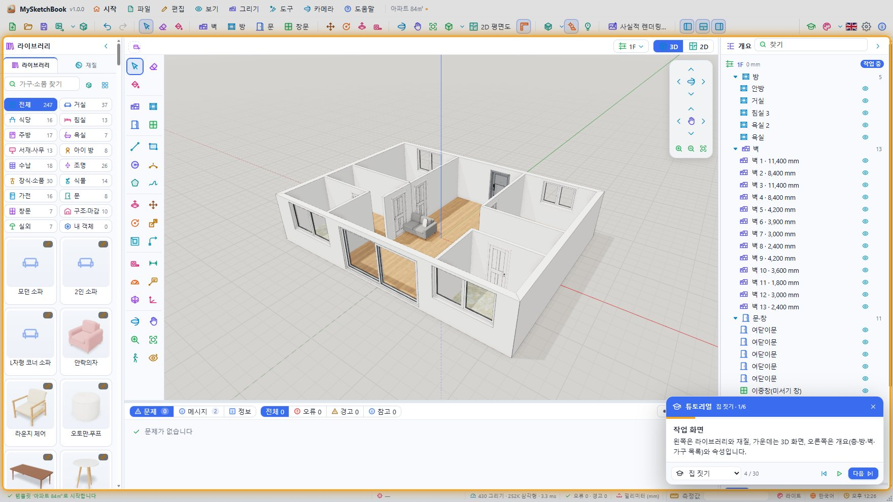

| 위치 | 이름 | 하는 일 |
|---|---|---|
| 맨 위 | **메뉴 막대** | 프로그램 이름·버전, 프로젝트 이름(바뀌면 ● 표시), 시작 · 파일 · 편집 · 보기 · 그리기 · 도구 · 카메라 · 도움말. 데스크톱에서는 제목 표시줄을 겸합니다(끌어서 창 이동, 두 번 클릭해 최대화, 오른쪽 끝에 최소화·최대화·닫기) |
| 그 아래 | **툴바** | 자주 쓰는 명령 (2.2) |
| 왼쪽 | **라이브러리 / 재질** 패널 | 가구·소품 카드와 재질 견본 |
| 왼쪽 안쪽 | **도구 모음** | SketchUp의 큰 도구 세트처럼 묶은 도구 (2.3) |
| 가운데 위 | **장면 탭**, **층 칩**, **3D / 2D** 전환 | 저장한 시점, 작업 층 고르기, 3D 보기와 2D 평면도 |
| 가운데 | **3D 화면** | 모델. 오른쪽 위의 **화면 조작** 패드(궤도·이동 화살표, 확대·축소, 전체 보기) |
| 가운데 아래 | **하단 패널** | 문제 · 메시지 · 정보 (2.6) |
| 오른쪽 | **개요** + **속성 · 스타일 · 그림자 · 태그 · 장면 · 층** 탭 | 모델의 목록과 선택한 것의 속성 (2.5) |
| 맨 아래 | **상태 표시줄** | 도움말·알림, 선택 개수, 커서 위치, 성능, 문제 개수, 단위, **측정값** 상자 (2.7) |

패널 사이의 경계선을 끌어 왼쪽·오른쪽 패널의 폭과 하단 패널의 높이를 바꿉니다. 개요와 아래 탭 사이의 경계도 끌 수 있습니다. 패널 머리글의 ‹ › 버튼(또는 `Ctrl+Shift+1` / `Ctrl+Shift+2`, `Ctrl+J`)으로 접고 펼칩니다. 접힌 패널은 가장자리에 좁은 띠로 남아 클릭하면 다시 펼쳐집니다. 데스크톱에서는 오른쪽 아래 모서리의 그립을 끌어 창 크기를 바꿉니다.

### 2.1 메뉴

| 메뉴 | 항목 |
|---|---|
| **파일** | 새 프로젝트 · 템플릿에서 새로 만들기… · 열기… · 시작 페이지 · 최근 파일… · 최근 폴더 · 최근 파일·폴더 기록 모두 지우기 · 저장 · 다른 이름으로 저장… · 3D 모델 가져오기… · **내보내기** ▸ (그림으로 저장… · 사실적 렌더링… · 평면도 그림 (.png) · glTF 바이너리 (.glb) · glTF (.gltf) · Wavefront OBJ (.obj) · STL (.stl, 3D 프린팅) · PLY (.ply) · USDZ (.usdz, AR) · 선택한 것만 .glb로) · 프로젝트 닫기 · 끝내기 |
| **편집** | 실행 취소 · 다시 실행 · 잘라내기 · 복사 · 붙여넣기 · 복제 · 삭제 · 모두 선택 · 선택 해제 · **회전·대칭** ▸ (90° 회전 (시계 방향) · 90° 회전 (반시계 방향) · 좌우 대칭 · 바닥에 내려놓기) · **숨기기·잠금** ▸ (숨기기 · 모두 보이기 · 잠금 · 잠금 해제) · 그룹 만들기 · 분해 · 안내선 모두 지우기 |
| **보기** | **표준 보기** ▸ (등각 보기 · 위 · 앞 · 뒤 · 왼쪽 · 오른쪽 · 아래) · 원근 투영 · 2D 평면도 · **면 스타일** ▸ · **표시** ▸ (눈금자 · 격자 · 축 · 모서리 선 · 그림자 · 조명 켜기 · 성능 표시 (FPS·삼각형) · 라이브러리 패널 · 개요·속성 패널 · 하단 패널 · 상태 표시줄) · **표시 품질** ▸ (빠르게 · 균형 · 고품질) · **장면** ▸ (장면 추가 · 이전 장면 · 다음 장면) · **모양** ▸ (테마 무작위로 바꾸기 · 테마 고르기 · 언어 전환 · 움직이는 배경 바꾸기 · 배경 이미지… · 배경 끄기) |
| **그리기** | 벽 · 방 · 문 · 창문 · 층 추가 · **도형 그리기** ▸ (선 · 사각형 · 원 · 호 · 다각형 · 자유선) |
| **도구** | 선택 · 지우개 · 페인트 통 · **수정** ▸ (밀기/당기기 · 이동 · 회전 · 크기 조절 · 오프셋 · 경로 따라가기) · **솔리드 도구** ▸ (합치기 · 빼기 · 교집합 · 면 교차 · 모서리 부드럽게) · **측정·주석** ▸ (줄자 · 치수 · 각도기 · 글 표시 · 축 지정 · 안내선 모두 지우기) · **단면** ▸ (단면 · 단면 켜기/끄기 · 단면 모두 지우기) · 지금 검사 · 문제 보기 · 메시지 보기 · 사실적 렌더링… · 설정… |
| **카메라** | 궤도 · 이동(화면) · 확대/축소 · 전체 보기 · 선택한 것 보기 · 걷기 · 표준 보기 ▸ · 원근 투영 · 2D 평면도 · 장면 추가 · 이전 장면 · 다음 장면 |
| **도움말** | 시작 안내 창 · 튜토리얼 · 튜토리얼 문서 · 튜토리얼 동영상 · 사용 설명서 · 단축키 목록… · 설정… · 프로그램 정보… |

메뉴 항목 오른쪽에는 단축키가, 지금 쓸 수 없는 항목은 흐리게 표시됩니다. 데스크톱에서 메뉴는 별도의 작은 창으로 열립니다.

**오른쪽 클릭 메뉴**

- 모델 위의 물체: 잘라내기 · 복사 · 복제 · 삭제, 종류별 명령(가구: 90° 회전 · 좌우 대칭 · 바닥에 내려놓기 · 다른 항목으로 바꾸기 · 재질 되돌리기 / 벽: 벽 나누기 · 벽 방향 뒤집기 / 모델: 그룹 편집 · 분해 · 솔리드 도구 / 문·창: 다른 항목으로 바꾸기), 이동 · 회전 · 크기 조절, 숨기기 · 잠금 · 잠금 해제, 선택한 것 보기.
- 빈 곳: 붙여넣기 · 모두 선택 · 전체 보기 · 표준 보기 · 원근 투영 · 2D 평면도 · 면 스타일 · 표시 · 장면 추가 · 그림으로 저장… · 사실적 렌더링….
- 라이브러리 카드: 배치하기 · 선택한 가구를 이것으로 바꾸기. 재질 견본: 이 재질로 칠하기 · 선택한 벽·방에 적용.
- 개요의 행, 하단 패널의 문제·메시지, 상태 표시줄, 입력 칸(잘라내기·복사·붙여넣기·모두 선택)에도 각자의 메뉴가 있습니다.

### 2.2 툴바

왼쪽부터 다음 묶음이 있습니다. 버튼에 마우스를 올리면 이름·단축키·설명이 나옵니다.

| 묶음 | 버튼 |
|---|---|
| 파일 | 새 프로젝트 · 열기 · 저장 · **그림으로 저장**(옆의 ▾ = 내보내기 메뉴) · 3D 모델 가져오기 |
| 편집 | 실행 취소 · 다시 실행 |
| 선택 | 선택 · 지우개 · 페인트 통 |
| 건축 | **벽** · **방** · **문** · **창문** |
| 수정 | 이동 · 회전 · 밀기/당기기 · 줄자 |
| 카메라 | 궤도 · 이동(화면) · 전체 보기 · **등각 보기**(▾ = 보기 방향) · **2D 평면도** · 눈금자 |
| 표현 | **면 스타일 바꾸기**(▾ = 면 스타일 고르기) · 그림자 · 조명 켜기 |
| 출력 | **사실적 렌더링…** |
| 패널 | 라이브러리 패널 · 하단 패널 · 개요·속성 패널 |
| 오른쪽 | 튜토리얼 · 테마 무작위로 바꾸기(▾ = 테마 고르기) · 언어 전환(국기) · 설정 · 프로그램 정보 |

창이 좁아져도 툴바가 잘리지 않도록 창의 최소 폭이 툴바에 맞춰 정해집니다.

### 2.3 도구 모음

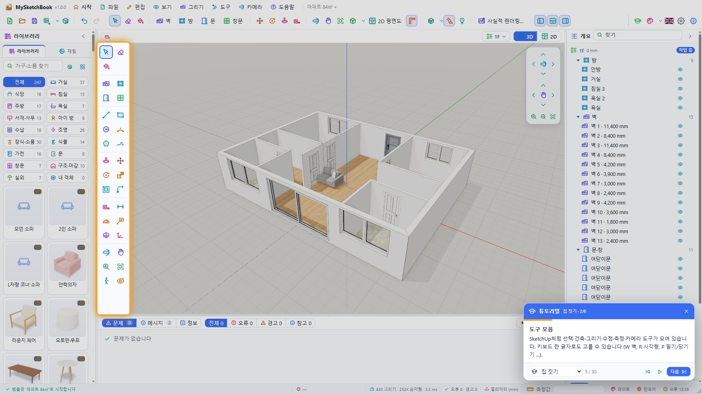

3D 화면 왼쪽의 도구 모음은 여섯 묶음입니다. 키보드 한 글자로도 고를 수 있습니다(괄호 안).

| 묶음 | 도구 |
|---|---|
| 선택 | 선택 (`Space`) · 지우개 (`E`) · 페인트 통 (`B`) |
| 건축 | 벽 (`W`) · 방 (`Shift+R`) · 문 · 창문 |
| 그리기 | 선 (`L`) · 사각형 (`R`) · 원 (`C`) · 호 (`A`) · 다각형 (`Shift+P`) · 자유선 |
| 수정 | 밀기/당기기 (`P`) · 이동 (`M`) · 회전 (`Q`) · 크기 조절 (`S`) · 오프셋 (`F`) · 경로 따라가기 |
| 측정·주석 | 줄자 (`T`) · 치수 (`D`) · 각도기 · 글 표시 · 단면 · 축 지정 |
| 카메라 | 궤도 (`O`) · 이동(화면) (`H`) · 확대/축소 (`Z`) · 전체 보기 (`Shift+Z`) · 걷기 · 둘러보기 |

도구를 고르면 상태 표시줄 왼쪽에 사용법이 나옵니다. `Esc`는 진행 중인 동작을 취소하고, 한 번 더 누르면 선택 도구로 돌아갑니다.

> **축 지정** 도구는 아직 준비 중입니다. 고르면 "이 도구는 아직 준비 중입니다"라고 알리고 선택 도구로 돌아갑니다.

### 2.4 왼쪽 패널: 라이브러리와 재질

- **라이브러리** 탭 — 검색 칸(한국어·영어 이름과 태그), 3D 모델 가져오기 버튼, 카드 크기(작게·보통·크게) 버튼, 분류 칩(전체 · 거실 · 식당 · 침실 · 주방 · 욕실 · 서재·사무 · 아이 방 · 수납 · 조명 · 장식·소품 · 식물 · 가전 · 문 · 창문 · 구조·마감 · 실외 · 내 객체, 칩마다 개수), 카드 목록. 카드의 **HQ** 표시는 실측 사진 모델(Poly Haven), 자 모양 표시는 크기·재질을 바꿀 수 있는 매개변수 모델입니다. 자세한 사용법은 [5장](#5-가구-배치).
- **재질** 탭 — 지금 칠할 재질(붓), 페인트 통 버튼, 검색 칸, **+**(새 재질), 분류 칩(나무 · 바닥재 · 패브릭 · 가죽 · 석재 · 타일 · 벽 마감 · 금속 · 유리 · 도장 · 플라스틱 · 도자기 · 카펫·러그 · 식물 · 기타), 견본 목록. [6장](#6-재질과-페인트-통).

### 2.5 오른쪽 패널: 개요와 편집 탭

**개요**는 층마다 **방 · 벽 · 문·창 · 가구·소품 · 모델**을 묶어 보여 줍니다.

- 행을 클릭하면 선택, `Ctrl`+클릭은 추가, `Shift`+클릭은 선택 전환, 두 번 클릭하면 그것을 화면에 맞춰 보여 줍니다.
- 행 끝의 눈 아이콘으로 숨기고 보이기, 잠근 것에는 자물쇠가 붙습니다.
- 묶음 머리를 클릭해 접고 펼치고, 층 머리를 클릭하면 그 층이 **작업 중**인 층이 됩니다.
- 위쪽 **찾기** 칸은 이름으로 거릅니다.

아래 탭:

| 탭 | 내용 |
|---|---|
| **속성** | 선택한 것의 크기·재질·위치 (아무것도 선택하지 않으면 프로젝트 이름·단위·방 면적 합계·구성). 종류별 항목은 4–5장 |
| **스타일** | 면 스타일, 모서리 선, 조명 켜기, 배경, 환경 조명, 노출, 표시 품질 (9장) |
| **그림자** | 그림자 표시, 시각, 날짜, 위도, 경도, 북쪽 각도, 도시 (9장) |
| **태그** | 태그 목록, 보이기/숨기기, 이름, 개수, 추가·삭제 (10장) |
| **장면** | 장면 목록, 이동·이름·현재 보기로 갱신·삭제, 추가 (10장) |
| **층** | 층 목록, 작업 층, 이름·바닥 높이·층 높이, 보이기, 삭제, 추가 (10장) |

### 2.6 하단 패널

`Ctrl+J`로 열고 닫습니다. 세 탭이 있습니다.

- **문제** — 모델 검사 결과(15장). 전체 · 오류 · 경고 · 참고로 거르고, **지금 검사**로 다시 검사합니다. 행을 클릭하면 대상을 선택하고 화면에 맞춰 보여 줍니다.
- **메시지** — 상태 표시줄에 잠깐 나왔던 알림과 오류가 시각과 함께 남습니다. **메시지 복사**, **메시지 지우기**.
- **정보** — 작업 층(이름·바닥 높이·층 높이), 면적(㎡와 평, 방마다), 구성(벽·방·가구·문·창·모델·장면 수), 화면(그리기 호출·삼각형·프레임 시간·FPS), 가져온 모델(개수·삼각형).

### 2.7 상태 표시줄과 측정값 상자

왼쪽부터: 지금 도구의 사용법 또는 알림 · 선택 개수 · 커서 위치(X, Y, 높이) · 성능(FPS · 그리기 호출 · 삼각형 · 프레임 시간, **보기 › 표시 › 성능 표시**가 켜져 있을 때) · 문제 개수(오류 · 경고, 클릭하면 문제 탭) · 단위 · **측정값** 상자 · 테마 · 언어 · 시계.

**측정값 상자**는 SketchUp의 VCB입니다. 도구가 동작하는 중에 그냥 숫자를 치면 상자로 들어가고, `Enter`로 적용됩니다(`Esc`는 지우기). 상자의 이름은 도구에 따라 길이 · 거리 · 각도 · 배율 · 반지름 · 치수 · 간격으로 바뀝니다.

| 입력 | 뜻 |
|---|---|
| `2400` | 프로젝트 단위로 2400 (mm 프로젝트면 2.4 m) |
| `2.4m` · `240cm` · `2400mm` | 단위를 붙이면 그 단위 |
| `8'` · `8'6` · `96in` · `96"` | 피트·인치 |
| `1200,800` (또는 `1200x800`) | 사각형의 가로, 세로 |
| `45` | 회전·각도기의 각도(°) |
| `1.5` | 크기 조절 배율 |
| `6s` | 다각형의 변 수, 원의 분할 수 |
| `x5` · `*5` · `/5` | 이동 복사 직후: 같은 간격으로 5개 더 / 처음과 끝 사이를 5등분 |

## 3. 카메라와 보기

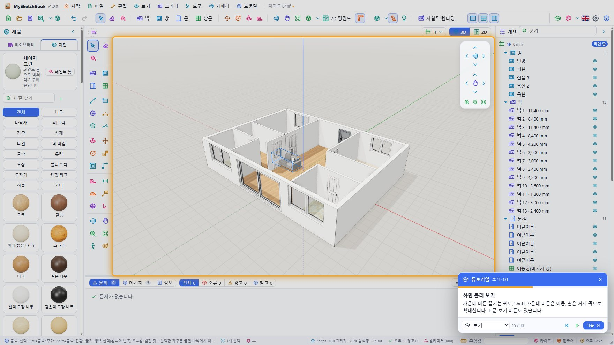

| 동작 | 마우스 | 도구·키 |
|---|---|---|
| 궤도(돌려 보기) | 가운데 버튼 끌기, 오른쪽 버튼 끌기, 선택 도구로 왼쪽 버튼 끌기(기본 설정) | 궤도 `O` + 왼쪽 버튼 끌기 |
| 화면 이동 | `Shift` + 가운데(또는 오른쪽) 버튼 끌기, 선택 도구로 `Alt` + 왼쪽 버튼 끌기 | 이동(화면) `H` |
| 확대/축소 | 휠 (커서가 있는 곳을 향해) | 확대/축소 `Z` + 위아래로 끌기 |
| 전체 보기 | — | `Shift+Z`, 화면 조작 패드의 전체 보기 |
| 그 점을 가운데로 | 가운데 버튼 두 번 클릭 | — |
| 선택한 것 보기 | 개요에서 두 번 클릭 | **카메라 › 선택한 것 보기** |

- 궤도는 커서 아래의 점을 중심으로 돕니다. 오른쪽 버튼은 4 픽셀 넘게 끌어야 궤도가 되고, 그냥 클릭하면 오른쪽 클릭 메뉴가 열립니다(마우스 휠 버튼이 없는 노트북용).
- 3D 화면 오른쪽 위의 **화면 조작** 패드: 위 원은 궤도(위·아래·왼쪽·오른쪽으로 돌기), 아래 원은 화면 이동, 그 아래 확대 · 축소 · 전체 보기. 누르고 있으면 계속 움직입니다.
- **표준 보기** — 등각 보기 · 위 · 앞 · 뒤 · 왼쪽 · 오른쪽 · 아래 (툴바의 등각 보기 버튼과 ▾). 앞은 +Z 쪽에서 본 모습입니다.
- **원근 투영** — 끄면 평행 투영(정사영)이 됩니다. 보이는 크기는 유지됩니다.
- **2D 평면도** (`F4`, 화면 위의 **3D / 2D** 전환) — 작업 층을 위에서 내려다보는 평행 투영이며, 바닥에서 1.2 m 높이에서 잘라 벽 단면을 진하게 칠합니다. 이 상태에서도 벽을 그리고 가구를 배치할 수 있습니다. 2D에서는 궤도 대신 화면 이동이 되고, **눈금자**(`Ctrl+Shift+R`)가 위쪽과 왼쪽에 나와 커서 위치를 표시합니다.
- **걷기** — 눈높이 1.6 m의 1인칭 시점. `W` `A` `S` `D` 또는 `↑` `↓`로 걷고 `←` `→`로 돌며, `Shift`로 빨리, `Q`/`E`로 내려가고 올라가며, 왼쪽 버튼 끌기로 둘러봅니다. 벽과 가구에 부딪히면 멈춥니다.
- **둘러보기** — 제자리에서 끌어 고개를 돌립니다.

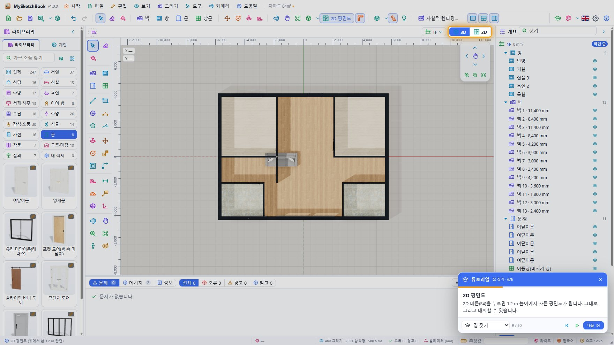

## 4. 집 짓기: 벽 · 방 · 문 · 창

### 4.1 벽

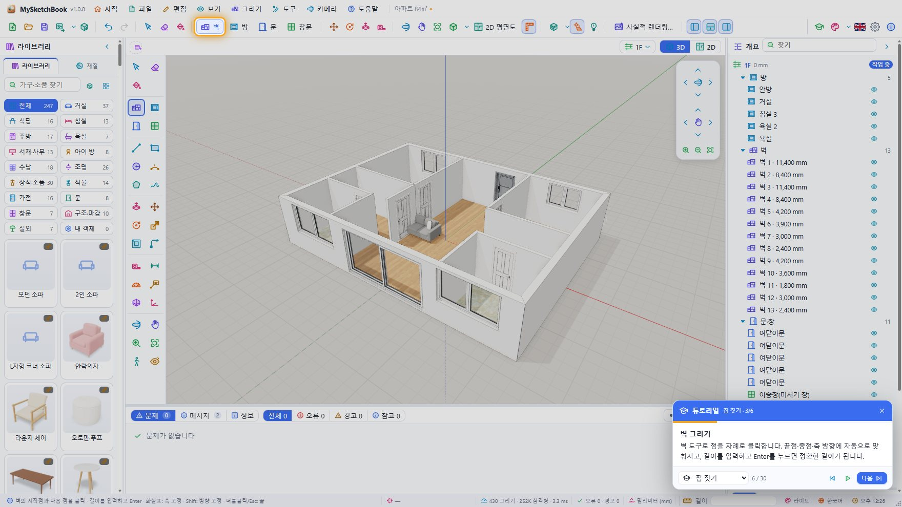

**벽** 도구(`W`)로 바닥 위의 점을 차례로 클릭하면 벽이 이어서 그려집니다.

1. 시작점을 클릭합니다.
2. 다음 점을 클릭할 때마다 벽 하나가 생기고, 마지막 점에서 계속 이어집니다. 그리는 동안 벽 두께의 윤곽과 길이가 보입니다.
3. 정확한 길이: 방향을 마우스로 잡은 채 길이를 치고 `Enter` (예: `3600`, `3.6m`).
4. 첫 점을 다시 클릭하면 닫히며 끝납니다. 두 번 클릭, `Enter`, `Esc`로도 끝냅니다.

- **추론**: 다른 벽의 끝점 · 중점 · 벽 위, 빨간 축(X)·초록 축(Z) 방향, 다른 점과의 정렬에 자동으로 맞추고, 무엇에 맞췄는지 커서 옆에 표시합니다. **격자에 맞춤**(설정 › 3D 보기)을 켜면 격자 간격에도 맞춥니다.
- **화살표 키**: `→`/`←`는 빨간 축, `↑`/`↓`는 초록 축으로 방향을 고정(다시 누르면 풀림). `Shift`를 누르고 있으면 지금 방향으로 고정됩니다.
- 새 벽의 두께는 **설정 › 3D 보기 › 기본 벽 두께**(기본 150 mm)이고, 높이는 작업 층의 층 높이를 따릅니다.
- 벽이 만나는 곳은 자동으로 이어집니다: 끝과 끝이 만나면 비스듬히(마이터), 한 벽의 끝이 다른 벽의 옆면에 닿으면 맞대어 붙습니다(1 cm 안이면 만난 것으로 봅니다).

**벽 속성** (벽을 클릭하고 **속성** 탭): 이름 · 길이 · 두께 · 높이 · 왼쪽 면 · 오른쪽 면(재질) · 태그 · 숨김 · 잠금. 길이를 바꾸면 끝점이 움직이고 그 끝에 이어진 벽도 함께 따라옵니다. 머리글의 버튼과 오른쪽 클릭 메뉴:

- **벽 나누기** — 벽을 가운데에서 둘로 나눕니다. 문·창은 있던 쪽 벽에 남습니다.
- **벽 방향 뒤집기** — 시작점과 끝점을 바꿉니다. 왼쪽/오른쪽 면 재질도 서로 바뀌고 문·창은 제자리에 있습니다.

벽을 옮기면(이동 도구, 화살표 키) 그 끝에 붙어 있던 다른 벽의 끝도 따라와 모서리가 떨어지지 않습니다.

### 4.2 방

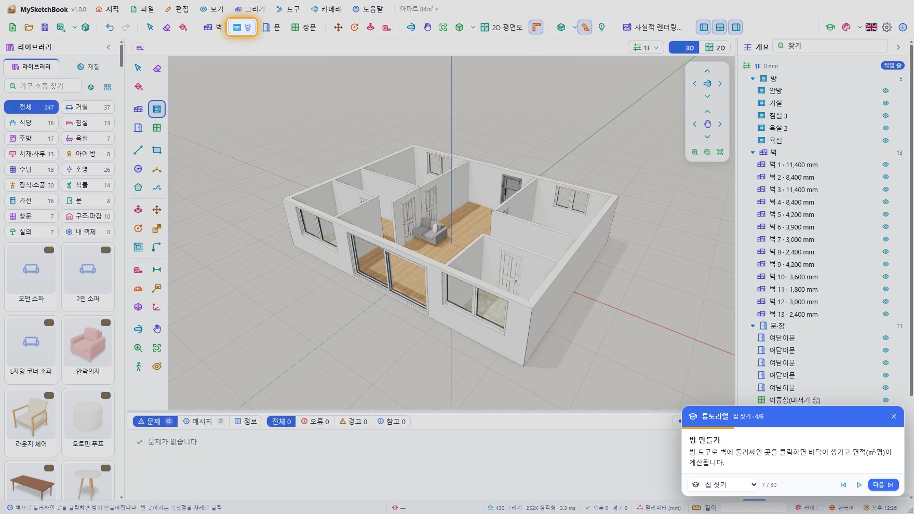

**방** 도구(`Shift+R`):

- **벽으로 둘러싸인 곳을 클릭** — 커서를 올리면 만들어질 바닥이 초록으로 미리 보이고 면적이 표시됩니다. 클릭하면 방이 생깁니다.
- **빈 곳에서는 꼭짓점을 차례로 클릭**해 윤곽을 그립니다. 첫 점을 다시 클릭하거나 두 번 클릭 또는 `Enter`로 닫습니다. `Esc`는 취소.

새 방은 "방 1, 방 2 …"라는 이름에 오크 바닥, 흰색 페인트 천장(천장은 숨김)으로 만들어집니다. 같은 윤곽의 방이 이미 있으면 다시 만들지 않습니다.

**방 속성**: 이름 · 면적(㎡와 평) · 바닥재 · 천장 표시 · 천장(재질) · 숨김 · 잠금. 방을 옮기면 바닥 윤곽이 함께 움직입니다.

**계단** 도구(`Shift+S`, 기둥 옆): 보기 위쪽 띠에서 형태(일자 · ㄱ자 참 · ㄱ자 돌음 · U자 중간참 · 원형 · 곡선)와 폭(원형은 지름)을 고른 뒤, **시작점**(첫 단의 가운데) → **오르는 방향** → (일자가 아니면) **꺾는 쪽**을 클릭합니다. 높이는 위층 바닥까지(맨 위층이면 층 높이)로 자동으로 맞춰지고, 단 높이는 모두 같게 나뉩니다(최대 단 높이 190 mm). 위층이 있으면 위층 바닥에 계단실 구멍이 뚫리고(아래층 천장도), 계단을 옮기거나 크기를 바꾸거나 지우면 구멍도 따라갑니다. 계단 속성에서 폭 · 디딤판 깊이 · 참 깊이 · U자 계단 사이 틈 · 원형의 회전 각도와 지름 · 난간(유리/난간살/없음, 위치) · 챌판 막힘/열림 · 위층 계단실 난간을 바꾸고, 단 수 · 단 높이 · 디딤폭 · 2R+G(편안한 범위 600–650 mm)를 확인합니다. 문제 탭은 위층까지 높이가 맞지 않거나 머리 높이(2 m)가 모자라는 계단을 알려 줍니다.

### 4.3 문과 창

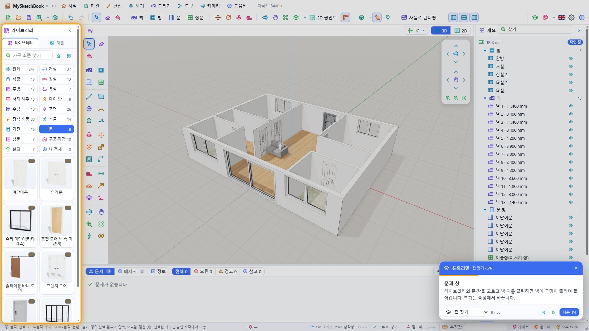

툴바·도구 모음의 **문** 또는 **창문**을 누르면 라이브러리가 문(또는 창문) 분류로 바뀌고 첫 항목의 배치가 시작됩니다. 다른 문·창은 카드를 고릅니다.

- 문 8가지: 여닫이 문 · 양개 문 · 미닫이 유리문 · 포켓 도어 · 바니 도어 · 프렌치 도어 · 현관문(철제) · 접이식 문.
- 창 7가지: 여닫이 창 · 오르내리 창 · 미서기 창 · 고정 창 · 들창 · 베이 윈도 · 지붕 창.

벽 위를 클릭하면 벽에 구멍이 뚫리며 문·창이 들어갑니다. 커서를 따라 벽을 미끄러지며 벽 시작점에서의 거리가 표시되고, 벽보다 넓으면 놓이지 않습니다("문·창은 벽 위에 놓아야 합니다"). 클릭한 면이 여는 쪽이 됩니다. 창은 바닥에서 기본 높이(대개 0.9 m)에 놓입니다.

**문·창 속성**: 폭 · 높이 · 바닥에서 높이 · 벽 시작점에서(벽 시작점부터 중심까지의 거리) · 경첩 방향 바꾸기 · 여는 쪽(왼쪽 면/오른쪽 면) · 그 밖의 치수와 옵션(문짝 수, 손잡이, 재질 등 항목마다 다름) · **다른 항목으로 바꾸기**. 이동 도구나 화살표 키로 옮기면 벽을 따라서만 움직입니다.

### 4.4 2D 평면도에서 그리기

`F4`로 2D 평면도를 켜면 위에서 본 도면 위에서 벽·방·문·창·가구를 그대로 다룰 수 있습니다. 치수 도구로 벽 길이를 표시하고, **파일 › 내보내기 › 평면도 그림 (.png)** 으로 도면을 그림으로 저장합니다(12장).

## 5. 가구 배치

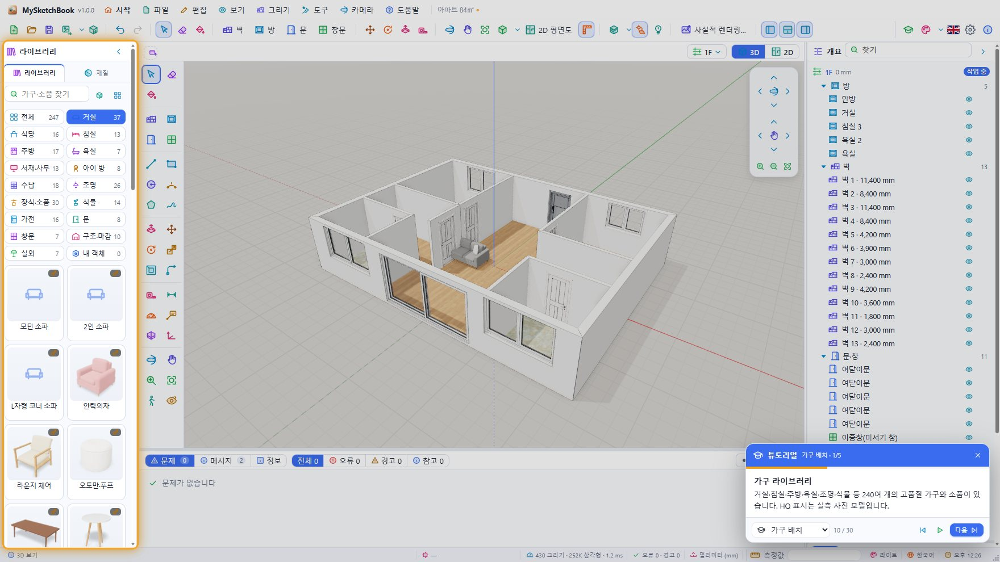

### 5.1 라이브러리

라이브러리에는 247개 항목이 있습니다.

- **매개변수 모델 125개** — 폭·깊이·높이·좌석 수 같은 치수와 천·나무·다리 모양 같은 옵션을 바꿀 수 있습니다. 16개 분류(거실 · 식당 · 침실 · 주방 · 욕실 · 서재·사무 · 아이 방 · 수납 · 조명 · 장식·소품 · 식물 · 가전 · 문 · 창문 · 구조·마감 · 실외)에 고루 있습니다.
- **고품질 모델 122개**(**HQ**) — Poly Haven의 실측 사진 모델(CC0)입니다. 크기는 원래대로이고 배율로만 바꿉니다.
- **내 객체** — 직접 가져온 3D 모델(11장).

카드에 마우스를 올리면 이름과 기본 크기가 나옵니다. 검색 칸은 한국어·영어 이름과 태그로 찾습니다.

### 5.2 배치하기

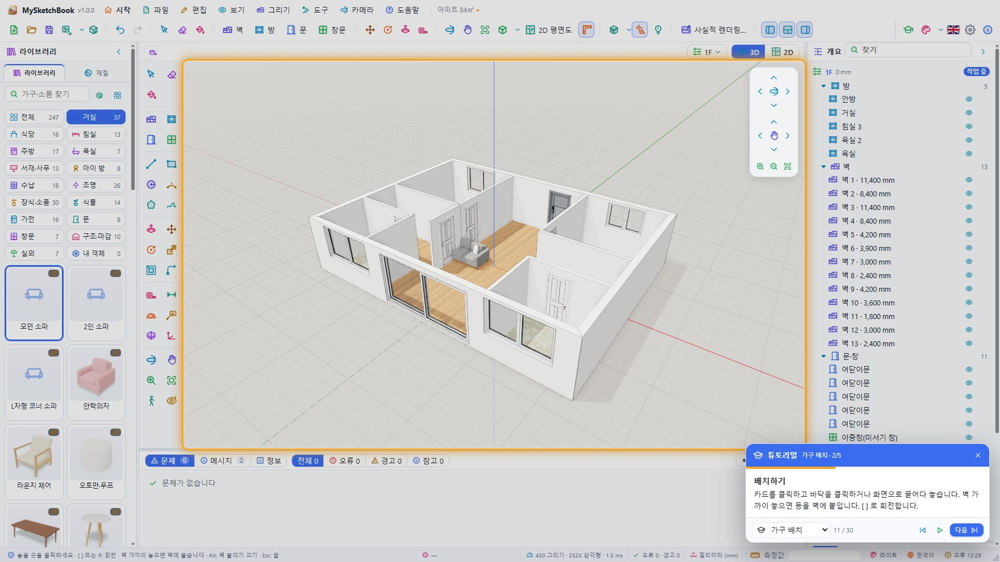

- **카드를 클릭**하고 3D 화면에서 놓을 곳을 클릭합니다. 반투명한 미리보기가 커서를 따라오며, 배치 도구는 `Esc`나 다른 도구를 고를 때까지 계속 같은 항목을 놓습니다.
- **카드를 화면으로 끌어다 놓기**도 됩니다(한 번만 놓음).
- **벽 가까이** 놓으면 등을 벽에 대고 벽에 붙습니다. `Alt`를 누르면 벽 붙이기가 꺼지고 켜집니다.
- `[` `]` (또는 `,` `.`, `R`)로 놓기 전에 90°씩, `Shift`와 함께 15°씩 돌립니다.
- 놓이는 곳은 항목마다 다릅니다: 바닥 가구는 바닥에, 그림·거울·벽등은 벽면에(정해진 높이), 천장 조명은 천장에, 작은 소품(화병·책 등)은 탁자나 선반의 윗면에.
- 놓은 것은 바로 선택되어 속성 탭에 나옵니다.

### 5.3 선택과 옮기기

- **선택**(`Space`): 클릭으로 선택, `Ctrl`+클릭 추가, `Shift`+클릭 전환, 빈 곳 클릭은 해제. 영역 선택: **왼쪽→오른쪽**으로 끌면 영역 안에 완전히 들어간 것만, **오른쪽→왼쪽**은 걸친 것까지. 기본 설정에서는 왼쪽 버튼 끌기가 화면 회전이므로 `Shift` 또는 `Ctrl`을 누른 채 끌어 영역을 선택합니다. **설정 › 3D 보기 › 왼쪽 버튼 끌기**를 **선택 상자 (SketchUp)**로 바꾸면 그냥 끌어도 영역 선택입니다.
- **선택한 가구를 끌면** 바닥 위에서 바로 옮겨집니다.
- **화살표 키**는 선택한 것을 10 cm씩, `Shift`와 함께 1 cm씩 옮깁니다.
- 정확한 이동·회전은 이동·회전 도구(7.5)나 속성의 숫자를 씁니다.
- **복제**(`Ctrl+D`)는 30 cm 옆에, **붙여넣기**(`Ctrl+V`)는 작업 층의 50 cm 옆에 사본을 만듭니다. 벽을 복사하면 그 벽의 문·창도 같이 복사됩니다.
- **삭제**(`Delete`), **숨기기**, **잠금**(잠근 것은 옮기거나 지울 수 없음), **모두 보이기**.

### 5.4 가구 속성과 옵션

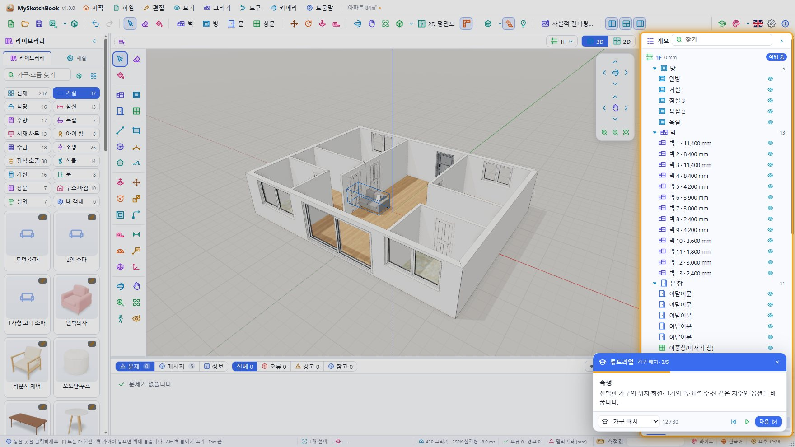

가구를 선택하면 **속성** 탭에 세 부분이 나옵니다.

1. **가구 이름 머리글** — 이름 · 항목 · 크기(실제 너비×높이×깊이) · X · 높이(바닥 위) · Z · 회전(°) · 배율(×) · 태그 · 숨김 · 잠금. 머리글 버튼: 90° 회전 · 좌우 대칭 · 다른 항목으로 바꾸기.
2. **치수와 옵션** — 매개변수 모델만. 예: 모던 소파 = 폭 · 좌석 수 · 깊이 · 높이 · 천 · 다리 · 팔걸이 · 쿠션 · 쿠션 수 · 쿠션 천. 길이는 프로젝트 단위로 입력하고, 개수는 −/+ 버튼, 재질은 재질 목록, 선택지는 펼침 목록, 켜고 끄는 것은 확인란입니다. 값은 항목이 허용하는 범위로 맞춰집니다.
3. **재질** — 그 가구가 쓰는 재질(최대 12가지)이 부분마다 나오며, 각각을 다른 재질로 바꿀 수 있습니다. **재질 되돌리기**로 원래대로.

그 밖의 명령:

- **다른 항목으로 바꾸기** — 같은 분류의 다른 항목(최대 30개) 메뉴에서 고르면 자리와 방향을 유지한 채 바뀝니다. 라이브러리 카드의 오른쪽 클릭 › **선택한 가구를 이것으로 바꾸기**로 아무 항목으로나 바꿀 수 있습니다.
- **좌우 대칭** — 가구를 거울에 비친 모양으로 뒤집습니다.
- **바닥에 내려놓기** — 높이를 0으로.
- **90° 회전** — `Ctrl+]`(시계 방향), `Ctrl+[`(반시계 방향). 선택한 것들의 가운데를 중심으로 돕니다.

## 6. 재질과 페인트 통

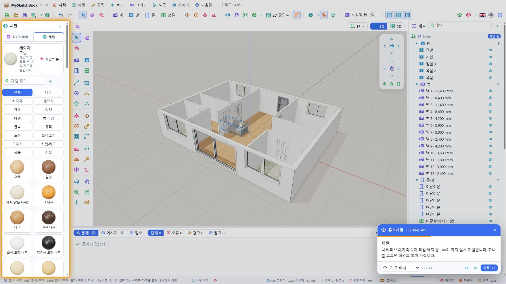

**재질** 탭에는 105가지 재질이 15개 분류로 있습니다. 나무·바닥재·타일·석재·벽 마감·패브릭·가죽 등 48가지는 Poly Haven의 사진 텍스처(색·요철·거칠기·음영)를 써서 실제 크기로 반복되고, 나머지는 색과 광택으로 표현합니다.

- 견본을 클릭하면 그 재질이 **붓**이 되고 **페인트 통** 도구가 켜집니다.
- **페인트 통**(`B`)으로 칠할 곳을 클릭합니다.
  - 벽: 클릭한 **면**(왼쪽 면·오른쪽 면·윗면)만 칠해집니다.
  - 방: **바닥** 또는 (천장을 표시했다면) **천장**.
  - 가구·문·창: 클릭한 **부분**의 재질만 바뀝니다(예: 소파의 천만, 다리만).
  - 모델링한 면: 보이는 쪽(앞면 또는 뒷면)이 칠해집니다.
- `Alt`+클릭은 **스포이트** — 클릭한 곳의 재질을 붓으로 가져옵니다.
- **+**(새 재질): 이름 · 색 · 거칠기 · 금속성으로 내 재질을 만듭니다. 프로젝트 파일에 저장되고 **기타** 분류에 나옵니다.
- 견본 오른쪽 클릭 › **선택한 벽·방에 적용**: 선택한 벽의 양쪽 면, 선택한 방의 바닥을 한 번에 칠합니다.
- 속성 탭의 재질 칸(벽의 왼쪽/오른쪽 면, 방의 바닥재/천장, 가구의 재질)을 누르면 알맞은 분류의 재질 목록이 열립니다.

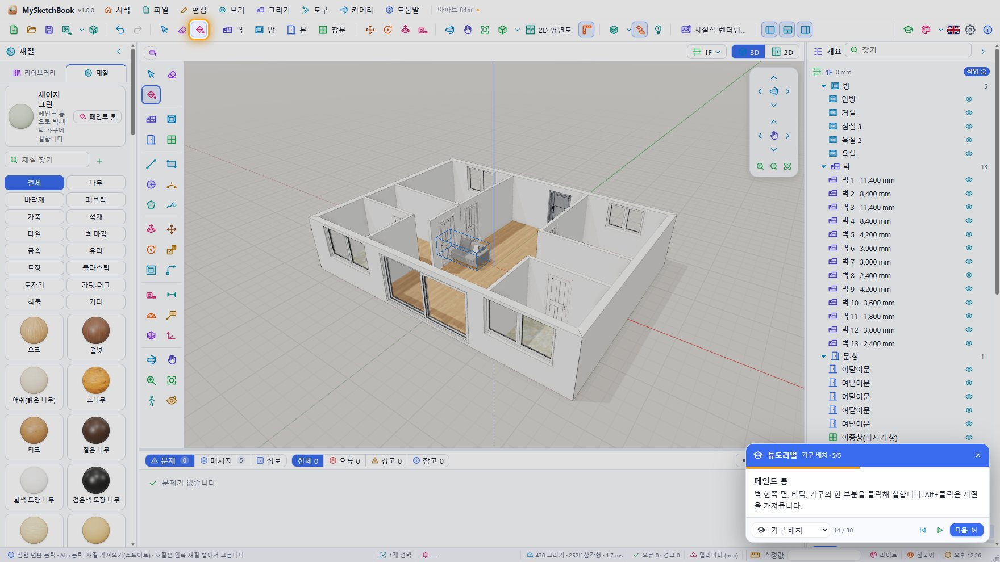

## 7. SketchUp식 모델링

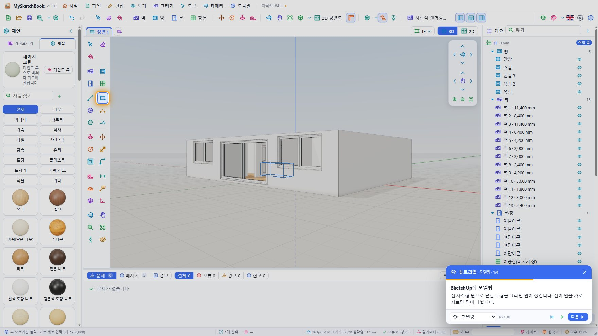

### 7.1 붙는 형상과 그룹

그리기 도구로 그린 선과 면은 SketchUp처럼 **서로 붙습니다**. 닫힌 선은 면이 되고, 면을 가로지르는 선은 면을 둘로 나누며, 면 안에 그린 닫힌 도형은 안쪽 면과 구멍이 됩니다. 점은 1/100 mm 안이면 하나로 합쳐집니다.

- 그룹 밖에서 그린 것은 층마다 하나인 **모델**(개요의 "모델" 묶음)에 들어가 서로 붙습니다.
- **그룹 만들기**(`G`): 선택한 모델을 그룹으로 바꿉니다. 그 뒤에 그리는 것은 새 모델로 들어가 그룹에 붙지 않습니다.
- 그룹을 **두 번 클릭**(또는 **그룹 편집**)하면 그 그룹을 편집합니다. 그리는 것이 모두 그룹 안으로 들어가며, `Esc`로 끝냅니다.
- **분해**: 그룹의 형상을 층의 모델로 되돌려 다시 붙게 합니다.
- 모델의 속성: 이름 · 컴포넌트 · 높이(바닥 위) · 태그 · 숨김 · 잠금 · 형상(면·모서리 수, 닫힌 솔리드면 부피 m³).

### 7.2 추론과 축 고정

그리기 도구는 커서 근처의 **끝점 · 중점 · 중심 · 교차점 · 모서리 위 · 면 위 · 빨간/초록/파란 축 방향 · 평행 · 수직**에 맞추고, 커서 옆에 이름(예: "끝점", "빨간 축 방향")과 점선을 보여 줍니다. 벽의 아래·위 모서리와 안내선에도 맞춥니다.

- `→` 빨간 축(X), `←` 초록 축(Z), `↑`/`↓` 파란 축(위)으로 방향을 고정합니다(다시 누르면 풀림).
- `Shift`를 누르고 있으면 지금 추론한 방향으로 고정됩니다.
- 도형은 처음 클릭한 **면의 평면**(바닥·벽·모델의 면) 위에 그려지고, 빈 곳이면 바닥에 그려집니다.

### 7.3 그리기 도구

| 도구 | 사용법 | 측정값 상자 |
|---|---|---|
| **선** `L` | 점을 차례로 클릭. 닫히면 면이 생기고 새로 시작. 두 번 클릭이나 `Esc`로 끝 | 길이: 지금 방향으로 그 길이만큼 |
| **사각형** `R` | 두 모서리를 클릭 (첫 클릭의 평면에서, 변은 축 방향) | `1200,800` = 가로, 세로 |
| **원** `C` | 중심, 반지름을 클릭 (기본 24분할) | 반지름 · `48s` = 분할 수 |
| **호** `A` | 시작점, 끝점, 볼록한 정도를 차례로 클릭 (12분할) | — |
| **다각형** `Shift+P` | 중심, 반지름을 클릭 (기본 6각형) | 반지름 · `8s` = 변 수 |
| **자유선** | 누른 채 끌어서 그립니다. 끝이 처음 점에 가까우면 닫힙니다 | — |

### 7.4 밀기/당기기 · 오프셋 · 경로 따라가기

- **밀기/당기기** `P` — 면 위에 커서를 올리면 파랗게 표시됩니다. 면을 클릭하고 움직인 뒤 다시 클릭(또는 누른 채 끌었다 놓기)합니다. 높이를 치고 `Enter`도 됩니다. 커서가 다른 형상의 끝점·중점·모서리에 닿으면 그 높이에 맞춥니다.
  - 옆면이 모두 직각인 상자의 면은 늘어나고(면 수 그대로), 그 밖에는 새 옆면이 생깁니다.
  - 벽면이나 윗면에 그린 사각형을 밀어 넣으면 홈이, 당기면 돌출부가 됩니다. 반대쪽 면까지 밀면 **구멍이 뚫립니다**.
  - 클릭할 때 `Ctrl`을 누르면 원래 면을 남기고 새로 뽑아냅니다.
  - 다른 면을 **두 번 클릭**하면 직전 거리를 반복합니다.
- **오프셋** `F` — 면을 클릭하고, 면의 가운데 쪽으로 움직이면 안쪽, 바깥쪽이면 바깥쪽으로 테두리를 복사합니다. 거리를 치면 양수는 안쪽, 음수는 바깥쪽입니다. 원은 원으로 유지됩니다. 너무 크면 "간격이 너무 커서 오프셋할 수 없습니다".
- **경로 따라가기** — 단면이 될 면을 클릭한 뒤, 같은 모델 안에 그려 둔 경로(면에 속하지 않은 선·호가 이어진 것)의 모서리 하나를 클릭합니다. 단면이 경로를 따라 쓸려 몰딩·난간·파이프가 만들어집니다. 경로가 갈라지거나 끊겨 있으면 "경로가 이어진 한 줄이 아닙니다".

### 7.5 이동 · 회전 · 크기 조절

이 도구들은 가구·문·창·벽·방·모델·치수·글에 모두 씁니다. 선택한 것이 없으면 클릭한 것을 선택해 다룹니다.

- **이동** `M` — 기준점을 클릭하고 옮길 곳을 클릭합니다(또는 끌었다 놓기). 움직임은 기준점 높이의 수평면 위이며, 벽 끝점·축 방향에 맞춥니다. `→`/`←` 빨간 축, `↑`/`↓` 초록 축 고정. 거리를 치면 그 거리만큼 옮기고, 끝난 직후에 쳐도 직전 이동 거리를 고칩니다.
  - 처음 클릭할 때 `Ctrl`을 누르고 있으면 **복사**하며 옮깁니다. 복사 직후 `x5`를 치면 같은 간격으로 사본이 5개가 되도록 더 만들고, `/5`는 처음과 끝 사이를 5등분해 놓습니다(배열 복사).
  - `Esc`는 이동을 취소합니다.
- **회전** `Q` — 회전 중심, 시작 방향, 끝 방향을 차례로 클릭합니다. 각도기 눈금처럼 15°마다 맞춥니다. 각도를 치고 `Enter`도 됩니다. 회전 중이 아닐 때 각도를 치면 선택한 것을 자기 가운데를 중심으로 그 각도만큼 돌립니다. 회전은 수직 축(위에서 보아) 기준입니다.
- **크기 조절** `S` — 가구와 모델에 씁니다. 클릭하고 끌면 바닥 가운데를 기준으로 고르게 커지고 작아지며 0.1 단위에 맞춥니다. 배율을 치고 `Enter`(예: `1.5`). `Esc`는 취소.

### 7.6 솔리드 도구와 그 밖의 편집

**도구 › 솔리드 도구** (모델을 선택한 뒤):

| 명령 | 조건 | 결과 |
|---|---|---|
| **합치기** | 모델 2개 이상 | 하나의 솔리드로 합침 |
| **빼기** | 모델 정확히 2개 | 먼저 선택한 모델에서 나중 모델을 뺌 |
| **교집합** | 모델 정확히 2개 | 겹친 부분만 남김 |
| **면 교차** | 모델 선택 | 선택한 모델 안에서 서로 지나가는 면에 교선을 넣어 면을 나눔 |
| **모서리 부드럽게** | 모델 선택 | 20°보다 완만하게 만나는 모서리를 부드럽게(선을 감추고 매끈하게 음영) |

솔리드 도구는 구멍 없이 닫힌 모델에만 씁니다. 아니면 "닫힌 솔리드가 아닙니다". 결과는 첫 모델에 담기고 나머지 모델은 사라집니다.

**지우개** `E` — 클릭하거나 끌어서 지웁니다. 가구·벽·방 등은 통째로, 모델은 커서 아래의 **모서리**(원·호는 곡선 전체) 또는 **면**만 지웁니다. 같은 평면의 두 면을 나누던 선을 지우면 면이 다시 하나로 합쳐집니다. 잠근 것은 지우지 않습니다.

## 8. 측정과 주석

| 도구 | 사용법 |
|---|---|
| **줄자** `T` | 두 점을 클릭하면 거리가 알림으로 나오고 **안내선**(점선)이 남습니다. 안내선은 다른 도구가 맞추는 기준이 됩니다 |
| **치수** `D` | 시작점, 끝점, 치수선 위치를 차례로 클릭. 길이는 프로젝트 단위로 표시되고 단위를 바꾸면 따라 바뀝니다 |
| **각도기** | 꼭짓점, 첫 방향, 둘째 방향을 클릭하면 각도가 알림으로 나오고 둘째 방향으로 3 m 안내선이 남습니다 |
| **글 표시** | 글을 붙일 곳을 클릭하고 내용을 입력합니다. 방을 클릭하면 이름과 면적, 벽은 길이, 가구는 이름이 미리 채워집니다 |
| **단면** | 자를 면을 클릭하면 그 면 앞쪽을 잘라 낸 단면 보기가 됩니다(새 단면이 켜지면 이전 단면은 꺼짐) |

- **안내선 모두 지우기** — **편집** 또는 **도구 › 측정·주석** 메뉴.
- **단면 켜기/끄기**, **단면 모두 지우기** — **도구 › 단면** 메뉴.
- 치수·글·안내선도 선택해 이동하고 지울 수 있습니다. 글은 속성 탭에서 내용을 고칩니다.

## 9. 스타일 · 그림자 · 환경 · 조명 · 표시 품질

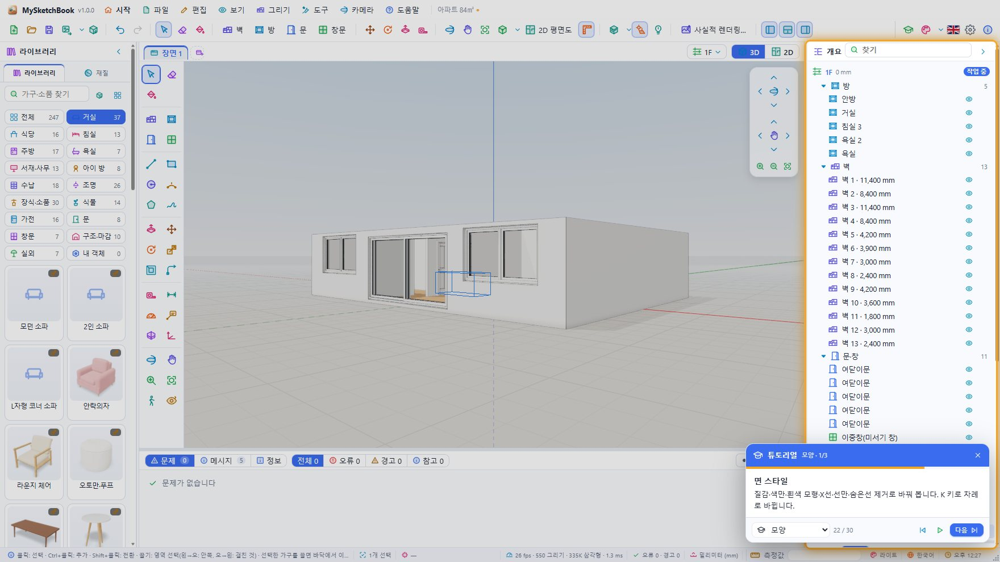

### 9.1 스타일 탭

- **면 스타일** — 질감(재질과 텍스처) · 색만(텍스처 없이 색) · 흰색 모형 · X선(반투명) · 선만 · 숨은선 제거. 툴바의 면 스타일 버튼이나 `K`로 차례로 바뀌고, ▾로 고릅니다.
- **모서리 선** — 물체의 윤곽선 표시.
- **조명 켜기 (램프가 빛을 냄)** — 천장등·스탠드 등 조명 가구가 실제 광원이 됩니다(툴바의 전구 버튼).
- **배경** — 하늘과 땅 · 흰색 · 어두운 색 · 환경 사진(HDRI).
- **환경 조명** — 기본 실내 조명, 또는 HDRI 8가지(밝은 거실 (흐린 낮) · 호텔 객실 · 바다 전망 스위트룸 · 촬영 스튜디오 · 맑은 낮 하늘 · 흐린 하늘 · 해 질 녘 · 밤). 반사와 주변광이 그 사진의 빛으로 바뀌며, 배경을 "환경 사진(HDRI)"으로 하면 사진이 배경으로 보입니다. 사실적 렌더링도 같은 HDRI로 비춥니다.
- **노출** — 0.3 ~ 2.5. 끄는 동안 바로 보입니다.
- **표시 품질** 묶음 — 표시 품질 · 구석 음영 (AO) · 계단 현상 제거 · 그림자 해상도 (9.4).

스타일은 장면마다 저장됩니다(10.1).

### 9.2 그림자 탭

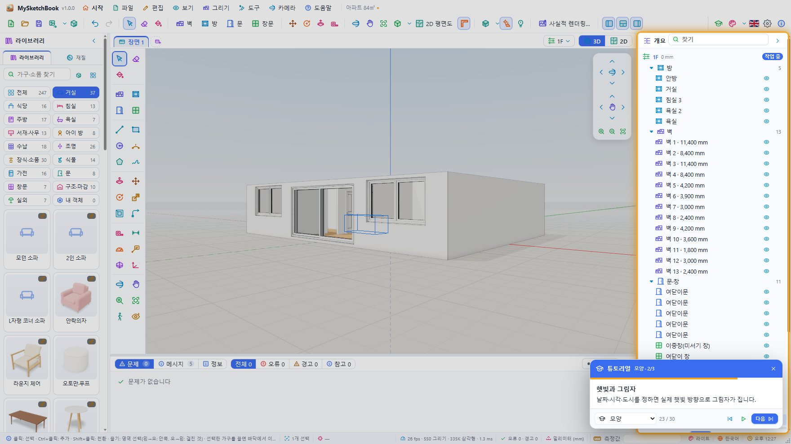

- **그림자 표시** — 툴바의 그림자 버튼과 같습니다.
- **시각**(05:00 ~ 21:00)과 **날짜** 막대 — 끌면 해의 위치와 그림자가 바로 바뀝니다.
- **위도 · 경도** — 집의 위치. **도시** 목록(서울 · 부산 · 제주 · 도쿄 · 뉴욕 · 런던 · 파리 · 시드니 · 싱가포르)에서 고르면 위도·경도·시간대가 들어갑니다.
- **북쪽 각도** — 평면도의 위쪽(−Z)과 실제 북쪽 사이의 각도.

### 9.3 보기 › 표시

눈금자 · 격자 · 축(빨강 X, 초록 Z, 파랑 위) · 모서리 선 · 그림자 · 조명 켜기 · 성능 표시 · 각 패널과 상태 표시줄을 켜고 끕니다.

### 9.4 표시 품질과 성능

**보기 › 표시 품질** 또는 스타일 탭에서 고릅니다.

| 품질 | 구석 음영 | 그림자 맵 | 계단 현상 제거 |
|---|---|---|---|
| 빠르게 | 없음 | 1024 | 없음 |
| 균형 (기본) | 있음 | 2048 | 4× |
| 고품질 | 있음 | 4096 | 8× |

화면은 **바뀐 것이 있을 때만** 다시 그립니다. 카메라를 움직이는 동안에는 구석 음영을 빼고 빠르게 그리다가, 멈추면 한 번 최고 품질로 그립니다. 움직이는 동안 프레임이 느려지면 해상도를 잠시 낮췄다가 멈추면 되돌립니다. 그 밖의 설정은 **설정 › 3D 보기**(16장)에 있습니다.

## 10. 장면 · 층 · 태그

### 10.1 장면

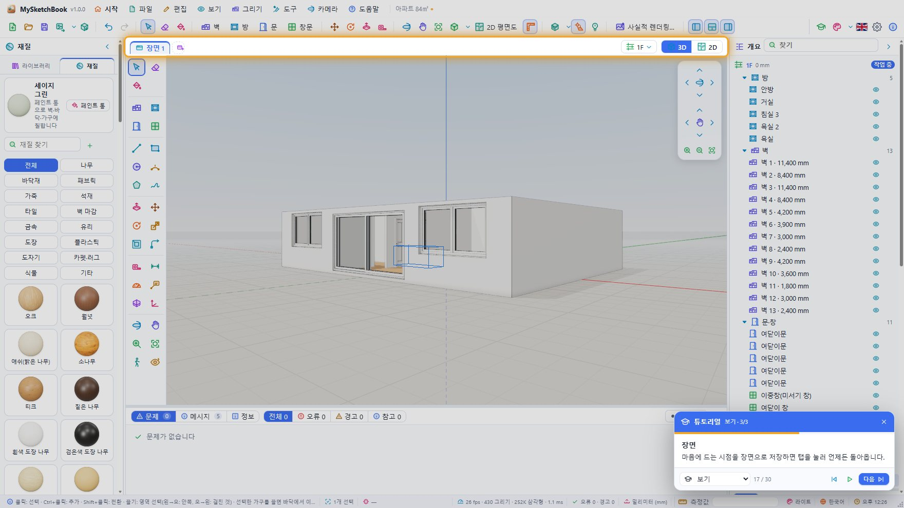

장면은 저장한 **시점**입니다. 카메라 위치, 면 스타일과 배경 등 스타일, 태그 보이기 상태, 2D/3D 여부가 함께 저장됩니다.

- 3D 화면 위 장면 탭 줄의 **+**(또는 **카메라 › 장면 추가**)로 지금 보기를 장면으로 추가합니다.
- 탭을 클릭하면 그 장면으로 부드럽게 이동합니다. `PageUp` / `PageDown`은 이전·다음 장면.
- **장면** 탭: 이 장면 보기 · 이름 바꾸기 · **현재 보기로 갱신** · 장면 삭제.

### 10.2 층

- **층 추가**(**그리기** 메뉴, 층 칩 메뉴, 층 탭의 +)는 맨 위층 위에 같은 높이의 층을 만들고("2F", "3F" …, 바닥판 25 cm를 띄움) 그 층을 작업 층으로 합니다.
- 3D 화면 오른쪽 위의 **층 칩**에서 작업 층을 고릅니다. 벽·방·가구·도형은 **작업 층에만** 그려지고 놓이며, 2D 평면도도 작업 층을 자릅니다.
- **층** 탭: 이 층에서 작업 · 이름 · 바닥 높이 · 층 높이 · 보이기/숨기기 · 층 삭제(층이 둘 이상일 때, 그 층의 벽·방·가구·모델도 함께 삭제).
- 벽의 높이는 따로 정하지 않으면 층 높이를 따릅니다.

### 10.3 태그

태그는 SketchUp의 태그(예전 레이어)처럼 물체를 묶어 한꺼번에 보이거나 숨깁니다.

- **태그** 탭의 **+**로 추가하고 이름을 바꿉니다. 눈 아이콘으로 보이기/숨기기, 오른쪽 숫자는 그 태그의 물체 수입니다.
- 벽·가구·모델의 속성 › **태그**에서 태그를 정합니다.
- 태그를 지우면 그 물체들은 "태그 없음"으로 돌아갑니다.

## 11. 내 3D 모델 가져오기

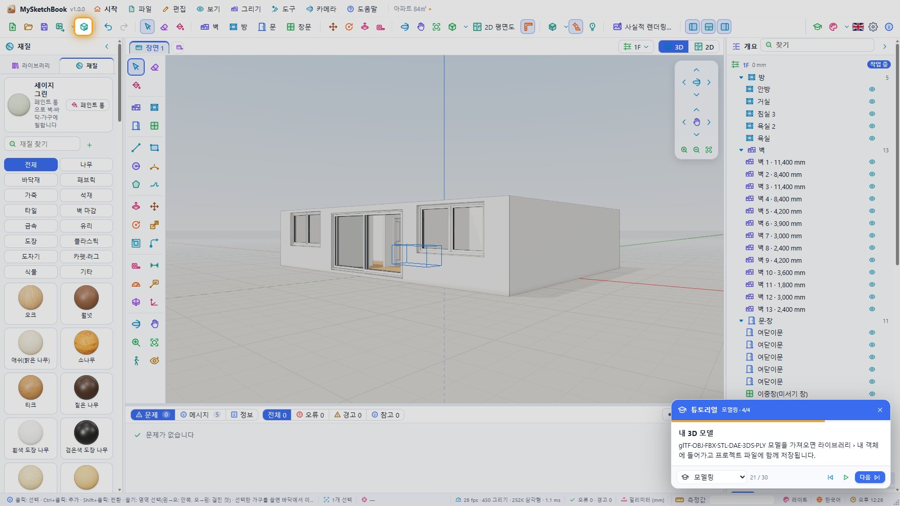

**파일 › 3D 모델 가져오기…**(`Ctrl+I`), 라이브러리의 가져오기 버튼, 또는 파일을 창에 끌어다 놓습니다.

| 형식 | 확장자 | 참고 |
|---|---|---|
| glTF / GLB | `.glb` `.gltf` | 가장 권장. `.gltf`는 `.bin`·텍스처를 함께 고릅니다 |
| Wavefront OBJ | `.obj` | `.mtl`과 텍스처 그림을 함께 고르면 재질이 들어옵니다 |
| Autodesk FBX | `.fbx` | |
| Collada | `.dae` | SketchUp 내보내기 형식 |
| STL | `.stl` | 3D 프린팅 |
| 3D Studio | `.3ds` | |
| PLY | `.ply` | 스캔 데이터 |
| 3MF | `.3mf` | 3D 프린팅 |
| USDZ | `.usdz` | |

- 가져오기 창에서 **파일 단위**(자동 · mm · cm · m · in · ft)와 **위쪽 축**(자동 · Y가 위 · Z가 위)을 고릅니다. 자동 단위는 모델 크기를 보고 실내 물건으로 그럴듯한 단위를 고르며("단위를 … (으)로 추정했습니다"), 200 m보다 크면 단위를 확인하라고 알립니다.
- **작은 부품 합치기 (빠르게)** — 부품이 아주 많은 모델을 재질별로 합쳐 빠르게 그립니다.
- 가져오는 동안 진행률 창이 나오며 취소할 수 있습니다. 끝나면 삼각형 수를 알리고, 라이브러리가 **내 객체**로 바뀌며 바로 놓을 수 있습니다.
- 가져온 모델은 GLB로 바뀌어 **프로젝트 파일(.msk) 안에 저장**됩니다. 다른 PC에서 열어도 그대로입니다. 놓은 뒤에는 다른 가구처럼 옮기고 돌리고 배율을 바꾸고 칠할 수 있습니다.
- **SketchUp(.skp)** 파일은 비공개 형식이라 직접 읽을 수 없습니다. SketchUp에서 **파일 › 내보내기 › 3D 모델**로 Collada(.dae) 또는 glTF(.glb)를 저장해 가져오세요.

### 11.1 도면 가져오기 (DXF · SVG · 그림)

**파일 › 도면 가져오기…**, 시작 화면의 **도면 가져오기**, 또는 파일을 창에 끌어다 놓습니다. 예제 도면은 `samples/plans/`에 있습니다(59㎡·84㎡ 아파트, 작은 사무실, 방 2개 주택; `node scripts/make-plan-samples.mjs`로 다시 만듭니다).

- **DXF / SVG** — 벽은 벽 두께만큼 떨어진 두 줄, 문은 호(반지름 = 문 폭)와 문짝 선, 창은 개구부를 가로지르는 여러 줄로 찾아 벽·문·창을 만들고, 벽으로 둘러싸인 곳마다 방을 만듭니다(방 이름 = 방 안의 글자). 블록(INSERT)·폴리라인·호를 읽고, 단위는 파일의 `$INSUNITS`(없으면 크기로 추정) 또는 직접 고른 값을 씁니다.
- 가져오기 창: **도면 단위**, **벽 그리기 방식**(자동 · 두 줄 · 한 줄 중심선, 한 줄 벽 두께), **기본 벽 높이**, **넣을 곳**(현재 층 바꾸기 · 새 층으로 추가 · 새 프로젝트), **나머지 선은 참조선으로 남기기**, **사용할 레이어**(치수·가구·해치 레이어는 처음에 꺼짐).
- **그림(PNG · JPG · WebP · BMP · GIF)** — 현재 층 바닥에 반투명하게 깔립니다(2D·3D). **두 점으로 축척 맞추기**를 켜면 길이를 아는 두 점을 클릭하고 실제 길이를 입력합니다(Esc 취소). 그다음 벽 도구로 따라 그리거나 **벽 자동 찾기**(검은 선·채운 벽의 윤곽을 읽어 벽·문 틈·창 틈을 만들고, 남길지 묻습니다)를 씁니다.
- 아무것도 선택하지 않았을 때 **엔티티 정보**의 **도면 그림**에서 보이기, 불투명도, 위치 X/Z, 회전, 폭(= 축척), 축척 맞추기, 벽 찾기, 지우기를 합니다. 그림은 .msk 파일 안에 함께 저장됩니다.

## 12. 저장 · 열기 · 내보내기

### 12.1 프로젝트 파일 (.msk)

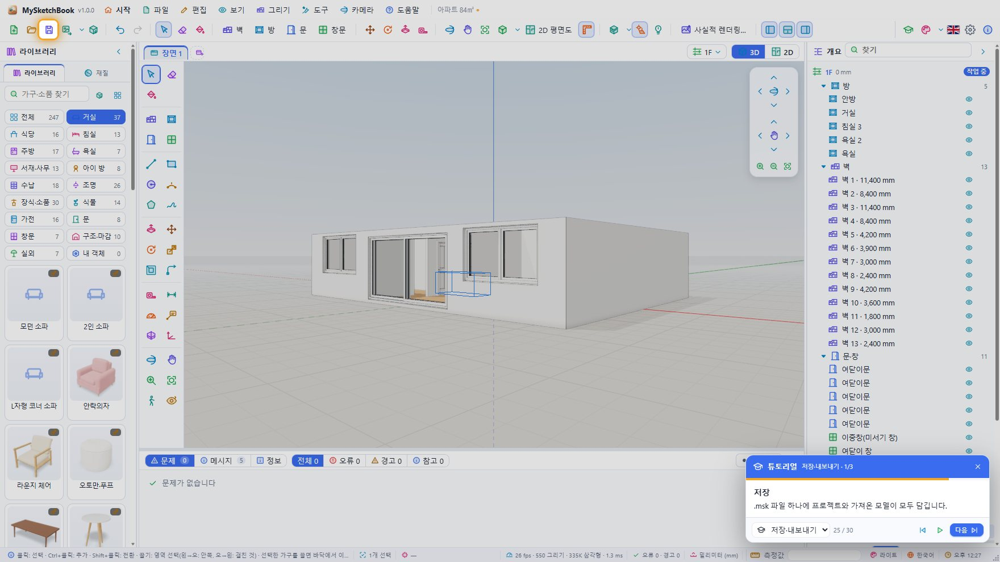

- **저장**(`Ctrl+S`), **다른 이름으로 저장…**(`Ctrl+Shift+S`). `.msk`는 ZIP 파일 하나에 프로젝트 내용(project.json), 작은 미리보기 그림, 가져온 모델이 모두 들어 있습니다.
- **열기…**(`Ctrl+O`)는 `.msk`와 3D 모델 파일을 모두 받습니다(3D 모델은 가져오기가 됩니다). `.msk` 파일을 창에 끌어다 놓아도 열립니다.
- **최근 파일…**(`Ctrl+R`), **최근 폴더**(그 폴더에서 열기 대화상자), **최근 파일·폴더 기록 모두 지우기**. 없어진 파일을 고르면 목록에서 지울지 묻습니다.
- 한 번에 프로젝트 하나를 엽니다. 저장하지 않은 변경이 있으면 새로 만들기·열기·닫기·끝내기 전에 **저장 / 저장 안 함 / 취소**를 묻습니다. 메뉴 막대의 프로젝트 이름 옆 ●가 저장하지 않은 변경 표시입니다.
- **프로젝트 닫기**(`Ctrl+W`)는 시작 화면으로 돌아갑니다.
- 데스크톱에서 **설정 › 일반 › 시작할 때 지난번에 연 파일 다시 열기**를 켜면 다음 실행 때 마지막 파일을 엽니다.
- 웹 버전: 저장은 브라우저의 저장 대화상자(지원하지 않는 브라우저는 내려받기)로, 최근 파일은 브라우저가 기억한 파일 핸들로 다시 엽니다(권한을 다시 물을 수 있음).

### 12.2 그림으로 저장

**파일 › 내보내기 › 그림으로 저장…**(`Ctrl+Shift+E`, 툴바의 그림 버튼):

- **크기**: HD · Full HD · QHD · 4K · 정사각 · A4 300dpi, 또는 가로 320~7680, 세로 240~4320 px.
- **형식**: PNG · JPEG · WebP. PNG는 **배경 투명**을 고를 수 있습니다.
- 창 크기와 상관없이 지금 시점을 최고 품질(그림자·구석 음영)로 그립니다.

### 12.3 평면도 그림

**파일 › 내보내기 › 평면도 그림 (.png)** — 2D 평면도와 숨은선 제거 스타일로 바꾸고 전체가 보이게 맞춘 뒤 3000 × 2000 PNG로 저장하고, 원래 보기로 돌아갑니다.

### 12.4 3D 파일로 내보내기

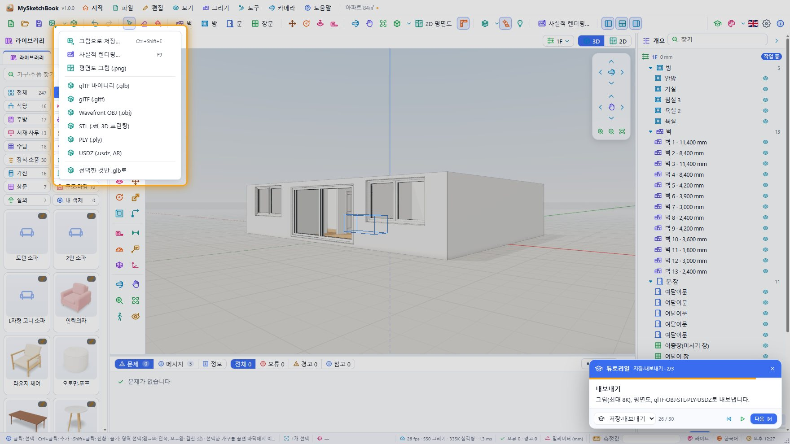

**파일 › 내보내기**에서 glTF 바이너리 (.glb) · glTF (.gltf) · Wavefront OBJ (.obj) · STL (.stl, 3D 프린팅) · PLY (.ply) · USDZ (.usdz, AR) 중 하나를 고르면 벽·바닥·문·창·가구·모델 전체를 미터 단위, Y가 위인 좌표로 저장합니다. 격자·축·안내선·모서리 선 같은 보조 표시는 빠집니다. **선택한 것만 .glb로**는 선택한 물체만 내보냅니다.

- glTF/GLB는 재질과 텍스처까지 들어가 다른 3D 프로그램·게임 엔진·SketchUp(확장 기능)·Blender에서 가장 잘 열립니다.
- OBJ는 형상과 재질 이름만 쓰고 `.mtl` 파일은 만들지 않습니다.
- USDZ는 iPhone·iPad의 AR 빠른 보기로 열 수 있습니다.

## 13. 사실적 렌더링

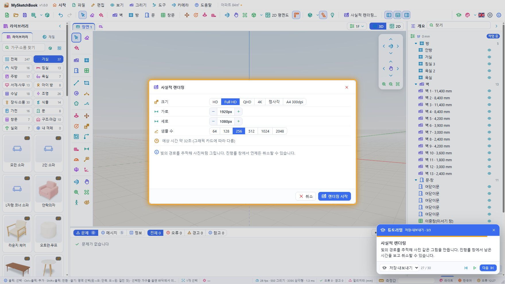

**사실적 렌더링…**(`F9`, 툴바)은 빛의 경로를 추적(path tracing)해 사진 같은 그림을 만듭니다.

1. 렌더링 창에서 **크기**(그림으로 저장과 같은 프리셋, 가로·세로)와 **샘플 수**(64 · 128 · 256 · 512 · 1024 · 2048)를 고릅니다. 예상 시간이 나옵니다(그래픽 카드에 따라 다름).
2. **렌더링 시작**을 누르면 진행률 창에 "샘플 수 / 전체 · 약 몇 초 남음"이 나옵니다. **취소**로 언제든 멈춥니다. 렌더링 중에도 프로그램은 응답합니다.
3. 끝나면 결과 창에 그림이 나오고 **PNG로 저장…** 으로 저장합니다.

- 지금 카메라 시점과 노출을 씁니다. 조명은 스타일 탭에서 고른 **환경 조명(HDRI)**이고, 기본 실내 조명이면 지금 하늘색으로 만든 하늘빛을 씁니다. 배경도 HDRI면 그 사진이 보입니다.
- 샘플이 많을수록 잡티가 줄고 오래 걸립니다. 먼저 64~128로 구도를 확인한 뒤 512 이상으로 마무리하세요.

## 14. 튜토리얼과 도움말 창

- **튜토리얼**(`F11`, 툴바, 시작 화면): 8개 장, 30단계로 실제 프로그램을 움직이며 기능을 보여 줍니다. 오른쪽 아래 카드에서 이전·다음·자동 재생·장 고르기·끝내기(`Esc`). 튜토리얼은 자기 예제 프로젝트에서 작업하고, 끝나면 원래 프로젝트와 설정을 되돌려 놓습니다. 단계별 내용은 [튜토리얼 문서](Tutorial.html)에 있습니다.
- **사용 설명서 · 튜토리얼 문서** — 별도의 창(웹은 새 탭)에서 열립니다. 위쪽 막대에서 장으로 이동, 한국어/English, 문서에서 찾기(`Ctrl+F`, `Enter` 다음 · `Shift+Enter` 이전), 인쇄, 브라우저로 열기. 문서는 프로그램의 테마 색을 따릅니다.
- **튜토리얼 동영상** — 튜토리얼 자동 재생을 녹화한 동영상(`npm run tutorial:video`로 만든 경우). 장 표시, 재생 속도, 전체 화면(`F`), `Space` 재생/일시정지, `←`/`→` 5초.
- **단축키 목록…** — 설정의 단축키 탭.
- **프로그램 정보…**(`F1`) — 버전, 빌드 날짜, 커밋, 실행 환경, 만든 사람.

## 15. 문제 검사

모델을 바꿀 때마다 잠시 뒤(0.4초) 자동으로 검사해 하단 패널의 **문제** 탭과 상태 표시줄에 개수를 보여 줍니다. **도구 › 지금 검사**로 바로 검사합니다.

| 심각도 | 문제 | 뜻과 해결 |
|---|---|---|
| 오류 | 문·창(…)이 벽(…)보다 넓습니다 | 문·창의 폭이 벽 길이보다 깁니다. 폭을 줄이거나 벽을 늘리세요 |
| 오류 | 문·창이 벽 끝을 벗어났습니다 | 위치(벽 시작점에서)가 벽 밖으로 나갔습니다. 문·창을 벽 안쪽으로 옮기세요 |
| 오류 | 문·창이 벽보다 높습니다 | 바닥에서 높이 + 높이가 벽 높이를 넘습니다 |
| 오류 | 문·창이 '…'와 겹칩니다 | 같은 벽의 두 문·창이 겹칩니다. 하나를 옮기세요 |
| 오류 | 라이브러리에 없는 항목입니다 (…) | 파일이 가리키는 항목이 이 버전의 라이브러리에 없습니다(라이브러리를 받지 않았거나 다른 버전). `npm run assets` 또는 다른 항목으로 바꾸기 |
| 경고 | 벽이 너무 짧습니다 (10 cm 미만) | 실수로 찍힌 짧은 벽일 수 있습니다. 지우거나 늘리세요 |
| 경고 | 어느 방에도 들어 있지 않습니다 | 가구의 중심이 그 층의 어느 방 바닥에도 없습니다(방이 있는 층만 검사) |
| 경고 | '…'와 …% 겹칩니다 | 바닥에 놓인 두 가구가 35%보다 많이 겹칩니다. 러그·카펫·쿠션은 검사하지 않습니다 |
| 참고 | 바닥에서 … 떠 있습니다 | 바닥 가구가 3 cm ~ 60 cm 떠 있습니다. **바닥에 내려놓기**로 고치세요 |
| 참고 | 벽은 있지만 방이 없습니다 | 벽만 있는 층입니다. 방 도구로 바닥을 만드세요 |

숨긴 가구는 검사하지 않습니다. 문제 행을 클릭하면 대상을 선택하고 보여 주며, 오른쪽 클릭 메뉴로 **선택하고 보기 · 복사 · 대상 삭제**를 합니다.

## 16. 설정

**도구 › 설정…** 또는 `Ctrl+,`. 바꾼 것은 바로 적용되고 저장됩니다. 아래의 **기본값으로**는 모든 설정을 처음대로 되돌립니다.

| 탭 | 항목 |
|---|---|
| **일반** | 언어(한국어/English) · 시작할 때 지난번에 연 파일 다시 열기(데스크톱) · 모델에서 요소를 삭제하기 전에 묻기 · 상태 표시줄에 시계 표시 · 상태 표시줄 · 마지막으로 쓴 폴더 · 튜토리얼 시작 |
| **시작 화면** | 시작할 때 시작 페이지 표시 · 시작할 때 안내 창 표시 · 최근 파일 표시 · 표시할 최근 파일 수(1~10) · 최근 폴더 표시 · 예제 프로젝트 표시 · 움직이는 배경 고르기 표시 · 튜토리얼 안내 띠 표시 · 시작 화면 지금 열기 |
| **테마** | 다크 20 · 라이트 20 · 사용자 정의, 시스템 설정(운영 체제의 밝기를 따름). 사용자 정의: 사용자 정의 테마 사용 · 어두운 테마 · 지금 테마의 색 가져오기 · 색 12가지(바탕 · 표면 · 패널 · 글자 · 흐린 글자 · 테두리 · 강조 · 강조 위 글자 · 줄무늬 행 · 차트 바탕 · 툴바 · 상태 표시줄), 글자가 잘 안 보이면 경고 |
| **글꼴** | 글꼴(시스템에 설치된 글꼴) · 글자 크기(9~28 px) · 굵기 · 스타일(보통/기울임) · 행 높이 · 확대/축소(50~200%) |
| **배경** | 배경 종류(움직이는 배경 · 이미지 · 없음) · 움직이는 배경 20가지 · 움직임 속도 · 시작할 때 배경 무작위 · 시작 페이지 배경 자동 변경(끄기 · 15초 · 30초 · 1분 · 2분 · 5분) · 움직이는 배경은 시작 페이지에서만 · 배경 이미지 고르기/지우기 · 배경 불투명도 · 맞춤(채우기 · 맞추기 · 바둑판 · 가운데 · 늘이기) |
| **3D 보기** | 아래 표 |
| **최근 기록** | 최근 파일과 최근 폴더 목록(없어진 것 표시), 하나씩 또는 모두 지우기 |
| **단축키** | 단축키 목록 (17장) |

**3D 보기** 탭:

| 묶음 | 항목 | 기본값 |
|---|---|---|
| 모델링 | 단위 (mm · cm · m · in · ft) — 새 프로젝트의 단위 | mm |
| | 기본 벽 높이 (1.8 ~ 6 m) | 2.4 m |
| | 기본 벽 두께 (0.05 ~ 0.6 m) — 새 벽의 두께 | 0.15 m |
| | 추론(스냅) 사용 | 켬 |
| | 격자에 맞춤 · 격자 간격 (0.05 ~ 2 m) | 끔 · 0.5 m |
| 화면 품질과 성능 | 표시 품질 (빠르게 · 균형 · 고품질) | 균형 |
| | 계단 현상 제거 · 구석 음영 (AO) · 그림자 표시 | 켬 |
| | 그림자 해상도 (낮음 · 보통 · 고품질) | 보통 |
| | 최대 프레임 (30 · 60 · 120 · 제한 없음) | 60 |
| | 해상도 배율 (자동 · 75% · 100% · 150% · 200%) | 자동 |
| | 성능 표시 (FPS·삼각형) | 켬 |
| 카메라 조작 | 왼쪽 버튼 끌기 — 회전 (빈 곳) · 선택 상자 (SketchUp). 선택 도구로 끌 때 화면을 돌릴지(`Alt`: 이동, 2D: 이동) 영역 선택을 할지 | 회전 (빈 곳) |
| | 시야각 (20 ~ 100°) | 50° |
| | 궤도 속도 · 확대 속도 (20 ~ 300%) | 100% |
| | 휠 방향 반대로 · 격자 · 축 | 끔 · 켬 · 켬 |

> 지금 버전에서 **기본 벽 높이**와 **추론(스냅) 사용**, 일반 탭의 **모델에서 요소를 삭제하기 전에 묻기**, 배경 탭의 **움직이는 배경은 시작 페이지에서만**은 저장만 되고 동작에는 아직 반영되지 않습니다. 새 벽은 층 높이를 따르고, 추론은 늘 켜져 있으며, 삭제는 묻지 않고 실행 취소로 되돌립니다.

프로젝트마다의 단위는 아무것도 선택하지 않은 상태의 **속성** 탭에서 바꿉니다. 단위를 바꾸면 치수·속성·측정값 상자가 모두 그 단위로 바뀝니다.

테마는 툴바의 테마 버튼(무작위)과 ▾(어두운/밝은 테마 두 줄 목록, 사용자 정의 테마 편집…), 언어는 국기 버튼이나 `Ctrl+Shift+L`로도 바꿉니다.

## 17. 단축키

**도움말 › 단축키 목록…**(설정 › 단축키)과 같은 목록입니다. 한 글자 단축키는 SketchUp과 같습니다. 글을 입력하는 칸에 커서가 있을 때는 한 글자 단축키가 동작하지 않습니다.

### 도구

| 키 | 기능 |
|---|---|
| `Space` | 선택 |
| `E` | 지우개 |
| `B` | 페인트 통 |
| `W` | 벽 |
| `Shift+R` | 방 |
| `Shift+C` | 기둥 |
| `Shift+S` | 계단 |
| `L` | 선 |
| `R` | 사각형 |
| `C` | 원 |
| `A` | 호 |
| `Shift+P` | 다각형 |
| `P` | 밀기/당기기 |
| `M` | 이동 |
| `Q` | 회전 |
| `S` | 크기 조절 |
| `F` | 오프셋 |
| `T` | 줄자 |
| `D` | 치수 |
| `O` | 궤도 |
| `H` | 이동(화면) |
| `Z` | 확대/축소 |
| `Shift+Z` | 전체 보기 |
| `K` | 면 스타일 바꾸기 |
| `G` | 그룹 만들기 |
| `F4` | 2D 평면도 |
| `F9` | 사실적 렌더링 |

### 마우스와 입력

| 키 | 기능 |
|---|---|
| `가운데 버튼 끌기` | 궤도 (오른쪽 버튼 끌기도 같음) |
| `Shift + 가운데 버튼 끌기` | 이동(화면) |
| `마우스 휠` | 확대/축소 (커서 쪽으로) |
| `숫자 입력` | 측정값 상자에 길이·각도 입력 (`Enter`로 적용) |
| `화살표 키` | 축 방향 고정 (그리기 중) · 선택한 것 10 cm 이동 (선택 도구, `Shift`: 1 cm) |
| `Shift 누르기` | 추론 방향 고정 |
| `이동 중 Ctrl` | 복사하며 이동 |
| `x5 / /5` | 배열 복사 (복사 직후) |
| `[ / ]` | 배치 중 회전 (90°, `Shift`: 15°) |
| `Alt + 클릭 (페인트 통)` | 재질 가져오기 |
| `W A S D (걷기 도구)` | 걷기 (`Shift` 빠르게, `Q`/`E` 아래/위) |
| `Esc` | 도구 끝내기 / 선택 해제 (그룹 편집 끝내기) |

### 파일과 편집

| 키 | 기능 |
|---|---|
| `Ctrl+N` | 새 프로젝트 |
| `Ctrl+O` | 열기 |
| `Ctrl+S` | 저장 |
| `Ctrl+Shift+S` | 다른 이름으로 저장 |
| `Ctrl+R` | 최근 파일 |
| `Ctrl+W` | 프로젝트 닫기 |
| `Ctrl+I` | 3D 모델 가져오기 |
| `Ctrl+Shift+E` | 그림으로 저장 |
| `Ctrl+Z` | 실행 취소 |
| `Ctrl+Y` | 다시 실행 (`Ctrl+Shift+Z`도 같음) |
| `Ctrl+X / C / V` | 잘라내기 · 복사 · 붙여넣기 |
| `Ctrl+D` | 복제 |
| `Delete` | 삭제 (`Backspace`도 같음) |
| `Ctrl+A` | 모두 선택 |
| `Ctrl+] / [` | 90° 회전 (시계 방향) / 반시계 방향 |

### 보기와 창

| 키 | 기능 |
|---|---|
| `PageUp / PageDown` | 이전 장면 / 다음 장면 |
| `Ctrl+Shift+1 / 2` | 라이브러리 패널 / 개요·속성 패널 |
| `Ctrl+J` | 하단 패널 |
| `Ctrl+Shift+R` | 눈금자 |
| `Ctrl+Shift+L` | 언어 전환 |
| `Ctrl+Shift+H` | 시작 페이지 |
| `Ctrl+Shift+B` | 움직이는 배경 바꾸기 |
| `Ctrl+,` | 설정 |
| `F11` | 튜토리얼 |
| `F1` | 프로그램 정보 |
| `Alt+F4` (macOS `Ctrl+Q`) | 끝내기 |

## 18. 성능을 위한 팁

- 화면은 바뀔 때만 그리므로 가만히 두면 그래픽 카드를 쓰지 않습니다. 상태 표시줄의 **성능 표시**(FPS · 그리기 호출 · 삼각형 · 프레임 시간)로 무엇이 느린지 봅니다.
- 느리면 **표시 품질 › 빠르게**, **구석 음영** 끄기, **그림자 해상도** 낮추기, **해상도 배율** 75%, **최대 프레임** 30 순서로 줄여 보세요.
- 같은 가구를 여러 개 놓아도 형상과 재질은 한 벌만 그래픽 카드에 올라가므로 부담이 적습니다. 반대로 수백만 삼각형짜리 모델을 가져오면 느려집니다. 가져올 때 **작은 부품 합치기**를 켜고, 필요하면 다른 프로그램에서 면 수를 줄이세요.
- 큰 집은 **층**이나 **태그**로 지금 필요 없는 부분을 숨기면 빨라집니다.
- 그림자는 장면이나 해가 바뀔 때만 다시 계산합니다. 시각 막대를 끄는 동안에는 그림자가 계속 다시 계산됩니다.
- 사실적 렌더링은 그래픽 카드를 오래 씁니다. 노트북은 전원을 연결하고, 낮은 샘플로 구도를 먼저 확인하세요.
- 웹 버전보다 데스크톱 앱이 파일 입출력이 빠르고 큰 파일을 다루기 좋습니다.

## 19. 자주 묻는 질문과 문제 해결

**라이브러리에 HQ 모델이 없고 재질이 단색으로만 보입니다.**
내려받은 라이브러리(`library/`)가 없을 때입니다. 소스에서 실행한다면 `npm run assets`로 받으세요. 설치판에는 들어 있습니다. 매개변수 가구와 단색 재질은 라이브러리 없이도 씁니다.

**SketchUp 파일(.skp)을 열 수 없습니다.**
.skp는 비공개 형식입니다. SketchUp에서 **파일 › 내보내기 › 3D 모델**로 .dae나 .glb를 저장해 가져오세요(11장).

**가져온 모델이 너무 크거나 작고, 누워 있습니다.**
가져오기 창에서 **파일 단위**와 **위쪽 축**을 직접 고르세요. 놓은 뒤에는 속성의 배율이나 크기 조절 도구로도 맞춥니다.

**OBJ를 가져왔더니 색이 없습니다.**
`.obj`와 함께 `.mtl` 파일과 텍스처 그림을 같이 골라(또는 같이 끌어다 놓아) 가져오세요.

**문·창이 벽에 들어가지 않습니다.**
벽 위를 클릭해야 하며, 문·창의 폭이 벽 길이보다 짧아야 합니다. 2D 평면도에서 하면 쉽습니다.

**방을 클릭해도 바닥이 생기지 않습니다.**
벽이 완전히 닫혀 있어야 합니다. 끝점에 맞춰(“끝점” 표시) 벽을 이으세요. 닫히지 않은 곳은 방 도구로 꼭짓점을 직접 찍어도 됩니다.

**밀기/당기기를 할 면이 없습니다.**
밀기/당기기는 그리기 도구로 만든 면(모델)에만 씁니다. 벽은 속성의 높이·두께로 바꾸세요. 선이 닫혀 면이 생겼는지(면이 칠해지는지) 확인하세요.

**솔리드 도구가 "닫힌 솔리드가 아닙니다"라고 합니다.**
구멍이나 남는 선이 없는 닫힌 입체만 됩니다. 모델 속성의 형상에 "solid … m³"가 나오는지 확인하세요.

**2D 평면도에서 돌아왔더니 화면이 기울어져 보입니다.**
**표준 보기 › 등각 보기**(툴바의 등각 보기 버튼)를 누르면 바로잡힙니다.

**사실적 렌더링이 너무 오래 걸립니다.**
샘플 수와 크기를 줄이세요. 진행률 창의 **취소**로 언제든 멈출 수 있습니다. 그래픽 카드가 작은 노트북에서는 Full HD·256 샘플도 몇 분 걸릴 수 있습니다.

**화면이 검게 나오거나 3D 화면이 보이지 않습니다.**
그래픽 드라이버를 업데이트하세요. 브라우저라면 하드웨어 가속이 켜져 있는지 확인하세요. **설정 › 3D 보기 › 해상도 배율**을 낮추면 메모리가 적은 그래픽 카드에서 도움이 됩니다.

**저장하지 않고 닫았습니다.**
저장하지 않은 프로젝트는 되돌릴 수 없습니다. 자주 `Ctrl+S`로 저장하세요. 실행 취소 기록(100단계)은 프로젝트를 닫으면 사라집니다.

**설정을 처음대로 되돌리고 싶습니다.**
**설정 › 기본값으로**. Windows에서는 설치 프로그램을 다시 실행할 때 사용자 데이터를 지울지 물어봅니다.

**오류 창이 떴습니다.**
오류 창의 내용(메시지·세부 정보·버전)은 복사할 수 있고, 하단 패널의 **메시지** 탭에도 남습니다. 문의할 때 함께 보내 주세요(SHKWON, knix008@naver.com).
