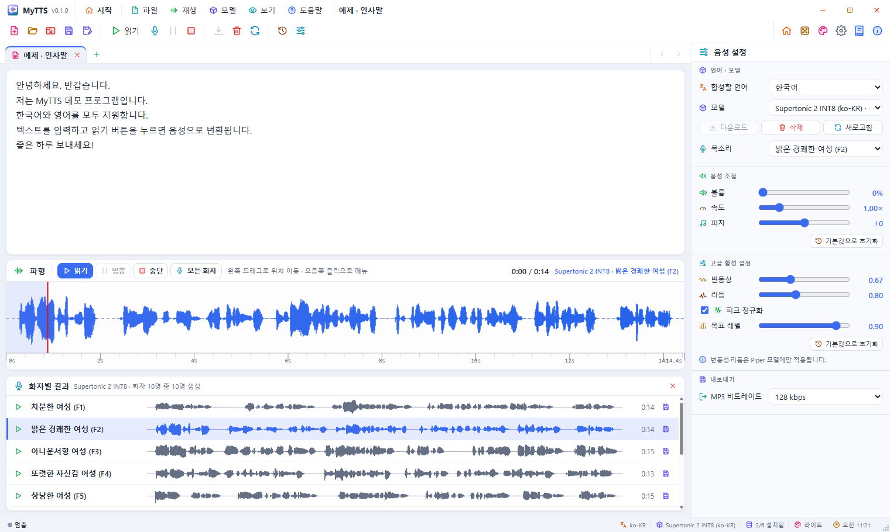

# MyTTS


Tauri 2 기반 멀티 플랫폼 TTS(Text-to-Speech) 프로그램입니다.
설치한 **ONNX / sherpa-onnx 음성 모델로 직접 합성**하고, 같은 PCM으로 파형을 그리고 재생하며 WAV · MP3로 저장합니다.
Rust(Tauri)가 창 · 대화 상자 · 클립보드를 맡고, TTS 엔진(onnxruntime-node · sherpa-onnx-node)은 함께 설치되는 Node.js 사이드카에서 돌아갑니다.

**개발자**: SHKWON (knix008@naver.com) · **버전**: 0.1.0

| 문서 | 내용 |
|------|------|
| [doc/UsersGuide.md](doc/UsersGuide.md) · [English](doc/UsersGuide.en.md) | 사용 설명서 (프로그램 안에서는 **도움말 › 사용 설명서**, F1) |
| [doc/Tutorial.md](doc/Tutorial.md) · [English](doc/Tutorial.en.md) | 따라 하는 튜토리얼 |
| [Architecture.md](Architecture.md) | 구조 · 채널 · 합성 흐름 · 빌드 |



---

## 주요 기능

- 모델별 실제 추론 — 운영체제 음성 엔진을 쓰지 않음, 모델은 HuggingFace에서 내려받음
- **텍스트 탭** 여러 개: 탭마다 텍스트 · 합성한 소리 · 파형 · 저장 위치를 따로 기억, 오른쪽 끝 **<** **>** 로 탭 줄 넘기기
- **모든 화자로 생성**: 화자가 여러 명인 모델(Supertonic 10명, Kokoro 82M 영어 28명, Kokoro KO/EN 4명)로 한 문장을 모든 화자로 만들어 「화자별 결과」에서 비교 · 재생 · 저장
- 파형에서 위치 이동 · 멈춤 · 이어 듣기, 볼륨 · 속도 · 피치, 고급 합성 설정(변동성 · 리듬 · 피크 정규화)
- WAV · MP3 저장 (비트레이트 선택, 파일 이름에 모델 · 화자)
- MyUMLMaker와 같은 화면: 시작 화면(움직이는 배경 + 카드 보드, 제목 카드는 고정), 제목 표시줄을 겸한 메뉴 막대, 컬러 아이콘 툴바 · 메뉴 · 우클릭 메뉴, 상태 표시줄
- 테마 42가지: 밝은 20 · 어두운 20 · 시스템 설정 · 사용자 정의 색
- **사용 설명서 창**: 사용 설명서 · 튜토리얼, 한국어 · English, 목차, 글자 크기, 인쇄 (테마를 따름)
- 음성 엔진은 화면과 다른 프로세스: 네이티브 오류로 엔진이 죽어도 프로그램은 남고, 엔진만 다시 시작해 「모델 삭제 후 다시 받기」를 제안

> 웹 모드(`npm run web`)는 화면 미리보기용입니다. **실제 합성은 데스크톱 프로그램에서만** 됩니다.

---

## 지원 모델

| 모델 ID | 이름 | 언어 | 엔진 | HuggingFace | 크기 |
|---------|------|------|------|-------------|------|
| `ko-supertonic-int8` | Supertonic 2 INT8 | 한국어 (+31개 언어) | sherpa-onnx | [csukuangfj2/sherpa-onnx-supertonic-tts-int8-2026-03-06](https://huggingface.co/csukuangfj2/sherpa-onnx-supertonic-tts-int8-2026-03-06) | ~100 MB |
| `ko-piper-kss` | Piper KSS | 한국어 | onnxruntime + goruut IPA + `@piper-plus/g2p` | [neurlang/piper-onnx-kss-korean](https://huggingface.co/neurlang/piper-onnx-kss-korean) | 64 MB (+ goruut ~96 MB) |
| `ko-mms-tts` | MMS TTS | 한국어 | onnxruntime (로마자 토큰) | [Xenova/mms-tts-kor](https://huggingface.co/Xenova/mms-tts-kor) | ~38 MB |
| `en-kokoro` | Kokoro 82M | 영어 (화자 28명) | onnxruntime + phonemizer (eSpeak-NG) | [onnx-community/Kokoro-82M-v1.0-ONNX](https://huggingface.co/onnx-community/Kokoro-82M-v1.0-ONNX) | ~96 MB |
| `ko-en-melotts` | MeloTTS KR/EN | 한국어 · 영어 | MeloTTS ONNX (INT8, 44.1 kHz) | [gnyong/melotts-kr-onnx](https://huggingface.co/gnyong/melotts-kr-onnx) | ~55 MB |
| `ko-en-kokoro` | Kokoro 82M KO/EN | 한국어(로마자 변환) · 영어 | onnxruntime, 다중 음성 | [onnx-community/Kokoro-82M-v1.0-ONNX](https://huggingface.co/onnx-community/Kokoro-82M-v1.0-ONNX) | ~84 MB |

모델 · 로그는 `%APPDATA%\TTSMultiOSV10\` (macOS · Linux: `~/TTSMultiOSV10/`)에 있습니다.

---

## 실행

```bash
npm install          # 의존성 (Rust 툴체인과 Node.js 22 이상 필요)
npm start            # 데스크톱 프로그램 (tauri dev)
npm run web          # 화면 미리보기만 (브라우저, 합성 없음)
```

## 빌드

```bash
npm run build:win    # Windows NSIS 설치 파일 → 프로젝트 루트로 복사
npm run build:mac    # macOS .app + DMG (macOS에서)
npm run build:linux  # AppImage + .deb (Linux에서)
npm run build:all    # 이 OS에서 만들 수 있는 전부
npm run build:debug  # 시험용 디버그 프로그램 (설치 파일 없음)
npm run icons        # assets/icon.svg → src-tauri/icons
npm run guide:images # doc/images/ko 스크린샷을 실제 프로그램에서 다시 찍기 (build:debug 먼저)
npm run clean        # 빌드 결과 지우기: dist/, src-tauri/target, src-tauri/gen, 루트의 설치 파일
npm run clean:all    # 위 + node_modules/ + %TEMP%의 시험용 모델 복사본 · 중단된 시험 폴더
npm run clean:dry    # clean:all이 지울 목록과 크기만 보기 (아무것도 지우지 않음)
```

설치본에는 Node.js 런타임과 운영용 `node_modules`(onnxruntime-node, sherpa-onnx-* 등 네이티브 모듈), 사용 설명서(`doc/`)가 함께 들어갑니다.
Windows 설치는 사용자별(관리자 권한 불필요)이며, 기존 설치(이전 이름 TTS Multi OS · Electron 판 포함)를 지운 뒤 사용자 데이터를 지울지 묻습니다(기본은 유지).

## 시험

```bash
npm test                 # 전부: unit · rust · web · desktop
npm run test:quick       # unit + rust
npm run test:unit        # Node: 호스트 프로토콜(실제 합성 포함), 오디오, 테마, 레이아웃, 아이콘, 문서, 설정
npm run test:web         # 헤드리스 Edge로 화면 전체 (시작 화면, 테마, 메뉴, 탭, 대화 상자, 사용 설명서)
npm run test:desktop     # 실제 Tauri 프로그램 (합성, 모든 화자, 탭, 파일, 창, 사용 설명서 창, 엔진 재시작, 종료)
npm run test:release     # build:win 뒤, 함께 묶인 Node만으로 릴리스 프로그램 시험
npm test -- --grep 탭     # 이름에 들어간 글자로 고르기 (--bail: 첫 실패에서 멈춤)
```

결과는 영어로, 색과 열을 맞춰 한 줄씩(번호 · 결과 · 분류 · 이름 · 시간) 나오고, 실행 중인 시험은 경과 시간과 함께 계속 표시되며, 마지막에 분류별 요약 표가 나옵니다.
데스크톱 시험은 소스가 바뀌었으면 디버그 프로그램을 먼저 다시 빌드합니다.

시험은 실제 데이터 폴더에 쓰지 않습니다. 실제 합성 시험은 `%APPDATA%\TTSMultiOSV10\models`의 모델을 `%TEMP%\tts-multios-test-data`로 **복사**해서 쓰고(읽기만), 프로그램은 `TTS_CONFIG_DIR`의 임시 폴더로 실행됩니다. 다른 복사본을 쓰려면 `TTS_TEST_APPDATA`를 지정하세요.

---

## 폴더 구조

```
MyTTSMultiOSV10/
├── doc/                     # 사용 설명서 · 튜토리얼 (한국어 · English), images/ko 스크린샷
├── src/
│   ├── web/                 # 화면: main.js(TTS 화면 로직), guide.js(사용 설명서 창), tauri-bridge.js
│   │   └── ui/              # shell(메뉴 · 툴바 · 시작 화면 · 테마), doctabs(탭), speakerpanel(화자별 결과),
│   │                        # contextmenu, markdown, themes(42), icons, startboard, background …
│   ├── host/                # Node 호스트: host.mjs(채널), rpc.mjs(JSON 줄 프로토콜), audio.mjs(PCM ↔ base64)
│   └── core/                # TTS 엔진: 모델 카탈로그 · 다운로드 · 합성 · WAV · MP3 · 로그
├── src-tauri/               # Rust: 창 · 대화 상자 · 클립보드 · 사용 설명서 창 · 호스트 관리, windows/hooks.nsh(설치)
├── scripts/                 # build · test 실행기(lib/reporter · cdp · desktop · testdata) · guide-shots
├── test/                    # unit.mjs · web.mjs · desktop.mjs
├── assets/                  # 프로그램 아이콘 (icon.svg 원본)
├── samples/                 # 예제 텍스트 10개 (한국어 5 · 영어 5)
├── index.html · guide.html · server.js
└── Architecture.md · README.md
```

## 연락처

SHKWON · knix008@naver.com
