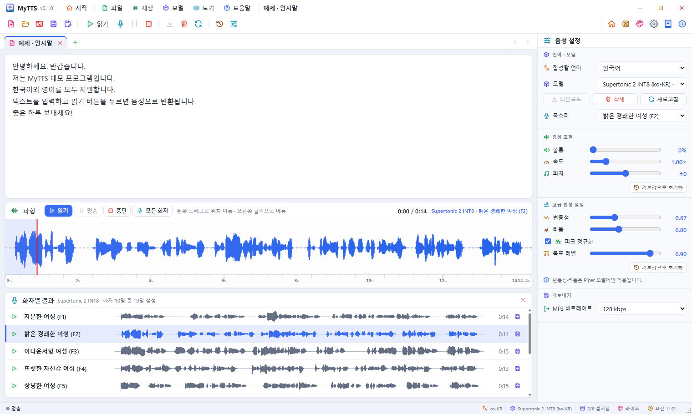
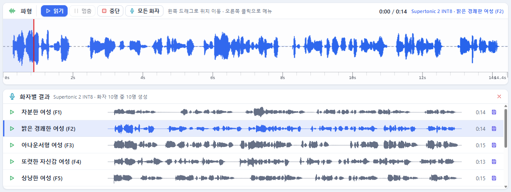
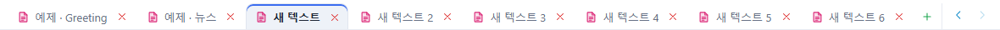
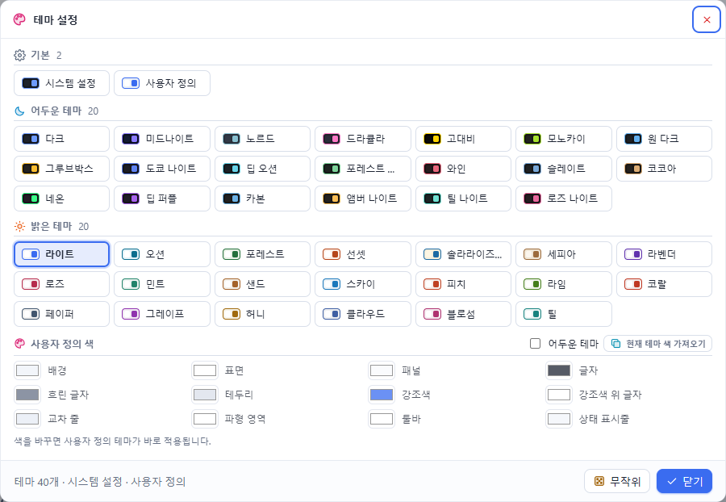

# MyTTS 0.1 — Tutorial

This hands-on tutorial walks through the main features of MyTTS step by step; it takes about 20 minutes.
Every feature is described in detail in the [User's Guide](UsersGuide.en.md). 한국어: [Tutorial.md](Tutorial.md).

> The interface is in Korean. Each label is given with its English meaning, for example **읽기** (Read).

| Step | You learn |
|------|-----------|
| [0. Preparation](#0-preparation) | Installing and downloading one model |
| [1. A look at the start screen](#1-a-look-at-the-start-screen) | Moving cards, choosing a theme |
| [2. Reading the first sentence](#2-reading-the-first-sentence) | Opening a sample, reading, pausing, seeking |
| [3. Voice and speed](#3-voice-and-speed) | Choosing a speaker; speed, pitch, volume |
| [4. Comparing every speaker](#4-comparing-every-speaker) | One sentence in every voice |
| [5. Saving](#5-saving) | WAV and MP3, quick save |
| [6. Working with several tabs](#6-working-with-several-tabs) | New tabs, switching, a sound per tab |
| [7. Opening your own text file](#7-opening-your-own-text-file) | Open, recent files |
| [8. Your own theme](#8-your-own-theme) | Custom colours |

---

## 0. Preparation

1. Install with `MyTTS_0.1.0_x64-setup.exe` and start the program.
2. On the start screen's **음성 모델** (Voice models) card, click **Supertonic 2 INT8**. The editor opens with that model selected.
3. Press **다운로드** (Download) in the **음성 설정** (Voice settings) panel. The status bar shows the progress (about 100 MB).
4. When it finishes, the model shows 「✓ 설치됨」 (installed).

> Supertonic has 10 speakers, which suits the "all speakers" exercise in step 4.

## 1. A look at the start screen

1. Press **시작** (Home) in the menu bar to return to the start screen.
2. Drag the **예제 텍스트** (Samples) card by its handle (the four-way arrow, top left) onto the **바로 가기** (Shortcuts) card. The other cards make room.
3. Drag a card's bottom-right corner to resize it.
4. **자동 정렬** (Auto arrange, top right) restores the default arrangement.
5. Click a theme you like on the **테마** (Themes) card. The whole window changes colour at once.
6. On the **움직이는 배경** (Moving background) card, try **별빛** (Starfield) or **오로라** (Aurora).

## 2. Reading the first sentence

1. Under **예제 텍스트** (Samples), click the Korean **인사말** (Greeting). A new tab 「예제 · 인사말」 opens.
2. Press **읽기** (Read, F5) above the waveform. When synthesis finishes, the waveform is drawn and you hear it.
3. While it plays, press **멈춤** (Pause, F6); **읽기** (Read) continues from there.
4. Click the middle of the waveform to jump there; drag with the left button to scrub.
5. Right-click the waveform and choose **처음으로** (To the start).

## 3. Voice and speed

1. Choose another speaker under **목소리** (Voice), for example 「밝은 경쾌한 여성 (F2)」, and press **읽기** (Read). It synthesizes again.
2. Raise **속도** (Speed) to about 1.30× and read again.
3. Set **피치** (Pitch) to +3 and **볼륨** (Volume) to 80 %.
4. Restore them with **기본값으로 초기화** (Reset to defaults) under 음성 조절 (Voice settings).

## 4. Comparing every speaker

1. Press **모든 화자** (All speakers, Shift+F5) above the waveform.
2. **화자별 결과** (Speaker results) below the waveform gets ten rows, generated one after another.
3. When they are done, press **▶** on a row you like. Its sound goes to the main waveform and the voice list selects that speaker.
4. Listen to a few more to compare.

## 5. Saving

1. Press the **save** button on the row you liked. The suggested file name contains the model and the speaker.
2. Choose `.mp3` as the type and save. The **MP3 비트레이트** (MP3 bit rate) under 내보내기 (Export) is used.
3. Now **저장** (Save, Ctrl+S) on the toolbar saves straight over that file.
   To save somewhere else, use **다른 이름으로 저장** (Save as, Ctrl+Shift+S).

## 6. Working with several tabs

1. Open a new tab with **+** (Ctrl+N) on the tab row.
2. Type `Today I try several tabs.`, then press **읽기** (Read).
3. Click the first tab 「예제 · 인사말」. Its text, waveform and speaker results come back unchanged.
4. Switch between tabs with **Ctrl+Tab**.
5. Press **+** several times: when the tabs no longer fit, **<** **>** at the right end become active. Use them to scroll the tab row.
6. Right-click a tab and choose **다른 탭 모두 닫기** (Close other tabs) to tidy up.

## 7. Opening your own text file

1. Make a `.txt` file in Notepad with a few sentences and save it.
2. Open it with **열기** (Open, Ctrl+O) on the toolbar. A new tab named after the file appears.
3. On the start screen, the **최근 항목** (Recent) card now lists the file; clicking it opens it again.
4. Right-click the editor and try the edit menu: **모두 선택** (Select all), **복사** (Copy) …

## 8. Your own theme

1. Open **보기 › 테마 설정…** (View › Theme settings).
2. Under **사용자 정의 색** (Custom colours), press **현재 테마 색 가져오기** (Take the current theme's colours).
3. Change **강조색** (Accent) to a colour you like. Buttons, icons and the waveform change with it.
4. Tick **어두운 테마** (Dark theme) and check that the status bar's theme name reads 「사용자 정의」 (Custom).

---

That's it. The shortcut list and the remaining features are in the [User's Guide](UsersGuide.en.md#13-keyboard-shortcuts).
Help is always one **F1** away.
