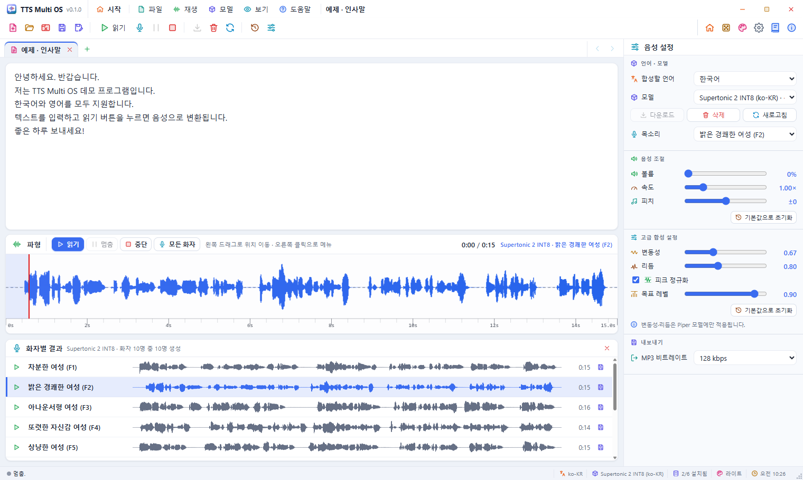
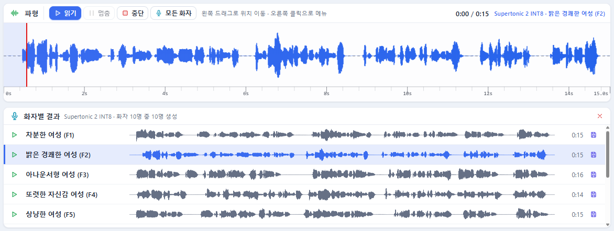
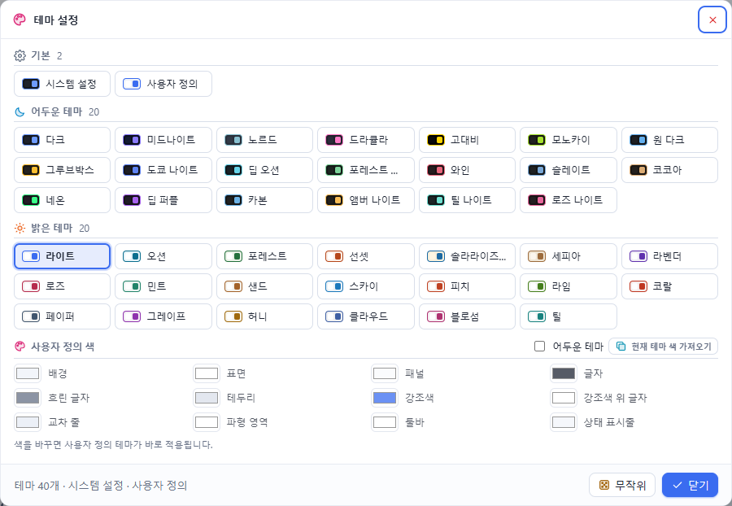

# TTS Multi OS 0.1 — 튜토리얼

이 문서는 직접 따라 하며 TTS Multi OS의 주요 기능을 차례로 익히는 실습서입니다. 처음부터 끝까지 20분쯤 걸립니다.
기능 하나하나의 자세한 설명은 [사용 설명서](UsersGuide.md)에 있습니다. English version: [Tutorial.en.md](Tutorial.en.md).

| 단계 | 배우는 것 |
|------|-----------|
| [0. 준비](#0-준비) | 설치와 모델 하나 받기 |
| [1. 시작 화면 둘러보기](#1-시작-화면-둘러보기) | 카드 옮기기, 테마 고르기 |
| [2. 첫 문장 읽기](#2-첫-문장-읽기) | 예제 열기, 읽기, 멈춤, 위치 이동 |
| [3. 목소리와 속도 바꾸기](#3-목소리와-속도-바꾸기) | 화자 고르기, 속도 · 피치 · 볼륨 |
| [4. 모든 화자로 비교하기](#4-모든-화자로-비교하기) | 한 문장을 모든 화자로 만들어 듣기 |
| [5. 저장하기](#5-저장하기) | WAV · MP3 저장, 빠른 저장 |
| [6. 탭 여러 개로 작업하기](#6-탭-여러-개로-작업하기) | 새 탭, 탭 이동, 탭마다 다른 소리 |
| [7. 내 텍스트 파일 열기](#7-내-텍스트-파일-열기) | 열기, 최근 항목 |
| [8. 나만의 테마](#8-나만의-테마) | 사용자 정의 색 |

---

## 0. 준비

1. `TTS Multi OS_0.1.0_x64-setup.exe`로 설치하고 실행합니다.
2. 시작 화면의 **음성 모델** 카드에서 **Supertonic 2 INT8**을 누릅니다. 편집기가 열리고 그 모델이 선택됩니다.
3. 오른쪽 **음성 설정** 패널의 **다운로드**를 누릅니다. 아래 상태 표시줄에 진행률이 나옵니다 (약 100 MB).
4. 끝나면 모델 이름 옆이 「✓ 설치됨」으로 바뀝니다.

> Supertonic은 화자가 10명이라 4단계의 「모든 화자」 실습에 알맞습니다.

## 1. 시작 화면 둘러보기

1. 메뉴 막대의 **시작**을 눌러 시작 화면으로 돌아갑니다.
2. **예제 텍스트** 카드의 왼쪽 위 손잡이(네 방향 화살표)를 끌어 **바로 가기** 카드 위로 옮겨 봅니다. 다른 카드가 비켜 납니다.
3. 오른쪽 아래 모서리를 끌어 카드 크기를 바꿔 봅니다.
4. 오른쪽 위 **자동 정렬**로 처음 배치로 되돌립니다.
5. **테마** 카드에서 마음에 드는 테마를 누릅니다. 창 전체 색이 바로 바뀝니다.
6. **움직이는 배경** 카드에서 **별빛**이나 **오로라**를 눌러 배경을 바꿔 봅니다.

## 2. 첫 문장 읽기

1. **예제 텍스트**의 한국어 **인사말**을 누릅니다. 새 탭 「예제 · 인사말」이 열립니다.
2. 파형 위 **읽기**(F5)를 누릅니다. 합성이 끝나면 파형이 그려지고 소리가 납니다.
3. 재생 중에 **멈춤**(F6)을 누르고, 다시 **읽기**를 누르면 멈춘 곳부터 이어집니다.
4. 파형 가운데를 누르면 그 위치로 가고, 왼쪽 단추로 끌면 위치를 옮기며 들을 수 있습니다.
5. 파형을 우클릭해 **처음으로**를 눌러 봅니다.

## 3. 목소리와 속도 바꾸기

1. 오른쪽 **목소리**에서 다른 화자(예: 「밝은 경쾌한 여성 (F2)」)를 고르고 **읽기**를 누릅니다. 다시 합성됩니다.
2. **속도**를 1.30×쯤으로 올리고 읽어 봅니다.
3. **피치**를 +3으로, **볼륨**을 80 %로 바꿔 봅니다.
4. **음성 조절**의 **기본값으로 초기화**로 되돌립니다.

## 4. 모든 화자로 비교하기

1. 파형 위 **모든 화자**(Shift+F5)를 누릅니다.
2. 파형 아래 **화자별 결과**에 화자 10명이 한 줄씩 생기고 차례로 만들어집니다.
3. 다 만들어지면 마음에 드는 줄의 **▶**를 누릅니다. 위 파형에 그 화자의 소리가 올라가고 목소리 목록도 그 화자로 바뀝니다.
4. 몇 명을 더 들어 비교해 봅니다.

## 5. 저장하기

1. 마음에 든 화자 줄의 **저장** 단추를 누릅니다. 파일 이름에 모델과 화자 이름이 들어가 있습니다.
2. 형식에서 `.mp3`를 고르고 저장합니다. 오른쪽 **내보내기**의 **MP3 비트레이트**가 쓰입니다.
3. 이제 도구 모음의 **저장**(Ctrl+S)을 누르면 방금 저장한 파일에 바로 덮어씁니다.
   다른 곳에 저장하려면 **다른 이름으로 저장**(Ctrl+Shift+S).

## 6. 탭 여러 개로 작업하기

1. 탭 줄의 **+**(Ctrl+N)로 새 탭을 엽니다.
2. `오늘은 탭을 여러 개 써 봅니다.`를 입력하고 **읽기**를 누릅니다.
3. 첫 탭 「예제 · 인사말」을 누릅니다. 그 탭의 글과 파형, 화자별 결과가 그대로 돌아옵니다.
4. **Ctrl+Tab**으로 탭 사이를 오가 봅니다.
5. **+**를 여러 번 눌러 탭을 늘리면 오른쪽 끝 **<** **>**가 켜집니다. 눌러서 탭 줄을 넘겨 봅니다.
6. 탭을 우클릭해 **다른 탭 모두 닫기**로 정리합니다.

## 7. 내 텍스트 파일 열기

1. 메모장으로 `.txt` 파일을 하나 만들어 문장 몇 개를 넣고 저장합니다.
2. 도구 모음의 **열기**(Ctrl+O)로 그 파일을 엽니다. 파일 이름으로 새 탭이 생깁니다.
3. 시작 화면으로 가 보면 **최근 항목** 카드에 그 파일이 있습니다. 누르면 다시 열립니다.
4. 편집기를 우클릭해 **모두 선택**, **복사** 같은 편집 메뉴를 써 봅니다.

## 8. 나만의 테마

1. **보기 › 테마 설정…**을 엽니다.
2. 아래 **사용자 정의 색**에서 **현재 테마 색 가져오기**를 누릅니다.
3. **강조색**을 원하는 색으로 바꿉니다. 단추와 아이콘, 파형 색이 함께 바뀝니다.
4. **어두운 테마**를 켜 보고, 상태 표시줄의 테마 이름이 「사용자 정의」로 바뀐 것을 확인합니다.

---

다 했습니다. 단축키 목록과 나머지 기능은 [사용 설명서](UsersGuide.md#13-단축키)에서 확인하세요.
도움말은 언제든 **F1**로 열 수 있습니다.
