# TTS Multi OS 0.1 — User's Guide

TTS Multi OS reads Korean and English text aloud by **synthesizing it with voice models you install**.
It does not use the operating system's speech engine: the sound comes from downloaded ONNX and sherpa-onnx models.
You can see the result as a waveform, play it from any point, and save it as WAV or MP3.

New users should start with the hands-on [Tutorial](Tutorial.en.md).
한국어: [UsersGuide.md](UsersGuide.md)

> The program's interface is in Korean. This guide gives each Korean label with its English meaning,
> for example **읽기** (Read). The screenshots show the Korean interface.

## Contents

1. [Getting started](#1-getting-started)
2. [The window](#2-the-window)
3. [Start screen](#3-start-screen)
4. [Text tabs](#4-text-tabs)
5. [Reading and playback](#5-reading-and-playback)
6. [Models and voices](#6-models-and-voices)
7. [Generate with every speaker](#7-generate-with-every-speaker)
8. [Voice and advanced synthesis settings](#8-voice-and-advanced-synthesis-settings)
9. [Saving (WAV · MP3)](#9-saving-wav--mp3)
10. [Menus and context menus](#10-menus-and-context-menus)
11. [Toolbar](#11-toolbar)
12. [Themes](#12-themes)
13. [Keyboard shortcuts](#13-keyboard-shortcuts)
14. [The guide window](#14-the-guide-window)
15. [Data folders · install · uninstall](#15-data-folders--install--uninstall)
16. [Troubleshooting](#16-troubleshooting)

---

## 1. Getting started

### Installing

On Windows, run `TTS Multi OS_0.1.0_x64-setup.exe`.

- It installs for the current user and does not ask for administrator rights.
- The installer brings the Node.js runtime the voice engine needs; nothing else has to be installed.
- An installed TTS Multi OS (including the earlier Electron build) is removed completely first.
  The installer then asks whether to delete downloaded voice models, settings and logs. The default is **keep**.

To run from source you need the Rust toolchain and Node.js: `npm install`, then `npm start`.

### First start

1. The start screen opens. Press **텍스트 읽기 시작** (Start reading text) or **시작** (Home) in the menu bar to reach the editor.
2. In the **음성 설정** (Voice settings) panel on the right, choose a **모델** (Model) and press **다운로드** (Download).
   It downloads from HuggingFace; progress shows in the status bar.
3. When it is installed, type a sentence and press **읽기** (Read, F5).

> A model is downloaded once. Installed models show as 「설치됨」 (installed) on the start screen's **음성 모델** (Voice models) card.

---

## 2. The window

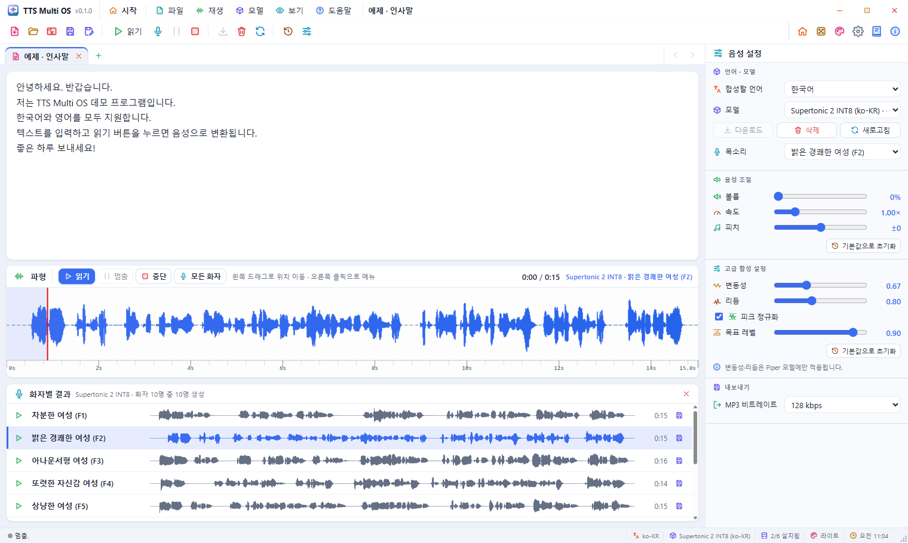

| Area | What it is |
|------|------------|
| **Menu bar** (top) | Program icon, name and version, directly followed by **시작** (Home) and the menus 파일 (File) · 재생 (Play) · 모델 (Model) · 보기 (View) · 도움말 (Help); then the current tab's name; minimize, maximize and close at the right end. It replaces the system title bar: drag an empty part to move the window, double-click it to maximize. |
| **Toolbar** | Colour icon buttons for frequent commands ([chapter 11](#11-toolbar)) |
| **Text tabs** | One tab per text; **+** for a new tab; **<** **>** at the right end ([chapter 4](#4-text-tabs)) |
| **Editor** | The text to read; right-click for the edit menu |
| **Waveform** | The synthesized sound, the Read · Pause · Stop · All speakers buttons, time, model and voice |
| **화자별 결과** (Speaker results) | Results of "All speakers" ([chapter 7](#7-generate-with-every-speaker)) |
| **음성 설정** (Voice settings, right) | Language, model, voice; voice settings; advanced synthesis; export |
| **Status bar** (bottom) | Progress, download progress, language, model, installed models, theme (click: theme settings), clock |
| **Resize grip** (dotted triangle, bottom right) | Drag it to resize the window (the window edges work too) |

The window can be resized freely; a minimum size (1180×720) keeps the toolbar from being cut off.

---

## 3. Start screen

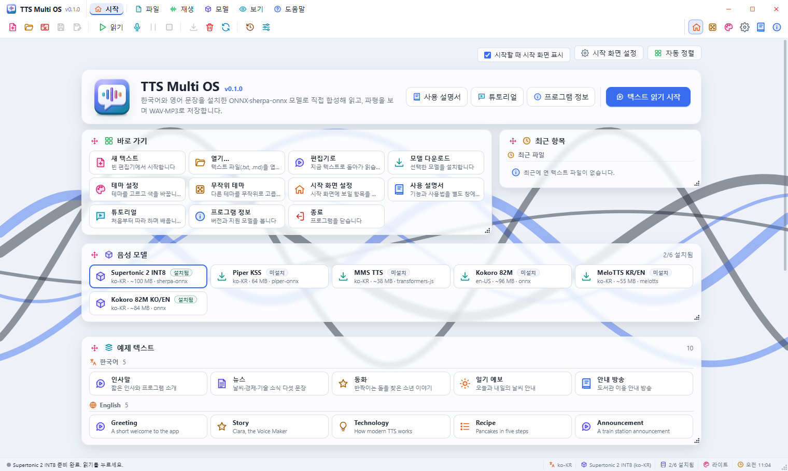

The start screen appears when the program starts. **시작** (Home) in the menu bar or **Ctrl+Home** switches between it and the editor.

| Card | Contents |
|------|----------|
| Title | Name, version, description; **사용 설명서** (User's Guide), **튜토리얼** (Tutorial), **프로그램 정보** (About); **텍스트 읽기 시작** (Start reading). It is fixed at the top and cannot be moved or resized. |
| 바로 가기 (Shortcuts) | New text · Open · To the editor · Download model · Theme settings · Random theme · Start screen settings · User's Guide · Tutorial · About · Exit |
| 최근 항목 (Recent) | Text files opened recently. Click to open in a tab; × removes it from the list. |
| 음성 모델 (Voice models) | Each model's language, size, engine and whether it is installed. Click to open the editor with that model. |
| 예제 텍스트 (Samples) | Five Korean and five English texts; click to open one in a new tab with the language set (a sample already open goes to its tab). |
| 테마 (Themes) | 20 dark and 20 light themes ([chapter 12](#12-themes)) |
| 움직이는 배경 (Moving background) | 20 backgrounds, shuffle, motion speed, card opacity, random at start, automatic change interval |

- Drag a card's **handle** (four-way arrow, top left) to move it and its **corner** (bottom right) to resize it.
  Double-click the corner to fit the height to the contents again.
- **자동 정렬** (Auto arrange, top right) puts the cards back in the default arrangement.
- Untick **시작할 때 시작 화면 표시** (Show the start screen at startup) to start in the editor next time.
- **시작 화면 설정** (Start screen settings) chooses the cards shown, the number of recent files, the card opacity and the motion speed.

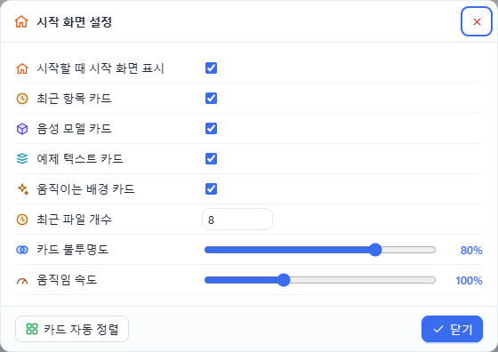

---

## 4. Text tabs

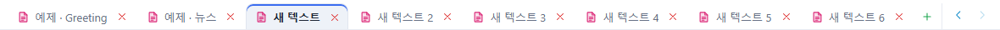

- Every text has its own tab. **+** or **Ctrl+N** opens a new one.
- Close a tab with its **×**, the middle mouse button or **Ctrl+W**. A modified tab (●) asks before closing.
  There is no "save text" command: keep texts you need in another editor.
- **Ctrl+Tab** / **Ctrl+Shift+Tab** go to the next / previous tab.
- When the tabs do not fit, **<** **>** at the right end (or the mouse wheel) scroll the tab row.
- Each tab keeps its text and cursor and also **its synthesized sound, waveform, last save location and speaker results**.
  While synthesizing, tabs cannot be switched or closed.
- Opening a file or a sample opens a new tab. An untouched tab is reused, and a file that is already open is shown in its tab.
- Right-click a tab for New text tab · Open · Close tab · Close other tabs.

---

## 5. Reading and playback

1. Type text in the editor. The **합성할 언어** (Synthesis language: 한국어 / English) follows what you type;
   you can also set it yourself (the model does not change).
2. **읽기** (Read, F5) synthesizes with the current model and voice, then plays.
   If the model is not installed, the download starts first.
3. The waveform shows the real sound the model produced; a red line follows the playback position.

While it synthesizes, a **progress window** opens (very short jobs finish without it): model and speaker, the start of the text,
a moving bar and the elapsed time. **취소** (Cancel) drops the result when synthesis ends (the engine cannot stop mid-sentence).

| Action | How |
|--------|-----|
| Pause / resume | **멈춤** (Pause, F6), then **읽기** (Read) |
| Back to the start | **중단** (Stop, F7) |
| Jump | Click the waveform or drag with the left button |
| Hear the same text again | With the same text, model, voice and language it plays at once without synthesizing again |

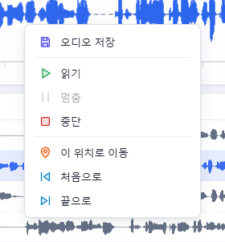

Right-click the waveform for Save audio · Read · Pause · Stop · Go here · To the start · To the end.

---

## 6. Models and voices

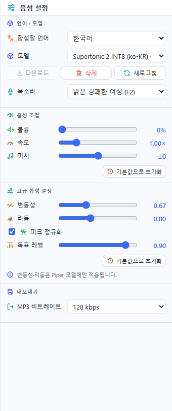

Choose a **모델** (Model), install it with **다운로드** (Download) or remove it with **삭제** (Delete).
**새로고침** (Refresh) reads the list and the installed state again. **목소리** (Voice) lists the model's speakers.

| Model | Language | Engine | Size | Speakers |
|-------|----------|--------|------|----------|
| Supertonic 2 INT8 | Korean (31 languages possible) | sherpa-onnx | ~100 MB | 10 (F1–F5, M1–M5) |
| Piper KSS | Korean | onnxruntime + goruut phonemizer | 64 MB (+ goruut ~96 MB) | 1 |
| MMS TTS | Korean | onnxruntime (romanized tokens) | ~38 MB | 1 |
| Kokoro 82M | English | onnxruntime + phonemizer | ~96 MB | 28 (American and British, female and male) |
| MeloTTS KR/EN | Korean · English | MeloTTS ONNX (INT8) | ~55 MB | model default |
| Kokoro 82M KO/EN | Korean (romanized) · English | onnxruntime | ~84 MB | 4 (Bella, Heart, Adam, Michael) |

- While a model downloads, a **progress window** shows the percentage, the file being fetched, MB received / total and the elapsed time.
  **숨기기** (Hide) only closes the window; the download goes on and the status bar keeps showing its progress.
- Choosing a model warms its engine up so the first read is quick; the status bar briefly shows 「엔진 준비 중…」 (preparing the engine).
- Piper KSS downloads the goruut phonemizer (~96 MB) the first time.
- Kokoro 82M (English) reads Korean text by its romanization, which can sound odd; use English text with it.
- The voice engine runs in a separate process. If a damaged model file crashes it, the program stays open,
  the engine restarts by itself and offers **모델 삭제 후 다시 받기** (Delete the model and download again).

---

## 7. Generate with every speaker

Models with several speakers (Supertonic: 10, Kokoro 82M English: 28, Kokoro KO/EN: 4) can produce the same text in every voice at once for comparison.

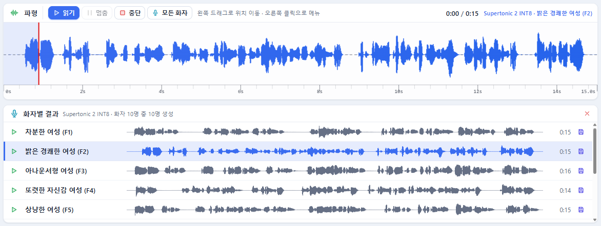

1. Type the text and press **모든 화자** (All speakers) above the waveform (also **Shift+F5**, the Play menu, the toolbar and the editor's context menu).
   It is disabled for single-speaker models.
2. **화자별 결과** (Speaker results) below the waveform gets a row per speaker, changing from 「생성 중…」 (generating) to a waveform and length.
   A **progress window** shows how far it is, e.g. 「3 / 10 화자 · 30%」 (3 of 10 speakers), the speaker being made and the elapsed time.
   **생성 중단** (Stop generating), in the window or the results, skips the remaining speakers once the current one is done.

   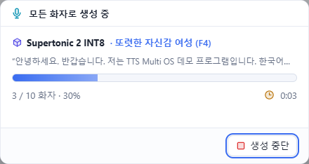
3. A row's **▶** puts that speaker's sound in the main waveform, plays it and selects that speaker in the voice list,
   so seeking, pausing and saving work as usual.
4. A row's **save** button saves that speaker's sound; the file name includes the speaker's name.

The results belong to the tab; **×** closes them.

---

## 8. Voice and advanced synthesis settings

| Setting | Range | Meaning |
|---------|-------|---------|
| 볼륨 (Volume) | 0–200 % | Playback volume (does not change saved files) |
| 속도 (Speed) | 0.25–4.00× | Synthesis and playback speed |
| 피치 (Pitch) | −12 to +12 | Playback pitch in semitones |
| 변동성 (Variance) | 0.00–2.00 | Intonation variety (Piper models only) |
| 리듬 (Rhythm) | 0.00–2.00 | Phoneme length variety (Piper models only) |
| 피크 정규화 · 목표 레벨 (Peak normalize · target level) | 0.10–1.00 | Scales the result so its peak reaches the target level |

**기본값으로 초기화** (Reset to defaults) in each group restores the defaults. Values are kept for the next start.

---

## 9. Saving (WAV · MP3)

1. Read (synthesize) once first.
2. Press **저장** (Save, Ctrl+S) or **다른 이름으로 저장** (Save as, Ctrl+Shift+S) on the toolbar.
3. Choose the format (`.wav` / `.mp3`) and the location in the save dialog.

- What is saved is **the real sound (PCM) the model produced**.
- MP3 uses the **MP3 비트레이트** (MP3 bit rate: 96 / 128 / 192 / 320 kbps) under 내보내기 (Export).
- The suggested file name is `model-speaker-YYYYMMDD-HHMMSS`.
- **Ctrl+S** saves straight over the file last saved from that tab (the first time it shows the dialog).

---

## 10. Menus and context menus

Every menu item has a colour icon and its shortcut. While a menu is open, moving to another menu name opens that menu.

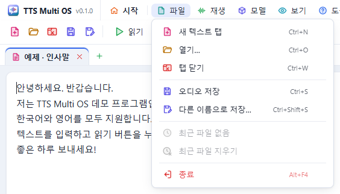

| Menu | Items |
|------|-------|
| 파일 (File) | New text tab · Open… · Close tab · Save audio · Save as… · recent files · Clear recent files · Exit |
| 재생 (Play) | Read · Generate with every speaker · Pause · Stop |
| 모델 (Model) | Download model · Delete model · Refresh model list · Voice defaults · Advanced synthesis defaults |
| 보기 (View) | Start screen · Theme settings… · Random theme · Start screen settings… · Status bar |
| 도움말 (Help) | User's Guide · Tutorial · About |

### Context menus

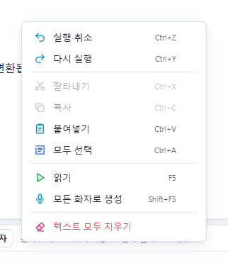

| Where | Items |
|-------|-------|
| Editor | Undo · Redo · Cut · Copy · Paste · Select all · Read · Generate with every speaker · Clear all text |
| Text tabs | New text tab · Open… · Close tab · Close other tabs |
| Waveform | Save audio · Read · Pause · Stop · Go here · To the start · To the end |

---

## 11. Toolbar

From the left:

| Group | Buttons |
|-------|---------|
| File | New text tab · Open · Close tab · Save audio · Save as |
| Play | Read · Generate with every speaker · Pause · Stop |
| Model | Download model · Delete model · Refresh model list |
| Defaults | Voice defaults · Advanced synthesis defaults |
| Right | Start screen · Random theme · Theme settings · Start screen settings · User's Guide · About |

Hovering a button shows its name, shortcut and description at once. Buttons that cannot be used are dimmed.

---

## 12. Themes

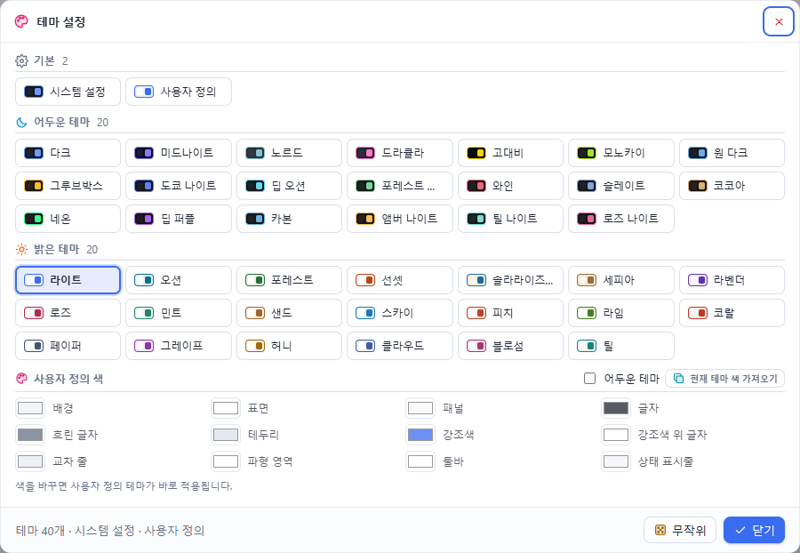

- 20 light themes, 20 dark themes, **시스템 설정** (System: follows Windows light / dark) and **사용자 정의** (Custom).
- Change it on the start screen's **테마** card, with **보기 › 테마 설정…** (View › Theme settings), the theme name in the status bar, or **무작위 테마** (Random theme) on the toolbar.
- **사용자 정의 색** (Custom colours) sets 12 colours (background, surface, panel, text, accent …) and **어두운 테마** (dark).
  **현재 테마 색 가져오기** (Take the current theme's colours) starts from the theme shown.
- Icon colours, the waveform and the guide window follow the theme.

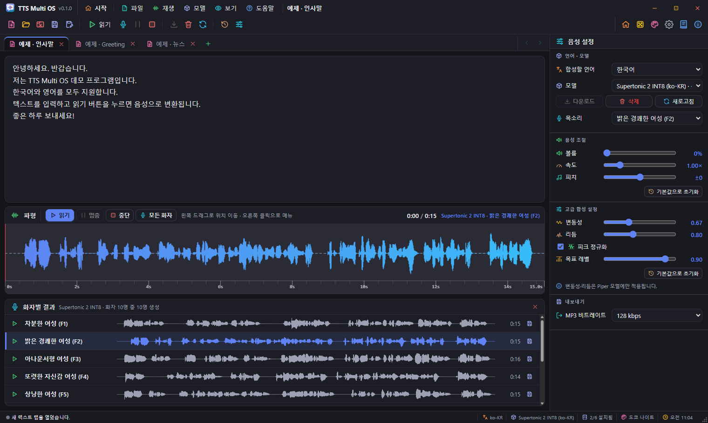

---

## 13. Keyboard shortcuts

| Keys | Action |
|------|--------|
| Ctrl+N | New text tab |
| Ctrl+O | Open |
| Ctrl+W | Close tab |
| Ctrl+Tab / Ctrl+Shift+Tab | Next / previous tab |
| Ctrl+S / Ctrl+Shift+S | Save / Save as |
| F5 | Read |
| Shift+F5 | Generate with every speaker |
| F6 / F7 | Pause / Stop |
| Ctrl+Home | Start screen ↔ editor |
| F1 | User's Guide |
| F12 | Developer tools |
| Esc | Close the menu |

---

## 14. The guide window

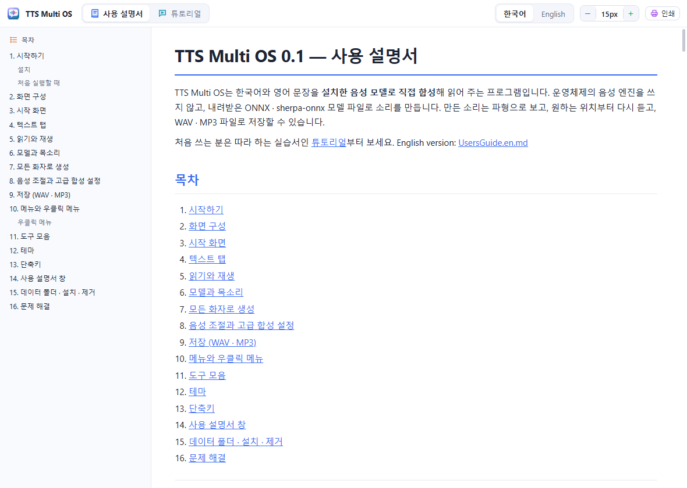

Open it with **도움말 › 사용 설명서** (Help › User's Guide, F1), the start screen's **사용 설명서** button, or the toolbar's guide button. It opens in a window of its own.

- At the top choose **사용 설명서** (User's Guide) / **튜토리얼** (Tutorial) and **한국어** / **English**.
- Click an entry of the **목차** (Contents) on the left to go to that section.
- Change the **font size** with − / + (or Ctrl+− / Ctrl++) and print with **인쇄** (Print).

---

## 15. Data folders · install · uninstall

| What | Where (Windows) |
|------|-----------------|
| Voice models | `%APPDATA%\TTSMultiOSV10\models\<model id>\` |
| goruut (Piper KSS) | `%APPDATA%\TTSMultiOSV10\goruut-bin\` |
| Log | `%APPDATA%\TTSMultiOSV10\logs\main.log` |
| Screen settings (theme, start screen, defaults, recent files) | `%LOCALAPPDATA%\com.shkwon.tts-multios\` |

macOS and Linux use `~/TTSMultiOSV10/`.

- Uninstalling with **Delete the application data** ticked also removes these folders.
- Reinstalling asks whether to delete earlier data; answer **No** to keep the models.

---

## 16. Troubleshooting

| Symptom | What to check |
|---------|---------------|
| 「설치된 모델이 없습니다」 (no model installed) | Choose a model and press **다운로드** (Download) |
| 「모델 합성은 데스크톱 앱(Tauri)에서만 지원됩니다」 (desktop only) | The web preview (`npm run web`) only shows the interface; run the installed program or `npm start` |
| 「음성 엔진이 비정상 종료되었습니다」 (the voice engine stopped) | It restarts by itself; if offered, accept 「모델 삭제 후 다시 받기」 (delete and download again) |
| The first read is slow | Wait until 「엔진 준비 중」 (preparing the engine) ends after choosing a model |
| Kokoro with Korean text sounds odd | Use English text, or Kokoro KO/EN or Supertonic |
| The All speakers button is disabled | The model has a single speaker (Piper KSS, MMS TTS, MeloTTS) or is not installed. If Kokoro 82M was downloaded with one voice, press **다운로드** (Download) to get its speakers |
| Download failed | Check the internet connection and free disk space, then **다운로드** again |
| You want to send an error report | The error dialog's **복사** (Copy) button, or the log file `main.log` |

---

Contact: SHKWON (knix008@naver.com) · Design and development notes: [Architecture.md](../Architecture.md)
