# TTS Multi OS 0.1 — 사용 설명서

TTS Multi OS는 한국어와 영어 문장을 **설치한 음성 모델로 직접 합성**해 읽어 주는 프로그램입니다.
운영체제의 음성 엔진을 쓰지 않고, 내려받은 ONNX · sherpa-onnx 모델 파일로 소리를 만듭니다.
만든 소리는 파형으로 보고, 원하는 위치부터 다시 듣고, WAV · MP3 파일로 저장할 수 있습니다.

처음 쓰는 분은 따라 하는 실습서인 [튜토리얼](Tutorial.md)부터 보세요.
English version: [UsersGuide.en.md](UsersGuide.en.md)

## 목차

1. [시작하기](#1-시작하기)
2. [화면 구성](#2-화면-구성)
3. [시작 화면](#3-시작-화면)
4. [텍스트 탭](#4-텍스트-탭)
5. [읽기와 재생](#5-읽기와-재생)
6. [모델과 목소리](#6-모델과-목소리)
7. [모든 화자로 생성](#7-모든-화자로-생성)
8. [음성 조절과 고급 합성 설정](#8-음성-조절과-고급-합성-설정)
9. [저장 (WAV · MP3)](#9-저장-wav--mp3)
10. [메뉴와 우클릭 메뉴](#10-메뉴와-우클릭-메뉴)
11. [도구 모음](#11-도구-모음)
12. [테마](#12-테마)
13. [단축키](#13-단축키)
14. [사용 설명서 창](#14-사용-설명서-창)
15. [데이터 폴더 · 설치 · 제거](#15-데이터-폴더--설치--제거)
16. [문제 해결](#16-문제-해결)

---

## 1. 시작하기

### 설치

Windows에서는 `TTS Multi OS_0.1.0_x64-setup.exe`를 실행합니다.

- 사용자별 설치라 관리자 권한을 묻지 않습니다.
- 설치 프로그램에 음성 엔진이 쓰는 Node.js가 함께 들어 있어 따로 설치할 것이 없습니다.
- 이미 설치된 TTS Multi OS(이전 Electron 판 포함)가 있으면 먼저 완전히 지운 뒤 설치합니다.
  이때 다운로드한 음성 모델 · 설정 · 로그를 지울지 묻습니다. 기본은 **유지**입니다.

소스에서 실행하려면 Rust 툴체인과 Node.js가 필요합니다: `npm install` 후 `npm start`.

### 처음 실행할 때

1. 시작 화면이 열립니다. **텍스트 읽기 시작** 또는 메뉴 막대의 **시작**을 누르면 편집기로 갑니다.
2. 오른쪽 **음성 설정** 패널의 **모델**에서 모델을 고르고 **다운로드**를 누릅니다.
   인터넷으로 HuggingFace에서 받으며, 진행률은 아래 상태 표시줄에 나옵니다.
3. 설치가 끝나면 편집기에 문장을 넣고 **읽기**(F5)를 누릅니다.

> 모델은 한 번만 받으면 됩니다. 설치된 모델은 시작 화면의 **음성 모델** 카드에 「설치됨」으로 표시됩니다.

---

## 2. 화면 구성

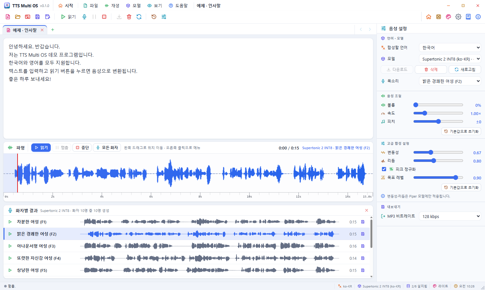

| 영역 | 설명 |
|------|------|
| **메뉴 막대** (맨 위) | 프로그램 아이콘 · 이름 · 버전, 그 바로 오른쪽에 **시작**과 메뉴(파일 · 재생 · 모델 · 보기 · 도움말), 지금 탭 이름, 오른쪽 끝 최소화 · 최대화 · 닫기. 시스템 제목 표시줄 대신 이 줄이 제목 표시줄입니다. 빈 곳을 끌면 창이 움직이고, 두 번 누르면 최대화됩니다. |
| **도구 모음** | 자주 쓰는 명령의 컬러 아이콘 단추 ([11장](#11-도구-모음)) |
| **텍스트 탭** | 텍스트마다 탭 하나. **+** 새 탭, 오른쪽 끝 **<** **>** ([4장](#4-텍스트-탭)) |
| **편집기** | 읽을 문장. 우클릭하면 편집 메뉴 |
| **파형** | 합성한 소리의 파형, 읽기 · 멈춤 · 중단 · 모든 화자 단추, 재생 시간, 모델 · 목소리 이름 |
| **화자별 결과** | 「모든 화자」로 만든 결과 ([7장](#7-모든-화자로-생성)) |
| **음성 설정** (오른쪽) | 언어 · 모델 · 목소리, 음성 조절, 고급 합성 설정, 내보내기 |
| **상태 표시줄** (맨 아래) | 진행 상태, 다운로드 진행률, 언어, 모델, 설치된 모델 수, 테마(누르면 테마 설정), 시각 |
| **크기 조절 표시** (오른쪽 아래 점 삼각형) | 끌어서 창 크기를 바꿉니다 (창 가장자리를 끌어도 됨) |

창 크기는 자유롭게 바꿀 수 있지만 도구 모음이 잘리지 않도록 최소 크기(1180×720)가 있습니다.

---

## 3. 시작 화면

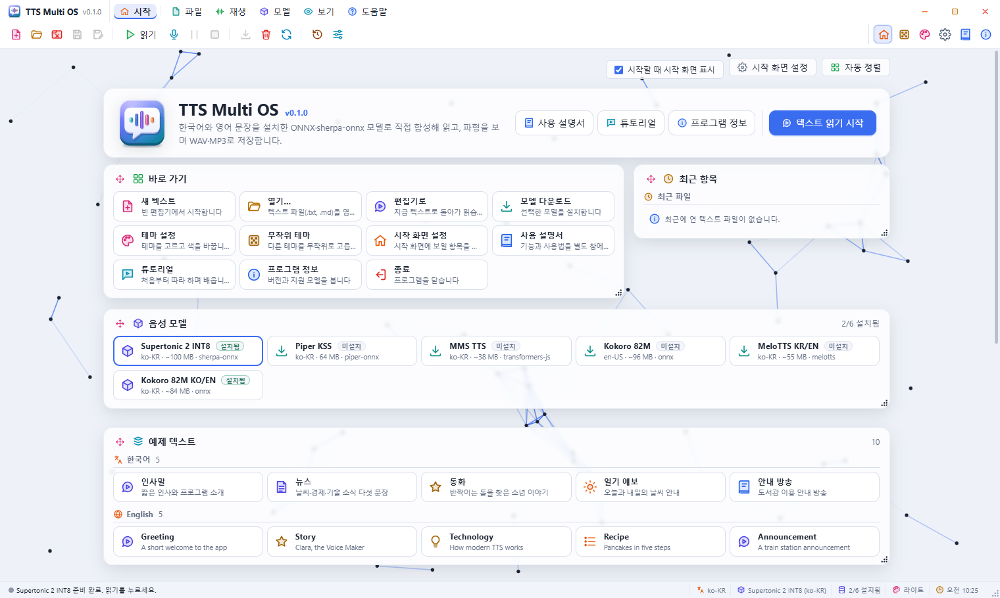

프로그램을 켜면 시작 화면이 나옵니다. 메뉴 막대의 **시작** 또는 **Ctrl+Home**으로 편집기와 오갑니다.

| 카드 | 내용 |
|------|------|
| 프로그램 제목 | 이름 · 버전 · 소개, **사용 설명서** · **튜토리얼** · **프로그램 정보**, **텍스트 읽기 시작**. 맨 위에 고정되어 옮기거나 크기를 바꿀 수 없습니다. |
| 바로 가기 | 새 텍스트 · 열기 · 편집기로 · 모델 다운로드 · 테마 설정 · 무작위 테마 · 시작 화면 설정 · 사용 설명서 · 튜토리얼 · 프로그램 정보 · 종료 |
| 최근 항목 | 최근에 연 텍스트 파일. 누르면 탭으로 열고, ×로 목록에서 지웁니다. |
| 음성 모델 | 모델마다 언어 · 크기 · 엔진 · 설치 여부. 누르면 그 모델로 편집기를 엽니다. |
| 예제 텍스트 | 한국어 5개 · 영어 5개. 누르면 새 탭으로 열고 언어도 맞춥니다. 이미 열린 예제면 그 탭으로 갑니다. |
| 테마 | 어두운 테마 20개, 밝은 테마 20개 ([12장](#12-테마)) |
| 움직이는 배경 | 배경 20종, 배경 바꾸기, 움직임 속도, 카드 불투명도, 시작할 때 무작위, 자동 변경 간격 |

- 카드 왼쪽 위 **손잡이**(네 방향 화살표)를 끌어 옮기고, 오른쪽 아래 **모서리**를 끌어 크기를 바꿉니다.
  모서리를 두 번 누르면 내용에 맞는 높이로 돌아갑니다.
- 오른쪽 위 **자동 정렬**은 카드를 처음 배치로 되돌립니다.
- **시작할 때 시작 화면 표시**를 끄면 다음부터 편집기로 바로 시작합니다.
- **시작 화면 설정**에서 보일 카드, 최근 파일 개수, 카드 불투명도, 움직임 속도를 고릅니다.

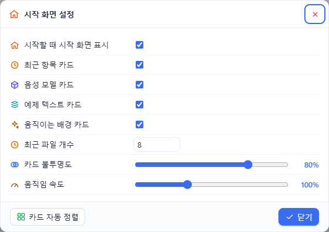

---

## 4. 텍스트 탭

- 텍스트마다 탭이 하나씩 있습니다. **+** 또는 **Ctrl+N**으로 새 탭을 엽니다.
- 탭의 **×**, 마우스 가운데 단추, **Ctrl+W**로 닫습니다. 고친 탭(●)은 닫기 전에 확인을 묻습니다.
  텍스트를 파일로 저장하는 기능은 없으니 필요한 글은 다른 편집기에 보관하세요.
- **Ctrl+Tab** / **Ctrl+Shift+Tab**으로 옆 탭으로 갑니다.
- 탭이 많아 다 보이지 않으면 오른쪽 끝 **<** **>**(또는 마우스 휠)로 탭 줄을 넘깁니다.
- 탭마다 텍스트 · 커서 위치와 함께 **합성한 소리 · 파형 · 마지막 저장 위치 · 화자별 결과**를 따로 기억합니다.
  합성 중에는 탭을 바꾸거나 닫을 수 없습니다.
- 파일을 열거나 예제를 고르면 새 탭으로 엽니다. 아무것도 입력하지 않은 탭이면 그 탭을 쓰고,
  이미 열려 있는 파일이면 그 탭으로 갑니다.
- 탭을 우클릭하면 새 텍스트 탭 · 열기 · 탭 닫기 · 다른 탭 모두 닫기 메뉴가 나옵니다.

---

## 5. 읽기와 재생

1. 편집기에 문장을 넣습니다. 입력한 글자로 **합성할 언어**(한국어 / English)가 자동으로 정해집니다.
   직접 바꿀 수도 있습니다(모델은 바뀌지 않음).
2. **읽기**(F5)를 누르면 지금 모델 · 목소리로 합성한 뒤 재생합니다.
   설치되지 않은 모델이면 먼저 다운로드를 시작합니다.
3. 파형에 모델이 만든 실제 소리가 그려지고, 빨간 선이 재생 위치를 따라갑니다.

| 동작 | 방법 |
|------|------|
| 멈춤 / 이어 듣기 | **멈춤**(F6) 후 **읽기** |
| 처음으로 | **중단**(F7) |
| 위치 이동 | 파형을 누르거나 왼쪽 단추로 끌기 |
| 같은 문장 다시 듣기 | 텍스트 · 모델 · 목소리 · 언어가 같으면 다시 합성하지 않고 바로 재생 |

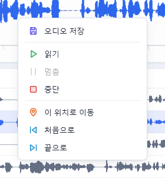

파형을 우클릭하면 오디오 저장 · 읽기 · 멈춤 · 중단 · 이 위치로 이동 · 처음으로 · 끝으로 메뉴가 나옵니다.

---

## 6. 모델과 목소리

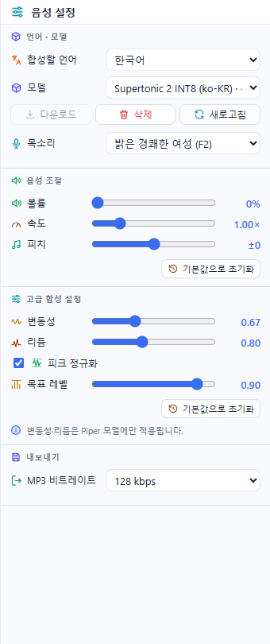

**모델**에서 고르고 **다운로드**로 설치, **삭제**로 지웁니다. **새로고침**은 목록과 설치 상태를 다시 읽습니다.
**목소리**에는 그 모델의 화자(보이스)가 나옵니다.

| 모델 | 언어 | 엔진 | 크기 | 화자 |
|------|------|------|------|------|
| Supertonic 2 INT8 | 한국어 (31개 언어 가능) | sherpa-onnx | ~100 MB | 10명 (F1–F5, M1–M5) |
| Piper KSS | 한국어 | onnxruntime + goruut 음소화 | 64 MB (+ goruut ~96 MB) | 1명 |
| MMS TTS | 한국어 | onnxruntime (로마자 토큰) | ~38 MB | 1명 |
| Kokoro 82M | 영어 | onnxruntime + phonemizer | ~96 MB | 28명 (미국 · 영국 영어 여성 · 남성) |
| MeloTTS KR/EN | 한국어 · 영어 | MeloTTS ONNX (INT8) | ~55 MB | 모델 기본 |
| Kokoro 82M KO/EN | 한국어(로마자 변환) · 영어 | onnxruntime | ~84 MB | 4명 (Bella, Heart, Adam, Michael) |

- 모델을 고르면 엔진을 미리 준비(워밍업)해 첫 읽기가 빨라집니다. 상태 표시줄에 「엔진 준비 중…」이 잠깐 보입니다.
- Piper KSS는 처음 쓸 때 음소화 도구 goruut(~96 MB)를 더 받습니다.
- Kokoro 82M(영어)에 한글만 넣으면 로마자 발음으로 읽혀 어색할 수 있습니다. 영어 문장을 권장합니다.
- 음성 엔진은 화면과 다른 프로세스에서 돌아갑니다. 모델 파일이 손상되어 엔진이 죽어도 프로그램은 남고,
  엔진만 자동으로 다시 시작해 **모델 삭제 후 다시 받기**를 제안합니다.

---

## 7. 모든 화자로 생성

화자가 여러 명인 모델(Supertonic 10명, Kokoro 82M 영어 28명, Kokoro KO/EN 4명)은 같은 문장을 모든 화자로 한 번에 만들어 비교할 수 있습니다.

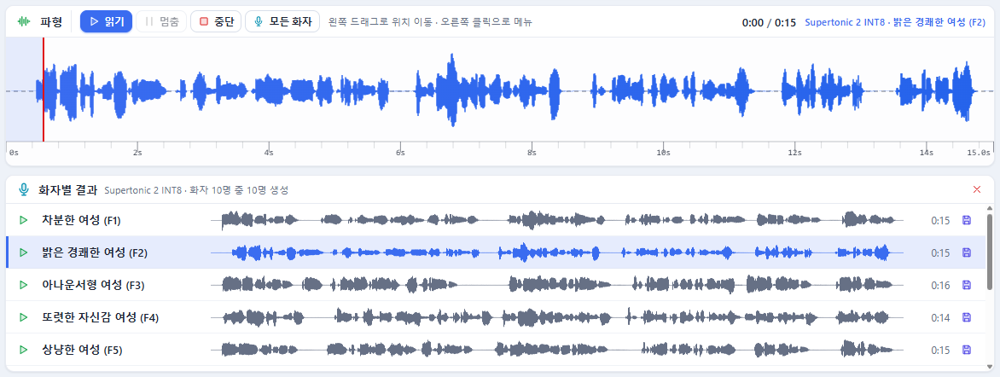

1. 문장을 넣고 파형 위 **모든 화자**를 누릅니다 (**Shift+F5**, 재생 메뉴, 도구 모음, 편집기 우클릭 메뉴에도 있음).
   화자가 한 명뿐인 모델에서는 꺼져 있습니다.
2. 파형 아래 **화자별 결과**에 화자마다 한 줄이 생기고 차례로 「생성 중…」 → 파형 · 길이로 바뀝니다.
   **생성 중단**을 누르면 남은 화자를 건너뜁니다.
3. 줄의 **▶**: 그 화자의 소리를 위 파형에 올려 재생하고 목소리 목록도 그 화자로 바꿉니다.
   그래서 위치 이동 · 멈춤 · 저장이 평소처럼 됩니다.
4. 줄의 **저장**: 그 화자의 소리를 저장합니다. 파일 이름에 화자 이름이 들어갑니다.

결과는 탭마다 따로 남고, **×**로 닫습니다.

---

## 8. 음성 조절과 고급 합성 설정

| 항목 | 범위 | 설명 |
|------|------|------|
| 볼륨 | 0–200 % | 재생 크기 (저장 파일에는 영향 없음) |
| 속도 | 0.25–4.00× | 합성 속도와 재생 속도 |
| 피치 | −12 ~ +12 | 재생 음높이(반음) |
| 변동성 | 0.00–2.00 | 억양의 다양함 (Piper 모델만) |
| 리듬 | 0.00–2.00 | 음소 길이의 다양함 (Piper 모델만) |
| 피크 정규화 · 목표 레벨 | 0.10–1.00 | 합성 결과의 최대 크기를 목표 레벨에 맞춤 |

각 묶음의 **기본값으로 초기화**로 되돌립니다. 값은 다음 실행에도 남습니다.

---

## 9. 저장 (WAV · MP3)

1. 먼저 한 번 읽기(합성)를 합니다.
2. 도구 모음의 **저장**(Ctrl+S) 또는 **다른 이름으로 저장**(Ctrl+Shift+S)을 누릅니다.
3. 저장 창에서 형식(`.wav` / `.mp3`)과 위치를 고릅니다.

- 저장되는 것은 **모델이 만든 실제 소리(PCM)** 입니다.
- MP3는 내보내기의 **MP3 비트레이트**(96 / 128 / 192 / 320 kbps)를 씁니다.
- 기본 파일 이름은 `모델-화자-YYYYMMDD-HHMMSS`입니다.
- **Ctrl+S**는 그 탭에서 마지막으로 저장한 곳에 바로 덮어씁니다(처음에는 저장 창).

---

## 10. 메뉴와 우클릭 메뉴

모든 메뉴 항목에는 컬러 아이콘과 단축키가 함께 나옵니다. 메뉴가 열린 채 다른 메뉴 이름 위로 가면 그 메뉴로 바뀝니다.

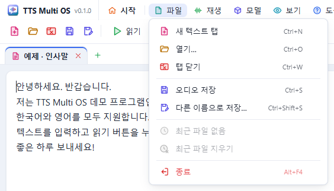

| 메뉴 | 항목 |
|------|------|
| 파일 | 새 텍스트 탭 · 열기… · 탭 닫기 · 오디오 저장 · 다른 이름으로 저장… · 최근 파일 · 최근 파일 지우기 · 종료 |
| 재생 | 읽기 · 모든 화자로 생성 · 멈춤 · 중단 |
| 모델 | 모델 다운로드 · 모델 삭제 · 모델 목록 새로고침 · 음성 기본값으로 · 고급 합성 기본값으로 |
| 보기 | 시작 화면 · 테마 설정… · 무작위 테마 · 시작 화면 설정… · 상태 표시줄 |
| 도움말 | 사용 설명서 · 튜토리얼 · 프로그램 정보 |

### 우클릭 메뉴

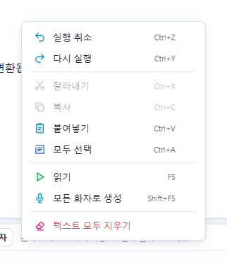

| 위치 | 항목 |
|------|------|
| 편집기 | 실행 취소 · 다시 실행 · 잘라내기 · 복사 · 붙여넣기 · 모두 선택 · 읽기 · 모든 화자로 생성 · 텍스트 모두 지우기 |
| 텍스트 탭 | 새 텍스트 탭 · 열기… · 탭 닫기 · 다른 탭 모두 닫기 |
| 파형 | 오디오 저장 · 읽기 · 멈춤 · 중단 · 이 위치로 이동 · 처음으로 · 끝으로 |

---

## 11. 도구 모음

왼쪽부터:

| 묶음 | 단추 |
|------|------|
| 파일 | 새 텍스트 탭 · 열기 · 탭 닫기 · 오디오 저장 · 다른 이름으로 저장 |
| 재생 | 읽기 · 모든 화자로 생성 · 멈춤 · 중단 |
| 모델 | 모델 다운로드 · 모델 삭제 · 모델 목록 새로고침 |
| 기본값 | 음성 기본값으로 · 고급 합성 기본값으로 |
| 오른쪽 | 시작 화면 · 무작위 테마 · 테마 설정 · 시작 화면 설정 · 사용 설명서 · 프로그램 정보 |

단추 위에 마우스를 올리면 이름 · 단축키 · 설명이 바로 나옵니다. 쓸 수 없는 단추는 흐리게 보입니다.

---

## 12. 테마

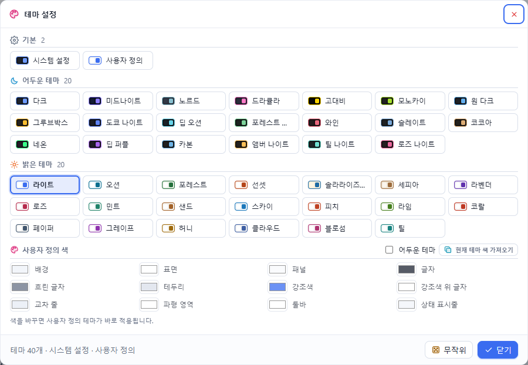

- 밝은 테마 20개, 어두운 테마 20개, **시스템 설정**(Windows의 밝게 / 어둡게를 따름), **사용자 정의**가 있습니다.
- 시작 화면의 **테마** 카드, **보기 › 테마 설정…**, 상태 표시줄의 테마 이름, 도구 모음의 **무작위 테마**로 바꿉니다.
- **사용자 정의 색**에서 배경 · 표면 · 패널 · 글자 · 강조색 등 12가지 색을 직접 고르고, **어두운 테마**를 켜고 끕니다.
  **현재 테마 색 가져오기**로 지금 테마에서 출발할 수 있습니다.
- 아이콘 색, 파형 색, 사용 설명서 창도 테마를 따릅니다.

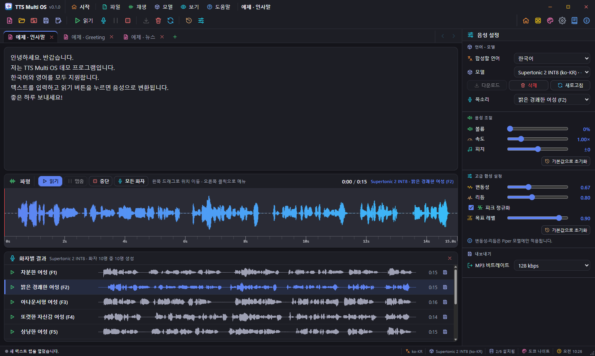

---

## 13. 단축키

| 키 | 동작 |
|----|------|
| Ctrl+N | 새 텍스트 탭 |
| Ctrl+O | 열기 |
| Ctrl+W | 탭 닫기 |
| Ctrl+Tab / Ctrl+Shift+Tab | 다음 / 이전 탭 |
| Ctrl+S / Ctrl+Shift+S | 저장 / 다른 이름으로 저장 |
| F5 | 읽기 |
| Shift+F5 | 모든 화자로 생성 |
| F6 / F7 | 멈춤 / 중단 |
| Ctrl+Home | 시작 화면 ↔ 편집기 |
| F1 | 사용 설명서 |
| F12 | 개발자 도구 |
| Esc | 메뉴 닫기 |

---

## 14. 사용 설명서 창

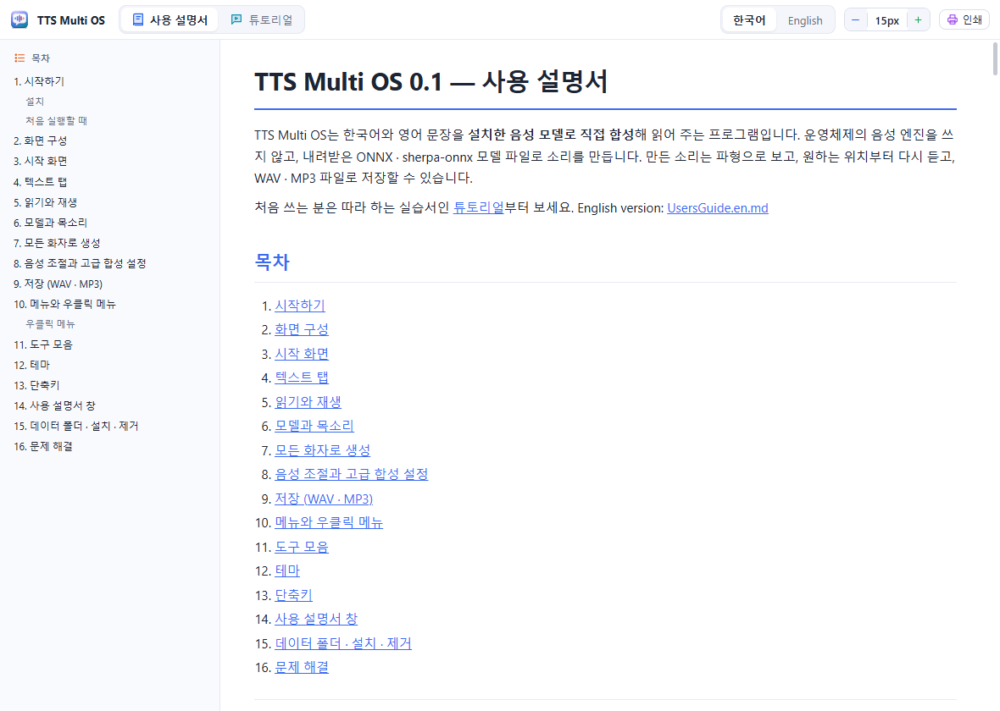

**도움말 › 사용 설명서**(F1), 시작 화면의 **사용 설명서**, 도구 모음의 사용 설명서 단추로 엽니다. 별도 창으로 열립니다.

- 위쪽에서 **사용 설명서** / **튜토리얼**, **한국어** / **English**를 고릅니다.
- 왼쪽 **목차**를 누르면 그 절로 갑니다.
- **글자 크기**를 − / +(또는 Ctrl+− / Ctrl++)로 바꾸고, **인쇄**로 문서를 인쇄합니다.

---

## 15. 데이터 폴더 · 설치 · 제거

| 무엇 | 위치 (Windows) |
|------|----------------|
| 음성 모델 | `%APPDATA%\TTSMultiOSV10\models\<모델 ID>\` |
| goruut (Piper KSS) | `%APPDATA%\TTSMultiOSV10\goruut-bin\` |
| 로그 | `%APPDATA%\TTSMultiOSV10\logs\main.log` |
| 화면 설정(테마 · 시작 화면 · 기본값 · 최근 파일) | `%LOCALAPPDATA%\com.shkwon.tts-multios\` |

macOS · Linux에서는 `~/TTSMultiOSV10/`을 씁니다.

- 프로그램을 제거할 때 **애플리케이션 데이터 삭제**를 고르면 위 폴더도 지웁니다.
- 다시 설치할 때 이전 데이터가 있으면 지울지 묻습니다. 모델을 다시 받지 않으려면 **아니요**를 고르세요.

---

## 16. 문제 해결

| 증상 | 확인 |
|------|------|
| 「설치된 모델이 없습니다」 | 모델을 고르고 **다운로드** |
| 「모델 합성은 데스크톱 앱(Tauri)에서만 지원됩니다」 | 웹 미리보기(`npm run web`)는 화면만 보여 줍니다. 설치본 또는 `npm start`로 실행하세요. |
| 「음성 엔진이 비정상 종료되었습니다」 | 엔진은 자동으로 다시 시작됩니다. 「모델 삭제 후 다시 받기」가 나오면 받아 주세요. |
| 첫 읽기가 느림 | 모델을 고른 뒤 「엔진 준비 중」이 끝나면 읽기 |
| Kokoro + 한글 문장이 어색함 | 영어 문장을 쓰거나 Kokoro KO/EN · Supertonic을 쓰세요. |
| 모든 화자 단추가 꺼져 있음 | 화자가 한 명뿐인 모델(Piper KSS · MMS TTS · MeloTTS)이거나 모델이 설치되지 않았습니다. Kokoro 82M을 화자 1명일 때 받았다면 **다운로드**로 화자를 받으세요. |
| 다운로드 실패 | 인터넷 연결과 디스크 여유 공간 확인 후 다시 **다운로드** |
| 오류 내용을 보내고 싶음 | 오류 창의 **복사** 단추, 또는 로그 파일 `main.log` |

---

문의: SHKWON (knix008@naver.com) · 구조와 개발 정보: [Architecture.md](../Architecture.md)
