# MyTrainer 튜토리얼

이 튜토리얼은 예제 열기, 데이터와 모델, 실시간 학습, 뉴런 보기, 테스트, PyTorch 코드, 모델 비교, 내보내기까지 MyTrainer 를 실제 화면으로 따라갑니다. 같은 단계가 프로그램 안에서도 실행됩니다 — **도움말 › 튜토리얼 시작** (또는 시작 화면 · 시작 안내 창의 **튜토리얼 시작**) 을 누르면 화면의 각 부분을 강조하고 옆에 설명 카드를 띄웁니다: [다음] / [이전], 또는 → / ← 와 Esc. **도움말 › 튜토리얼 영상** 으로 영상으로도 볼 수 있습니다.

## 차례

1. 시작
2. 모델 그리기
3. 데이터
4. 학습
5. 속 들여다보기
6. 모델 비교
7. 내보내기와 도움말

## 1. 시작

### 1. MyTrainer 에 오신 것을 환영합니다

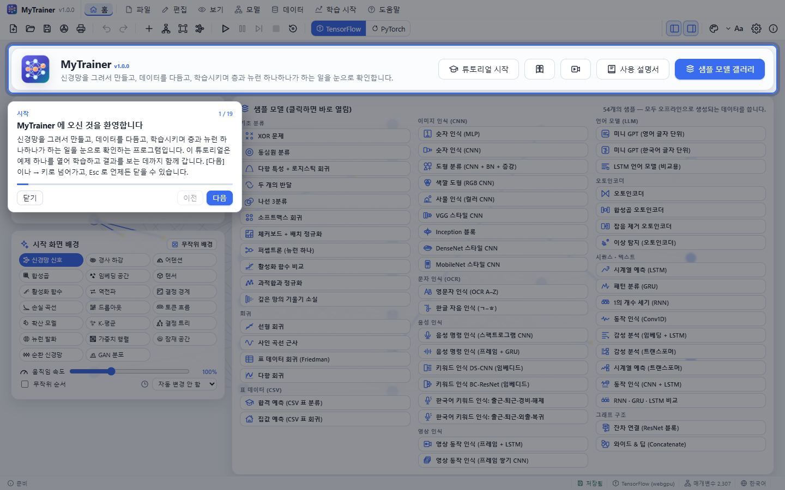

신경망을 그려서 만들고, 데이터를 다듬고, 학습시키며 층과 뉴런 하나하나가 하는 일을 눈으로 확인하는 프로그램입니다. 이 튜토리얼은 예제 하나를 열어 학습하고 결과를 보는 데까지 함께 갑니다. [다음] 이나 → 키로 넘어가고, Esc 로 언제든 닫을 수 있습니다.

### 2. 예제 모델

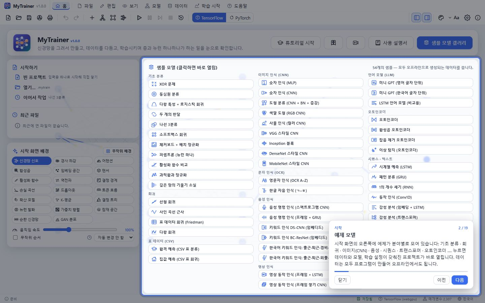

시작 화면의 오른쪽에 예제가 분야별로 모여 있습니다: 기초 분류 · 회귀 · 이미지(CNN) · 음성 · 시퀀스 · 트랜스포머 · 오토인코더 …. 누르면 데이터와 모델, 학습 설정이 갖춰진 프로젝트가 바로 열립니다. 데이터는 모두 프로그램이 만들어 오프라인에서도 됩니다.

### 3. 예제 열기: 두 개의 반달

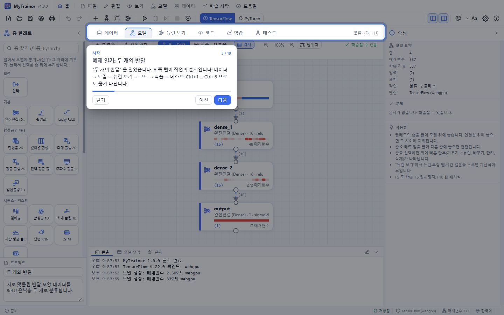

"두 개의 반달" 을 열었습니다. 위쪽 탭이 작업의 순서입니다: 데이터 → 모델 → 뉴런 보기 → 코드 → 학습 → 테스트. Ctrl+1 … Ctrl+6 으로도 옮겨 다닙니다.

## 2. 모델 그리기

### 4. 모델 그래프

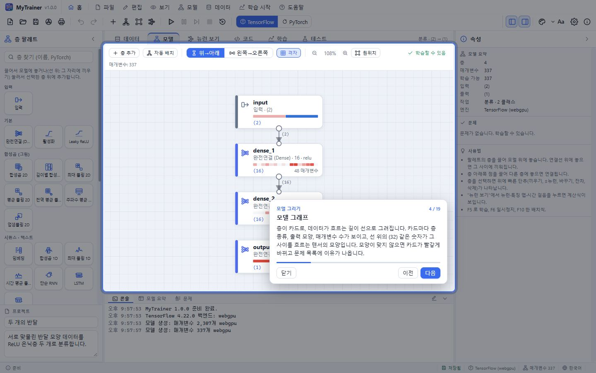

층이 카드로, 데이터가 흐르는 길이 선으로 그려집니다. 카드마다 층 종류, 출력 모양, 매개변수 수가 보이고, 선 위의 (32) 같은 숫자가 그 사이를 흐르는 텐서의 모양입니다. 모양이 맞지 않으면 카드가 빨갛게 바뀌고 문제 목록에 이유가 나옵니다.

### 5. 층 팔레트

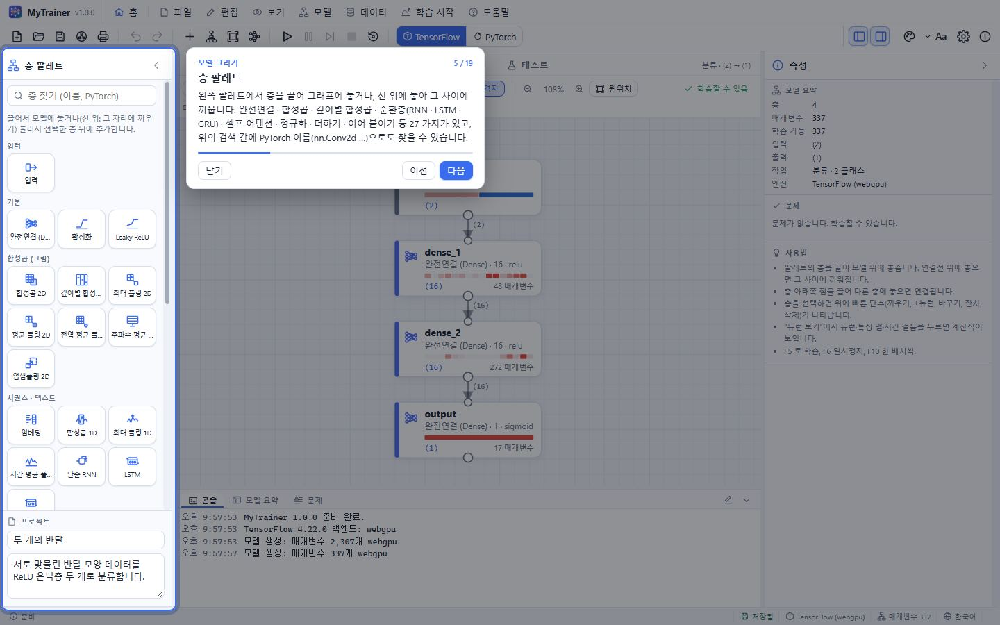

왼쪽 팔레트에서 층을 끌어 그래프에 놓거나, 선 위에 놓아 그 사이에 끼웁니다. 완전연결 · 합성곱 · 깊이별 합성곱 · 순환층(RNN · LSTM · GRU) · 셀프 어텐션 · 정규화 · 더하기 · 이어 붙이기 등 27 가지가 있고, 위의 검색 칸에 PyTorch 이름(nn.Conv2d …)으로도 찾을 수 있습니다.

### 6. 속성

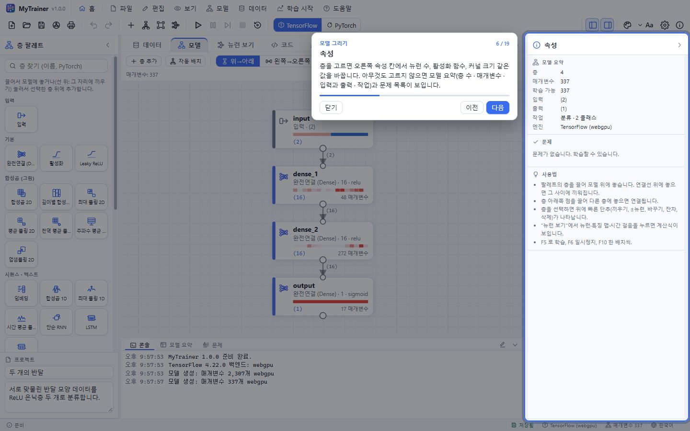

층을 고르면 오른쪽 속성 칸에서 뉴런 수, 활성화 함수, 커널 크기 같은 값을 바꿉니다. 아무것도 고르지 않으면 모델 요약(층 수 · 매개변수 · 입력과 출력 · 작업)과 문제 목록이 보입니다.

### 7. 콘솔 · 모델 요약 · 문제

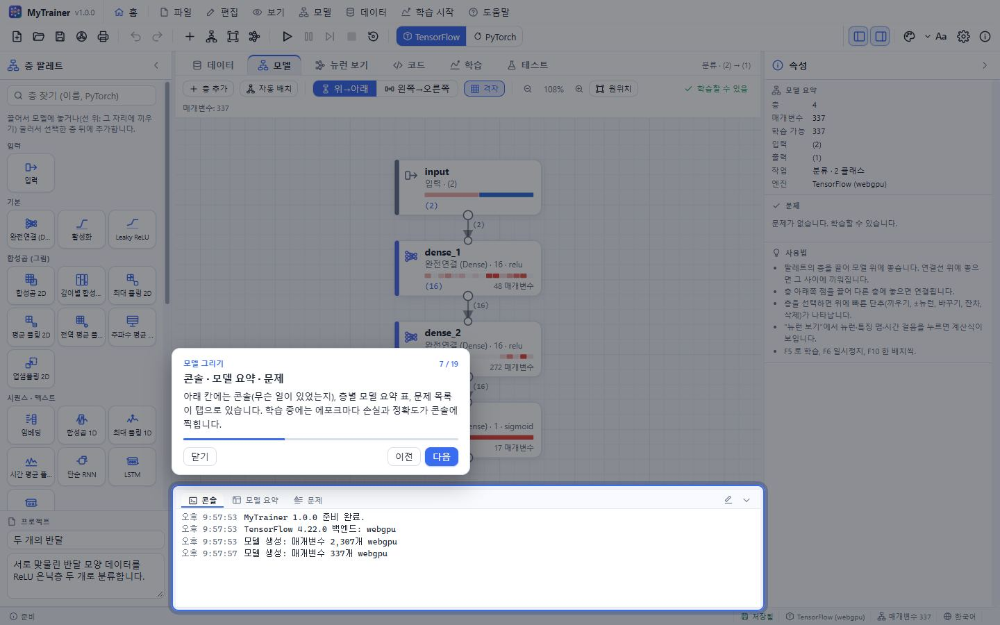

아래 칸에는 콘솔(무슨 일이 있었는지), 층별 모델 요약 표, 문제 목록이 탭으로 있습니다. 학습 중에는 에포크마다 손실과 정확도가 콘솔에 찍힙니다.

## 3. 데이터

### 8. 데이터 탭

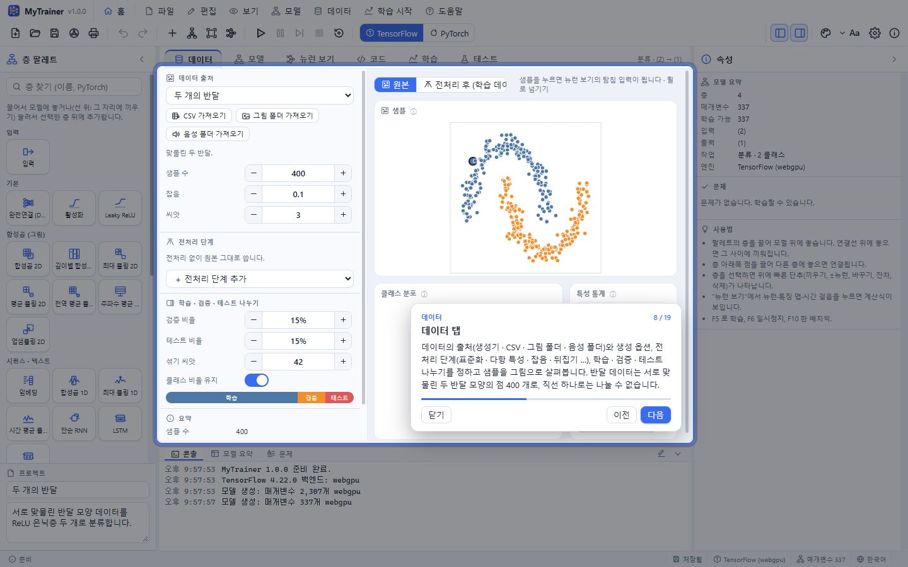

데이터의 출처(생성기 · CSV · 그림 폴더 · 음성 폴더)와 생성 옵션, 전처리 단계(표준화 · 다항 특성 · 잡음 · 뒤집기 …), 학습 · 검증 · 테스트 나누기를 정하고 샘플을 그림으로 살펴봅니다. 반달 데이터는 서로 맞물린 두 반달 모양의 점 400 개로, 직선 하나로는 나눌 수 없습니다.

## 4. 학습

### 9. 학습 설정

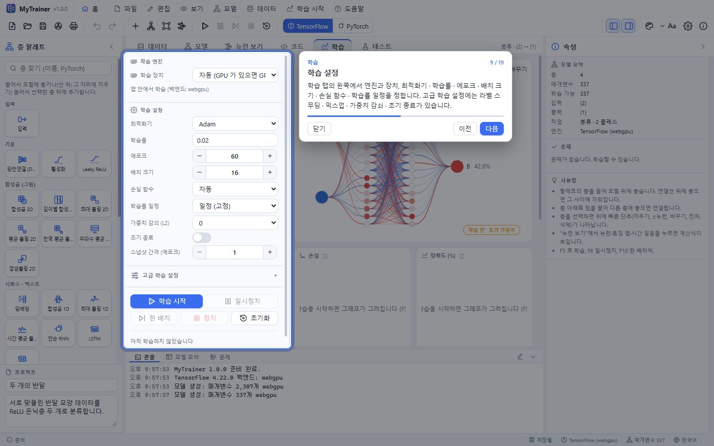

학습 탭의 왼쪽에서 엔진과 장치, 최적화기 · 학습률 · 에포크 · 배치 크기 · 손실 함수 · 학습률 일정을 정합니다. 고급 학습 설정에는 라벨 스무딩 · 믹스업 · 가중치 감쇠 · 조기 종료가 있습니다.

### 10. 두 엔진: TensorFlow 와 PyTorch

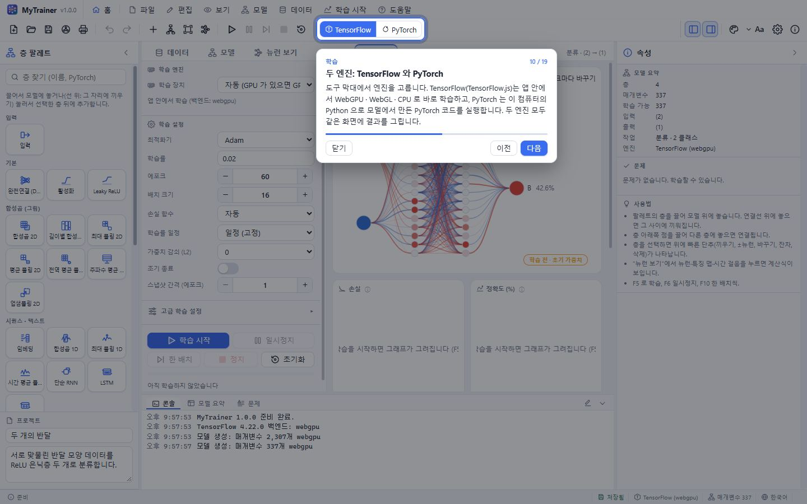

도구 막대에서 엔진을 고릅니다. TensorFlow(TensorFlow.js)는 앱 안에서 WebGPU · WebGL · CPU 로 바로 학습하고, PyTorch 는 이 컴퓨터의 Python 으로 모델에서 만든 PyTorch 코드를 실행합니다. 두 엔진 모두 같은 화면에 결과를 그립니다.

### 11. 학습 시작

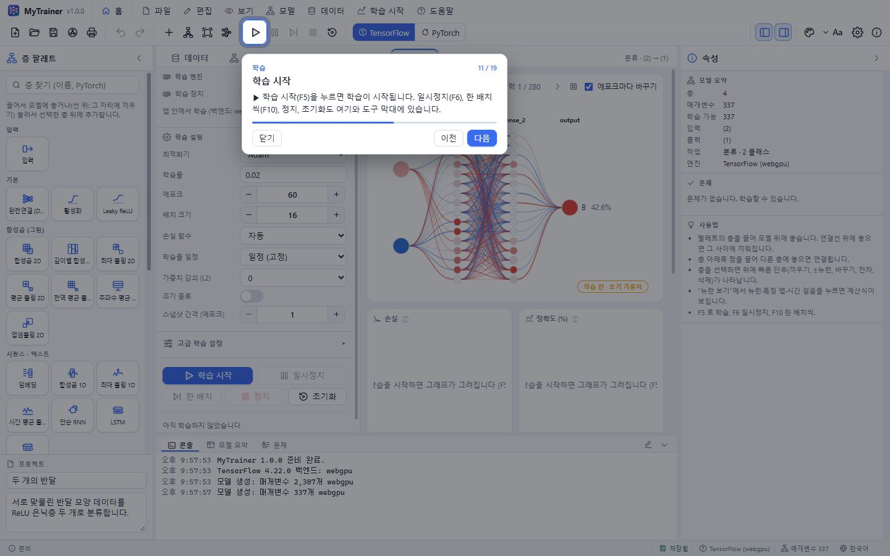

▶ 학습 시작(F5)을 누르면 학습이 시작됩니다. 일시정지(F6), 한 배치씩(F10), 정지, 초기화도 여기와 도구 막대에 있습니다.

### 12. 실시간 그래프

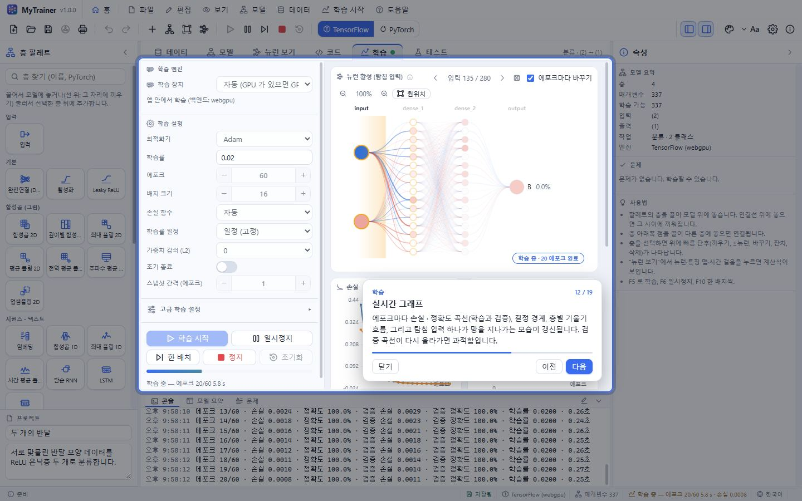

에포크마다 손실 · 정확도 곡선(학습과 검증), 결정 경계, 층별 기울기 흐름, 그리고 탐침 입력 하나가 망을 지나가는 모습이 갱신됩니다. 검증 곡선이 다시 올라가면 과적합입니다.

## 5. 속 들여다보기

### 13. 뉴런 보기

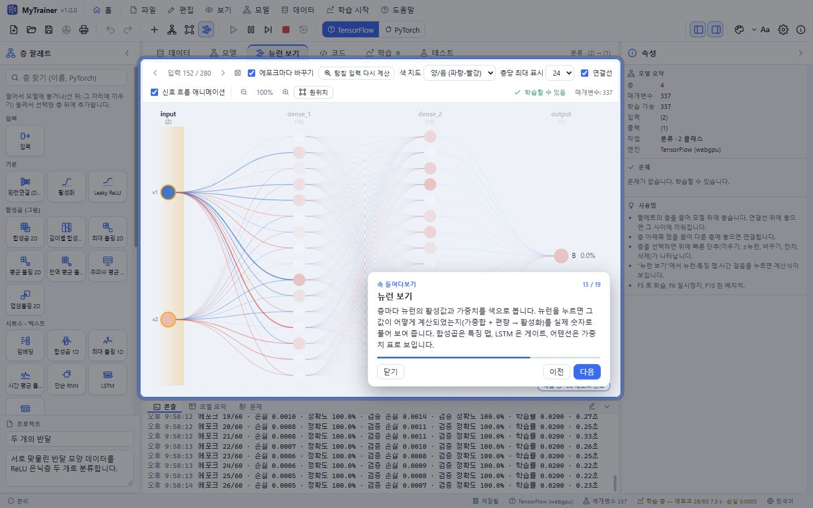

층마다 뉴런의 활성값과 가중치를 색으로 봅니다. 뉴런을 누르면 그 값이 어떻게 계산되었는지(가중합 + 편향 → 활성화)를 실제 숫자로 풀어 보여 줍니다. 합성곱은 특징 맵, LSTM 은 게이트, 어텐션은 가중치 표로 보입니다.

### 14. 테스트

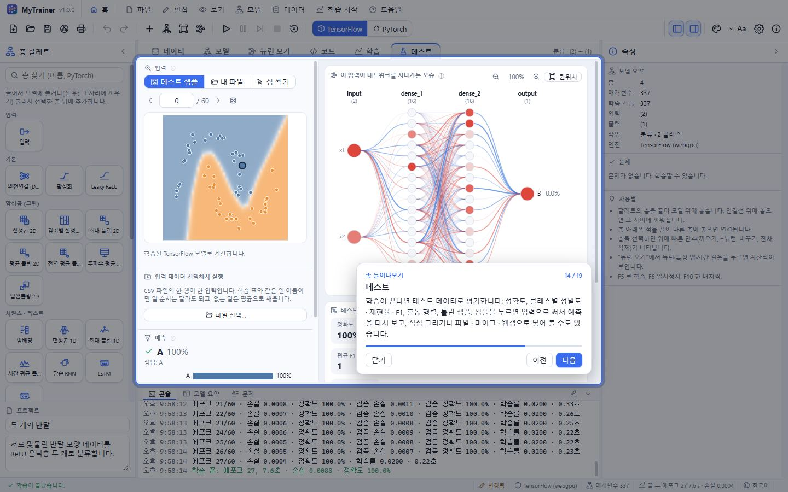

학습이 끝나면 테스트 데이터로 평가합니다: 정확도, 클래스별 정밀도 · 재현율 · F1, 혼동 행렬, 틀린 샘플. 샘플을 누르면 입력으로 써서 예측을 다시 보고, 직접 그리거나 파일 · 마이크 · 웹캠으로 넣어 볼 수도 있습니다.

### 15. PyTorch 코드

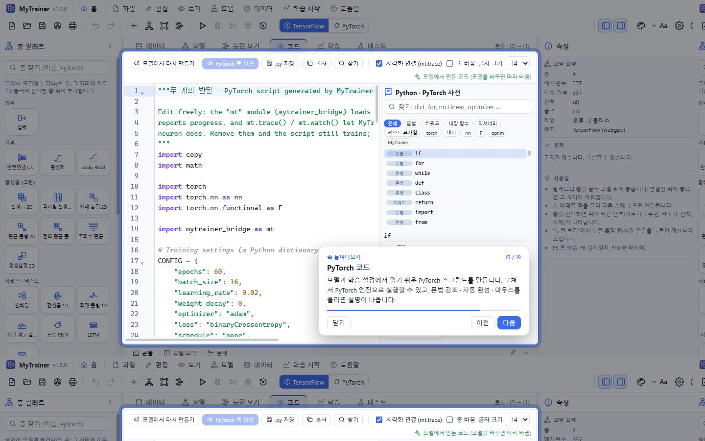

모델과 학습 설정에서 읽기 쉬운 PyTorch 스크립트를 만듭니다. 고쳐서 PyTorch 엔진으로 실행할 수 있고, 문법 강조 · 자동 완성 · 마우스를 올리면 설명이 나옵니다.

## 6. 모델 비교

### 16. 모델 구조 고르기

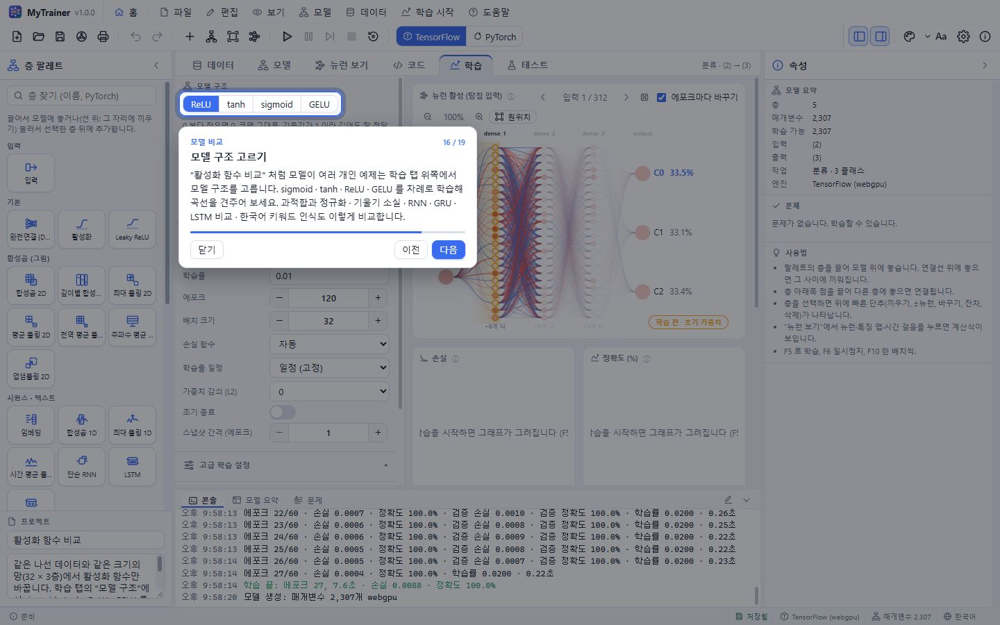

"활성화 함수 비교" 처럼 모델이 여러 개인 예제는 학습 탭 위쪽에서 모델 구조를 고릅니다. sigmoid · tanh · ReLU · GELU 를 차례로 학습해 곡선을 견주어 보세요. 과적합과 정규화 · 기울기 소실 · RNN · GRU · LSTM 비교 · 한국어 키워드 인식도 이렇게 비교합니다.

## 7. 내보내기와 도움말

### 17. 저장과 내보내기

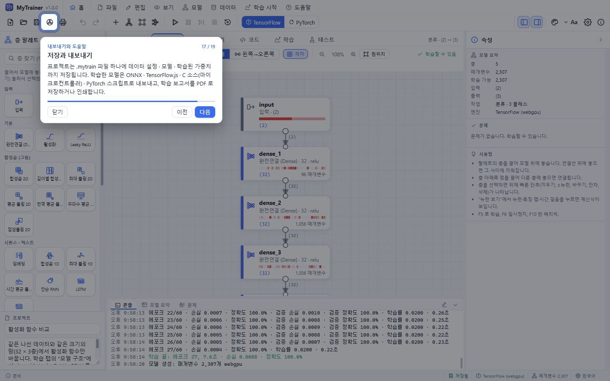

프로젝트는 .mytrain 파일 하나에 데이터 설정 · 모델 · 학습된 가중치까지 저장됩니다. 학습한 모델은 ONNX · TensorFlow.js · C 소스(마이크로컨트롤러) · PyTorch 스크립트로 내보내고, 학습 보고서를 PDF 로 저장하거나 인쇄합니다.

### 18. 설정과 테마

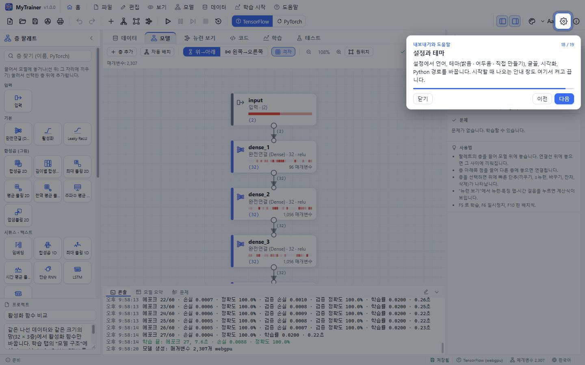

설정에서 언어, 테마(밝음 · 어두움 · 직접 만들기), 글꼴, 시각화, Python 경로를 바꿉니다. 시작할 때 나오는 안내 창도 여기서 켜고 끕니다.

### 19. 도움말

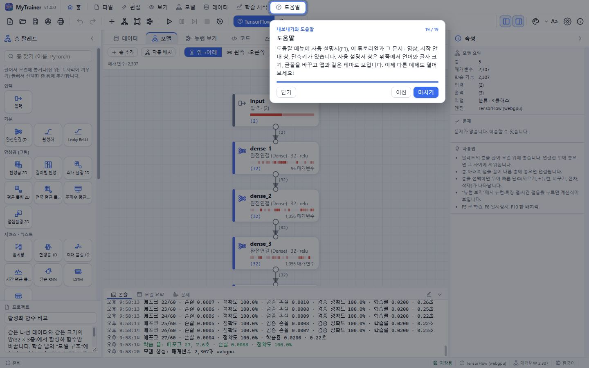

도움말 메뉴에 사용 설명서(F1), 이 튜토리얼과 그 문서 · 영상, 시작 안내 창, 단축키가 있습니다. 사용 설명서 창은 위쪽에서 언어와 글자 크기, 글꼴을 바꾸고 앱과 같은 테마로 보입니다. 이제 다른 예제도 열어 보세요!

---

모든 기능의 자세한 설명은 [사용 설명서](UsersGuide.md) 에 있습니다.

© SHKWON (knix008@naver.com)
