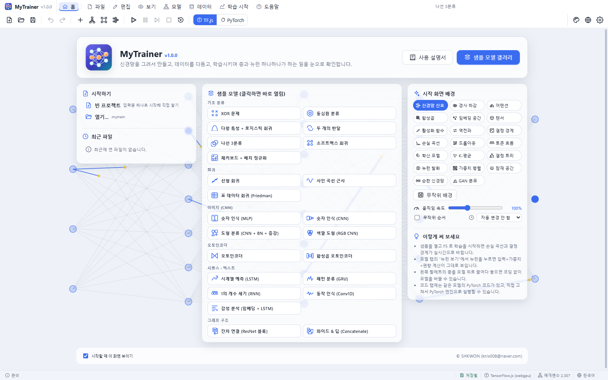
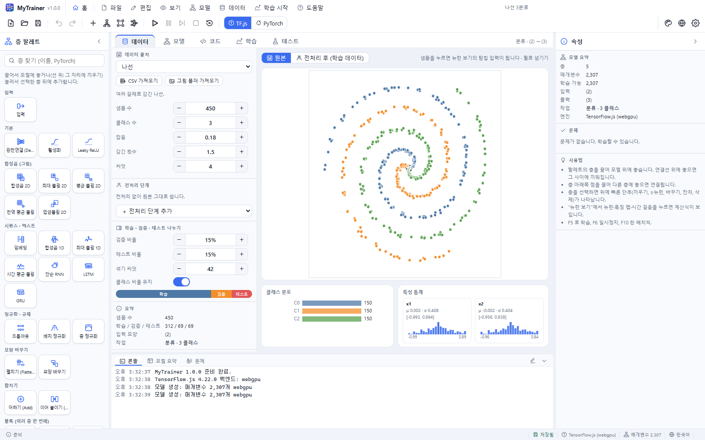
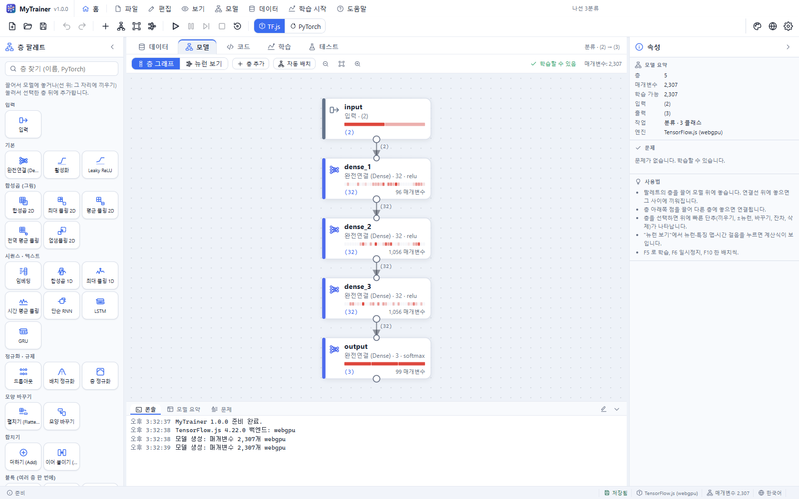
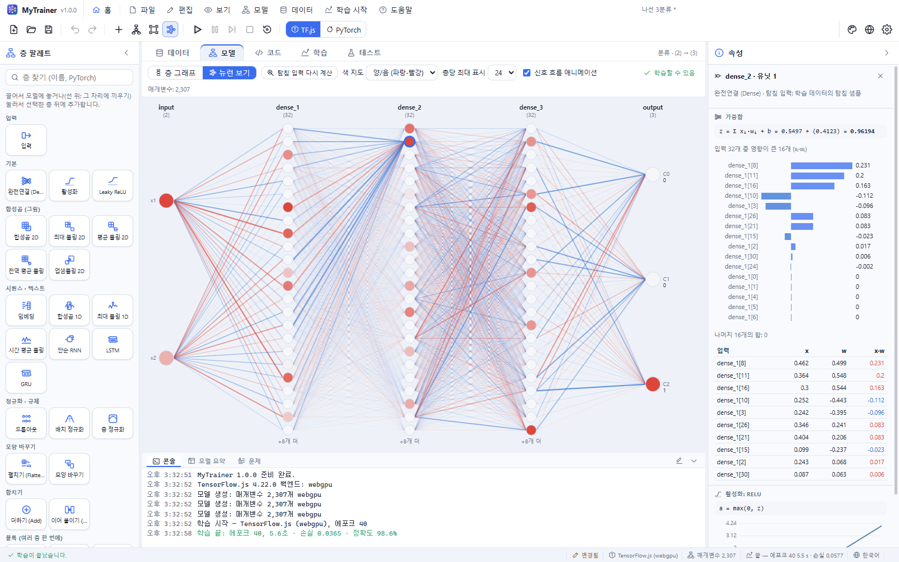
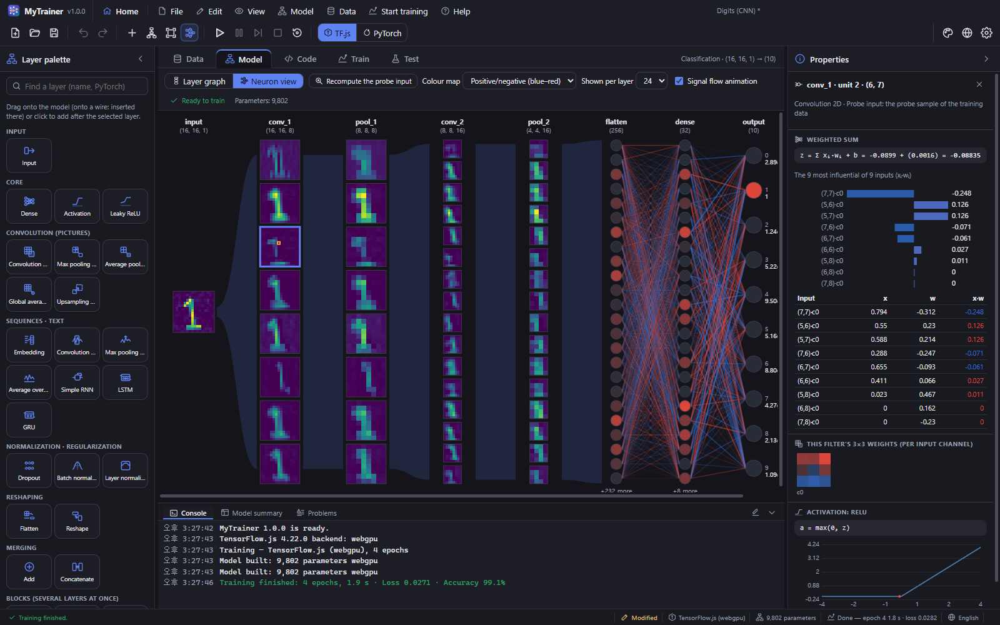
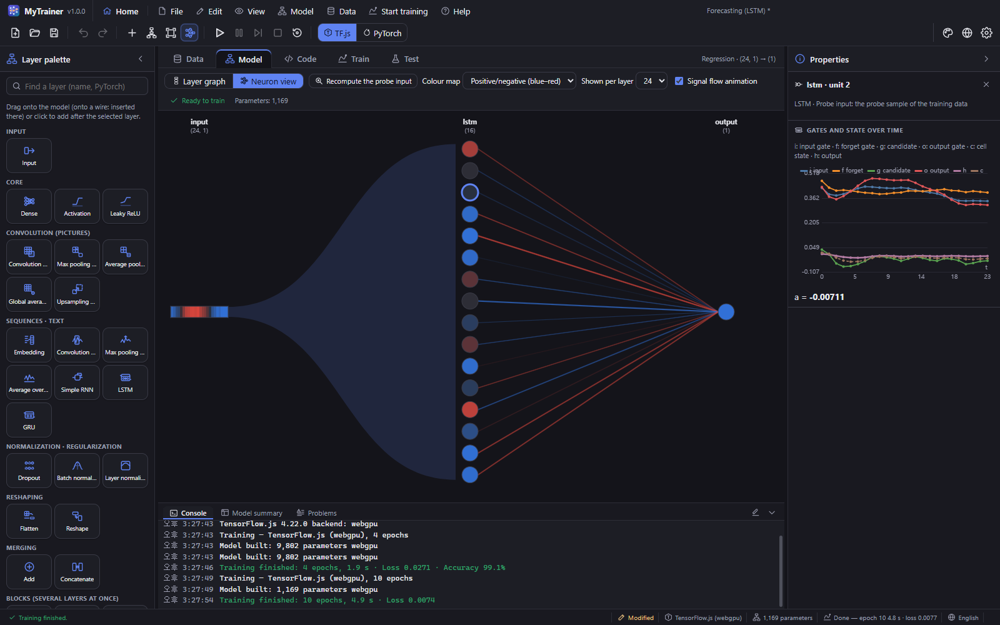
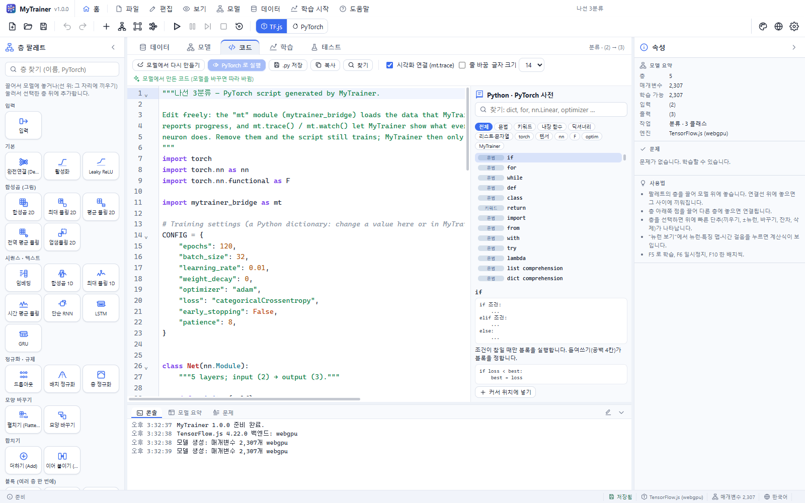
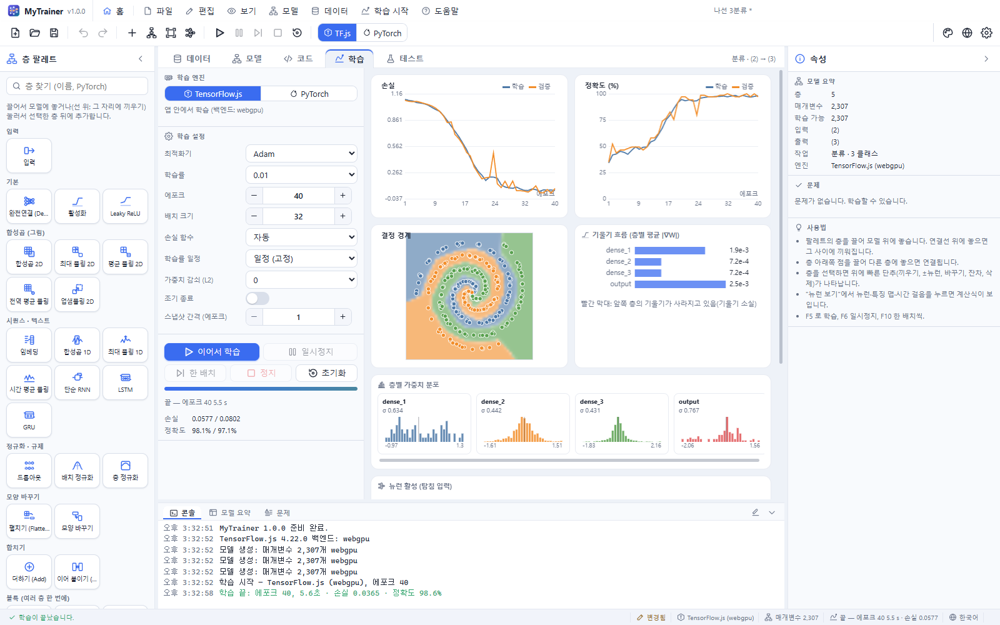
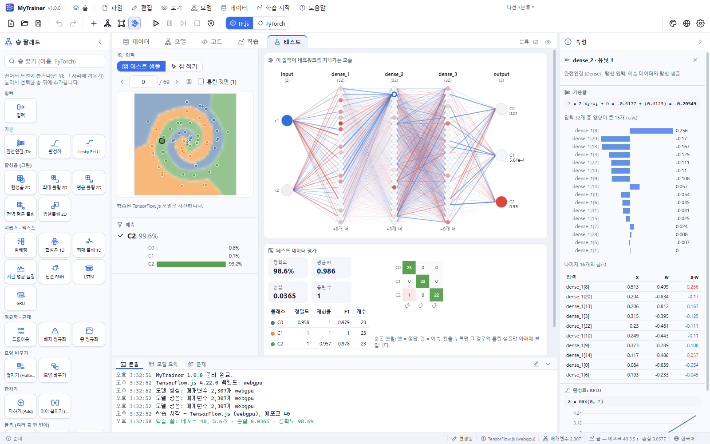
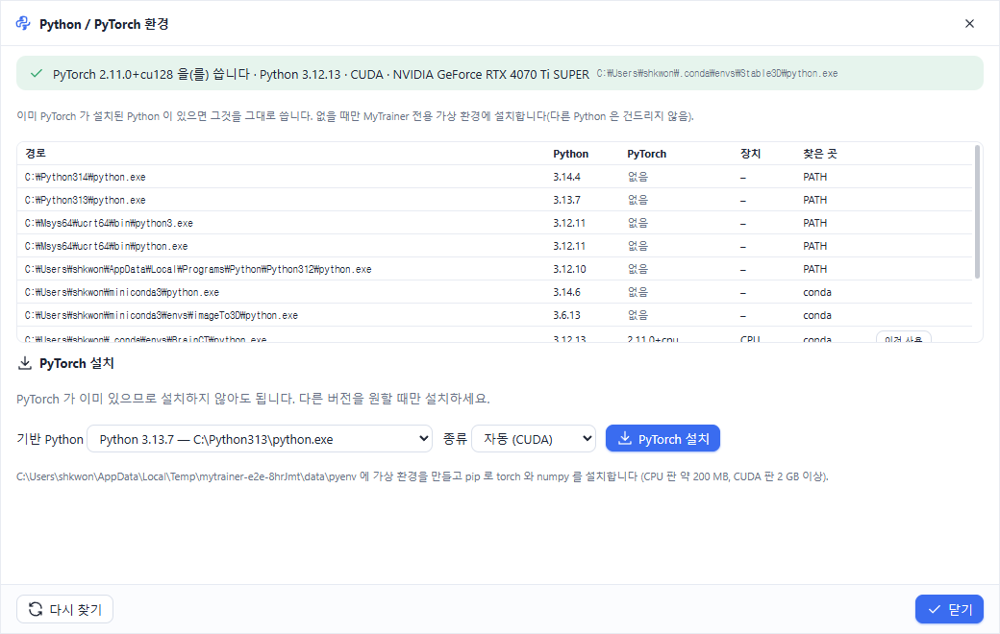

# MyTrainer 사용 설명서

MyTrainer 는 신경망을 **그려서** 만들고, 데이터를 다듬고, 학습시키면서 **층과 뉴런 하나하나가 하는 일을 눈으로 확인**하는 프로그램입니다. 학습한 모델은 그림·마이크·웹캠·파일로 바로 시험하고, **PyTorch 코드**로 보고 고치고, **C/C++ 코드나 ONNX** 로 내보내 다른 프로그램과 기기에서 쓸 수 있습니다.

- 웹 브라우저, Windows, macOS, Linux 에서 같은 화면으로 동작합니다(Tauri 2).
- 학습 엔진은 두 가지입니다: 앱 안에서 바로 학습하는 **TensorFlow**(TensorFlow.js — WebGPU · WebGL · CPU), 그리고 이 컴퓨터의 Python 으로 실행하는 **PyTorch**(데스크톱 앱).
- **38개의 샘플 모델**: MLP, CNN, 오토인코더, RNN · LSTM · GRU, Conv1D, 임베딩, 잔차 연결, 음성 인식(임베디드용 DS-CNN · BC-ResNet, 한국어 키워드), 이미지·문자(OCR)·영상 인식, 표 데이터(CSV), **언어 모델(미니 GPT · LSTM)**.



## 빠른 시작

1. 시작 화면에서 **샘플 모델**(예: "나선 3분류")을 누릅니다.
2. **F5**(또는 툴바의 ▶)를 누르면 학습이 시작됩니다. **학습** 탭에 손실·정확도 곡선이 실시간으로 그려지고, 아래 **콘솔**에 에포크마다 손실·정확도·검증 값·학습률·걸린 시간이 한 줄씩 나옵니다.
3. **뉴런 보기** 탭(Ctrl+3)에서 뉴런 하나를 클릭하면, 오른쪽 **속성** 패널에 그 뉴런의 계산(입력 × 가중치 + 편향 → 활성화)이 숫자 그대로 보입니다.
4. **테스트** 탭에서 테스트 샘플을 넘겨 보거나, 직접 그리고, 마이크·웹캠·파일로 시험합니다.
5. 다 되면 **파일 › C/C++ 코드로 내보내기** 또는 **ONNX 모델로 내보내기**로 학습 결과를 내보냅니다.

## 화면 구성

| 위치 | 내용 |
|---|---|
| 메뉴 막대 | 홈 · 파일 · 편집 · 보기 · 모델 · 데이터 · 학습 · 도움말. 마우스를 올리면 메뉴가 열립니다. 창 제목 막대 역할도 합니다(빈 곳을 끌어 창 이동, **두 번 눌러 최대화/복원**). |
| 툴바 | 새로 만들기·열기·저장, 실행 취소/다시 실행, 층 추가·자동 배치·맞추기·뉴런 보기, 학습 시작·일시정지·한 배치·정지·초기화, **엔진 선택(TensorFlow / PyTorch)**, 오른쪽에 **테마(▾ 목록)** · **언어(Aa / ᄒᆞᆫ)** · 설정 · 프로그램 정보. 창을 가장 작게 줄여도 모든 단추가 보입니다. |
| 왼쪽: 층 팔레트 | 모든 층과 블록(세로 스크롤). 끌어다 모델에 놓거나 눌러서 추가합니다. 아래에 프로젝트 이름과 설명. |
| 가운데: 작업 탭 | **데이터 · 모델 · 뉴런 보기 · 코드 · 학습 · 테스트** (Ctrl+1 … Ctrl+6). 좁으면 탭 이름 대신 아이콘만 보입니다. |
| 오른쪽: 속성 | 선택한 층의 설정, 선택한 뉴런의 계산 과정, 아무것도 선택하지 않으면 모델 요약과 문제 목록(세로 스크롤) |
| 아래: 패널 | **콘솔**(엔진 메시지, 에포크별 학습 진행, Python 출력), **모델 요약**(층별 매개변수·MACs·출력 크기와 실행 비용), **문제** |
| 상태 표시줄 | 알림, 저장 여부, 엔진, 매개변수 수, 학습 상태, 언어 |

모든 오른쪽 클릭 메뉴와 팝업 창은 아이콘이 있고, 팝업의 **×** 단추는 마우스를 올리면 빨간색이 됩니다.

## 데이터 탭



### 데이터 출처

- **내장 데이터** — 2차원 점(XOR, 동심원, 반달, 나선, 점 무리, 체커보드), 함수·표(직선, 사인, Friedman), 그림(숫자, 도형, 색깔 도형, 물체), 문자(영문 A–Z, 한글 자음), **음성 명령**(포먼트 합성, 멜 스펙트로그램), **영상**(움직이는 물체 클립), 시퀀스(사인파 예측, 패턴, 1 세기, 동작 센서), 텍스트(짧은 문장 감성, **영어·한국어 문장(글자 단위 언어 모델)**). 샘플 수·잡음·씨앗 같은 값을 바꾸면 바로 다시 만들어집니다.
- **녹음된 음성 (실제 데이터)** — **한국어 키워드: 출근·퇴근·경비·해제**. Supertonic TTS 화자 120명(기본 남 5·여 5 + 두 목소리를 섞은 30명 + 세 목소리를 섞어 조금 바꾼 80명)이 평서·명령·질문 억양과 여러 빠르기로 말한 음성 5520개(키워드 3840개 + unknown 1680개)와, 비슷하게 들리는 말·일상어 120여 개(unknown: 출발·퇴장·경보·해지 …)입니다. **증강 복사본**(빠르기·높이, 시간 이동, 크기, 마이크 특성, 울림, 배경 소음, 뒤에서 말하는 사람, VTLP, SpecAugment)과 **배경 소음(noise) 부류**를 더할 수 있습니다.
- **CSV 가져오기** — 쉼표·세미콜론·탭을 자동으로 알아냅니다. 정답 열을 고르면 글자이거나 값의 종류가 적을 때 **분류**, 아니면 **회귀**가 됩니다. 글자 특성 열은 원-핫 열로, 빈 숫자는 열의 평균으로 채웁니다.
- **그림 폴더 가져오기** — 하위 폴더 이름이 클래스입니다(`cats/`, `dogs/` …). PNG · JPEG · GIF · WebP · BMP · AVIF · ICO · SVG · **TIFF · TGA** 를 읽습니다.
- **음성 폴더 가져오기** — 하위 폴더 이름이 클래스입니다. WAV · MP3 · OGG · FLAC · M4A · WebM 을 읽어, 소리가 가장 큰 1초를 8 kHz 로 바꿔 저장합니다.

`data/` 폴더에 바로 쓸 수 있는 예제가 있습니다: CSV(`csv/`), 그림(`images/`), 음성(`audio/speech/`, `audio/kws-ko/`), 예측해 볼 파일(`predict/`). 자세한 내용은 `data/README.md` 를 보세요.

샘플을 누르면 그 샘플이 **탐침 입력**이 됩니다. 뉴런 보기와 학습 탭의 뉴런 그림은 탐침 입력이 네트워크를 지나가는 모습입니다. 음성 샘플은 눌러서 들을 수 있고, 그림 위에서 마우스 휠로 다음 샘플들을 넘겨 봅니다.

### 전처리 단계

| 단계 | 하는 일 |
|---|---|
| 표준화 | 학습 데이터의 평균·표준편차로 (x − μ) / σ |
| 최소-최대 정규화 | 학습 데이터의 최소~최대를 지정한 범위로 |
| 다항 특성 | x₁², x₁x₂ … 곱 특성 추가 (뉴런 하나로 원형 경계를 만드는 샘플 참고) |
| 범위 자르기 | 이상치를 범위 안으로 |
| 잡음 증강 · 좌우 뒤집기 · 이동 증강 | 변형한 복사본을 **학습 데이터에만** 추가 |
| 밝기 반전 | 1 − x |

통계(평균, 범위)는 **학습 데이터에서만** 구해 검증·테스트 데이터에 똑같이 적용합니다. 단계는 켜고 끄거나 순서를 바꿀 수 있습니다. **원본 / 전처리 후** 단추로 차이를 확인하세요. 같은 전처리가 C 내보내기(`mt_preprocess`)와 ONNX 내보내기(모델 안)에 그대로 들어갑니다.

### 나누기

검증·테스트 비율, 섞기 씨앗, **클래스 비율 유지**(층화 추출)를 정합니다. 음성 데이터에는 **화자(원본)별로 나누기**가 있어(기본 켬) 한 화자의 음성(또는 한 녹음과 그 증강 복사본)이 학습·검증·테스트 중 한 곳에만 들어갑니다 — 검증·테스트 정확도가 처음 듣는 목소리에 대한 정확도가 됩니다. 아래 막대가 세 부분의 크기를 보여 줍니다.

## 모델 탭 — 코딩 없이 모델 만들기



모델은 층 카드와 연결선으로 된 그래프입니다. 카드에는 층 이름, 종류와 주요 설정, **출력 모양**, 매개변수 수, 그리고 학습 중에는 **활성값 띠**가 보입니다.

| 하고 싶은 일 | 방법 |
|---|---|
| 층 추가 | 팔레트의 층을 캔버스로 **끌어 놓기** · 층을 선택하고 팔레트에서 **누르기**(선택한 층 뒤에 끼워짐) · 빈 곳을 **두 번 클릭** |
| 두 층 사이에 끼우기 | 팔레트의 층을 **연결선 위에** 놓기 · 연결선을 오른쪽 클릭 → "이 연결선에 층 끼우기" |
| 연결 | 층 아래쪽 점(출력 포트)을 끌어 다른 층에 놓기 |
| 연결 끊기 | 연결선을 누르고 Delete · 오른쪽 클릭 → 연결선 삭제 |
| 빠른 편집 | 층을 선택하면 위에 단추가 나타납니다: **위에 끼우기 · 아래에 추가 · 뉴런/필터 −/+ · 다른 층으로 바꾸기 · 복제 · 잔차 연결 · 삭제** |
| 여러 층 한 번에 | **블록**(Dense+BN+ReLU+드롭아웃, Conv+BN+ReLU+풀링, 분류 머리, LSTM 2층, 깊이별+점별(DS-CNN) …) |
| 설정 바꾸기 | 오른쪽 속성 패널: 이름(코드의 변수 이름), 종류, 뉴런 수·활성화·커널 크기 … |
| 정리 | **자동 배치**(Ctrl+L), **화면에 맞추기**(Ctrl+0, 가운데 정렬), 확대/축소(− [비율] + 단추, Ctrl+휠, Ctrl+= / Ctrl+-) |
| 방향 · 격자 | **위→아래 / 왼쪽→오른쪽**: 같은 배치를 세로 또는 가로로 보여 줍니다(배치는 그대로 남음). **격자**(Ctrl+G): 5칸마다 진한 선이 있는 5×5 격자를 켜고 끕니다. |
| 선택 | 클릭, Shift+클릭, Shift+끌기(사각형), Ctrl+A |

층 종류: 완전연결, 활성화, Leaky ReLU, 합성곱 2D, **깊이별 합성곱 2D**(커널 높이·너비 따로), 최대/평균/전역 평균 풀링, **주파수 평균 풀링**(BC-ResNet), 업샘플링, 합성곱 1D, 최대 풀링 1D, 시간 평균 풀링, RNN · LSTM · GRU, 임베딩, **토큰 + 위치 임베딩 · 셀프 어텐션(헤드 수, 인과 마스크) · 마지막 시점**(트랜스포머), 드롭아웃, 배치 정규화, 층 정규화, 펼치기, 모양 바꾸기, 더하기(브로드캐스트), 이어 붙이기.

모양은 데이터에서 출력까지 자동으로 계산되며, 맞지 않으면 카드에 빨간 표시와 설명이 붙습니다. **문제** 탭에서 모든 문제를 볼 수 있고, 문제를 누르면 그 층으로 이동합니다. 데이터를 바꾸면 출력층의 뉴런 수와 활성화가 작업에 맞게 자동으로 바뀝니다.

## 뉴런 보기 탭



네트워크를 왼쪽(입력)에서 오른쪽(출력)으로 **뉴런 단위**로 그립니다. 처음에는 **창 폭에 맞춰** 전체가 보이고, 툴바의 − [비율] + 단추(또는 Ctrl+휠, Ctrl+= / Ctrl+-)로 확대·축소, 맞추기 단추(Ctrl+0)로 다시 창 폭에 맞춥니다. 창보다 작으면 가운데에, 크면 스크롤로 봅니다.

- 벡터 층은 **뉴런 원**(색 = 활성값), 그림 층은 **채널별 특징 맵**, 시퀀스 층은 **유닛별 시간 띠**로 보입니다.
- 층과 층 사이는 **선으로 연결**됩니다: 완전연결은 가중치, 합성곱은 채널 사이 커널 합, 깊이별 합성곱은 채널 1:1, 순환층은 후보 게이트 가중치, 셀프 어텐션은 값·출력 가중치(Wv·Wo), 임베딩은 표의 값, 정규화·풀링·활성화는 1:1. 파랑 = 음수, 빨강 = 양수, 굵고 진할수록 큼. **선 보이기**로 켜고 끕니다.
- 뉴런 위에 마우스를 올리면 그 뉴런으로 들어오고 나가는 선이 강조됩니다.
- 새 스냅샷이 오면 신호가 입력에서 출력으로 **흘러가는 애니메이션**이 나옵니다.
- **뉴런 · 특징 맵의 픽셀 · 시간 걸음을 클릭**하면 속성 패널에 그 값이 어떻게 계산됐는지 나옵니다.

| 층 | 속성 패널에 보이는 것 |
|---|---|
| 완전연결 | z = Σ xᵢ·wᵢ + b, 영향이 큰 입력 순서의 기여 막대와 표, 들어오는 선 그림, 활성화 함수 그래프 위의 z, 결과 a |
| 합성곱 · 깊이별 합성곱 | 선택한 위치의 수용 영역 × 필터 가중치(채널별 필터 그림), 합, 활성화 |
| 풀링 · 주파수 평균 | 창 안의 값들과 max / 평균 |
| 배치 정규화 | (x − μ) / √(σ² + ε) · γ + β |
| LSTM · GRU · RNN | 시간에 따른 게이트(입력·망각·후보·출력 / 갱신·리셋·후보)와 은닉·셀 상태 그래프 |
| 임베딩 · 토큰+위치 임베딩 | 토큰 번호와 그 벡터, E[토큰] + P[위치] |
| **셀프 어텐션** | 선택한 위치의 토큰이 앞 토큰들을 얼마나 보는지 **헤드별 색 선**(굵기 = 어텐션 가중치), softmax(q·kᵀ/√d)·V → Wo 의 기여 |
| 더하기 · 이어 붙이기 | 각 입력에서 온 값 (브로드캐스트 포함) |

계산 결과 옆의 **✓ 엔진 값**은 엔진(TensorFlow 또는 PyTorch)이 실제로 계산한 값과 이 식으로 다시 계산한 값이 같다는 표시입니다.





## 코드 탭 — PyTorch 코드



모델과 학습 설정이 그대로 담긴 **완전한 PyTorch 스크립트**가 만들어집니다.

- `CONFIG` 딕셔너리(에포크, 배치 크기, 학습률, 최적화기 매개변수, 학습률 일정, 조기 종료, 레이블 스무딩 …), `class Net(nn.Module)` 의 `__init__`(층)과 `forward`(계산), 손실 함수, `learning_rate(epoch)`(일정), 평가 함수, 학습 반복문이 들어 있습니다. 트랜스포머 층은 `TokenPositionEmbedding`, `SelfAttention` 클래스로 함께 만들어집니다.
- 그림·시퀀스의 축 순서(앱은 채널이 마지막, PyTorch 는 채널이 먼저)는 `permute` / `transpose` 와 주석으로 보입니다.
- `mytrainer_bridge`(`mt`) 모듈이 앱과 통신합니다: `mt.load_data()`, `mt.batches()`, `mt.trace(이름, 텐서)`, `mt.watch(model, loss_fn)`, `mt.report_epoch()`, `mt.finish()`, `mt.serve()`. **시각화 연결**을 끄면 `mt.trace` 줄 없이 만듭니다.
- 모델을 바꾸면 코드도 따라 바뀝니다. **코드를 직접 고치면** "직접 고친 코드"가 되어 보존되고, PyTorch 엔진은 그 코드를 실행합니다. **모델에서 다시 만들기**로 생성된 코드로 돌아갑니다.
- 편집기: Python 문법 강조, 자동 완성(Ctrl+Space), 마우스를 올리면 설명, 문법 오류 표시, 찾기(Ctrl+F), 줄 바꿈·글자 크기.
- **Python · PyTorch 사전**(오른쪽): 문법, 키워드, 내장 함수, 딕셔너리 메서드, 리스트·문자열, torch · 텐서 · nn · F · optim, MyTrainer 함수를 설명·예제로 찾아보고 **커서 위치에 넣기**.

## 학습 탭



| 항목 | 설명 |
|---|---|
| 모델 구조 | 모델을 여러 개 가진 샘플(예: 한국어 키워드 인식의 **ResNet CNN / DS-CNN / BC-ResNet**)에서 학습할 모델을 고릅니다. 고친 내용은 각 모델에 따로 남습니다. |
| 엔진 | 툴바의 **TensorFlow / PyTorch** 단추로 고릅니다. TensorFlow 는 앱 안의 TensorFlow.js(WebGPU → WebGL → CPU 자동 선택), PyTorch 는 데스크톱에서 Python 으로 학습합니다. 이 칸에는 쓰는 백엔드·Python 정보가 나옵니다. |
| 최적화기 | Adam, SGD, SGD+모멘텀, RMSprop, Adagrad, Adadelta, Adamax |
| 학습률 | 값을 직접 입력하거나 목록에서 고릅니다 |
| 학습률 일정 | 고정, 단계적 감소, 지수 감소, 코사인 |
| 손실 | 자동(분류: 교차 엔트로피, 회귀·복원: MSE), MAE, Huber |
| 가중치 감쇠 · 조기 종료 · 참을성 · 스냅샷 간격 | 과적합 줄이기 / 몇 에포크마다 모든 층의 활성값·가중치·기울기를 가져올지 |

**고급 학습 설정**(펼치기) — 고른 최적화기·일정·조기 종료에 맞는 항목만 보입니다:

| 항목 | 설명 |
|---|---|
| 모멘텀 · Nesterov | SGD+모멘텀 |
| β₁ · β₂ · ε | Adam · Adamax |
| ρ · ε | RMSprop · Adadelta |
| 단계 간격 · 감소 비율 · 최소 학습률 | 단계 / 지수 / 코사인 일정 |
| 워밍업 | 처음 몇 에포크 동안 학습률을 천천히 올리기(트랜스포머에 흔함) |
| 조기 종료 기준 · 최소 개선폭 · 최고 가중치 복원 | 검증/학습 손실·정확도 중 무엇을 볼지, 얼마나 좋아져야 개선인지, 끝나면 가장 좋았던 에포크의 가중치로 되돌릴지 |
| 에포크마다 섞기 · 레이블 스무딩 | 배치 순서 섞기 / 정답을 (1−ε)로 두어 과신 줄이기(분류) |
| 믹스업 (α) | 두 샘플과 정답을 λ : 1−λ 로 섞어 학습(λ ~ Beta(α, α), 분류). 처음 보는 데이터에 더 고르게 맞힙니다. 한국어 키워드 인식 샘플은 0.3 |

**학습 시작(F5) · 일시정지/계속(F6) · 한 배치(F10) · 정지(Shift+F5) · 초기화**. TensorFlow 는 정지 후 **이어서 학습**할 수 있습니다. 학습하는 동안 콘솔에 에포크마다 진행 상황이 나옵니다. 데이터와 모델을 준비하고 첫 에포크가 끝날 때까지 시간이 걸리면 **진행률 창**이 떠서 얼마나 남았는지 보여 줍니다. 음성 데이터처럼 큰 데이터를 처음 만들 때도 같은 창이 나옵니다. 학습이 끝나면(정지 단추로 멈춘 경우는 빼고) **알림 창**에 에포크 수·걸린 시간·손실·정확도가 나옵니다(설정 › 일반에서 끌 수 있음). 오류가 나면 **오류 창**에 내용·위치·시각·버전·엔진·스택이 나오고 **오류 내용 복사**로 그대로 복사할 수 있습니다.

학습 탭의 **뉴런 활성** 카드: 맨 끝 출력 뉴런마다 **분류 레이블과 값**(확률은 %)이 붙고 가장 큰 것이 강조됩니다. ◀ 입력 n / N ▶ 🎲 로 네트워크를 지나가는 입력(학습 샘플)을 바꾸고(학습 중에도 바로 바뀜), **에포크마다 바꾸기**를 켜면 에포크마다 다른 샘플이 지나갑니다. − [배율] + 와 **원위치**로 확대·축소하고, 끌어서 옮길 수 있습니다.

모든 그래프 카드에는 제목이 있고, 제목(ⓘ)에 마우스를 올리면 그 카드가 무엇을 보여 주는지 설명이 나옵니다(데이터·테스트 탭도 같습니다). 분류 작업의 **출력 확률** 카드는 탐침 입력 하나를 지금의 모델에 넣었을 때 클래스(예: 경비·출근·퇴근·해제)마다의 확률이고, 글씨가 진한 막대가 실제 정답입니다. 맨 위에는 탐침 입력이 네트워크를 지나가는 **뉴런 활성**(선 연결)이 있어 학습하면서 바로 보입니다. 그 아래 차트: 손실(학습/검증, 지난 실행은 점선), 정확도 또는 학습률, **결정 경계**(2차원 점, 왼쪽 정렬) · **학습된 곡선** · **원본/복원** · 출력 확률, **기울기 흐름**(층별 평균 |∇W|), **층별 가중치 분포**. 그래프와 그림은 원래 비율을 유지합니다.

## 테스트 탭



- **테스트 샘플**: 이전/다음/무작위, 음성은 ▶로 듣기, 평가 후에는 **틀린 것만** 넘겨 보기.
- **직접 입력**: 그림 데이터는 검은 칸에 **그리기**, 2차원 점은 평면을 **클릭**, 텍스트는 문장 **입력**, 표·함수 데이터는 원래 단위의 값 입력(전처리는 자동 적용).
- **텍스트 생성**(글자 단위 언어 모델): 시작 글을 쓰고 **글자 수**와 **온도**를 골라 **이어 쓰기**를 누르면 모델이 다음 글자 확률에서 하나씩 뽑아 글을 이어 씁니다. 온도가 낮을수록 확실한 글자만, 높을수록 다양하게 씁니다.
- **입력 고르기**: **테스트 샘플** · **내 파일**(그림·음성·CSV·텍스트 파일이나 폴더를 열어 바로 실행) · **예제**(앱에 들어 있는, 학습에 쓰지 않은 예제 입력. 누르면 하나, **모두 실행**은 전부) · 직접 입력. 고른 입력이 네트워크를 지나가고 예측이 아래에 나옵니다.
- **마이크로 시험하기**(음성 모델): **한 번 말하기**를 누르고 4초 안에 한 단어를 말하면, 말이 끝나는 순간(잠깐 조용해지면) 그 단어 전체를 학습 데이터처럼 가운데에 맞춰 예측합니다. **계속 듣기**는 단어가 끝날 때마다 하나씩 예측합니다(단어 일부만 보고 판단하지 않음). **마이크 감도(증폭)**와 **말소리 기준**(이보다 작으면 "조용함")을 조절할 수 있고, 입력 크기 막대의 세로선이 기준입니다.
- **웹캠으로 시험하기**(그림·영상 모델): 웹캠을 켜고 **찍어서 예측** 또는 **계속 인식**. 화면 가운데 정사각형을 학습 그림과 같은 크기·채널로 바꾸고, 흰 종이에 그린 글씨는 자동으로 반전합니다. 영상 모델은 프레임 여러 장을 찍어 클립으로 예측합니다.
- **입력 데이터 선택해서 실행**: 그림(모든 형식) · 음성 · 동영상(MP4 · WebM · MOV …) · CSV · 텍스트 파일이나 폴더를 골라 한꺼번에 예측하고, 결과 표를 CSV 로 저장합니다.
- 입력이 네트워크를 지나가는 모습이 뉴런 보기로 크게 나오고, 예측(클래스 확률 · 값 · 복원 그림)이 보입니다.
- **성능 (추론 시간)**: **측정**을 누르면 테스트 입력을 하나씩 정한 횟수(20 · 50 · 100 · 200)만큼 넣어 **평균 ± 표준 편차**, 최소 … 최대, 중앙값, p95 와, 한 번에 여러 개(최대 256)를 넣었을 때의 **처리량**(입력/초)을 보여 줍니다. 엔진에 요청해서 답을 받을 때까지(앱이 실제로 기다리는 시간)를 잽니다.
- **평가**(학습이 끝나면 자동): 정확도, 평균 F1, 손실, 클래스별 정밀도·재현율·F1, **혼동 행렬**, 틀린 샘플 그림. 회귀는 MAE · RMSE · R², 예측-정답 그림과 오차 분포.

처음 마이크·웹캠을 쓸 때 사용 권한을 묻습니다. 허용해야 쓸 수 있습니다(macOS 는 시스템 설정 › 개인정보 보호).

PyTorch 엔진은 학습이 끝난 뒤에도 실행을 살려 두고(`mt.serve`) 테스트 요청에 답합니다. **PyTorch 종료**로 끝냅니다.

## 모델 내보내기 — C/C++ · ONNX

툴바의 **내보내기** 단추(또는 **파일 › 모델 내보내기…**)를 누르면 형식을 고르는 창이 뜹니다: **ONNX** · **TensorFlow.js** · **C/C++** · **PyTorch 코드**. 학습된 가중치와 함께 내보냅니다(데스크톱: 고른 폴더 아래 `<이름>-onnx` / `<이름>-tfjs` / `<이름>-c` 폴더, 웹: ZIP 내려받기).

| 형식 | 들어 있는 것 | 쓰는 곳 |
|---|---|---|
| **C/C++** | `model.h`, `model.c`(가중치는 `const float` 배열, 라이브러리·동적 메모리 없음), `example.c`(테스트 샘플로 스스로 검사), `README.md` | C · C++ 프로그램, 마이크로컨트롤러(임베디드 음성 인식 등). `mt_preprocess()` 에 학습 전처리가, `mt_predict()` 에 모델이, `mt_classify()` 에 둘 다와 가장 큰 클래스가 있습니다. |
| **TensorFlow.js** | `model.json` + `weights.bin`(Keras 형식 층 모델), `mytrainer.json`(클래스 이름, 입력 모양, 전처리 단계), `README.md` | `tf.loadLayersModel`(브라우저 · Node), `tensorflowjs_converter` 로 Keras(.h5) · SavedModel. TensorFlow 엔진으로 학습한 모델만 |
| **ONNX** | `model.onnx`(opset 13, 전처리 포함 — 입력은 원래 값), `model.json`(모양, 클래스 이름, 테스트 샘플), `README.md`(ONNX Runtime C++/Python 예제) | ONNX Runtime(C, C++, C#, Java, Python, 모바일, 웹) 등 ONNX 를 읽는 모든 도구 |

```c
#include "model.h"
float raw[MT_RAW_INPUT_SIZE];       /* 데이터 출처가 주는 원래 값 */
float out[MT_OUTPUT_SIZE];
int cls = mt_classify(raw, out);     /* mt_labels[cls] */
```

`gcc -O2 -std=c99 example.c model.c -lm -o example && ./example` 로 빌드하면 MyTrainer 가 계산한 값과의 차이를 보여 줍니다. 모든 샘플에서 C 와 ONNX 결과가 TensorFlow.js 와 1e-6 이내로 같은지 자동 시험으로 확인합니다. 음성 모델의 입력은 MyTrainer 가 만드는 멜 스펙트로그램(32 대역 × 32 프레임, 8 kHz)입니다.

**모델 요약**(아래 패널)에는 층별 MACs(곱셈-누적 횟수)와 출력 크기, 그리고 전체 연산량 · 가중치 크기(float32 / int8) · 작업 메모리 최대값이 나와 기기에 올릴 수 있는지 가늠할 수 있습니다.

## PyTorch 엔진과 Python 환경



**학습 › Python / PyTorch 환경…** 창에서 이 컴퓨터의 Python 들을 볼 수 있습니다.

1. **이미 설치된 것을 먼저 씁니다.** `MYTRAINER_PYTHON` 환경 변수, MyTrainer 전용 환경, 활성화된 가상 환경, conda 환경, PATH, Windows `py` 실행기, 일반 설치 폴더, pyenv 를 모두 찾아 각 Python 에 PyTorch 가 있는지 확인합니다. 여럿이면 **CUDA → Apple MPS → MyTrainer 전용 → 최신 PyTorch** 순서로 고르고, **이것 사용**으로 바꿀 수 있습니다.
2. **없을 때만 설치합니다.** 기반 Python 과 종류(자동 / CPU / CUDA / PyPI 기본)를 고르고 **PyTorch 설치**를 누르면, 앱 데이터 폴더에 **MyTrainer 전용 가상 환경**을 만들고 pip 로 torch 와 numpy 를 설치합니다.
3. Python 이 아예 없으면 Windows 에서는 **Python 3.12 설치(winget)** 단추로 설치할 수 있습니다.

PyTorch 로 학습하면 실행 폴더(앱 데이터 폴더의 `runs/`)에 스크립트(`train.py`), 브리지 모듈, 전처리된 데이터가 만들어집니다. 스크립트의 출력과 오류는 콘솔에 나옵니다.

## 샘플 모델

| 묶음 | 샘플 |
|---|---|
| 기초 분류 | XOR, 동심원, 다항 특성 + 로지스틱 회귀, 두 개의 반달, 나선 3분류, 소프트맥스 회귀, 체커보드 + 배치 정규화 |
| 회귀 | 선형 회귀, 사인 곡선 근사, 표 데이터 회귀(Friedman) |
| 표 데이터 (CSV) | 학생 합격 예측, 집값 예측 |
| 이미지 인식 | 숫자 인식(MLP · CNN), 도형 분류, 색깔 도형(RGB CNN), 물체 인식(CNN) |
| 문자 인식 (OCR) | 영문 대문자, 한글 자음 |
| 음성 인식 | 음성 명령(CNN · GRU), **키워드 인식 DS-CNN · BC-ResNet (임베디드)**, **한국어 키워드 인식: 출근·퇴근·경비·해제**(Supertonic 음성, ResNet CNN / DS-CNN / BC-ResNet 선택) |
| 영상 인식 | 동작 인식(프레임 + LSTM, 프레임 쌓기 CNN) |
| 언어 모델 (LLM) | **미니 GPT**(영어 · 한국어, 글자 단위 트랜스포머), LSTM 언어 모델 |
| 오토인코더 | 오토인코더, 합성곱 오토인코더 |
| 시퀀스 · 텍스트 | 시계열 예측(LSTM), 패턴 분류(GRU), 1의 개수 세기(RNN), 동작 인식(Conv1D), 감성 분석(임베딩 + LSTM) |
| 그래프 구조 | 잔차 연결(ResNet 블록), 와이드 & 딥(Concatenate) |

**파일 › 샘플 모델…**(갤러리) 또는 시작 화면에서 엽니다.

## 파일

- **프로젝트(.mytrain)**: 데이터 출처와 전처리·나누기, 모델 그래프(여러 모델이면 모두), 학습 설정, 엔진, PyTorch 코드(직접 고친 경우), 지난 실행 기록, 설정에 따라 **학습된 가중치**를 담은 JSON 파일입니다. CSV·그림·음성 폴더 데이터도 파일 안에 들어갑니다.
- **PyTorch 스크립트(.py)**, **C/C++ 코드**, **ONNX** 로 내보낼 수 있습니다.
- 데스크톱에서는 `.mytrain` 파일을 두 번 누르면 MyTrainer 로 열립니다. 저장하지 않은 작업은 자동으로 기억됩니다.

## 시작 화면

왼쪽에 **시작하기**(새 모델, 열기, 샘플 갤러리, 사용 설명서), 최근 파일, **배경 설정**, 오른쪽에 묶음별 **샘플 모델**이 한 화면에 보입니다. 배경은 **인공지능을 주제로 한 움직이는 그림 20가지**(신경망 신호, 경사 하강, 어텐션, 합성곱, 임베딩 공간, 텐서, 활성화 함수, 역전파, 결정 경계, 손실 곡선, 드롭아웃, 토큰 흐름, 확산 모델, K-평균, 결정 트리, 뉴런 발화, 가중치 행렬, 잠재 공간, 순환 신경망, GAN 분포)이며, 속도와 자동 변경 간격을 정할 수 있습니다. 메뉴 막대의 **홈**으로 언제든 돌아옵니다.

## 테마와 설정

- **테마 ▾**(툴바): 다크 테마 20개(두 줄) · 라이트 테마 20개(두 줄) · **사용자 정의 테마**(✎로 편집) · 시스템 설정 따르기가 한 번에 보이는 목록입니다. 왼쪽 팔레트 단추는 무작위 테마입니다.
- **언어 단추**: 한국어일 때 **Aa**(영어로), 영어일 때 **ᄒᆞᆫ**(한국어로).
- **편집 › 설정…** (크기가 고정된 창, 탭 4개): **일반**(언어, 시작 화면, 끝낼 때 저장 확인, 가중치 저장, 학습이 끝나면 알림 · 시각화: 색 지도, 층당 표시할 뉴런 수, 신호 애니메이션 · PyTorch: Python 경로, 설치 종류) / **테마**(목록) / **사용자 정의 테마**(배경·표면·글자·강조 색, 다크 여부, 기존 테마에서 시작, 미리 보기) / **글꼴·코드**(글꼴·크기·굵기·모양 · 코드 글자 크기, 줄 바꿈, 시각화 연결). 바꾼 값(테마·글꼴·언어 …)은 메인 창에 **바로 적용**됩니다. **확인**은 그대로 두고, **취소**(또는 ×, Esc)는 창을 열 때의 설정으로 되돌리며, **초기화**는 이 창의 설정을 기본값으로 바꿉니다(언어와 창 배치는 그대로, 확인을 눌러야 남습니다).
- **사용 설명서**(F1)는 별도의 창에 열립니다.

## 단축키

| 키 | 동작 |
|---|---|
| Ctrl+N · Ctrl+O · Ctrl+S · Ctrl+Shift+S | 새로 만들기 · 열기 · 저장 · 다른 이름으로 저장 |
| Ctrl+Z · Ctrl+Y | 실행 취소 · 다시 실행 |
| Ctrl+1 … Ctrl+6 | 데이터 · 모델 · 뉴런 보기 · 코드 · 학습 · 테스트 탭 |
| Delete · Ctrl+D · Ctrl+A | 삭제 · 복제 · 모두 선택 (모델 탭) |
| Ctrl+L · Ctrl+0 · Ctrl+E | 자동 배치 · 화면에 맞추기 · 뉴런 보기 |
| Ctrl+= · Ctrl+- · Ctrl+G | 확대 · 축소 (모델 · 뉴런 보기) · 격자 켜기/끄기 |
| 방향키 (Shift: 크게) | 선택한 층 이동 |
| F5 · F6 · F10 · Shift+F5 | 학습 시작 · 일시정지/계속 · 한 배치 · 정지 |
| F1 | 사용 설명서 |
| Ctrl+F · Ctrl+Space | 코드에서 찾기 · 자동 완성 |

## 문제 해결

- **"모델에 오류가 있습니다"** — **문제** 탭을 보세요. 가장 흔한 것은 출력층의 뉴런 수가 클래스 수와 다른 경우, 그림 층 앞에 그림이 아닌 입력이 오는 경우, 셀프 어텐션의 특성 수가 헤드 수로 나누어떨어지지 않는 경우입니다.
- **마이크/웹캠이 안 됨** — 권한을 허용했는지 확인하세요. 다른 프로그램이 카메라를 쓰고 있으면 켜지지 않습니다. 말해도 "조용함"이면 **마이크 감도**를 올리거나 **말소리 기준**을 내리세요.
- **PyTorch 엔진을 고를 수 없음** — 웹판에서는 PyTorch 엔진을 쓸 수 없습니다. 데스크톱 앱을 쓰세요.
- **PyTorch 가 없다고 나옴** — Python / PyTorch 환경 창에서 **다시 찾기**, 또는 설정의 Python 경로에 PyTorch 가 있는 Python 을 직접 적으세요.
- **PyTorch 로 내보내기가 안 됨** — PyTorch 엔진은 학습이 끝나고 실행 중일 때(종료 전) 내보낼 수 있습니다.
- **학습이 느림** — 상태 표시줄의 엔진 백엔드를 확인하세요(cpu 면 느립니다). 배치 크기를 키우거나 스냅샷 간격을 늘리면 빨라집니다.
