# MyUMLMaker User's Guide

MyUMLMaker draws UML and software diagrams model first, the way StarUML does. It draws the 15 UML 2 diagrams (class, sequence, state machine, activity and the rest) plus ER, flowchart, data flow, SysML, BPMN, C4, mind map, wireframe, cloud (AWS, Azure, GCP) and network diagrams, Gantt charts, WBS and timelines, ArchiMate 3, user story maps and customer journey maps, and JSON, YAML, EBNF and regex diagrams. It manages and traces requirements, validates the model, simulates BPMN processes, generates Java, C#, C++, Python, TypeScript, Kotlin and PHP code and SQL DDL, and reads source code back into a model. It compares the model with baselines, generates Word, PDF and HTML documents, and exchanges models with StarUML (.mdj), XMI (Enterprise Architect and others), PlantUML and Mermaid. It runs with the same screens as a desktop app on Windows, macOS and Linux and in a web browser.

This guide is organised by task. Menu and command names are written exactly as the program shows them (for example **File › Export › HTML documentation (.html)…** is the "HTML documentation (.html)…" command in the "Export" submenu of the "File" menu). The pictures are captured from the tutorial. Shortcuts are given for Windows and Linux; on macOS use `Cmd` instead of `Ctrl`.

> 한국어 설명서: [UsersGuide.md](UsersGuide.md)

## Getting started

### First start

On the first start the **Welcome to MyUMLMaker** window opens. It explains that the tutorial uses a sample project to show every feature in turn, from the Model Explorer and diagrams to quick edit, relationships, formatting, layout, code generation, exports and settings, and says where to find the tutorial, the sample project and the user's guide.

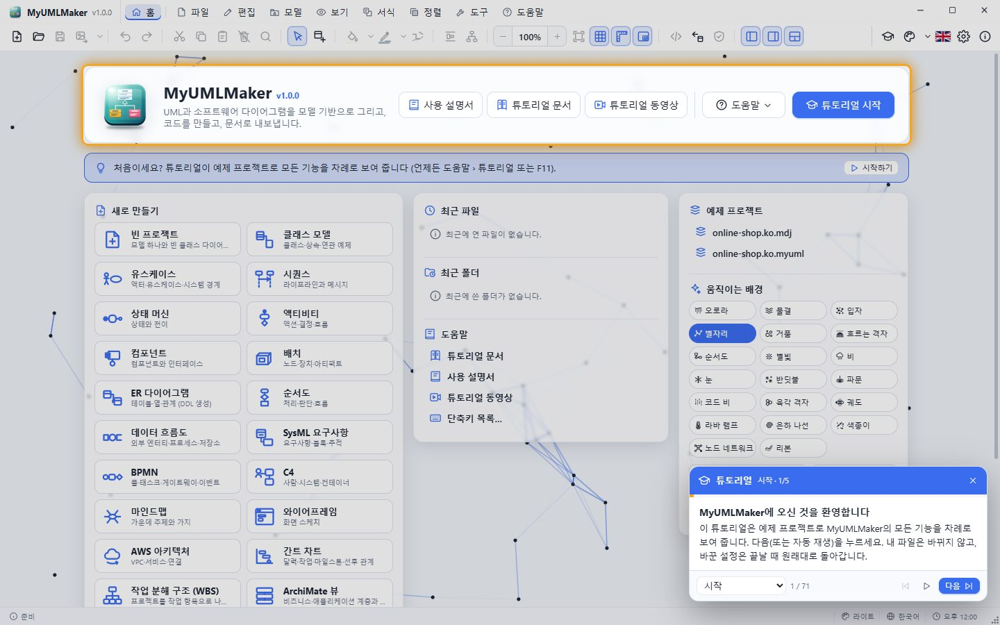

| Button | What it does |
|---|---|
| **Start the tutorial** | Starts the tutorial, which shows every feature one by one on a sample project |
| **Open the sample** | Opens the "Online Shop" sample project |
| **Later** | Closes the window. The tutorial is always at **Help › Tutorial** (`F11`) |

The welcome window shows only once. You can run several MyUMLMaker desktop apps at once: every start opens one more window (see [Running several windows](#running-several-windows)).

### Start page

The start page shows when no project is open (and from the **Home** button at the start of the menu bar, `Ctrl+Shift+H`). Its background keeps moving. The **Home** button does not close the open project: press **Home** (`Ctrl+Shift+H`) again to go back to it.

| Area | Contents |
|---|---|
| Top | Program name and version, the line "Model UML and software diagrams, generate code and publish documentation.", three document buttons — **User's guide** · **Tutorial document** · **Tutorial video** (each opens its own window, see [Document windows](#document-windows)) —, a **Help** button (the tutorial, the tutorial document, the tutorial video, the user's guide, the shortcut list, settings and About) and **Start the tutorial**. Until the tutorial has been finished, a "New here?" banner with a **Start** button shows too |
| **New** | 23 template tiles, **Open…**, **Open StarUML project (.mdj)…**, **Reverse engineer (code → model)**, **Import Mermaid / PlantUML…** |
| **Recent files** · **Recent folders** | The files and folders opened lately. ✕ removes one entry, **Clear all** · **Clear all folders** remove them all. Clicking a folder opens the Open window in that folder |
| **Help** | **Tutorial document**, **User's guide**, **Tutorial video**, **Keyboard shortcuts…** |
| **Sample projects** | The installed sample files (only those in the current language). If the install folder has no samples, a single **Online Shop (sample)** shows |
| **Moving background** | Pick one of 20 animations, **Change moving background** (random), **Background image…**, **Motion speed** (0–300%), **Random at start**, **Auto change** (Off, every 15 s, 30 s, 1 min, 2 min or 5 min) |
| Bottom | **Show the start page at start-up** check box |

Which parts show, and how many recent files, is set in **Settings › Start page**. Right-clicking the start page offers New project · Open · Recent files · Change moving background · Tutorial · About.

### New project from a template

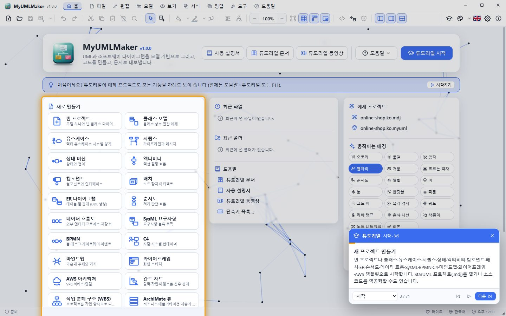

Pick a template tile on the start page or **File › New from template**. Each template holds a matching diagram and a small example drawing.

| Template | Holds |
|---|---|
| **Blank project** | One model and an empty class diagram |
| **Class model** | Classes, inheritance and associations |
| **Use cases** | Actors, use cases and the subject (system boundary) |
| **Sequence** | Lifelines and messages |
| **State machine** | States and transitions |
| **Activity** | Actions, decisions and flows |
| **Components** | Components and interfaces |
| **Deployment** | Nodes, devices and artifacts |
| **ER diagram** | Tables, columns and relationships (DDL generation) |
| **Flowchart** | Processes, decisions and flows |
| **Data flow** | External entities, processes and stores |
| **SysML requirements** | Requirements, blocks and tracing |
| **BPMN** | Pools, tasks, gateways and events |
| **C4** | People, systems and containers |
| **Mind map** | A central topic and branches |
| **Wireframe** | Screen sketches |
| **AWS architecture** | A VPC, services and connections |
| **Gantt chart** | Calendar, tasks, milestone, dependencies |
| **Work breakdown (WBS)** | The project split into work items |
| **ArchiMate view** | Business and application layers |
| **Network diagram** | Networks, nodes, addresses |
| **User Story Map** | Activities, steps, stories, releases |
| **Customer Journey Map** | Stages, rows, emotion curve, persona |

**New project** on the toolbar (`Ctrl+N`) makes a blank project. Only one project is open at a time, so a new project, a template or the sample replaces the current project. When the current project has unsaved changes, you are asked first: **Save** · **Don't save** · **Cancel** (see [Unsaved changes](#unsaved-changes)). A project made from a template has no file yet, so the first save asks for a file name.

### The sample project

The "Online Shop" sample draws the requirements, structure, behaviour and data of an online shop in several notations: a finished example of every one of the 40 kinds of diagram the program draws.

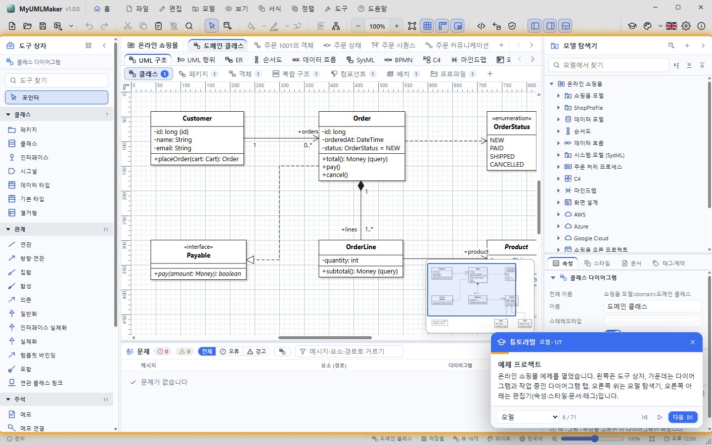

| Diagram | Kind | Contents |
|---|---|---|
| Domain Classes | Class | Customer · Order · OrderLine · Product (abstract) · Book · Food · OrderStatus (enumeration) · Payable (interface) with association, composition, directed association, generalization, realization and dependency, and a note |
| Package Structure | Package | Web, service, domain and repository layer packages with their classes, «import» dependencies |
| Objects of Order 1001 | Object | Order, customer and order line instances with slots (attribute = value) and links |
| Order Processor Structure | Composite structure | Parts, ports, connectors, provided and required interfaces |
| Components | Component | Components inside a subsystem, a port, delegation and assembly connectors, interfaces, «manifest» |
| Deployment | Deployment | Device, nodes, execution environments and artifacts, «deploy» and «manifest», communication paths |
| Shop Profile | Profile | Stereotypes, metaclasses and extensions (applied to classes) |
| Use Cases | Use case | Actors with a generalization, the system boundary, include and extend (with an extension point) |
| Order Fulfilment | Activity | Three swimlanes, an object node, fork and join, send and accept signal |
| Order States | State machine | A composite SHIPPED state, triggers, guards and effects, cancel paths |
| Place Order Sequence | Sequence | Lifelines, a ref to Log In, a create message, an alt/else fragment |
| Place Order Communication | Communication | The roles of the sequence with six numbered messages |
| Payment Timing | Timing | Two state lifelines, time ticks, duration and time constraints, a message |
| Shopping Interaction Overview | Interaction overview | ref nodes to real interactions, decision and merge, a retry loop |
| Information Flows | Information flow | Information items conveyed «flow» |
| Shop Database | ER | Six tables, 1:N, 1:0..1 and a non-identifying relationship |
| Payment Flow | Flowchart | Many symbols and a retry loop |
| Order Processing DFD (Level 1) | Data flow | External entities, processes, data stores and data flows |
| Shop Requirements | SysML requirement | Containment, derive, verify, refine, satisfy and trace |
| Shop Block Definition | SysML block definition | Blocks, an interface block, value types, a constraint block and relationships |
| Shop Internal Blocks | SysML internal block | Part properties, ports, connectors and an item flow |
| Order Price Calculation | SysML parametric | Constraint properties, constraint parameters and bindings |
| Order Handling (BPMN) | BPMN | Two pools and two lanes, message flows, gateways, a boundary error event, a timer, a data object and store, an annotation |
| System Context | C4 | Customer, Online Shop, Payment Provider and E-mail Service in an enterprise boundary |
| Shop Launch Plan | Mind map | A central topic with two levels of branches |
| Checkout Screen | Wireframe | Web and mobile screens |
| AWS Deployment | AWS | Region, VPC, subnets, Auto Scaling and connected services |
| Azure Deployment | Azure | Resource group, virtual network and connected services |
| GCP Deployment | GCP | Project, region, VPC and connected services |
| Shop Launch Schedule | Gantt chart | A calendar with closed week days and dates, three separators, tasks (completion, resources) and milestones, dependencies |
| Shop Work Breakdown | WBS | The top item and two levels of numbered work items |
| Shop Year 2026 | Timeline | A one-year time axis, five linked events and four periods |
| Order Handling Layered View | ArchiMate | Motivation, strategy and implementation elements, a business grouping, application and technology layers, serving, realization, assignment, access, flow, triggering and more |
| Shop Network | Network | Internet and firewall, the dmz and internal networks with addresses, a web server node group, database, storage and laptop nodes |
| Order API Messages | JSON | Order request, payment response and shipping event JSON documents with references |
| Deployment Configuration | YAML | application.yaml · deployment.yaml · a CI workflow |
| Order Number Grammar | EBNF | Railroad diagrams of five EBNF rules that refer to each other |
| Input Validation | Regex | Regular expressions for e-mail, domain, mobile number, coupon code and postal code |
| Shop User Story Map | User Story Map | 3 activities and 5 steps, story cards (priority, story points, status) in 2 releases (MVP · Release 2), a dependency between stories |
| Shop Customer Journey Map | Customer Journey Map | A persona, 5 journey stages (Awareness · Consideration · Purchase · Delivery · Loyalty), rows of actions, touchpoints, emotions, pain points and opportunities, an emotion curve |

The last two diagrams are under the **Agile & UX** model in the Model Explorer.

The `samples` folder of the installation holds the same sample as `.myuml` and as StarUML `.mdj`, a class model template (`.mumlt`) and a model fragment (`.mfj`), in Korean and English.

### Tutorial

Start it with **Help › Tutorial** (`F11`), the graduation-cap button at the right of the toolbar, or **Start the tutorial** on the start page. The tutorial drives the real program and shows the features one by one in 71 steps.

- Move through it with the **Next** and **Previous step** buttons in the guide box at the bottom right, or with **Auto play** (▶). While auto play runs, **Pause auto play** stops it. On the last step press **Done**.
- The **Choose a chapter** list jumps to a chapter: Start · The model · Drawing · Kinds of diagrams · Format & arrange · Model tools · Files & export · Customizing · Help.
- The part of the screen each step explains is outlined. The guide box can be dragged out of the way. `Esc` or ✕ (**End the tutorial (Esc)**) ends it.
- The tutorial opens its own sample project separately, and at the end closes it and goes back to the project you had open. Your project is not changed, and the settings the tutorial changes (theme, language, background and so on) are put back when it ends.

**Tutorial document** — a document of every tutorial step with its picture. The **Tutorial document** button at the top of the start page or **Help › Tutorial document** opens it in its own window (see [Document windows](#document-windows)).

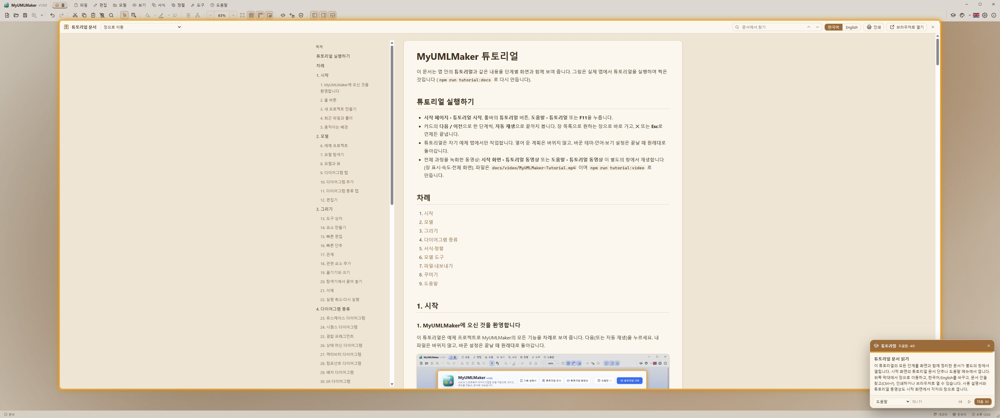

### Document windows

The **User's guide** and the **Tutorial document** open in a window of their own, apart from the program window — from the buttons at the top of the start page, the start page's **Help** list or the **Help** menu alike. There is one window per document; choosing a document that is already open brings its window to the front. Move it by its title bar, resize it by its edges, maximize and close it like any window; it opens again where you left it. Closing the program (its main window) closes the document windows too.

| Bar at the top | What it does |
|---|---|
| **Go to chapter** | The chapters and sections of the document; pick one to go there. The chapter being read is shown |
| **Find in document** (`Ctrl+F`) | Every match of the text is highlighted, with "3/12" telling which one is current. `Enter`/`F3` next, `Shift+Enter`/`Shift+F3` previous, `Esc` clears |
| **한국어** / **English** | Switches the document's language (the program's stays) |
| **Print** (`Ctrl+P`) | Prints the document |
| **Open in browser** | Opens the same document in the default web browser |

The document follows the program's theme colours. In the web version the same document view opens in a new browser tab.

### Tutorial video

A recording of the whole tutorial (71 steps) on auto play. The **Tutorial video** button at the top of the start page or **Help › Tutorial video** plays it in its own window (which behaves like the [document windows](#document-windows)).

- The bar under the picture plays, pauses, seeks, sets the volume and goes full screen. `Space` plays/pauses, `←`/`→` jump 5 seconds, `F` toggles full screen.
- The bar at the top: **Go to chapter** (the chapters with their start times), **Playback speed** (0.5× – 2×), **Full screen**, 한국어/English (the language of the chapter names) and **Open in player** (the system's default video player).
- The list on the right holds the chapters and steps with their times; click one to play from there. The current chapter is marked, and the strip under the video shows where each chapter starts.
- The video is `docs/video/MyUMLMaker-Tutorial.mp4` in the installation folder. Without it the window says "The tutorial video has not been made yet. Run npm run tutorial:video to make it."

## The screen

From the top there are the menu bar and the **Toolbar** (one row). Below them, the **Toolbox** is on the left, and the **Model Explorer** (top) and the editors (bottom) are on the right. In the middle, from the top, are the row with the project name and the **diagram tabs**, the two rows of **diagram type tabs**, and the diagram with rulers along its top and left edges. At the very bottom is the **Status bar**. Dragging the splitters between the panels changes their width, and dragging the horizontal splitter between the Model Explorer and the editors changes how the height is shared. Dragging the bottom right corner of the window resizes the window. The window cannot be made narrower than the width that keeps every toolbar button and menu visible.

### Menu bar

The **Home** button at the start of the menu bar (`Ctrl+Shift+H`) goes back to the start page at any time. Resting the pointer on an item marked ▸ opens its submenu beside the row, and moving the pointer to another row of the same menu closes it. From the keyboard, `→` or `Enter` opens a submenu and `←` or `Esc` closes the innermost one. Each menu command shows its shortcut, and commands that cannot be used right now are dimmed.

| Menu | Commands |
|---|---|
| **File** | New project · New from template · Open… · Start page · Recent files… · Recent folders · Clear all recent files and folders · Save · Save as… · Save as template… · Open from database… · Save to database (desktop app) · Import ▸ · Export ▸ · Print… · Project properties · Close project · Exit |
| **Edit** | Undo · Redo · Cut · Copy · Paste · Duplicate · Delete from diagram · Delete from model · Select all · Clear selection · Select in Model Explorer · Select in diagram · Edit name · Find… |
| **Model** | Add diagram · Add element · Move up in model · Move down in model · Show all relationships · Elements not on any diagram · Requirements · Traceability Matrix · Baselines… · Compare with file… · Validate model · Model statistics |
| **View** | Zoom ▸ · Show ▸ · Diagram colours ▸ · Default line style ▸ · Diagrams ▸ · Presentation mode · Theme, language and background ▸ |
| **Format** | Font ▸ · Fill color · Line color · Line style ▸ · Stereotype display ▸ · Display ▸ · Auto resize · Fit to content · Diagram background… |
| **Arrange** | Order ▸ · Align & distribute ▸ · Auto layout · Auto layout ▸ · Mind map ▸ |
| **Tools** | Generate code… · Generate SQL DDL… · Generate document… · Reverse engineer (code → model) · Validate model · Simulate BPMN process · Settings… |
| **Help** | Tutorial · Tutorial document · Tutorial video · User's guide · Keyboard shortcuts… · Settings… · About… |

The submenus hold:

| Submenu | Commands |
|---|---|
| **File › Import** | Open StarUML project (.mdj)… · Open XMI (Enterprise Architect, MagicDraw, Papyrus)… · Import model fragment (.mfj)… · Import Mermaid / PlantUML… · Reverse engineer (code → model) |
| **File › Export** | Export as picture… · Export SVG (current diagram)… · Export PDF (all diagrams)… · All diagrams as pictures (.zip)… · HTML documentation (.html)… · Markdown documentation (.zip)… · StarUML project (.mdj)… · XMI 2.5 for Enterprise Architect (.xmi, with diagrams)… · XMI 2.5, model only (.xmi)… · Export model fragment (.mfj)… · Mermaid (.mmd)… · PlantUML (.puml)… |
| **View › Zoom** | Zoom in · Zoom out · Zoom 100% · Fit diagram · Zoom to selection |
| **View › Show** | Grid · Rulers · Snap to grid · Pan & zoom window · Quick edit buttons · Show shadows · Toolbox · Model Explorer & editors · Status bar |
| **View › Diagram colours** | Classic (white) · Pastel · Blueprint · Dark |
| **View › Default line style** | Rectilinear · Oblique · Rounded rectilinear · Curve |
| **View › Diagrams** | Add diagram · Previous diagram · Next diagram |
| **View › Theme, language and background** | Random theme · Choose theme · Switch language · Change moving background · Background image… · Turn background off |
| **Format › Font** | Bold · Italic · Increase font size · Decrease font size · Font colour |
| **Format › Line style** | Rectilinear · Oblique · Rounded rectilinear · Curve · Clear bend points |
| **Format › Stereotype display** | Label («…») · Decoration · Icon (interface lollipop) · None |
| **Format › Display** | Suppress attributes · Suppress operations · Show visibility · Show namespace · Show operation signature · Shadow |
| **Arrange › Order** | Bring to front · Send to back · Bring forward · Send backward |
| **Arrange › Align & distribute** | Align left · Align center · Align right · Align top · Align middle · Align bottom · Distribute horizontally · Distribute vertically · Same width · Same height · Same size |
| **Arrange › Auto layout** | Top to bottom · Bottom to top · Left to right · Right to left |
| **Arrange › Mind map** | Add subtopic (`Tab`) · Add topic (same level) (`Enter`) · Collapse / expand branch (`Ctrl+.`) · Collapse all branches · Expand all branches · Lay out map again |

### Toolbar

From the left the toolbar buttons fall into these groups. Pointing at a button shows its name and shortcut.

| Group | Buttons |
|---|---|
| File | **New project** · **Open…** · **Save** · **Export as picture…** (the ▾ next to it is the **Choose an export format** menu) |
| Undo | **Undo** · **Redo** (pointing at them shows what they would undo or redo) |
| Clipboard and find | **Cut** · **Copy** · **Paste** · **Delete from model** · **Find…** (`Ctrl+F`, see [Find](#find)) |
| Tools | **Pointer** · **Add diagram** |
| Colour and line | **Fill color** · **Line color** (the left half paints the last colour at once, the ▾ opens the colour picker) · **Line style** |
| Arrange | **Align** · **Auto layout** |
| Zoom and display | − · the zoom box · + · **Fit diagram** · **Grid** · **Rulers** · **Pan & zoom window** (shown pressed while on; the same as **View › Show › Grid** · **Rulers** · **Pan & zoom window**) |
| Model tools | **Generate code…** · **Reverse engineer (code → model)** · **Validate model** |
| Panels | **Toolbox** · **Model Explorer & editors** (show or hide) |
| Right end | **Tutorial** (graduation cap) · the theme button (a random theme on every click, ▾ for **Choose theme**) · the flag button (**Switch language**) · **Settings…** · **About…** (ⓘ) |

Type a number in the zoom box, or step it with the Up and Down arrow keys.

### The diagram tab row

Only one project is open at a time. The row above the diagram starts with the project name; a ● after it means there are unsaved changes (pointing at it shows the file path). After it come **one tab for every diagram of the project**, in model order, and a **+** at the end that opens the **Add diagram** menu. Only when the tabs do not fit, ‹ › (**Scroll tabs left** · **Scroll tabs right**) appear at the right end to scroll the row. See [Diagram tabs](#diagram-tabs) for how to use them.

The two rows under it are the **diagram type tabs**: pick a group in the upper row and a diagram type in the lower row (see [Diagram type tabs](#diagram-type-tabs)).

**File › Close project** (`Ctrl+W`) closes the project and goes back to the start page.

### Toolbox (left)

The tools for the kind of diagram that is open show in groups. See [Drawing](#drawing) for how to use them. When no diagram is open, only the hint "Open a diagram to see its tools here." shows.

### Model Explorer and editors (right)

The **Model Explorer** at the top right shows every element of the project as a tree, and the editors below have the **Properties** · **Style** · **Documentation** · **Tags & constraints** tabs for the selected element (and an **Outline** tab on mind maps). See [Models and diagrams](#models-and-diagrams).

### Collapsing the panels

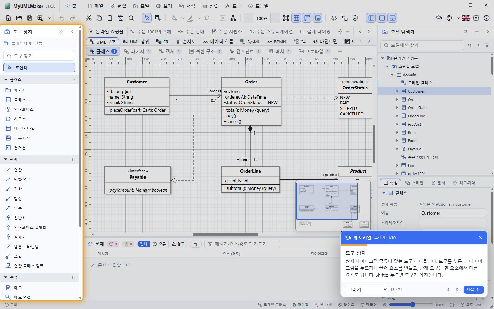

The toolbox and the right panel collapse with the arrow buttons in their headers (**Collapse tool panel** · **Collapse properties panel**), with the panel buttons on the toolbar, or with `Ctrl+Shift+1` · `Ctrl+Shift+2`. A collapsed panel becomes a narrow strip with only an icon and a title ("Tools" · "Model"), and the **Expand** button at its top opens it again. The collapsed toolbox strip still holds the pointer and a few common tools, ready to use.

### Status bar

| Item | Contents |
|---|---|
| Notice | The result of the last action ("Saved {name}.", "Undo: …" and so on). Normally **Ready** |
| Current diagram | The name of the current diagram |
| Save state | **Saved** or **Modified**. Pointing at it shows the file path ("Project not saved yet") |
| Selection | With one view selected, its kind, position and size (for example "Class · 380, 40 · 160 × 120"); with several, "N selected"; with nothing, "N views" |
| Pointer position | Diagram coordinates |
| Drawing tool | Shows only while a tool is chosen. Clicking it goes back to the pointer |
| Model validation | "N errors · N warnings" after a validation. Clicking it opens the validation results |
| Theme · language | The current theme name and language |
| Zoom | A zoom slider and %, and the **Fit diagram** button |
| Clock | The current time (**Settings › General › Clock on the status bar**) |

Right-clicking the status bar offers hide the bar · zoom · theme · language.

### Right-click menus

| Where | Menu |
|---|---|
| A mind map topic | Add subtopic · Add topic (same level) · Collapse / expand branch, then the same menu as an element (view) |
| An element (view) | Edit (`F2`) · Add related element ▸ · add members such as attributes and operations · Cut · Copy · Paste · Duplicate · Delete from diagram · Delete from model · Select in Model Explorer · Stereotype display ▸ · Display ▸ · Auto resize · Fit to content · Font ▸ · Fill color · Line color · Order ▸ |
| A line (relationship) | Edit · Cut · Copy · Paste · Duplicate · Delete from diagram · Delete from model · Select in Model Explorer · Line style ▸ · Font ▸ · Fill color · Line color · Order ▸ |
| Several selected | Cut · Copy · Duplicate · Delete from diagram · Delete from model · Align & distribute ▸ · Order ▸ · Auto layout ▸ · Font ▸ · Fill color · Line color · Line style ▸ |
| An empty part of the diagram | Paste (where you clicked) · Select all · Add here · Show all relationships · Auto layout ▸ · Mind map ▸ (on a mind map) · Simulate BPMN process (on a BPMN diagram) · Zoom in · Zoom out · Fit diagram · Show ▸ · Diagram background… · Export as picture… · Export SVG (current diagram)… |
| Model Explorer | Open diagram · Add element · Add diagram · Rename · Select in diagram · Copy · Cut · Paste · Move up in model · Move down in model · Delete from model · Generate code… · Export model fragment (.mfj)… |
| A diagram tab | Rename · Select in Model Explorer · Previous diagram · Next diagram · Diagram background… · Export as picture… · Export SVG (current diagram)… · Mermaid (.mmd)… · PlantUML (.puml)… |
| A text box | Undo typing · Cut · Copy · Paste · Select all |

In right-click menus too, resting the pointer on a row marked ▸ opens its submenu beside it (as in the [menu bar](#menu-bar)).

### Pop-up windows

Menus, the colour picker, settings, find, code generation, print preview and similar windows open as separate small windows in the desktop app. `Esc` closes a menu (the innermost open submenu first), and the arrow keys move between its items. Submenus open beside their row inside the same menu window. Long tasks (opening, saving, building a PDF, generating code and so on) show a progress window.

## Models and diagrams

### Model and views

The most important idea in MyUMLMaker is the difference between the *model* and its *views*. A box on a diagram is a "view" of a model element. The same element can show on several diagrams, and renaming it in one place renames it on every diagram.

| Action | Result |
|---|---|
| `Delete` (**Delete from diagram**) | Removes only the view on this diagram. The element stays in the model and still shows in the Model Explorer |
| `Ctrl+Delete` (**Delete from model**) | Removes the element from the model. Its views on every diagram and the relationships that need it go too |

Before **Delete from model** a confirmation lists the elements to be deleted (it can be turned off with **Settings › General › Ask before deleting elements from the model**). Notes, texts, rectangles and other annotations are views only, not model elements, so both ways of deleting do the same.

**Model › Elements not on any diagram** lists the elements that show on no diagram; clicking one goes to it. **Model › Model statistics** shows the number of elements, views and diagrams and the counts per kind.

### Model Explorer

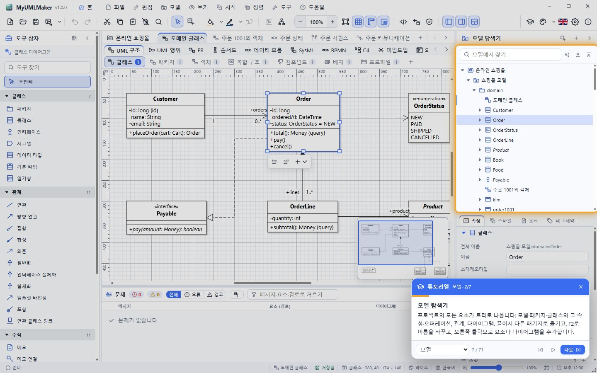

Every element of the project shows as a tree: models, packages, classes with their attributes and operations, relationships and diagrams. A relationship without a name shows its kind and both ends, like "(Association) Customer → Order".

| Action | What it does |
|---|---|
| Click | Selects the element, and also its view on the current diagram. The editors show the element's properties |
| `Ctrl`+click | Selects several elements |
| Double-click | Opens a diagram; renames any other element |
| `F2` | Rename (`Enter` applies, `Esc` cancels) |
| Up / Down arrow | Move the selection. Right expands, Left collapses |
| `Enter` | Opens the diagram |
| `Delete` | Delete from model |
| Drag onto another row | Moves the element into that one (for example a class into another package). Where it cannot go: "It cannot be moved there." |
| Drag onto a diagram | Makes a view of the element on that diagram (see [Dragging from the Model Explorer](#dragging-from-the-model-explorer)) |
| `Ctrl+Up` · `Ctrl+Down` | Change the order within the same parent (**Move up in model** · **Move down in model**) |

Above the tree are these tools:

- The **Filter model** box narrows the tree by name or kind. Only the matching elements and their parents stay, all expanded.
- **Sort by name** groups diagrams, members, elements and relationships, then sorts each group by name.
- **Expand all** · **Collapse all**

The **Add diagram** · **Add element** buttons in the panel header put a new diagram or element under the selected element. The add-element menu shows only the kinds the selected element can own; when there are many, they are grouped into submenus such as Classifiers · Behaviours · Instances · Packages & models. A new element is ready to be renamed straight away.

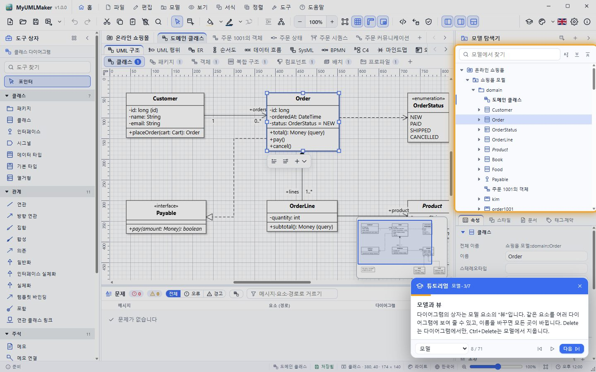

### Adding diagrams

Choose one from **Model › Add diagram**, **Add diagram** on the toolbar, or **+** in the Model Explorer header or at the end of the diagram tab row. The menu is grouped into UML · ERD · Flowchart · Data Flow · SysML · BPMN · C4 · Mind Map · Wireframe · Cloud · Project Management · ArchiMate · Network · Data · Agile & UX (40 kinds, see [Kinds of diagrams](#kinds-of-diagrams)).

A new diagram is made under the package or model selected in the Model Explorer (else in the package of the current diagram) and opens at once. Owners that some kinds need are made automatically: sequence, communication and timing diagrams go inside an interaction, state machine diagrams inside a state machine, activity and interaction overview diagrams inside an activity, ER diagrams inside a data model, Gantt charts, WBS and timeline diagrams inside a project plan, ArchiMate diagrams inside an ArchiMate model, network diagrams inside a network model, JSON, YAML, EBNF and regex diagrams inside a data specification, and user story maps and customer journey maps inside an Agile & UX model.

The **+** (**Add another {type}**) at the end of the [diagram type tabs](#diagram-type-tabs) makes one more diagram of the current diagram's type.

### Diagram tabs

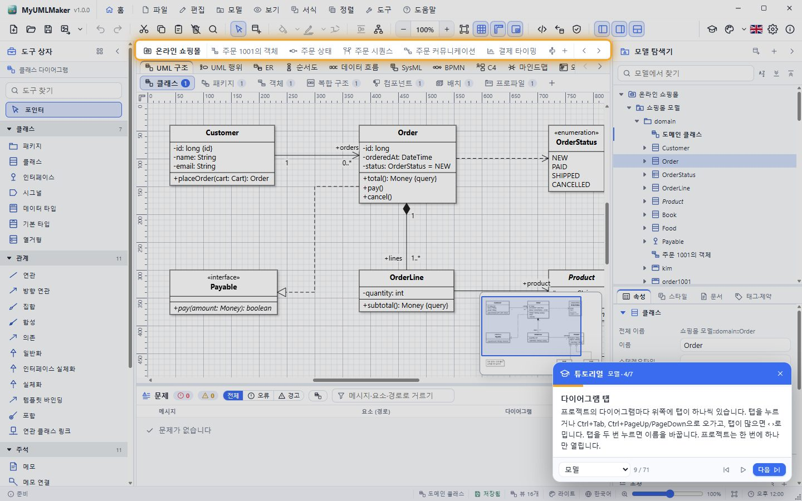

The row above the diagram has one tab for every diagram of the project, in the same order as the Model Explorer. The tab of the current diagram is highlighted, and pointing at a tab shows its name and type.

- Clicking a tab opens that diagram. Double-clicking a diagram in the Model Explorer does the same.
- `Ctrl+Tab` · `Ctrl+Shift+Tab` or `Ctrl+PageDown` · `Ctrl+PageUp` (**Next diagram** · **Previous diagram**) go to the next or previous tab.
- Double-clicking a tab renames it in place.
- Right-clicking a tab offers **Rename** · **Select in Model Explorer** · **Previous diagram** · **Next diagram** and the exports (picture · SVG · Mermaid · PlantUML).
- **+** at the end opens the **Add diagram** menu.
- When the tabs do not fit, ‹ › (**Scroll tabs left** · **Scroll tabs right**) appear at the right end. Opening another diagram scrolls the row so that its tab shows.
- To remove a diagram, use **Delete from model** in the Model Explorer; the tabs have no close button.

### Diagram type tabs

Under the diagram tab row are the two rows of **diagram type tabs**.

| Row | Contents |
|---|---|
| Upper row (**Diagram groups**) | UML Structure · UML Behavior · ER · Flowchart · Data Flow · SysML · BPMN · C4 · Mind Map · Wireframe · Cloud · Project · ArchiMate · Agile & UX · Data |
| Lower row (**Diagram types**) | The diagram types of the chosen group. For example UML Structure has Class · Package · Object · Composite Structure · Component · Deployment · Profile, UML Behavior has Use Case · Activity · Statechart · Sequence · Communication · Timing · Interaction Overview · Information Flow, SysML has Requirement · Block Definition · Internal Block · Parametric, Cloud has AWS · Azure · GCP · Network, Project has Gantt Chart · WBS · Timeline, Agile & UX has User Story Map · Customer Journey Map, and Data has JSON · YAML · EBNF · Regex |

- Clicking a group switches the lower row to its types. Opening a diagram picks its group by itself.
- The number next to a type is how many diagrams of that type the project has.
- Clicking a type opens the diagram of that type you used last (else the first one), or makes a new one when the project has none yet (the tooltip says **Open the {type}** or **Create a {type} (none yet)**).
- The **Toolbox** then shows just the tools of that diagram type.
- **+** at the end of the lower row (**Add another {type}**) adds one more diagram of the current type.

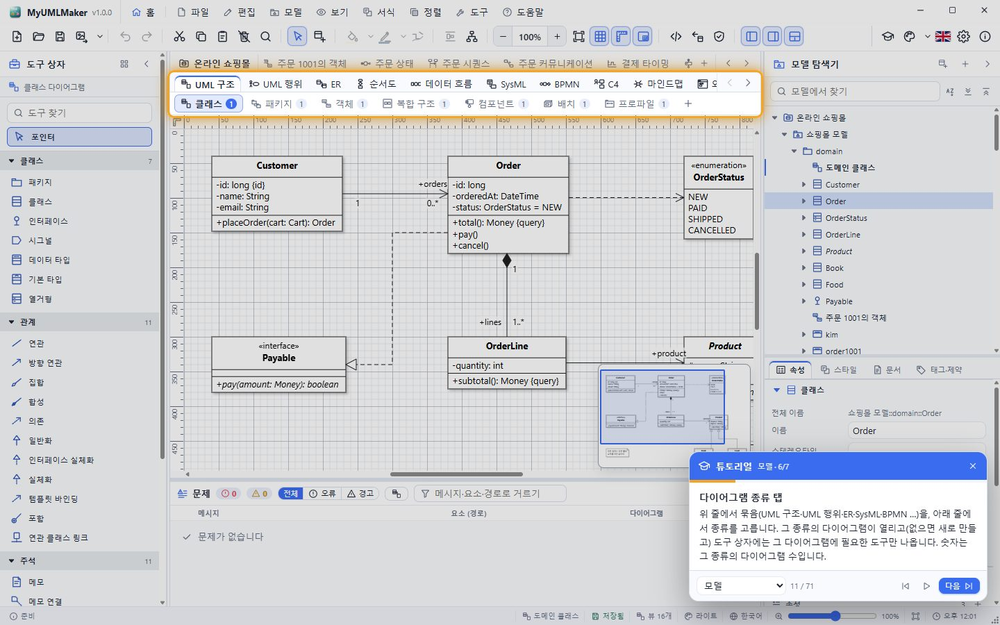

### Editors

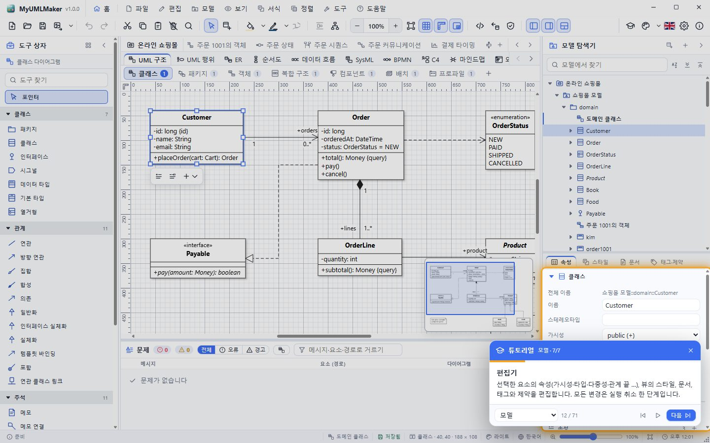

The editors under the Model Explorer edit the selected element: the element of the view selected on the diagram, the element picked in the Model Explorer, or, with nothing selected, the current diagram (the project when there is no diagram). Every change is one undo step. Text fields apply on `Enter` or when you move elsewhere.

| Tab | Contents |
|---|---|
| **Properties** | All fields of the element: name, stereotype, visibility, flags such as abstract, leaf and final, type, multiplicity, default value, references to other elements and so on. The **Qualified name** (package path) shows at the top |
| **Style** | Colours, font, line style and display options of the selected view (see [Format and arrange](#format-and-arrange)) |
| **Documentation** | A description of the element. It goes into the HTML and Markdown documentation and into comments of the generated code |
| **Tags & constraints** | Tagged values and constraints |
| **Outline** | Shown on mind map diagrams only. Lists the topics as an indented tree, copies them as text or Markdown, and adds subtopics from indented text (see the [Mind Map Diagram](#bpmn-c4-mind-map-wireframe-and-cloud)) |

The **Properties** tab has these parts:

- **General** — the fields for the kind of element. Type fields suggest the class names of the project and basic types (int · long · String · boolean · Date …); the type field of an ER column suggests SQL types (INTEGER · VARCHAR · TIMESTAMP …). The stereotype field suggests standard names such as entity · control · boundary · service. Reference fields (for example the element a lifeline represents, or the signature of a message) only accept elements of the right kind, and the **Go to this element** button next to them goes to that element. Multiplicity must look like `1`, `0..1`, `0..*`, `1..*` or `2..5`.
- **End 1 (tail)** · **End 2 (head)** — the two ends of relationships such as associations: name, visibility, navigability, aggregation (shared or composite), multiplicity, qualifiers, derived, read-only and so on.
- **Members** — lists of attributes · operations · parameters · literals · columns · operands · ports · parts · slots · regions · time segments and so on. **+** in the header adds one, and each row has **Move up** · **Move down** · **Delete** buttons. Clicking a member's name selects it to edit its properties (pick an operation to edit its parameters in turn).
- **Shown on diagrams** — the diagrams that show this element. Clicking one opens that diagram and selects the element.
- **Diagram options** — when a diagram is selected. Sequence and communication diagrams have **Show sequence numbers** and **Message signature** (none · names only · types only · name and type), and sequence diagrams have **Show activations**. The number of **Views** shows too.

**File › Project properties** shows the project itself (name · author · company · copyright · version) in the editors.

On the **Tags & constraints** tab, **Add tag** adds a name, a kind (String · Boolean · Number · Reference · Hidden) and a value, and **Add constraint** adds a name and a specification (for example `age >= 0`). Tags that are not hidden show on the diagram as `{name=value}`.

## Drawing

### Toolbox


The toolbox shows the tools for the kind of the current diagram. Changing the type on the [diagram type tabs](#diagram-type-tabs) changes the toolbox to that type's tools. The diagram kind is at the top, with the **Find a tool** box and the **Pointer** tool under it. Clicking a tool group header (for example Classes · Relationships · Annotations) collapses or expands it; the number next to the header is the number of tools. The **Icons only** button in the header hides the names and packs the icons closely.

| Kind of tool | How to use it |
|---|---|
| Element tools | Click the tool, then click the diagram for the default size, or drag for a size of your own. You can also drag the tool onto the diagram |
| Relationship tools | Drag from one element to another |

- After creating, the pointer comes back. Hold `Shift` while creating, or double-click the tool, to keep the tool and make several of the same.
- `Esc` or `Ctrl+1` goes back to the **Pointer**. Clicking the tool name on the status bar does too.
- Every diagram has the **Annotations** group: Note · Note Link · Text · Constraint · Frame · Rectangle · Rounded Rectangle · Ellipse · Hyperlink · Image · Free Line.

### Creating elements

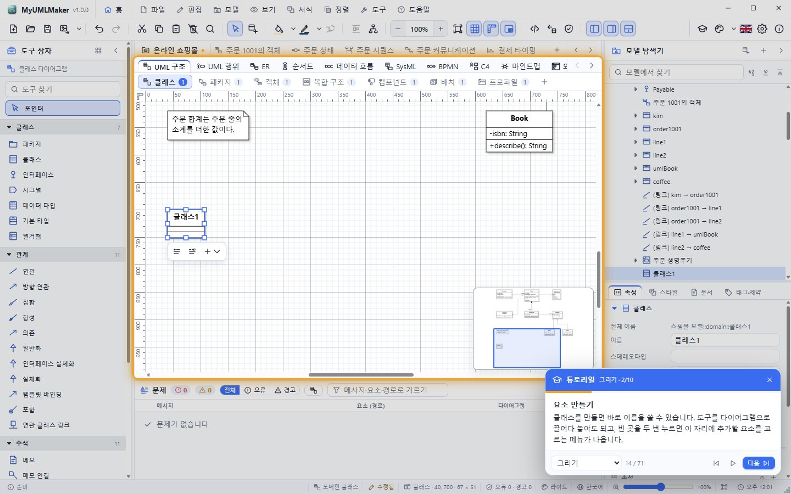

A new class is ready for its name straight away. `Enter` applies and `Esc` cancels. Double-clicking an empty spot (or right-click › **Add here**) shows a menu of elements to add at that spot.

Members such as attributes and operations must be put inside an element that can own them. Dropped on an empty spot, they give the notice "Drop the Attribute inside an element that can own it (for example a class)." An element put inside a container such as a package, subject, node or partition also becomes part of it in the model.

### Quick edit

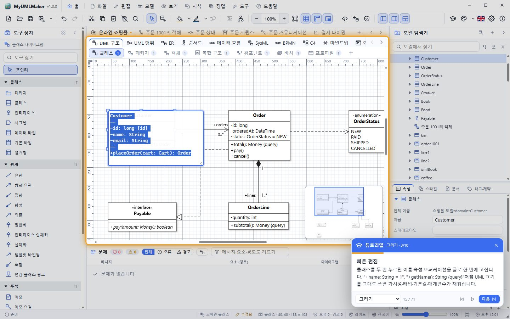

Double-clicking a class (including interfaces, data types, signals, enumerations and entities), or pressing `F2` or `Enter`, edits its name, attributes and operations as text in one go (StarUML's quick edit). The first line is the name, then after a `--` line the attributes, then after another `--` the operations, one per line. `Ctrl+Enter` applies and `Esc` cancels.

```
«entity» Order
--
-id: long {id}
-orderedAt: DateTime
-status: OrderStatus = NEW
+lines: OrderLine [1..*] {ordered}
--
+total(): Money {query}
+cancel()
+addLine(in product: Product, quantity: int = 1): OrderLine
```

| Write | Meaning |
|---|---|
| `+` · `-` · `#` · `~` | public · private · protected · package visibility |
| `/name` | A derived attribute |
| `name: Type` | The type. If the project has exactly one class of that name, it becomes a reference to that class |
| `[0..*]` | Multiplicity |
| `= 1` | Default value |
| `{readOnly}` · `{ordered}` · `{unique}` · `{id}` | Read-only · ordered · unique · identifier |
| `op(a: int, out b: String): bool` | An operation with parameters (`in` · `out` · `inout`) and a return type |
| `{query}` · `{abstract}` | Query (does not change state) · abstract operation |
| `«stereotype» Name` or `<<stereotype>> Name` | Stereotype |

Members are matched line by line, so renaming an existing attribute keeps its other settings and links.

For other elements:

- **Enumeration** — write the literals under `--`, one per line.
- **Entity** (ER) — write the columns under `--` like `PK id: INTEGER`, `FK customer_id: INTEGER`, `name: VARCHAR(100)`.
- **Combined Fragment** — write the guards of the operands, one per line. More lines add operands.
- **Message** — writing `getItems(id)` splits it into the name and the arguments.
- **Constraint** · **State Invariant** · BPMN **Text Annotation** — write the specification or text.
- **Note** · **Text** · shapes — write text over several lines (`Ctrl+Enter` applies).
- Other elements and lines — write the name. `«stereotype» name` works too.

### Quick buttons

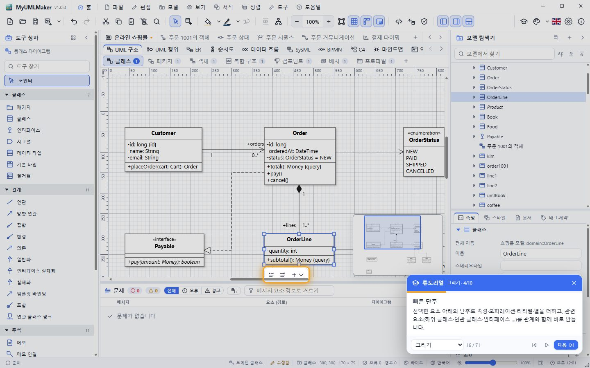

When one element is selected, small buttons show under it. A class has **Add attribute** · **Add operation** · **Add related**; an enumeration has **Add literal**, an entity **Add column**, an object **Add slot**, a combined fragment **Add operand**, and a timing lifeline **Add time segment**. Adding a member opens quick edit at once. Turn the buttons off with **View › Show › Quick edit buttons** or in **Settings › Diagram**.

### Adding related elements

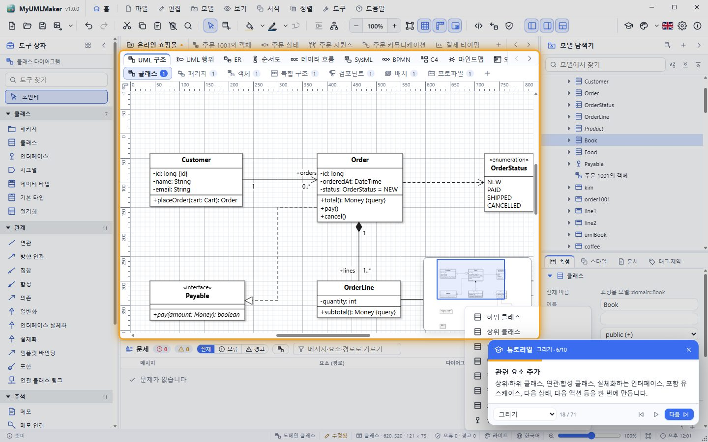

**Add related** (▾) among the quick buttons, or right-click › **Add related element**, makes a new element next to the selected one and links them with a relationship. The new element is ready for its name straight away.

| Selected element | Related elements you can add |
|---|---|
| Class | Subclass · Superclass · Associated class · Directed associated class · Aggregated (part) class · Composite (part) class · Dependent class · Realized interface |
| Interface | Realizing class · Superclass · Subclass · Dependent class |
| Use case | Included use case · Extending use case · Associated actor |
| Actor | Associated use case · Subclass · Superclass |
| State | Next state |
| Action | Next action |
| Mind map node | Child node |
| Entity | Referencing entity (1:N) |
| Flowchart process, decision, terminator and data | Next step |

### Drawing relationships

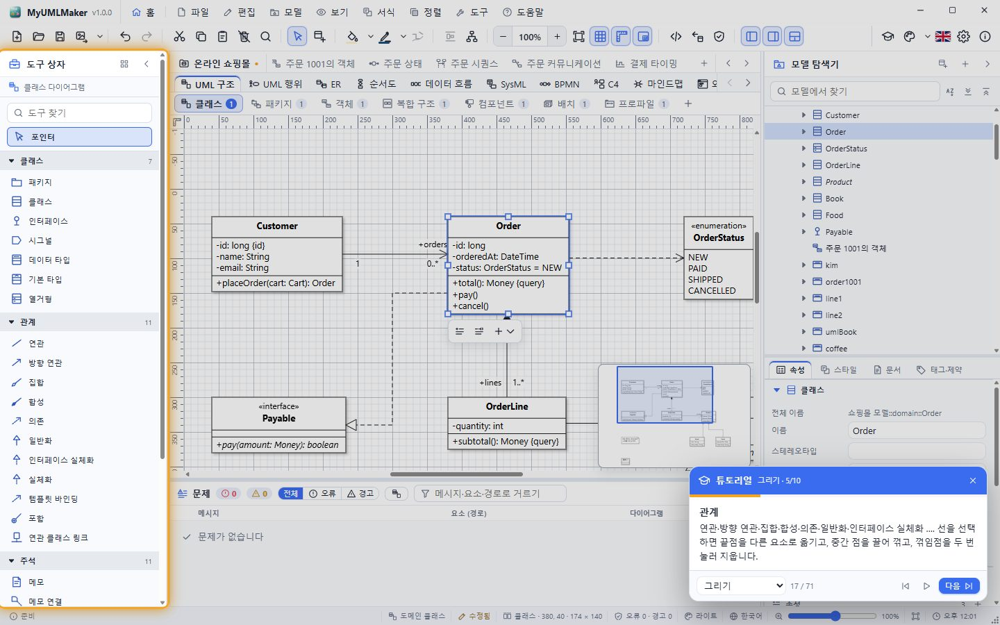

Choose a relationship tool (association · directed association · aggregation · composition · dependency · generalization · interface realization …) and drag from one element to another. While you drag, the element under the pointer is outlined, and an element that this relationship cannot connect to is marked red. Starting on an empty spot gives "Start a relationship on an element and drag to another.", and releasing on an empty spot gives "Release over the element to connect to."

- **Note Link** and **Association Class Link** can also attach to a line (relationship).
- On a sequence diagram a message is placed at the height where the drag started; released on the same lifeline it becomes a self message.
- On a communication diagram, the **Message (on a connector)** tool adds a message in that direction when you click a connector.

### Working with lines

A selected line shows square handles at both ends, filled handles at its bend points and a white circle in the middle of each segment.

| Action | Result |
|---|---|
| Drag an end handle onto another element | Reconnects that end to the other element. The end of the relationship in the model changes too |
| Drag the circle in the middle of a segment | Makes a bend point there |
| Drag a bend point | Moves the bend point |
| Double-click a bend point | Removes that bend point |
| **Format › Line style › Clear bend points** | Removes all bend points added by hand |
| Double-click the line | Edits the line's name (label) |

### Moving and resizing

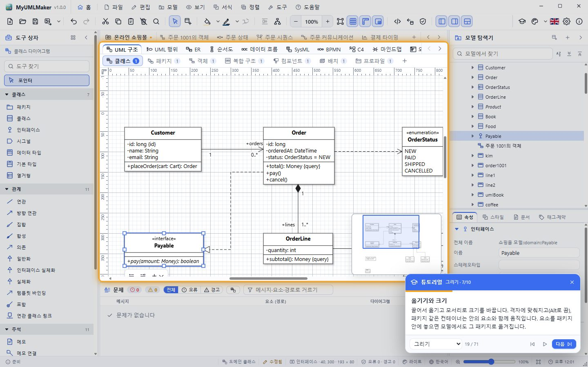

- **Selection** — click to select; with `Shift` or `Ctrl` held, a click adds to or removes from the selection. Dragging on an empty spot picks the views that lie entirely inside the rectangle (with `Shift` or `Ctrl` it adds to the selection). `Ctrl+A` selects all and `Esc` clears the selection.
- **Move** — drag to move. Positions snap to the grid (hold `Alt` not to snap), and `Shift` keeps the move horizontal or vertical. The arrow keys move by the grid, `Shift`+arrow by 1 pixel. Dragging to the edge of the window scrolls the view.
- **Container** — moving a container such as a package, subject, node, partition or frame moves the elements inside it too. Putting an element inside a package also moves it into that package in the model (**Settings › Diagram › Dropping into a package moves the element in the model**).
- **Size** — drag one of the eight handles of the selected view. Resizing by hand turns **Auto resize** off.
- **Locked (cannot move)** — a view with this style option on cannot be moved, resized or renamed.

### Dragging from the Model Explorer

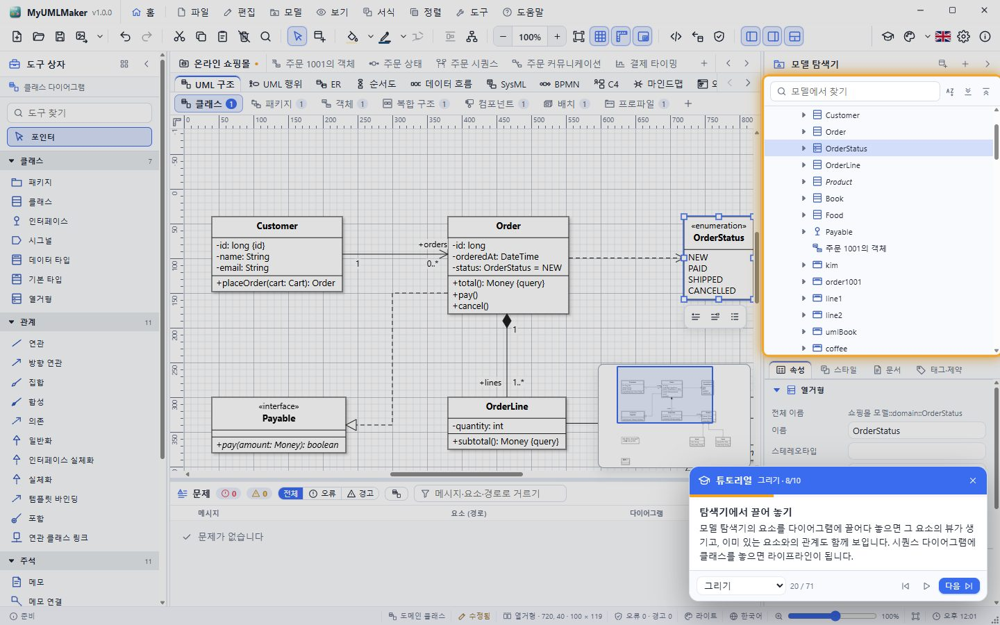

Dragging an element from the Model Explorer onto a diagram makes a view of it, and its relationships with the elements already on the diagram show too. Several elements can be picked and dropped together. An element that is already on the diagram is not made again, only selected. A class dropped on a sequence diagram becomes a lifeline that represents the class. Dropping a diagram opens that diagram.

**Model › Show all relationships** draws every relationship between the elements on the diagram that does not show yet.

### Cut, copy and paste

- Copying on a diagram copies the selected views and their elements, together with the lines between the copied elements. Paste makes new elements (numbered when the name is taken) and views, slightly offset. Right-click › **Paste** pastes where you clicked.
- **Cut** on a diagram copies and then removes the views from the diagram.
- Copying in the Model Explorer copies only the elements, and paste puts them inside the element selected in the explorer. Cut in the explorer deletes from the model.
- **Duplicate** (`Ctrl+D`) copies and pastes in one step.
- The names of the copied elements also go to the system clipboard as text, so they can be pasted into other programs.

### Undo and redo

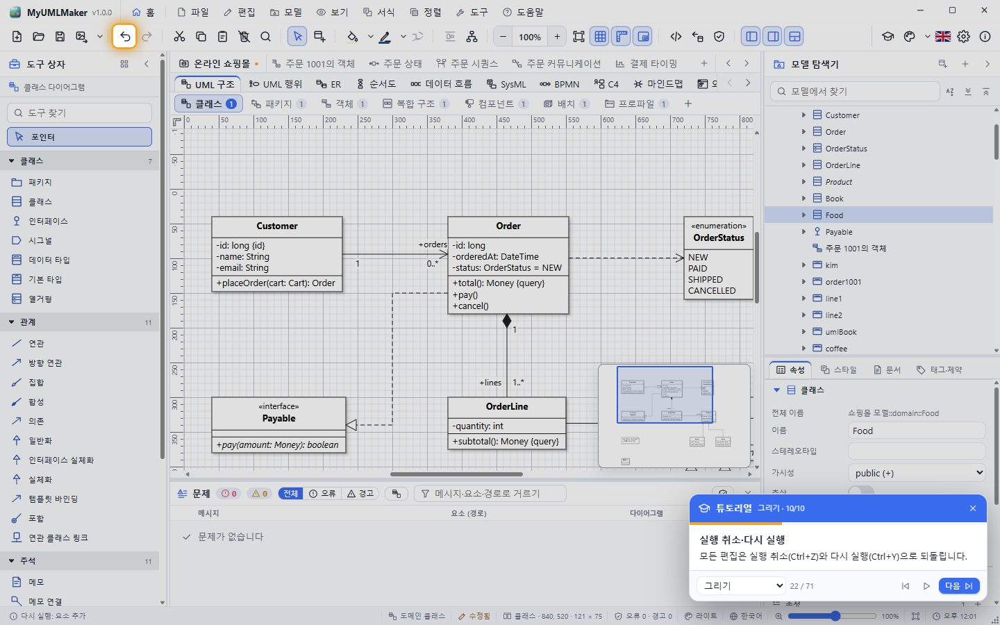

Every edit can be taken back with **Undo** (`Ctrl+Z`) and **Redo** (`Ctrl+Y` or `Ctrl+Shift+Z`). Dragging, a quick edit, a property change, an auto layout and so on are one step each. Pointing at the toolbar buttons shows what they would undo, like "Undo: Move", and the status bar says what was undone. The undo history belongs to the open project and starts afresh when another project is opened.

## Kinds of diagrams

MyUMLMaker draws 40 kinds of diagrams. They all work the same way (toolbox, quick edit, dragging relationships, editors), and the toolbox shows the tools that fit each kind.

### The 15 UML diagrams

| Diagram | Toolbox |
|---|---|
| **Class Diagram** | Package · Class · Interface · Signal · Data Type · Primitive Type · Enumeration / Association · Directed Association · Aggregation · Composition · Dependency · Generalization · Interface Realization · Realization · Template Binding · Containment · Association Class Link |
| **Package Diagram** | Package · Model · Subsystem · Profile / Dependency · Import · Merge · Containment · Generalization |
| **Object Diagram** | Object · Class · Package / Link · Dependency |
| **Composite Structure Diagram** | Class · Part · Port · Collaboration · Collaboration Use · Interface / Connector · Dependency · Realization · Usage |
| **Component Diagram** | Component · Interface · Interface (Icon) · Port · Artifact · Class · Package / Dependency · Required Interface (Usage) · Provided Interface · Component Realization · Assembly Connector · Delegation Connector · Generalization · Manifestation |
| **Deployment Diagram** | Node · Device · Execution Environment · Node Instance · Artifact · Artifact Instance · Component · Component Instance / Communication Path · Deployment · Manifestation · Dependency · Generalization |
| **Profile Diagram** | Profile · Stereotype · Metaclass · Enumeration · Data Type / Extension · Generalization · Dependency |
| **Use Case Diagram** | Actor · Use Case · Subject · Package / Association · Directed Association · Generalization · Include · Extend · Dependency |
| **Sequence Diagram** | Lifeline · Actor Lifeline / Synch, Asynch, Reply, Create and Delete Message · Signal · Lost/Found Endpoint · Gate / 12 combined fragments · Interaction Use · State Invariant · Continuation · Duration Constraint · Time Constraint |
| **Communication Diagram** | Lifeline · Actor Lifeline / Connector · Message (on a connector) |
| **Timing Diagram** | Timing Lifeline · Time Tick · Duration Constraint · Time Constraint / Message |
| **Interaction Overview Diagram** | Initial Node · Activity Final · Decision · Merge · Fork · Join · Interaction Use · Interaction Frame / Control Flow |
| **Information Flow Diagram** | Class · Information Item · Actor · Component / Information Flow · Dependency · Association |
| **Statechart Diagram** | State · Composite State · Submachine State · Final State · Initial State · Choice · Junction · Fork · Join · Shallow History · Deep History · Entry Point · Exit Point · Terminate / Transition |
| **Activity Diagram** | Action · Call Behavior · Call Operation · Send Signal · Accept Event · Time Event · Object Node · Central Buffer · Data Store · Input Pin · Output Pin / Initial Node · Activity Final · Flow Final · Fork · Join · Decision · Merge / Vertical Partition · Horizontal Partition · Structured Node · Expansion Region · Interruptible Region / Control Flow · Object Flow · Exception Handler |

### Use case diagram

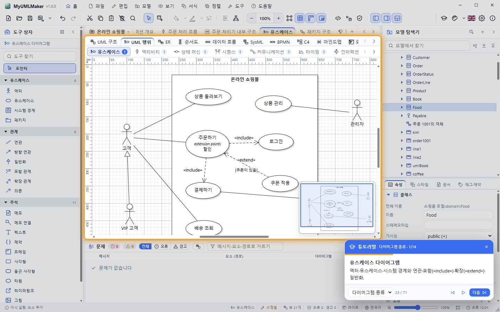

Place actors, use cases and the subject (system boundary), and link them with association, include («include»), extend («extend») and generalization. A use case's **Extension points** are added in the member list of the Properties tab. Use cases inside a subject move with it.

### Sequence diagram

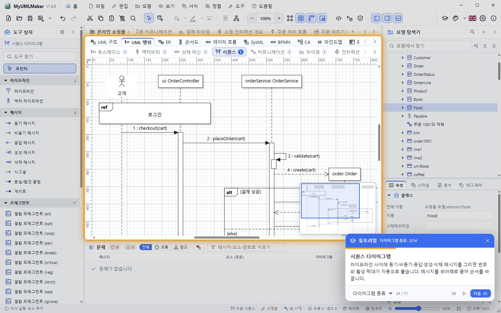

Draw synchronous, asynchronous, reply, create and delete messages between lifelines; numbers and activation bars are added automatically. A lifeline that receives a create message starts at that height, and one that receives a delete message ends there with an ×.

- Select a message and drag its round middle handle (or the message itself) up or down to change the order.
- In a message's properties set **Message sort**, **Signature (operation)** (an operation of the receiving class), **Arguments**, **Assignment target** and **Guard**. With a signature set, the operation shows instead of the message name.
- **Show sequence numbers** · **Message signature** · **Show activations** in the diagram options change how it looks.
- Setting what a lifeline **Represents** (a role, that is an attribute) shows "name: Type" in its head.

### Combined fragments

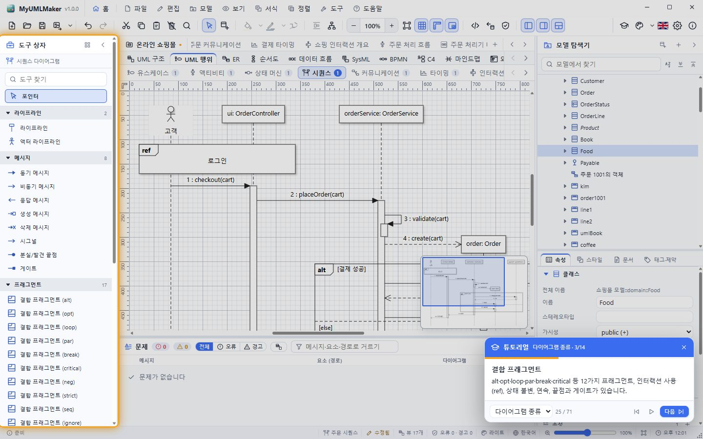

There are 12 combined fragments (alt · opt · loop · par · break · critical · neg · strict · seq · ignore · consider · assert), interaction uses (ref), state invariants, continuations, endpoints and gates. Double-clicking a fragment edits the guards of its operands, one per line, and **Add operand** among the quick buttons adds operands. **Refers to** of an interaction use points at another interaction.

### State machine diagram

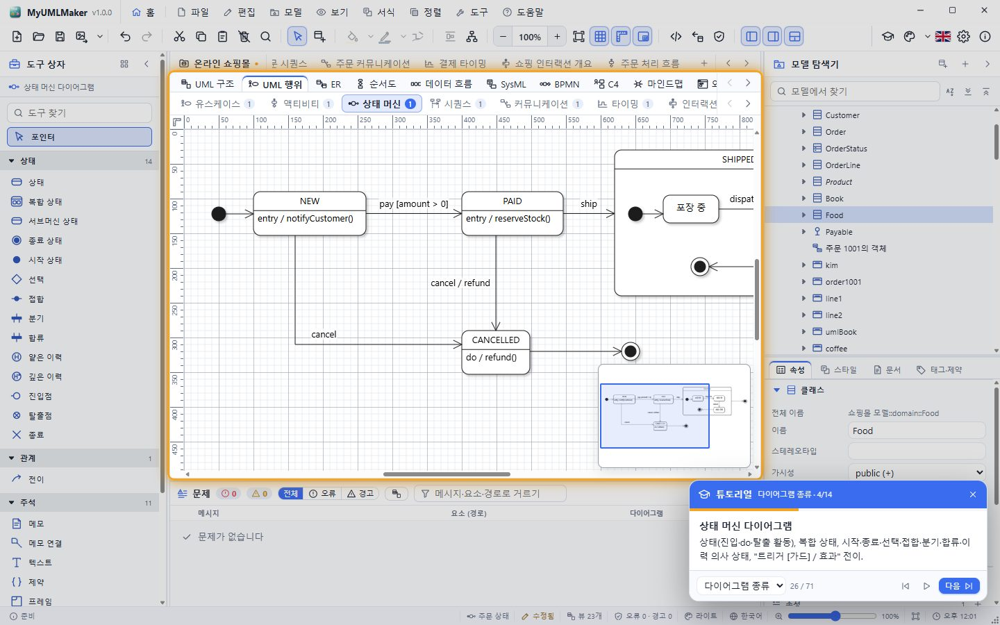

There are states (with **Entry activity** · **Do activity** · **Exit activity**), composite states, submachine states, and the initial, final, choice, junction, fork, join, shallow history, deep history, entry point, exit point and terminate pseudostates. A transition with **Triggers**, **Guard** and **Effect** shows as "trigger [guard] / effect". The transition **Kind** is external · internal · local. A state put inside a composite state goes into that state's region.

### Activity diagram

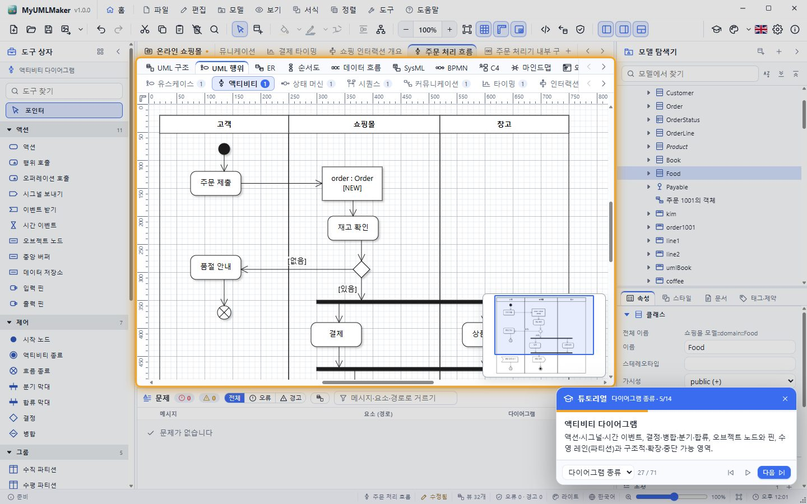

There are actions and call behavior, call operation, send signal, accept event and time event actions, decision, merge, fork and join, object nodes with input and output pins, swimlanes (partitions), and structured, expansion and interruptible regions. A **Guard** on a control flow or object flow shows as `[guard]`. Partitions come vertical and horizontal, and actions inside them move with them.

### Component and deployment diagrams

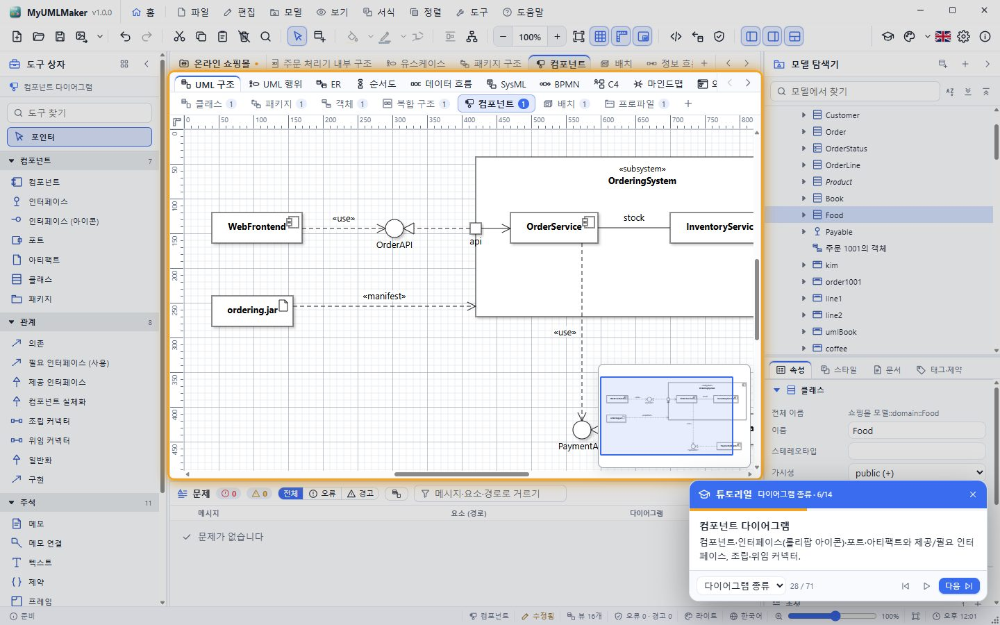

A component diagram has components, interfaces (lollipop icon), ports and artifacts with provided / required interfaces and assembly and delegation connectors. The **Interface (Icon)** tool draws an interface as a circle (lollipop), and any interface can be switched to that with **Format › Stereotype display › Icon (interface lollipop)**.

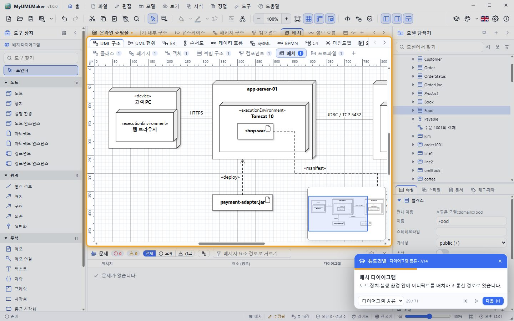

A deployment diagram deploys artifacts on nodes, devices and execution environments, linked by communication paths. Elements inside a container such as a node move with it.

### Other UML diagrams

- **Object Diagram** — set an object's **Classifier** and add "attribute = value" with **Add slot**. Objects are linked with links.
- **Composite Structure Diagram** — place parts and ports inside a larger class and link them with connectors.
- **Package Diagram** and **Profile Diagram** — draw imports and merges between packages, and stereotypes extending metaclasses.
- **Communication Diagram** — link lifelines with connectors and put messages on the connectors. The numbering is automatic.
- **Timing Diagram** — set the **States (comma separated)** of a timing lifeline and chain states and durations with **Add time segment**.
- **Interaction Overview Diagram** — link interaction uses and interaction frames with control flows.
- **Information Flow Diagram** — draw information items flowing as **Conveyed** items.

### ER diagram

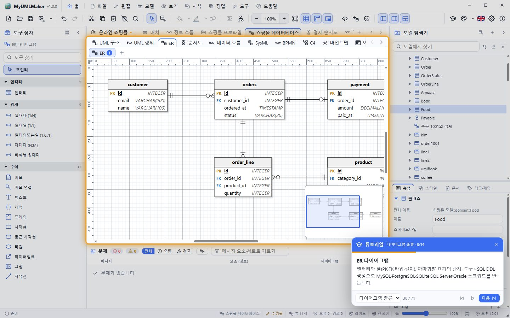

Draw entities with columns (PK, FK, type, length) and relationships in crow's-foot notation. The relationship tools are One to Many · One to One · One to Zero or One · Many to Many · Non-identifying One to Many. Columns have **Primary key (PK)**, **Foreign key (FK)**, **References column**, **Nullable**, **Unique** and **Default value**, and entities have the **Weak entity** flag. **Tools › Generate SQL DDL…** writes MySQL, PostgreSQL, SQLite, SQL Server and Oracle scripts (see [Code generation](#code-generation)).

### Flowchart and data flow

- **Flowchart Diagram** — the Process · Terminator · Decision · Delay · Predefined Process · Alternate Process · Data · Document · Multi-Document · Preparation · Display · Manual Input · Manual Operation · Card · Punched Tape · Connector · Off-Page Connector · Or · Summing Junction · Collate · Sort · Merge · Extract · Stored Data · Database · Direct Access Storage · Internal Storage symbols and flows. The name of a flow ("Yes" · "No") shows on the line.
- **Data Flow Diagram** — External Entity · Process · Data Store and Data Flow.

### The 4 SysML diagrams

| Diagram | Toolbox |
|---|---|
| **SysML Requirement Diagram** | Requirement · Block · Use Case · Package / Derive · Satisfy · Verify · Refine · Trace · Copy · Containment |
| **SysML Block Definition Diagram** | Block · Interface Block · Value Type · Constraint Block · Enumeration · Actor · Package / Association · Directed Association · Aggregation · Composition · Generalization · Dependency · Interface Realization |
| **SysML Internal Block Diagram** | Block · Part Property · Port · Actor / Connector · Item Flow · Dependency |
| **SysML Parametric Diagram** | Constraint Block · Constraint Property · Constraint Parameter · Part Property / Connector |

Requirements have fields such as ID, text, kind, status, priority, risk and verification method, and the requirement box shows the status and priority too. For the requirements list and the traceability matrix see [Requirements and traceability](#requirements-and-traceability).

### BPMN, C4, mind map, wireframe and cloud

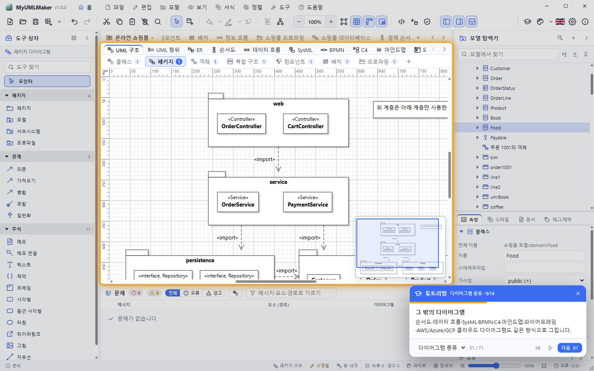

- **BPMN Diagram** — Pool · Lane (swimlanes); Task and User, Service, Script, Manual, Send, Receive and Business Rule tasks; Sub-Process · Call Activity; start, intermediate, boundary and end events (message, timer, signal, error, terminate and so on); exclusive, parallel, inclusive, event-based and complex gateways; Data Object · Data Store · Text Annotation · Group; Sequence Flow · Message Flow · Association · Data Association.
- **C4 Diagram** — Person · External Person · Software System · External System · Container · Container (Database) · Component, Boundary · Deployment Node, and Relationship. Elements take a **Description** and a **Technology**, and relationships take a **Technology** (for example HTTPS).
- **Mind Map Diagram** — topics (nodes) and branches, the way MindManager works.
  - With a topic selected, **Tab** (or **Insert**, **Shift+Enter**) adds a subtopic and **Enter** the next topic at the same level, and you type its name right away (Enter on the central topic adds a main topic). **F2** renames. **Add related › Child node** among the quick buttons does the same.
  - Adding or collapsing topics lays the map out again so that branches do not overlap. The diagram's **Map layout** property: map (both sides) · right · left · down (org chart) · free (never moved). **Arrange › Mind map › Lay out map again** tidies it at any time.
  - The **−** beside a topic with subtopics collapses its branch and then shows how many topics are hidden (**Ctrl+.**). **Collapse / Expand all branches** are in Arrange › Mind map and in the canvas's right-click menu.
  - Topic properties: **Direction** (auto · left · right: the side of a main topic), **Shape** (auto · rounded rectangle · rectangle · capsule · ellipse · diamond · hexagon · cloud · underline · no border), **Marker** (flag · star · done · question · warning · idea · heart · smile), **Priority** (1–5), **Progress** (0–100%), **Start date · Due date · Owner** (one line under the name). Markers are drawn before the name.
  - **Floating Topic** in the toolbox is a topic without a branch. **Relationship** in the **Branches** group joins any two topics with a dashed curved arrow, and **Boundary** puts a soft dashed outline around topics (the boundary's **Boundary shape** property: rounded rectangle · cloud · rectangle).
  - The **Outline** tab of the right panel (shown on mind maps only) lists the topics as an indented tree, each row with its priority, progress and marker badges and its due date. Clicking a row selects that topic, and the caret before a row collapses or expands its branch (on the map too). **Copy as text** · **Copy as Markdown** put the list on the clipboard. Write one topic per line in **Add subtopics from indented text** (levels by tab or space indentation, `-` lists or `#` headings) and press **Add under the selected topic** to add them all under the topic selected on the map.
  - The **Arrange › Mind map** submenu has Add subtopic (`Tab`) · Add topic (same level) (`Enter`) · Collapse / expand branch (`Ctrl+.`) · Collapse all branches · Expand all branches · Lay out map again. A topic's right-click menu starts with Add subtopic · Add topic (same level) · Collapse / expand branch, and right-clicking an empty part of the map shows the **Mind map** submenu.
- **Wireframe Diagram** — Desktop Frame · Web Frame · Mobile Frame · Panel frames and the Button · Text · Link · Input · Text Area · Checkbox · Radio · Switch · Dropdown · Slider · Tabs · Image · Avatar · List · Table · Divider · Progress · Icon widgets. Widgets have **Checked** · **Disabled** · **Items (comma separated)** fields.
- **AWS Diagram** · **Azure Diagram** · **GCP Diagram** — groups such as cloud, region, VPC and subnet, service tiles (coloured by category: compute · storage · database · network · security · analytics · integration · ML · management · developer tools · users) and connections. AWS, for example, has EC2 · Lambda · S3 · RDS · DynamoDB · CloudFront · API Gateway · IAM · SQS and more. The tiles are pictures drawn by MyUMLMaker; no company logos are used.

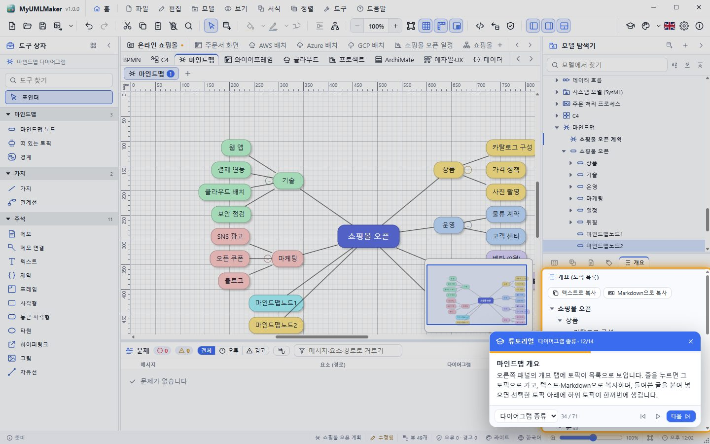

On a BPMN diagram you can watch tokens move along the flows (see [BPMN process simulation](#bpmn-process-simulation)).

### Nine more kinds of diagram

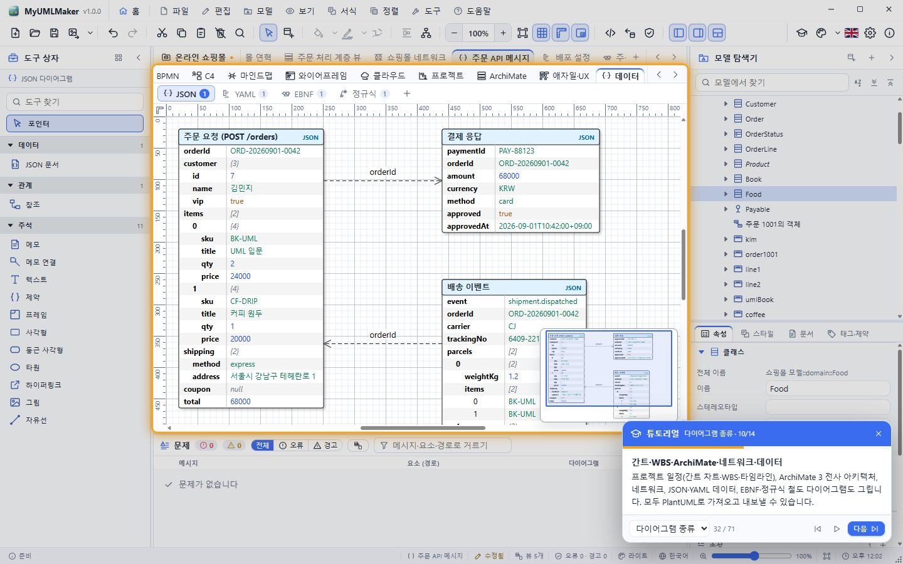

These are the kinds PlantUML and Enterprise Architect draw. In the diagram type tabs they are in the **Project** (Gantt Chart · WBS · Timeline), **ArchiMate**, **Cloud** (Network) and **Data** (JSON · YAML · EBNF · Regex) groups. All of them import from and export to PlantUML (see [PlantUML and Mermaid](#plantuml-and-mermaid)).

| Diagram | Toolbox |
|---|---|
| **Gantt Chart** | Calendar · Task · Milestone · Separator / Dependency |
| **WBS Diagram** | Work Item / Sub-item |
| **Timeline Diagram** | Time Axis · Event · Period / Link |
| **ArchiMate Diagram** | The elements of the Business · Application · Technology · Physical · Motivation · Strategy · Implementation & Migration · Other groups / Composition · Aggregation · Assignment · Realization · Serving · Access · Influence · Triggering · Flow · Specialization · Association |
| **Network Diagram** | Network · Network Node · nodes per device (database · router · switch · firewall · pc · laptop · mobile · storage · cloud · printer · queue) · Node Group / Network Connection |
| **JSON Diagram** · **YAML Diagram** | JSON Document · YAML Document / Reference |
| **EBNF Diagram** | EBNF Rule / Reference |
| **Regex Diagram** | Regular Expression / Reference |

- **Gantt Chart** — the **Calendar** (**Start** · **Days (0 = fit)** · **Day width** · **Closed week days** · **Closed dates**) draws the date scale and a task name column on the left. Tasks and milestones move by themselves to the horizontal position of their dates on the row where they are placed, and separators fit the calendar's width. A **Task** has **Start** · **End** · **Duration** (working days, closed days skipped) · **Completion (%)** · **Resources**, a **Milestone** has a **Date**. A task without a start date starts when the task before it (linked by a **Dependency**) ends, or else on the project start. The bar is filled darker for the completion, with the resources next to it. The **Add Next Task** quick button of a task makes a linked task right under it.
- **WBS Diagram** — **Work Items** (**Code** · **Side**) are joined as a tree with **Sub-item** lines. The **Add Sub-item** quick button grows the branches.
- **Timeline Diagram** — **Events** (**Date**) and **Periods** (**Start** · **End**) placed on a **Time Axis** (**Start** · **End** · **Day width**) move to the position of their dates. Events are joined with **Links**.
- **ArchiMate Diagram** — every element of the ArchiMate 3 layers (Business Actor · Business Process · Application Component · Node · Goal · Capability · Work Package …) is drawn with its layer's colour and shape. Changing an element's **Kind** makes it another element. A **Grouping** is a frame that holds elements, and **Junction (And)** · **Junction (Or)** (**Junction type**) split or join relationships. **Access** relationships have an **Access type** (Write · Read · Access · Read/write), **Influence** has a **Strength** and **Association** has **Directed**.
- **Network Diagram** — like PlantUML nwdiag, **Network Nodes** (**Device** · **Description**) are attached with **Network Connections** (**Address**) to long horizontal **Networks** (**Address** · **Description**). A **Node Group** is a frame around nodes.
- **JSON and YAML diagrams** — the **Text** of a data document is drawn as a tree table of keys and values (**Format**: JSON · YAML).
- **EBNF and regex diagrams** — the **Expression** of an EBNF rule or a regular expression is drawn as a railroad diagram. Documents and rules are joined with **References**.

Dates are written as `YYYY-MM-DD`. [Model validation](#model-validation) reports invalid dates, periods that end before they start, and JSON, YAML, EBNF or regex text with syntax errors.

### The 2 Agile & UX diagrams

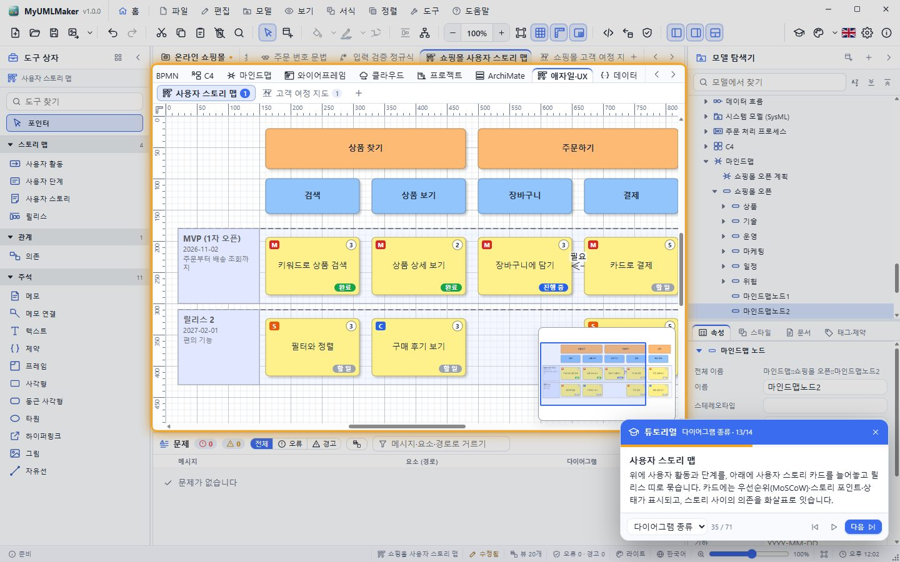

These kinds draw agile planning and user experience, the way Visual Paradigm does. They are in the **Agile & UX** group of the diagram type tabs, and a new one is made inside an **Agile & UX Model**.

| Diagram | Toolbox |
|---|---|
| **User Story Map** | User Activity · User Step · User Story · Release / Dependency |
| **Customer Journey Map** | Persona · Journey Stage · Journey Row · Touchpoint · Journey Card · Thought · Pain Point · Opportunity · Idea · Emotion / Emotion Curve |

- **User Story Map** — **User Activities** (orange cards, the backbone of the map) go along the top row, **User Steps** (blue cards) under them, and **User Stories** (yellow cards) below. A story has **As a** · **I want** · **So that**, a **Priority** (MoSCoW: Must · Should · Could · Won't, shown as an M · S · C · W badge on the card), **Story points** (shown in a circle at the top right of the card), a **Status** (To do · Doing · Done, shown as a coloured pill at the bottom right) and **Acceptance criteria**. A **Release** is a band across the map with its name, **Date** and **Goal** on its left; it holds the cards placed in it. A **Dependency** between stories is a dashed arrow.
- **Customer Journey Map** — a **Persona** (**Role** · **Goals** · **Frustrations**), **Journey Stages** (coloured columns, with a **Goal**) and **Journey Rows** (bands; **Row kind**: Actions · Touchpoints · Thoughts · Emotions · Pain points · Opportunities) lay out the board. In it go **Touchpoints** (**Channel**: Web · Mobile · Store · Phone · Email · Social · Ad · Other, each with a picture), **Journey Cards** (**Card kind**: Action · Thought · Pain point · Opportunity · Idea, coloured by kind; the **Thought** · **Pain Point** · **Opportunity** · **Idea** tools of the toolbox make cards of that kind) and **Emotions** (**Emotion**: a face from Very bad to Very good, red to green). An **Emotion Curve** joins the emotion points to show the highs and lows of the experience.

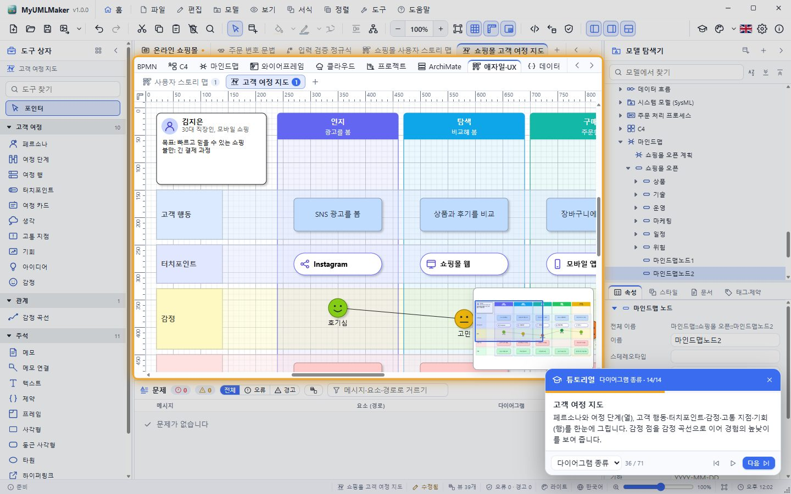

These two kinds have no PlantUML form, so PlantUML import and export do not cover them.

## Format and arrange

### Style

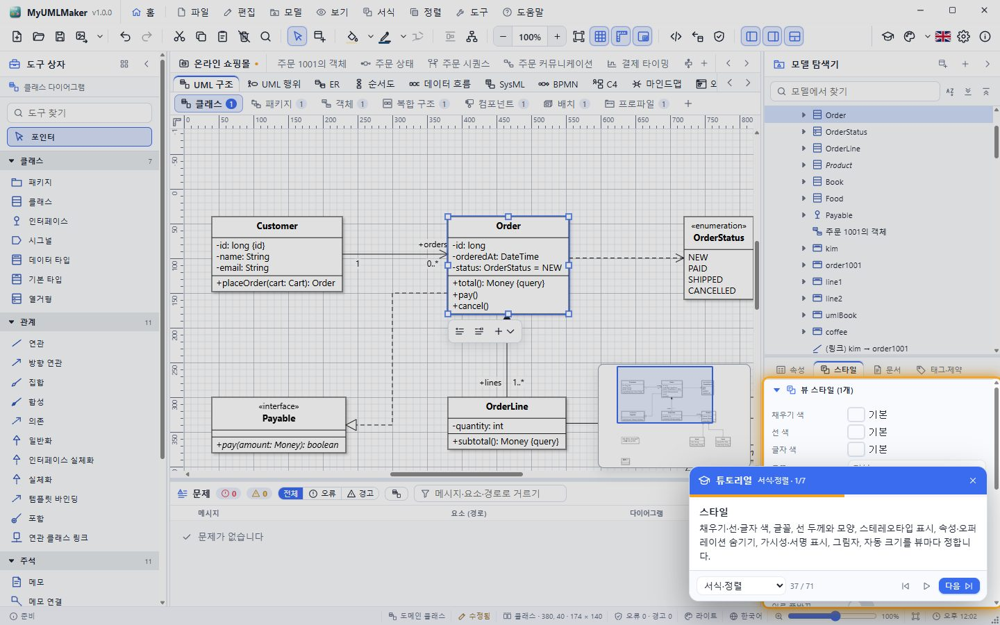

The **Style** tab of the editors sets how the selected views look (its header reads "View style (N)"). With several views selected, a change applies to all of them.

| Item | Contents |
|---|---|
| **Fill colour** · **Line colour** · **Font colour** | Open the colour picker. ✕ (**Reset**) goes back to the colour of the diagram colours |
| **Font** · **Font size** | A font and size (9–32px) for this view alone. Left empty, the font of **Settings › Diagram** is used |
| **Font style** | Bold · Italic |
| **Line width** | 1 · 1.5 · 2 · 3 · 4px |
| **Line style** | For lines: Default (settings) · Rectilinear · Oblique · Rounded rectilinear · Curve |
| **Stereotype display** | Label («…») · Decoration · Icon (interface lollipop) · None |
| **Shadow** · **Auto resize** · **Wrap the name** · **Locked (cannot move)** | Display of element views |
| Classifier display | **Suppress attributes** · **Suppress operations** · **Suppress receptions** · **Suppress literals** · **Show visibility (+ - # ~)** · **Show namespace** · **Show operation signature** · **Show property strings {…}** · **Show types** · **Show multiplicity** |
| Line display | **Show visibility** · **Show multiplicity** · **Show × on non-navigable ends** · **Locked (cannot move)** |
| **Clear all style** | Removes every style given to this view |
| **Fit to content** | Shrinks or grows the view to fit its text |

The same commands are in the **Format** menu and the right-click menu: **Format › Font** (Bold `Ctrl+B` · Italic `Ctrl+I` · Increase font size `Ctrl+Shift+>` · Decrease font size `Ctrl+Shift+<` · Font colour), **Format › Display**, **Format › Stereotype display**, **Auto resize** (the size follows when the text changes) and **Fit to content** (fits once).

### Colours

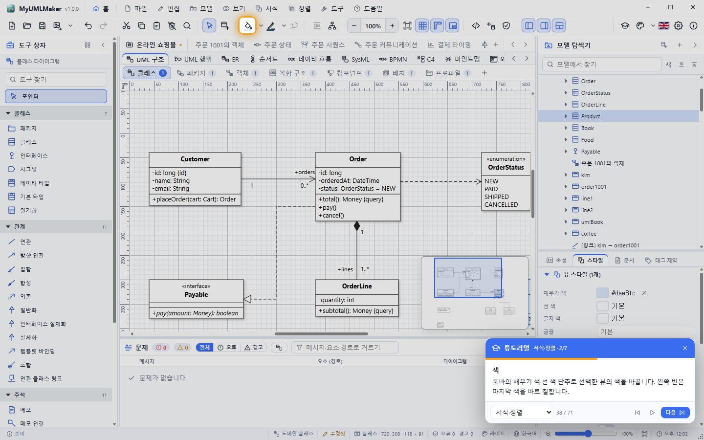

The **Fill color** · **Line color** buttons on the toolbar change the colours of the selected views. The left half of a button paints the last colour, shown in the bar under it, at once; the ▾ opens the colour picker. The colour picker has 12 **Soft colours** and 18 **Standard colors**, **None** (back to the diagram colours) and **More colors…** (the system colour picker).

### Line styles

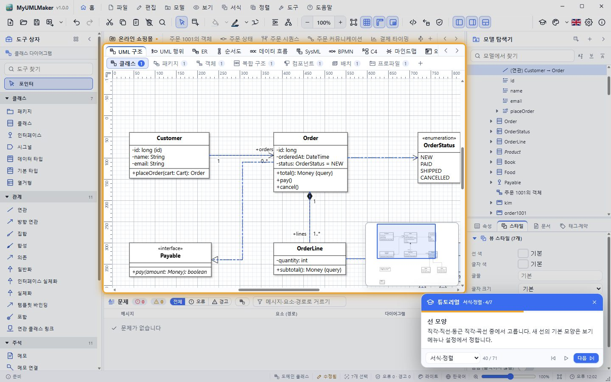

Lines are **Rectilinear** · **Oblique** · **Rounded rectilinear** · **Curve**. Select a line and change it with **Line style** on the toolbar, **Format › Line style** or the Style tab. Changing the style removes the bend points added by hand. The style of new lines is set in **View › Default line style** or **Settings › Diagram › Default line style**, and lines whose style is **Default (settings)** follow that setting.

### Diagram background

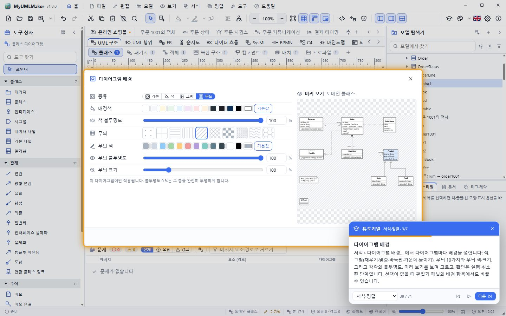

Every diagram can have its own background. The diagram colours (**View › Diagram colours**) stay as they are; only this diagram's background changes. Text and line colours follow the colour scheme.

- **Editors panel**: click an empty part of the diagram so that nothing is selected; the Properties tab shows a **Background** group under **Diagram options**. Every change applies at once and is one undo step (`Ctrl+Z`).
- **Format › Diagram background…** (also in the right-click menu of an empty part of the diagram and of a diagram tab, and the button on the Background group's header) opens a window with the same controls and a **Preview**. **OK** applies everything as one step, undone in one step.

| Item | Description |
|---|---|
| **Kind** | **Default** (the colour scheme's background) · **Colour** · **Picture** · **Pattern** |
| **Background colour** | 12 swatches, **Custom colour**, **Default** (the colour scheme's background colour). Pictures and patterns are drawn over this colour |
| **Colour opacity** | Opacity of the colour layer, 0–100 %. At 0 % the colour is fully transparent and the program's background shows through on screen |
| **Picture** | **Choose picture…** · **Clear**. A picture longer than 2560 px on a side is scaled down to 2560 px when chosen. The picture is saved inside the project file |
| **Fit** | **Fill** (cropped to fill) · **Fit** (all of it visible) · **Tile** (repeated at its own size) · **Centre** (its own size, centred) · **Stretch** (ignores the aspect ratio) |
| **Picture opacity** | Opacity of the picture layer, 0–100 % |
| **Pattern** | **Dots** · **Grid** · **Horizontal lines** · **Vertical lines** · **Diagonal lines** · **Diagonal cross** · **Checkerboard** · **Crosshatch** · **Waves** · **Hexagons** (click a tile) |
| **Pattern colour** | The colour the pattern is drawn in (swatches, custom colour; **Default** is the colour scheme's grid colour) |
| **Pattern opacity** | Opacity of the pattern layer, 0–100 % |
| **Pattern size** | 50–300 % |

On the canvas the background lies under the grid and the views, and the minimap shows it. Tiled pictures and patterns start at page 0, 0, so they sit where they do in an exported picture; pictures with the other fits are placed over the visible area. The background is in **Export as picture**, SVG and PDF, printing, the presentation and the diagram pictures of generated documents (HTML · Word · PDF · Markdown). **Transparent** in **Export as picture** still exports with no background at all, and with **Print the diagram background** off the sheet is printed on white. Where an opacity is below 100 %, PNG · WebP · BMP · TIFF · SVG stay that transparent; JPEG, which has no transparency, and printing put it over white.

The background is saved in .myuml projects and StarUML (.mdj) files and is the same when opened again; XMI exports leave it out. Comparing with a baseline lists it as changed diagram fields (Background kind, Background colour …).

### Order

The front-to-back order of overlapping views is changed in **Arrange › Order**: **Bring to front** (`Ctrl+Shift+F`) · **Send to back** (`Ctrl+Shift+K`) · **Bring forward** · **Send backward**.

### Align and distribute

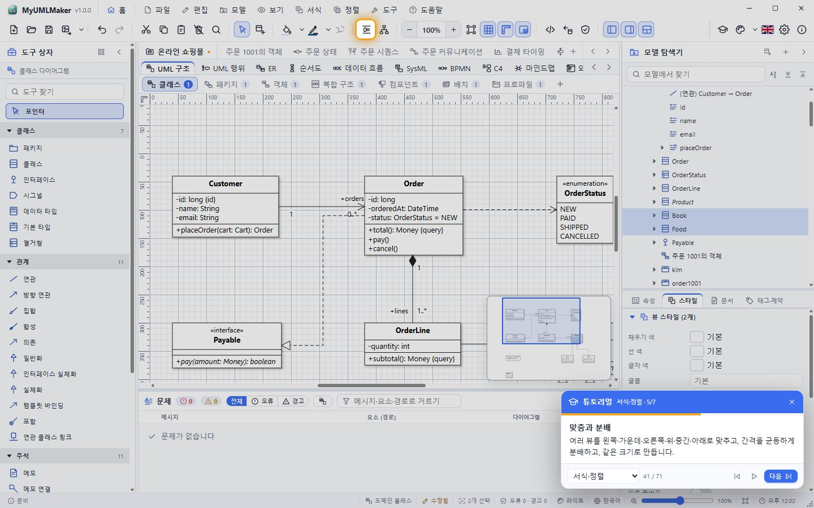

Select two or more views and use **Align** on the toolbar or **Arrange › Align & distribute**.

| Command | What it does |
|---|---|
| **Align left** · **Align center** · **Align right** | Lines up the horizontal positions |
| **Align top** · **Align middle** · **Align bottom** | Lines up the vertical positions |
| **Distribute horizontally** · **Distribute vertically** | Evens out the gaps between three or more |
| **Same width** · **Same height** · **Same size** | Matches the sizes |

With only one view selected you get "Select two or more views.", and when distributing with only two, "Select three or more views."

### Auto layout

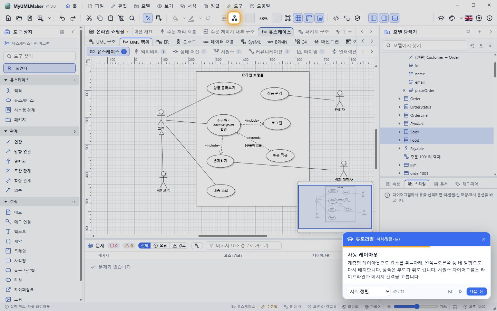

Pick a direction from **Auto layout** on the toolbar or **Arrange › Auto layout**: **Top to bottom** · **Bottom to top** · **Left to right** · **Right to left**. A layered layout rearranges the elements, with parents of an inheritance on top (the first row). With two or more views selected, only the selected views are rearranged. On a sequence diagram the lifelines and the message spacing are evened out. Afterwards the whole diagram is fitted into view and "Rearranged N views." shows. If you do not like it, `Ctrl+Z` takes it back.

### Zoom and pan

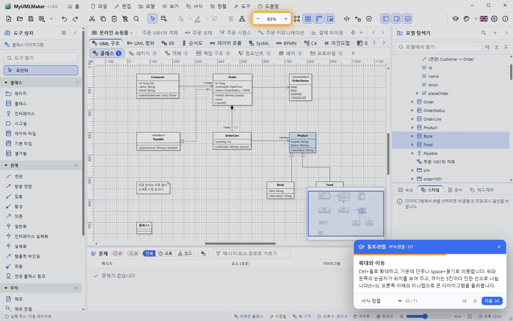

| How | What it does |
|---|---|
| `Ctrl`+wheel | Zoom in or out around the pointer (10%–800%) |
| `Ctrl+=` · `Ctrl+-` · `Ctrl+0` | Zoom in · Zoom out · Zoom 100% |
| `Ctrl+Shift+W` | Fit diagram |
| **View › Zoom › Zoom to selection** | Zooms so the selected views fill the screen |
| −, + and the zoom box on the toolbar, the slider on the status bar | Step by step or to any value |
| Drag with the middle button, `Space`+drag | Pan |
| Wheel · `Shift`+wheel | Scroll up and down · left and right |

The diagram is an endless canvas that grows by itself when you draw near its edge. The **Pan & zoom window** (minimap) at the bottom right shows the whole diagram and the visible part; clicking or dragging in it moves there. Turn it off and on with the **Pan & zoom window** toolbar button or **View › Show › Pan & zoom window**. The grid is turned on and off with **View › Show › Grid** (or the **Grid** button on the toolbar), and snapping with **Snap to grid**.

**Grid** — the grid is drawn as lines: a thin line every grid step and a darker, thicker line every 5 steps, so each large square is 5×5 cells. The colours follow the [diagram colours](#diagram-colours). The grid spacing (**Settings › Diagram › Grid size**, 5–40px) is the size of a cell at 100 %. Zooming makes the grid grow and shrink with the diagram until a cell on the screen gets smaller than half the grid size or larger than 2.5 times it; past that threshold the grid is redrawn one level coarser (5 cells become 1) or finer (1 cell becomes 5), so the darker lines of one level become the thin lines of the next and the 5×5 pattern carries on. With a 10px grid, for example, there is a line every 10 page units from 50 % to 240 % (5–24 px on the screen), every 2 above 250 % and every 50 below 50 %. Snapping and arrow-key nudging follow the visible grid cell.

**Rulers** — rulers run along the top and left edges of the diagram. They show page coordinates, with numbers on the major grid lines, and mark where the pointer is. The spacing of the numbers adapts to the zoom (for example every 100 at 50% and every 25 at 200%). Turn them on and off with **View › Show › Rulers**, the **Rulers** button on the toolbar or **Settings › Diagram › Rulers**. The **Grid** and **Rulers** toolbar buttons show pressed while they are on.

Turning `Ctrl`+wheel outside the diagram (over a panel or menu) changes the size of the whole program screen (**Settings › Font › Zoom**, 50–200%).

## Model tools

### Model validation

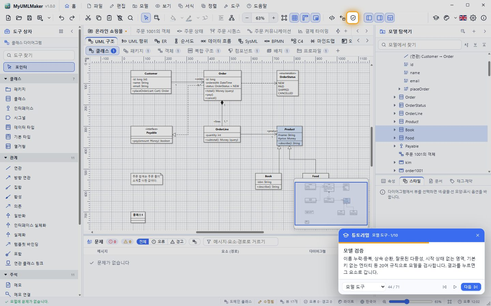

**Model › Validate model** (`Ctrl+Shift+V`, **Validate model** on the toolbar) checks the model against 34 rules. With no problems it says "The model has no problems."; otherwise the validation results window shows the numbers of errors and warnings and the list. Clicking an entry shows that element in the Model Explorer and on its diagram. The result also stays on the status bar as "N errors · N warnings". While the [Problems panel](#problems-panel) at the bottom is open, the same check runs in the background after every edit and its list and counts refresh by themselves. With the panel closed, **Settings › Diagram › Validate the model after each edit (counts in the status bar while the Problems panel is closed)** keeps just the status bar counts fresh.

| Rule | Severity |
|---|---|
| Name is missing | Error |
| Duplicate name in the same namespace | Error |
| Generalization cycle | Error |
| Generalization between incompatible types | Error |
| Interface attribute should be static or read-only | Warning |
| Abstract operation in a non-abstract class | Error |
| Realization target is not an interface | Error |
| Association end has no reference | Error |
| Relationship end refers to a missing element | Error |
| Invalid multiplicity (n, n..m, *, n..*) | Error |
| Enumeration has no literals | Warning |
| Lifeline does not represent anything | Warning |
| Create message to the same lifeline | Error |
| Region has no initial pseudostate | Warning |
| Region has more than one initial pseudostate | Error |
| Final state has an outgoing transition | Error |
| Decision node has fewer than 2 outgoing flows | Warning |
| Entity has no primary key | Warning |
| Foreign key column has no referenced column | Warning |
| Diagram is empty | Warning |
| Reference to a missing element | Error |
| Invalid date (YYYY-MM-DD) | Error |
| Task lasts less than a day and has no end date | Warning |
| End date is before the start date | Error |
| Syntax error in the text | Error |
| Approved requirement is not satisfied by any element | Warning |
| Approved requirement is not verified by any element | Warning |
| Requirement id is used more than once | Warning |
| Duplicate column name in the entity | Error |
| Column has no data type | Warning |
| Entity has no columns | Warning |
| Foreign key type differs from the referenced column | Warning |
| No foreign key column links the related entities | Warning |
| Duplicate entity name in the data model | Error |

The date rules apply to the date fields of Gantt charts and timelines, the syntax rule to JSON and YAML documents, EBNF rules and regular expressions. The satisfied and verified rules apply only to requirements whose status is **approved**, **implemented** or **verified** and that have no sub-requirements (a requirement with sub-requirements is covered by them). **proposed**, **rejected** and **deferred** requirements are not checked.

The ER diagram rules compare column and entity names without regard to case, as SQL does (`email` and `EMAIL` are the same name). Foreign key types are compared without their length and with same-meaning names taken as one (`INT` = `INTEGER` = `SERIAL`, `NUMERIC` = `DECIMAL`, `VARCHAR(20)` = `VARCHAR`). The relationship rule passes when either of the two related entities has a foreign key column that references a column of the other.

### BPMN process simulation

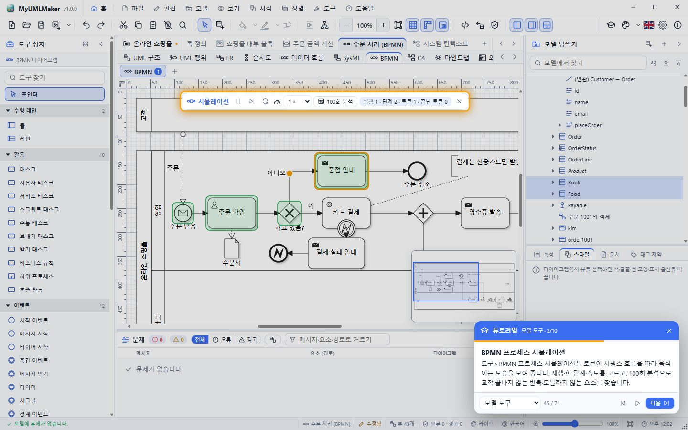

**Tools › Simulate BPMN process** (also in the right-click menu of an empty part of a BPMN diagram) shows tokens moving along the sequence flows of a BPMN diagram (Visual Paradigm's process animation). A simulation bar appears over the drawing area.

| Bar | What it does |
|---|---|
| **Play** · **Pause** | Keeps the tokens moving, or stops them |
| **One step** | Goes one step on |
| **From the start** | Starts again at the start events |
| **Speed** | 0.5× · 1× · 2× · 4× |
| **Analyse 100 runs** | Runs the process 100 times and sums up (see below) |
| ✕ (**End the simulation**) | Closes the bar and clears the marks. Choosing the menu command again also ends it |
| Status line | Run number · step · tokens · finished tokens, and the result when the run ends |

- Tokens start at the start events and move along the sequence flows. An activity or an event passes its token along every outgoing flow. An exclusive gateway (and an event-based or complex one) takes one flow, an inclusive gateway one or more, and a parallel gateway all of them.
- A parallel join waits until a token has come along every incoming flow, an inclusive join until no other token can still arrive. An end event consumes tokens.
- Visited elements are outlined green and the element holding a token orange; a join that can never fire is marked red (deadlock). Joins show how many tokens are waiting.
- A run ends **completed** (every token reached an end), **deadlocked**, or stopped at the 400-step limit (a loop that never ends).
- **Analyse 100 runs** runs the process 100 times with different random choices at the gateways, tells how many runs completed, deadlocked or ran too long, and marks every element with the share of runs that reached it (%). Elements never reached are outlined red and dashed, and flows never used are marked too.
- The simulation does not change the model. Without a start event it says "There is no start event".

### Problems panel

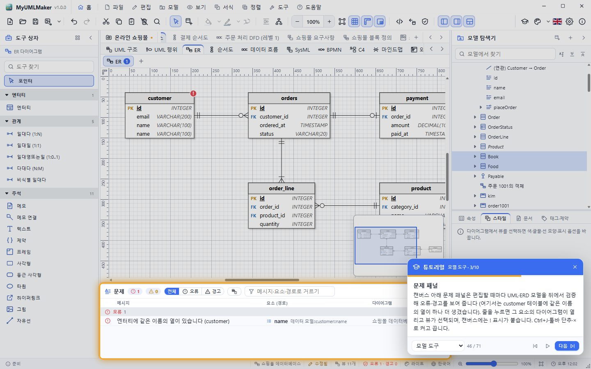

The **Problems** panel under the diagram keeps checking the model in the background, as an IDE does, and shows what is wrong in the ERD or UML model and where to fix it. After an edit, an undo or redo or opening a file, it checks once the edits pause (about 0.4 s) and in idle time, so typing and dragging never stutter. A large model that takes long to check waits longer (up to 3 s), and nothing is checked during a drag.

- **Show and hide** — **View › Show › Problems panel**, the **Problems panel** button on the toolbar, `Ctrl+J`, the **×** at the panel's top right, or **Settings › Diagram › Problems panel**. Clicking "N errors · N warnings" on the status bar opens it too. Closing it keeps its filters and selection; the start page does not show it.
- **Header** — the error and warning counts, the **All** · **Errors** · **Warnings** filter, **Current diagram only** (only problems of elements drawn on the diagram you are looking at), a box that filters by message, element, path or diagram name, how many problems were found and how long the check took, and **Validate all** (check again now).
- **List** — errors first, then warnings, each by element path. A row shows the severity, the message, the element's name and path (`package::…`), its type, the diagrams that show it and the rule id. A column or an attribute, which is not drawn by itself, lists the diagrams of its entity or class.
- **Going there** — clicking a row selects the element in the Model Explorer (expanding its owners), opens the first diagram that shows it (the current one when it does) and selects and scrolls to its view. A double-click goes on to the property editor field to fix (name, type, multiplicity …). In the list, the up and down arrow keys move the selection, `Enter` goes there (`Ctrl+Enter` as a double-click) and `Esc` returns to the diagram.
- **Marks on the diagram** — while the panel is open, views whose element has a problem get a red (error) or orange (warning) **!** at their top-right corner (lines: at the middle). Its tooltip lists the messages; clicking it selects the problem in the list.
- **Size** — drag the border above the panel to change its height (from 90 pixels up to 60 % of the window). The height is remembered for the next start.

### Find

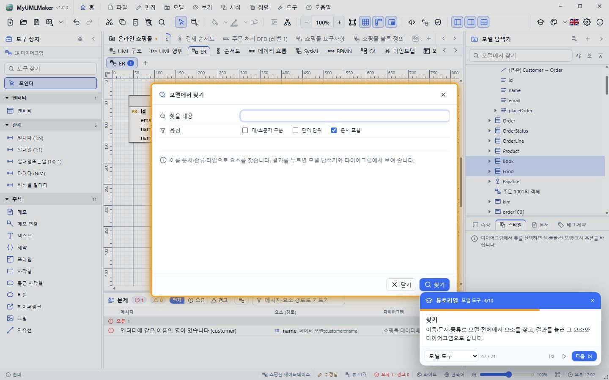

**Edit › Find…** (`Ctrl+F`) opens the **Find in model** window. Type in **Find what** and press **Find** to search the whole model by name, documentation, kind and type. The **Options** are **Match case** · **Whole words** · **Include documentation**. The results show the name, kind and qualified name (package path); clicking one expands and selects it in the Model Explorer and opens a diagram that shows it.

The **Filter model** box above the Model Explorer is a lighter way that narrows the tree at once.

### Code generation

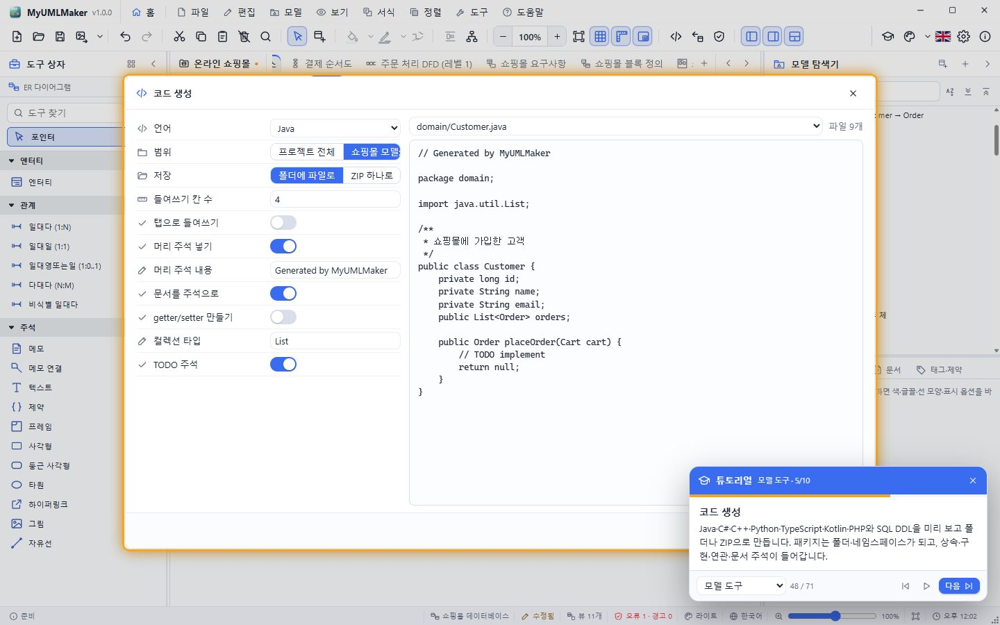

**Tools › Generate code…** (`Ctrl+Shift+G`) opens the **Generate code** window. As you choose the settings on the left, the files to be made and their contents show at once on the right ("N files").

| Item | Contents |
|---|---|
| **Language** | Java · C# · C++ · Python · TypeScript · Kotlin · PHP · SQL (DDL) |
| **Scope** | **Whole project**, or the element (package, class and so on) selected in the Model Explorer or on the diagram |
| **Output** | Desktop app: **Files in a folder** or **One ZIP file**. The web version makes a ZIP |
| Language options | **Indent spaces** · **Indent with tabs** · **Header comment** · **Header text** · **Documentation as comments** · **Getters and setters** (Java, C#, PHP) · **Collection type** (List · std::vector · list · array) · **TODO comments** · **Type hints** (Python, PHP) · **#pragma once** (C++) |
| SQL options | **SQL dialect** (MySQL / MariaDB · PostgreSQL · SQLite · SQL Server · Oracle) · **DROP TABLE first** · **Quote identifiers** · **Foreign key constraints** |

Pressing **Generate** asks for a folder (files in a folder) or a ZIP file name.

- Each class, interface, enumeration, data type and signal becomes one file (two for C++: `.h` and `.cpp`).
- Packages become folders, with the package or namespace declaration of the language.
- Inheritance, interface implementation, associations (navigable ends become fields, collections when the multiplicity is many), operations with parameters and return types go in, and the element's documentation becomes a doc comment.
- Type names are translated for the language (for example `String` becomes `string` in C#, `std::string` in C++ and `str` in Python).
- SQL makes tables, columns, primary keys and foreign keys from the ER data models in the scope. **Tools › Generate SQL DDL…** opens the same window with SQL chosen as the language.
- Right-click › **Generate code…** in the Model Explorer generates just that element.
- When there is nothing to generate from, it says "There are no classifiers to generate code from."

### Reverse engineering (code → model)

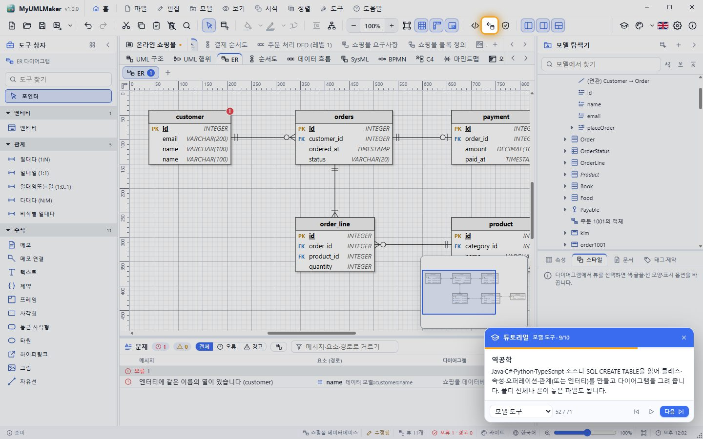

**Tools › Reverse engineer (code → model)** (`Ctrl+Shift+R`, the toolbar button, the start page) opens a menu of languages.

| Menu item | What it reads |
|---|---|
| Java (.java) | Packages, classes, interfaces, enumerations, fields, methods, constructors, extends and implements |
| C# (.cs) | Namespaces, classes, interfaces, enumerations, structs, fields, properties, methods |
| C++ (.h, .hpp, .hh, .hxx, .cpp, .cc, .cxx) | Namespaces → packages; classes, structs, unions and enumerations (`enum class` too); the `public:` · `protected:` · `private:` sections; fields (static, const → read-only), methods (pure virtual `= 0` → abstract) and constructors; base lists → generalization and realization. A class with only pure virtual methods becomes an interface. Collections such as `std::vector` and `std::array` get multiplicity `*`, pointers `0..1`, and smart pointers (`std::unique_ptr` and so on) become their target type |
| Python (.py, .pyi) | Module folders, classes, attributes, methods, type hints |
| TypeScript (.ts, .tsx, .mts, .cts) | Folders, classes, interfaces, enumerations, properties, methods |
| SQL (DDL) (.sql, .ddl) | `CREATE TABLE` → entities, columns, primary keys and foreign key relationships of an ER data model |
| **A whole folder (language detected)…** | Desktop app: finds all sources in a folder and reads the most common language |

Several files can be picked. The result goes into the model or package selected in the Model Explorer (else the first model). Packages, namespaces and folders become packages, inheritance and implementation become generalizations and interface realizations, and fields typed with a class that was read become navigable associations. Reading code makes a "Reverse Engineered" class diagram, and reading SQL an ER diagram, laid out automatically. Unresolved types and the like are listed in the **Reverse engineering warnings** window. Dropping source files on the window reverse engineers them too.

### PlantUML and Mermaid

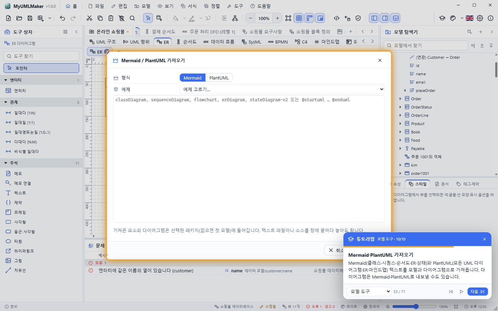

**File › Import › Import Mermaid / PlantUML…** turns text into model elements and a diagram. Choose the **Format** (Mermaid · PlantUML), paste the text and press **Import**. Choosing one in the **Examples** list puts its text in (Mermaid: Class · Sequence · Flowchart · ER · State; 21 for PlantUML: Class · Object · Use case · Sequence · Activity · State · Component · Deployment · Timing · ER · Mind map · Gantt · WBS · Timeline · ArchiMate · Network · JSON · YAML · EBNF · Regex · Salt screen).

| Format | Diagrams it imports and exports |
|---|---|
| PlantUML `@startuml` | Every UML diagram PlantUML has: class · object · package · profile · use case · component · deployment · composite structure · information flow · sequence · activity (new and legacy syntax) · state · timing · ER (IE `entity` notation), and ArchiMate (archimate sprites and macros) |
| Other PlantUML blocks | `@startmindmap` (mind map) · `@startgantt` (Gantt chart) · `@startwbs` (WBS) · `@startchronology` (timeline) · `@startnwdiag` (network) · `@startjson` · `@startyaml` · `@startebnf` · `@startregex` · `@startsalt` (wireframe) |
| Mermaid | Import: `classDiagram` · `sequenceDiagram` · `flowchart`/`graph` · `erDiagram` · `stateDiagram`/`stateDiagram-v2` |

- The PlantUML preprocessor is followed: comments, `!define` and `!$variable` substitution, `!if` · `!ifdef` are applied, and decorations such as `!include`, `skinparam`, styles, legends, headers and footers are skipped.
- Lines that were skipped or not understood are listed after the import in an **N import warnings** window.
- The imported elements and diagram go into the selected package (else the first model) and the diagram opens.
- Opening or dropping a `.mmd` · `.mermaid` · `.puml` · `.plantuml` · `.pu` file opens this window with its contents. **Paste** (`Ctrl+V`) with any PlantUML block starting with `@start…` (`@startuml` · `@startgantt` · `@startjson` …) or Mermaid text on the clipboard opens it too, and so does dropping such text on the window.
- Other kinds of Mermaid diagram give "This kind of Mermaid diagram cannot be imported (class, sequence, flowchart, ER and state only)."

The other way round, **File › Export › PlantUML (.puml)…** · **Mermaid (.mmd)…** write the current diagram as text. PlantUML exports every kind in the table above (wireframes as Salt); communication diagrams are written as sequence diagrams, interaction overviews as activities and profiles as class diagrams. User story maps and customer journey maps have no PlantUML form and are not exported. Mermaid exports class · sequence · flowchart · ER · state machine · use case · activity diagrams (use case and activity as flowcharts).

## Requirements and traceability

As in Enterprise Architect, each requirement carries attributes, and the trace relationships between requirements and other elements are handled as a table and a matrix. Requirements are made with the **Requirement** tool of a SysML requirement diagram.

### Requirement attributes

The Properties tab of a requirement has these fields.

| Field | Values |
|---|---|
| **ID** | A new requirement gets the number after the highest `REQ-` number of the project by itself (`REQ-001` in a new project). It can be changed |
| **Text** | The requirement text |
| **Kind** | functional · non-functional · performance · interface · usability · reliability · security · design constraint · physical · business · user |
| **Status** | proposed · approved · implemented · verified · rejected · deferred |
| **Priority** | high · medium · low |
| **Difficulty** · **Stability** | low · medium · high |
| **Risk** | (none) · low · medium · high |
| **Verify method** | (none) · analysis · demonstration · inspection · test |
| **Version** · **Author** · **Phase** | Free text. The author starts as the author in the project properties |

On the diagram the requirement box shows `Status = …, Priority = …` under `Id` and `Text`, and `Risk = …, Verify = …` when a risk or verification method is set.

### Requirements list

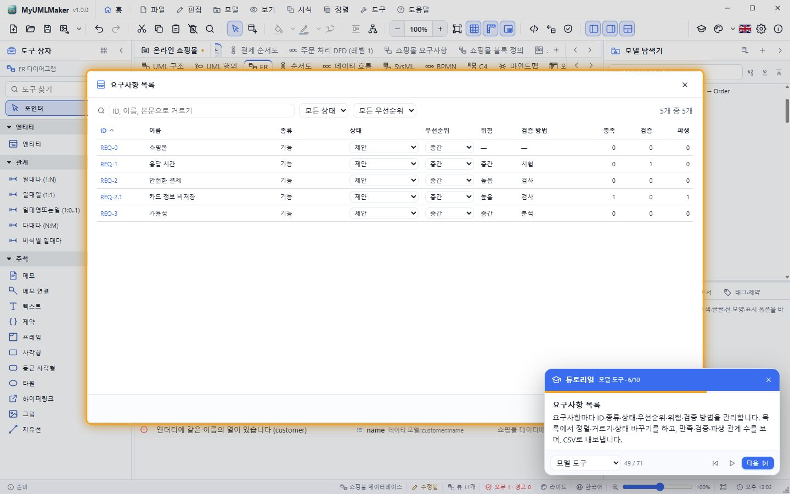

**Model › Requirements** shows every requirement of the project in a table.

- Columns: **ID** · **Name** · **Kind** · **Status** · **Priority** · **Risk** · **Verification** · **Satisfied** · **Verified** · **Derived** (the number of elements linked by satisfy, verify and derive relationships).
- Clicking a heading sorts by that column; clicking it again reverses the order.
- The box at the top (**Filter by id, name or text**) and the **Any status** · **Any priority** lists filter the rows; "N of M" shows on the right.
- **Status** and **Priority** are changed right in the table (one undo step, **Edit requirement**).
- When an approved, implemented or verified requirement without sub-requirements has nothing satisfying or verifying it, that cell is highlighted ("Approved requirement with nothing linked").
- Clicking an ID shows the requirement in the Model Explorer and on its diagram.
- **Export CSV** saves the rows shown now (after filtering) as a CSV file.

While it is open, the list follows every edit and undo.

### Traceability matrix

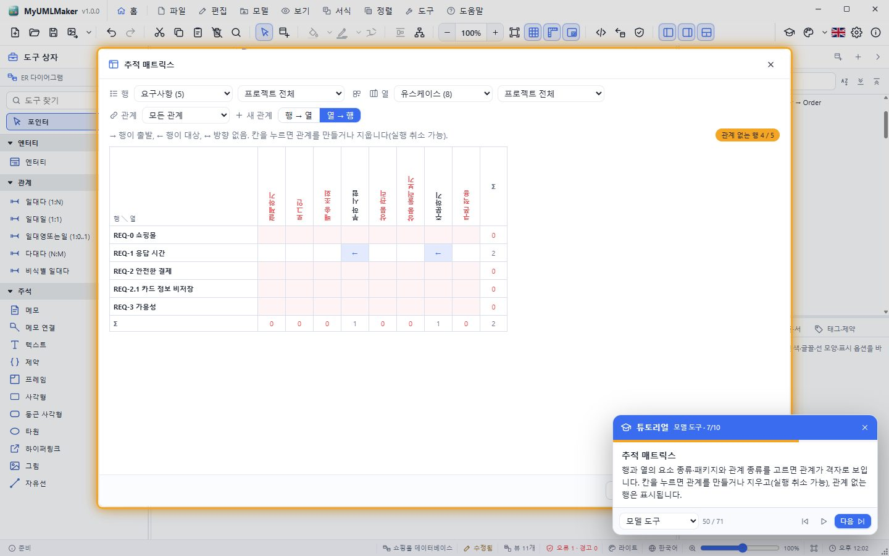

**Model › Traceability Matrix** shows the relationships between elements as a grid. At first the rows are the requirements and the columns the kind of element most often related to them.

| Item | Contents |
|---|---|
| **Rows** · **Columns** | The element type (**Row element type** · **Column element type**, with counts) and package (**Row package** · **Column package**, **Whole project** by default). The button between them is **Swap rows and columns** |
| **Relationship** | **All relationships** or one relationship type (satisfy · verify · derive · trace · dependency …) |
| **New link** | The direction of relationships made by clicking cells: **Row → column** · **Column → row** |

- A cell shows the direction of its relationships: → the row is the source, ← the row is the target, ↔ undirected. Its tooltip names the relationship types.
- With one type chosen in **Relationship**, clicking a cell creates that relationship (empty cell) or deletes it (filled cell). Every change can be undone (**Change trace relationship**). With **All relationships**, clicking a cell says "Choose one relationship type to create or delete links by clicking cells."
- Rows without any relationship are highlighted, and "N of M rows without links" shows at the top. The last row and column (Σ) are totals.
- Clicking a row or column heading goes to that element. Many rows or columns are paged with the buttons at the bottom.
- **Copy** puts the matrix on the clipboard as tab-separated text, and **Export CSV** saves it as a CSV file.

### Requirements in documents

**HTML documentation (.html)…**, **Markdown documentation (.zip)…** and the documents of [Generating documents](#generating-documents) include a requirements table (ID · Name · Kind · Status · Priority · Risk · Verification · Satisfied by · Verified by · Text). For the requirement rules see [Model validation](#model-validation).

## Baselines and documents

### Baselines

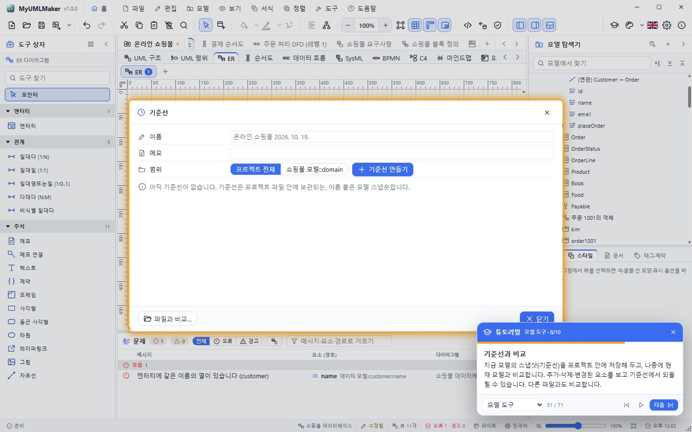

A **baseline** is a named snapshot of the model at one point in time. **Model › Baselines…** opens the **Baselines** window.

- Set a **Name** (empty: the project name and the date), a **Note** and the **Scope** (**Whole project** or the package picked in the Model Explorer) and press **Create baseline**.
- The list shows each baseline's name, creation time, scope, number of elements and note, with buttons for **Compare with current**, **Export as .myuml** (the model of that time as a project file of its own) and **Delete**.
- Baselines are saved inside the `.myuml` project file. Creating and deleting them can be undone too. Templates (`.mumlt`) and StarUML `.mdj` files are saved without baselines.
- **Compare with file…** at the bottom of the window (or **Model › Compare with file…**) compares the current model with another `.myuml`, `.mumlt` or `.mdj` file.

### Comparison

The compare window (**Compare with {name}**) shows the differences between the baseline (or file) and the current model.

- At the top are the **N added** · **N removed** · **N changed** counts.
- **Show** filters by added · removed · changed and by elements · members · relationships · diagrams, and **Filter by text** finds names.
- The list on the left shows the changed elements as a tree under their owners ("renamed from …" when the name changed). Picking a row shows the changed fields on the right as a **Field** · **Before** · **Now** table. Diagrams show the numbers of views added, removed, moved or resized and restyled.
- **Go to element** shows the element in the Model Explorer and on its diagram (just picking the row goes there too).
- **Restore from baseline** puts a changed element back to its baseline contents, or puts a removed element back into its old owner. It is one undo step (**Restore from baseline**).

### Generating documents

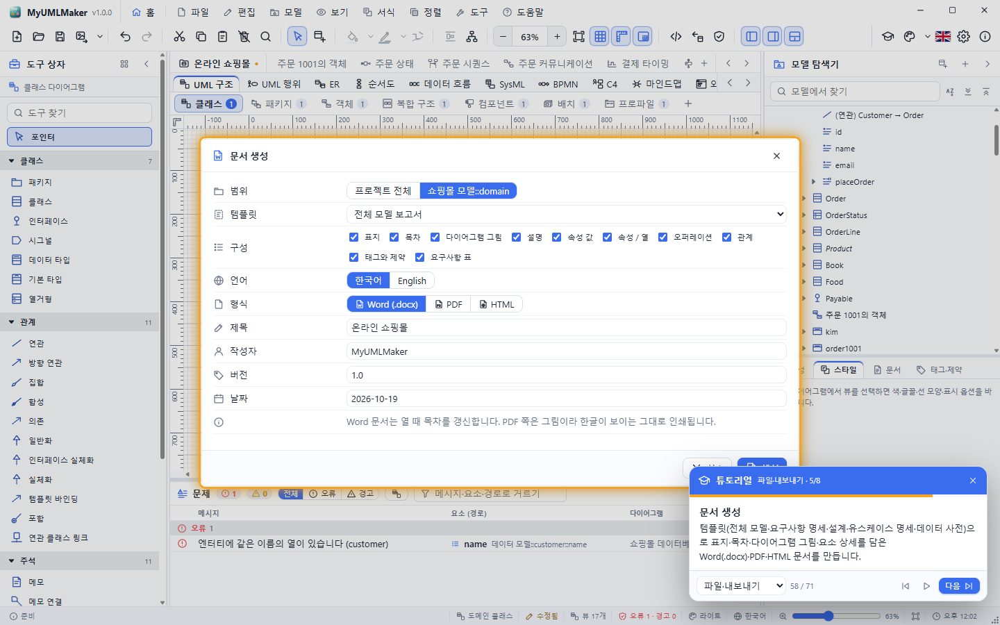

**Tools › Generate document…** makes Word, PDF and HTML documents from templates.

| Item | Choices |
|---|---|
| **Scope** | **Whole project** or the package picked in the Model Explorer |
| **Template** | **Full model report** · **Requirements specification** · **Design document (classes + diagrams)** · **Use case specification** · **Data dictionary (ER)** |
| **Sections** | **Cover page** · **Table of contents** · **Diagrams as pictures** · **Documentation** · **Properties** · **Attributes / columns** · **Operations** · **Relationships** · **Tags and constraints** · **Requirements table** (choosing a template switches on its sections; each can be switched on or off) |
| **Language** | 한국어 · English |
| **Format** | Word (.docx) · PDF · HTML |
| **Title** · **Author** · **Version** · **Date** | Go on the cover page. They start as the project name, author and version and today's date |

A template chooses the elements and diagrams of the document: the requirements specification holds the requirements and requirement diagrams, the design document classes, interfaces, components, blocks and the like with structure and behaviour diagrams, the use case specification actors, use cases and use case diagrams, and the data dictionary ER entities and ER diagrams. **Generate** asks for a file name and saves. The template, sections, language and format chosen last are remembered.

- **Word (.docx)** — title and heading styles, a table of contents, tables, PNG pictures of the diagrams and page numbers. Word refreshes the table of contents when the document opens.
- **PDF** — every A4 page is made as a picture, so Korean text prints exactly as shown (the text on the pages cannot be selected or searched).
- **HTML** — one file with the diagrams embedded as SVG.

## Files and export

### Saving

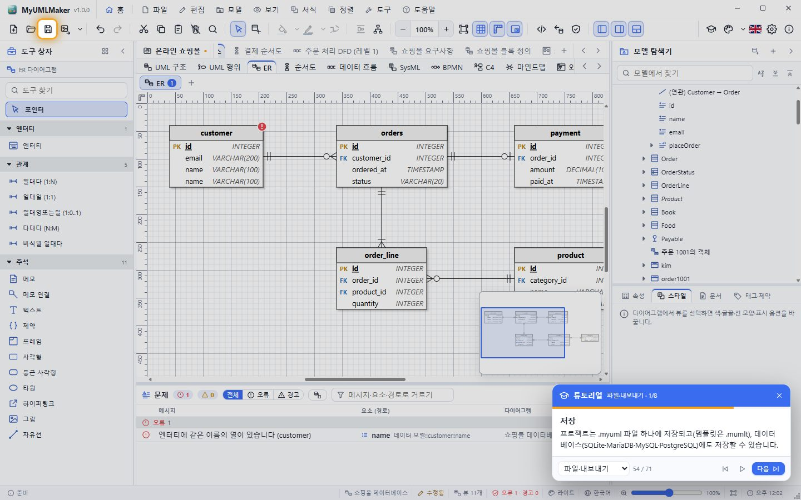

A project is saved as one `.myuml` file holding the model and all diagrams (in JSON). Files in the old `.muml` format still open; saving one asks for a `.myuml` file name.

| Command | What it does |
|---|---|
| **Save** (`Ctrl+S`) | Saves to the current file. New projects, templates and imported files ask for a file name |
| **Save as…** (`Ctrl+Shift+S`) | Saves under a new file name |
| **Save as template…** | Saves as a `.mumlt` template |

`Ctrl+Alt+S` (**Save all**) still works; with one project open it saves the project when it is modified.

With **Settings › Diagram › Auto save (saved files)** set to 1, 5, 10 or 30 minutes, files that have been saved once are saved again at that interval (desktop app). With **Settings › General › Reopen last files when starting** on, the files that were open are opened again on the next start. When a database is set up, saving also writes to the database (see [Database storage](#database-storage)).

### The File menu


### Opening

**Open…** (`Ctrl+O`) opens `.myuml` (project, the old `.muml` too), `.mumlt` (template), `.mdj` (StarUML project) and `.xmi` · `.xml` · `.uml` (XMI 2.x, see [Exchanging XMI](#exchanging-xmi)) files. Only one project is open at a time, so the opened file replaces the current project. When the current project has unsaved changes, the **Unsaved changes** window asks first: **Save** · **Don't save** · **Cancel**. When several files are picked, only the first one opens. Opening the file that is open now says "{name} is already open." Recent files, drag and drop and opening from the database replace the current project in the same way. Opening a template makes a new project with its contents (the template itself stays as it is), and opening a StarUML or XMI file makes an imported project that asks for a `.myuml` name when saved.

The installed desktop app is associated with `.myuml` and `.mumlt` files, so double-clicking them in Explorer or the Finder opens them at once. After installation `.myuml` files show their own MyUMLMaker project document icon labelled "MYUML".

### Templates

**File › Save as template…** saves the current project as `.mumlt`. Opening a template always makes a new, unnamed project, so it is a good starting point for new work holding the package structure, stereotypes and example diagrams you use often. A project made from a template shows a template icon next to its name at the start of the diagram tab row.

### Exchanging with StarUML


- **File › Import › Open StarUML project (.mdj)…** (or **Open…**) opens the model and diagrams of a StarUML project as they are. MyUMLMaker's model uses the same element kinds and field names as StarUML, so the model carries over unchanged, and the diagram views are converted.
- **File › Export › StarUML project (.mdj)…** writes the current project as an `.mdj` that StarUML can open (without baselines).

### Exchanging XMI


XMI 2.x (OMG UML 2.5 XMI) exchanges models with tools such as Enterprise Architect, MagicDraw (Cameo) and Papyrus.

- **File › Import › Open XMI (Enterprise Architect, MagicDraw, Papyrus)…** — opens an `.xmi` · `.xml` · `.uml` file as an imported project (replacing the current one). **Open…** and drag and drop open them too. Enterprise Architect 2.1 / 2.5 exports are read with their diagrams and element positions, tagged values and notes; MagicDraw and Papyrus files use their diagram information (UML DI or GMF) when they have it. Without any diagram information a class diagram is made per package and laid out automatically.
- What cannot be read is skipped; after opening, a message such as "Imported … with N warning(s). First: …" gives the number of warnings and the first one. XMI import never stops with an error.
- **File › Export › XMI 2.5 for Enterprise Architect (.xmi, with diagrams)…** — writes the model plus the diagrams and element positions in Enterprise Architect's extension, so EA shows them as drawn after importing.
- **File › Export › XMI 2.5, model only (.xmi)…** — writes standard XMI with the model only, no diagrams (MagicDraw, Papyrus and others).

What is exchanged: packages, models and profiles; classes, interfaces, data types, enumerations, signals, components, nodes, artifacts, actors and use cases with their attributes, operations, parameters and literals; generalizations, interface realizations, associations (with their ends), dependencies of every kind, include, extend and profile extensions; state machines, activities and interactions; instances; comments and documentation; stereotype applications. Non-UML notations such as ER, BPMN and C4 are not written to XMI.

### Model fragments

A model fragment (`.mfj`) is a file holding one element (for example one package and everything in it); it can also be exchanged with StarUML.

- **File › Export › Export model fragment (.mfj)…** or right-click › **Export model fragment (.mfj)…** in the Model Explorer — saves the selected element as a fragment.
- **File › Import › Import model fragment (.mfj)…** — puts a fragment inside the element selected in the Model Explorer (the first model if it cannot go there). Opening or dropping an `.mfj` file works too.

### Exporting pictures


**File › Export › Export as picture…** (the export button on the toolbar) opens the **Export as image** window. The last settings are remembered.

| Item | Choices |
|---|---|
| **File format** | PNG · JPEG · WebP · BMP · TIFF · SVG |
| **Background** | Transparent · White (JPEG has no transparency, so it gets white). White exports the diagram's own background too ([Diagram background](#diagram-background)) |
| **Area** | Whole diagram · Selected views |
| **Scale** | 1× · 2× · 3× (SVG is a vector format and stays sharp at any scale) |
| **Quality** | The compression quality of JPEG and WebP (40–100%) |
| **Image size** | The pixel size of the picture to be made |

A transparent background lets you lay the picture straight over documents and slides. Also:

- **Export SVG (current diagram)…** — saves the current diagram (only the selected views, if any are selected) as SVG at once.
- **All diagrams as pictures (.zip)…** — makes every diagram of the project a 2× PNG and saves them numbered in one ZIP.
- **Export PDF (all diagrams)…** — saves a PDF with every diagram laid out by the print settings (paper, orientation, margins, header and footer).

Exports and printing use the **Diagram colours** and the default line style as they are.

### Exporting documentation


- **HTML documentation (.html)…** — makes a single searchable HTML page. On the left is a tree of the model; on the right each element has its kind, qualified name, documentation, properties, members, relationships and the diagrams it shows on, and every diagram is embedded as SVG. A search box filters elements and diagrams, and light or dark colours follow the system setting. Being one file, it can be mailed or put on the web as it is.
- **Markdown documentation (.zip)…** — saves one Markdown document and the diagram SVG pictures (the `images/` folder) in one ZIP.

The titles and headings of the documents are made in the current language (Korean or English). The descriptions written on the **Documentation** tab of the editors go into the documents, and so does a requirements table when the project has requirements. For Word and PDF documents with a cover and contents made from a template, use **Tools › Generate document…** (see [Generating documents](#generating-documents)).

### Recent files and folders

The last 10 files and 10 folders are remembered.

- **File › Recent files…** (`Ctrl+R`) — the **Recent files and folders** window. The file and folder lists have **Open** (**Open from this folder**), a bin button (**Remove from the list**), and **Clear all** · **Clear all folders**.
- **File › Recent folders** — picking a folder opens the Open window in that folder.
- **File › Clear all recent files and folders** — clears both lists at once.
- Trying to open a file that is gone shows the **File not found** window: choose **Keep** or **Remove from the list**. In **Settings › Recent**, files that are gone are marked **Missing**.

### Drag and drop

Dragging a file onto the window shows the "Drop here to open" hint, and the dropped file is handled by its kind.

| Dropped | What happens |
|---|---|
| `.myuml` · `.muml` · `.mumlt` · `.mdj` · `.xmi` · `.xml` · `.uml` | Opens as a project (replacing the current one) |
| `.mfj` | Imports the model fragment |
| `.mmd` · `.mermaid` · `.puml` · `.plantuml` · `.pu` | Opens the Mermaid / PlantUML import window with its contents |
| Java · C# · C++ · Python · TypeScript · SQL sources | Reverse engineers them |
| A picture file (PNG · JPEG · GIF · WebP · BMP · SVG and others) | Becomes the program background image |

In the web version, dropping Mermaid or PlantUML text also opens the import window.

### Printing and print preview


**File › Print…** (`Ctrl+P`) opens the **Print preview** window. Changing a setting on the left updates the preview on the right at once, and ‹ › at the bottom turn the pages. The settings are remembered for the next print and for PDF export.

| Tab | Items |
|---|---|
| **What to print** | **All pages** (all diagrams) · **Current page** (the current diagram) · **Page range** (the **First diagram**–**Last diagram** numbers), **To print** (N diagrams · N sheets) |
| **Paper** | **Paper** (A3 · A4 · A5 · B4 · B5 · Letter · Legal · Tabloid) · **Orientation** (Portrait · Landscape) · **Margins** (None · Narrow · Normal · Wide) · **Size** (Fit to sheet · Actual size · Percent) · **Scale** (10–400%) · **Center on the sheet** · **Print the diagram background** |
| **Header and footer** | **Header** and **Header text** (the project name when empty) · **Footer** and **Footer text** |

Printed at **Actual size** or a large scale, a big diagram is split over several sheets. **Print** opens the system print dialog.

## Database storage

The desktop app can save projects to a database as well as to files. A web browser cannot connect to a database server or an SQLite file directly, so the web version does not have this.

### Connection settings

Choose the **Database type** on the **Settings › Database** tab: **None** · SQLite · MariaDB · MySQL · PostgreSQL.

| Database type | What to enter |
|---|---|
| SQLite | The **SQLite file** (for example `C:\Data\myumlmaker.db`). Pick it with **Browse…** or give a new file name |
| MariaDB · MySQL · PostgreSQL | **Server (host)**, **Port** (3306 for MariaDB and MySQL, 5432 for PostgreSQL by default), **Database name** (letters, digits, `_`, `$` and `-` only), **User**, **Password** |

- With **Save the password in the settings** off, the password is not stored but only remembered until the program closes.
- **Test connection** tries to connect and shows "Connected — (server version)" or the error.
- The table that holds the projects is made automatically on the first save.

### Saving and opening

- With a database set up, **Save** (`Ctrl+S`) writes to the file and the database together and says "Saved {name} — to the file and to the database". The tip of the toolbar's save button also shows where it saves.
- **File › Save to database** saves to the database only. New projects without a file can be saved this way too.
- **File › Open from database…** lists the stored projects (name · time saved · size). **Open** opens one (it replaces the current project, asking first when that has unsaved changes), the bin button (**Delete from database**) deletes one (this cannot be undone), and **Refresh** reads the list again.
- When the connection is not set up yet, the settings window opens with the hint "Set up the connection in Settings › Database first".

## Customizing and settings

### Themes


The theme button at the right of the toolbar picks a different random theme on every click. The ▾ next to it (**Choose theme**) shows 20 dark and 20 light themes in two rows, with **System setting** (follow the light or dark mode of the operating system) and **Custom** at the top. **Edit custom theme…** at the bottom opens the Theme tab of the settings.

In **Settings › Theme** you pick from the dark · light · custom groups. A custom theme lets you change the background · surface · panel · text · dim text · border · accent · text on accent · striped rows · chart background · toolbar · status bar colours one by one, and the **Dark theme** switch says whether it is a dark one. **Copy the current theme's colors** starts from the current theme, and when the contrast is so low that text is hard to read it warns "Text may be hard to read". **Use the custom theme** applies it. The window title bar follows the brightness of the theme too.

### Diagram colours


In **View › Diagram colours** or **Settings › Diagram › Diagram colours** pick the colours of the whole diagram: **Classic (white)** · **Pastel** · **Blueprint** · **Dark**. They are set apart from the program theme, and the same colours are used for picture, SVG and PDF export, printing and presentations. Colours given to a view (its style) win over the diagram colours.

### Language


The flag button on the toolbar (`Ctrl+Shift+L`) switches between Korean and English. In Korean it shows the British flag, in English the Korean flag. **Settings › General › Language** changes it too. Menus, windows, error messages, the default names of new elements and the headings of exported documents follow the language. The names of elements already made do not change.

### Fonts

In **Settings › Font** set the **Font** (from the fonts installed on the system), **Size** (9–28px), **Weight**, **Style** (Normal · Italic), **Row height** and **Zoom** (50–200%) of the program screen (tables, lists, menus). The font inside diagrams is set separately with **Diagram font** and **Diagram font size** (9–24px) in **Settings › Diagram**.

### Start page and moving background

**Settings › Start page**:

- **Show the start page at start-up**
- **Show recent files** · **Recent files shown** (1–10) · **Show recent folders** · **Show sample projects** · **Show the moving background picker** · **Show the tutorial banner**
- **Start page › Open now** opens the start page at once.

**Settings › Background**:

| Item | Contents |
|---|---|
| **Background** | Moving · Image · None |
| **Moving background** | Aurora · Waves · Particles · Constellation · Bubbles · Flowing grid · Flowchart · Star field · Rain · Snow · Fireflies · Ripples · Code rain · Hexagons · Orbits · Lava lamp · Spiral galaxy · Confetti · Node network · Ribbons, and **Change moving background** |
| **Motion speed** | 0–300% |
| **Random background at start** · **Start page background changes** | A different background on every start, and changing it on the start page at the chosen interval |
| **Moving background on the start page only** | When on, no moving background is drawn behind the work area |
| **Background image** | **Choose…** · **Remove**. Images of any size can be used, and dropping a picture file on the window also makes it the background |
| **Background opacity (behind views)** | How strong the background behind the work area is (0–100%) |
| **Fit** | Fill · Fit · Tile · Center · Stretch |

`Ctrl+Shift+B` (**Change moving background**) switches to another background at any time. **View › Theme, language and background › Turn background off** turns the background off.

### Panels


**View › Show** shows or hides the **Toolbox** (`Ctrl+Shift+1`) · **Model Explorer & editors** (`Ctrl+Shift+2`) · **Problems panel** (`Ctrl+J`) · **Status bar**. The panel widths, the height shared by the Model Explorer and the editors, **Icons only** in the toolbox and **Sort by name** in the Model Explorer are remembered for the next start. Right-clicking a panel, the toolbar or the menu bar also shows the panel menu.

### The Settings window


**Settings…** (`Ctrl+,`, the gear on the toolbar) has these tabs. Changes apply and are saved at once. **Defaults** puts every setting back to the start, and **Done** closes the window.

| Tab | Contents |
|---|---|
| **General** | Language · Reopen last files when starting · Ask before deleting elements from the model · Clock on the status bar · Status bar · Last folder used · Start tutorial |
| **Start page** | See [Start page and moving background](#start-page-and-moving-background) above |
| **Theme** | Dark · light · custom themes, System setting |
| **Font** | Program font, size, weight, style, row height and zoom, with a preview |
| **Background** | The moving background and the background image |
| **Diagram** | The table below |
| **Database** | See [Database storage](#database-storage) |
| **Recent** | The recent files and recent folders lists, removing one or all |
| **Shortcuts** | The list of all shortcuts |

The **Settings › Diagram** tab:

| Item | Contents |
|---|---|
| **Diagram colours** | Classic (white) · Pastel · Blueprint · Dark |
| **Default line style** | Rectilinear · Oblique · Rounded rectilinear · Curve |
| **Diagram font** · **Diagram font size** | The default font of diagrams (the default when empty) and its size |
| **Grid** · **Grid size** | Show the grid, spacing 5 · 10 · 15 · 20 · 25 · 40px (a cell at 100 %). It zooms with the diagram and is redrawn 5× finer or coarser past a threshold; every 5th line is darker (see [Zoom and pan](#zoom-and-pan)) |
| **Rulers** | Show the rulers along the top and left edges of the diagram |
| **Snap to grid** | Snap to the grid when moving and creating |
| **Pan & zoom window** | Show the minimap |
| **Show shadows** | Shadows of element views |
| **Quick edit buttons** | The quick buttons under the selected element |
| **Dropping into a package moves the element in the model** | A drop into a container changes the owner in the model |
| **Problems panel** | Shows the background check under the diagram ([Problems panel](#problems-panel)) |
| **Validate the model after each edit (counts in the status bar while the Problems panel is closed)** | Keeps the validation counts on the status bar up to date even with the Problems panel closed (with it open the model is always checked) |
| **Auto save (saved files)** | Off · 1 min · 5 min · 10 min · 30 min |

## Keyboard shortcuts


The **Settings › Shortcuts** tab (or **Help › Keyboard shortcuts…**) has the same list, and the menus show the shortcuts next to their commands. On macOS use `Cmd` instead of `Ctrl`.

| Shortcut | Command | Notes |
|---|---|---|
| `Ctrl+N` | New project | |
| `Ctrl+O` | Open | .myuml · .mumlt · .mdj. Replaces the current project |
| `Ctrl+S` | Save | Also saves to the database when one is set up |
| `Ctrl+Shift+S` | Save as | |
| `Ctrl+Alt+S` | Save all | Not in the menus |
| `Ctrl+W` | Close project | Back to the start page |
| `Ctrl+P` | Print | The Print preview window |
| `Ctrl+R` | Recent files | The Recent files and folders window |
| `Ctrl+Z` | Undo | |
| `Ctrl+Y` | Redo | `Ctrl+Shift+Z` works too |
| `Ctrl+X` | Cut | |
| `Ctrl+C` | Copy | |
| `Ctrl+V` | Paste | |
| `Ctrl+D` | Duplicate | |
| `Delete` | Delete from diagram | `Backspace` works too. The element stays in the model |
| `Ctrl+Delete` | Delete from model | Removes its views on every diagram too |
| `Ctrl+A` | Select all | |
| `Esc` | Clear selection | Back to the pointer while a tool is chosen |
| `Ctrl+F` | Find | The Find in model window |
| `Ctrl+E` | Select in Model Explorer | |
| `F2 / Enter` | Edit name | Quick edit for classes |
| `Double-click` | Quick edit (name, attributes, operations) | On an empty spot: Add here |
| `Ctrl+Enter` | Apply quick edit | `Esc` cancels |
| `Tab / Insert / Shift+Enter` | Add subtopic | With a mind map topic selected |
| `Enter` | Add topic (same level) | With a mind map topic selected. On the central topic, a main topic |
| `Ctrl+.` | Collapse / expand branch | The selected mind map topic |
| `Ctrl+1` | Pointer | |
| `Shift+create` | Keep the tool | Double-clicking the tool works too |
| `Ctrl+B / I` | Bold / Italic | |
| `Ctrl+Shift+> / <` | Increase font size / Decrease font size | |
| `Ctrl+Shift+F / K` | Bring to front / Send to back | |
| `Ctrl+Up / Down` | Move up in model / Move down in model | Order within the same parent |
| `Arrow keys` | Nudge by the grid (Shift: 1 pixel) | One visible grid cell (with a 10px grid: 10 from 50% to 240%, 2 above 250%, 50 below 50%) |
| `Shift+drag` | Move straight, resize keeping proportions, rotate in 15° steps | On a diagram, dragging moves only horizontally or vertically |
| `Alt+drag` | Drag without snapping | Does not snap to the grid |
| `Ctrl+= / Ctrl+-` | Zoom in / Zoom out | |
| `Ctrl+0` | Zoom 100% | |
| `Ctrl+Shift+W` | Fit diagram | |
| `Ctrl+wheel` | Zoom in / Zoom out | Around the pointer. Outside the diagram, the whole screen |
| `Space+drag / middle button` | Pan | |
| `Ctrl+PageUp / PageDown` | Previous diagram / Next diagram | Between the diagram tabs |
| `Ctrl+Shift+G` | Generate code | |
| `Ctrl+Shift+R` | Reverse engineer (code → model) | |
| `Ctrl+Shift+V` | Validate model | |
| `F5` | Presentation mode | |
| `Ctrl+Tab` | Next diagram tab | `Ctrl+Shift+Tab` goes to the previous diagram tab |
| `Ctrl+Shift+1 / 2` | Toolbox / Model Explorer & editors | Show or hide the panels |
| `Ctrl+J` | Problems panel | Show or hide the problem list under the diagram |
| `Ctrl+Shift+L` | Switch language | |
| `Ctrl+Shift+B` | Change moving background | |
| `Ctrl+Shift+H` | Start page | |
| `Ctrl+,` | Settings | |
| `F11` | Tutorial | |
| `F1` | About | |

Also, `Alt+F4` (`Cmd+Q` on macOS; `Ctrl+Q` works too) is **Exit**. In the Model Explorer the arrow keys, `F2`, `Enter` and `Delete` act on the tree (see [Model Explorer](#model-explorer)).

In presentation mode these keys work:

| Key | Action |
|---|---|
| `→` · `↓` · `PageDown` · `Space` · `Enter`, clicking the screen | Next diagram (ends the show on the last one) |
| `←` · `↑` · `PageUp` · `Backspace` | Previous diagram |
| `Home` · `End` | First · last diagram |
| `Esc` | Exit |

## Help and troubleshooting

### Presentation mode


**View › Presentation mode** (`F5`) shows the diagrams that have views one after another in full screen. It starts at the current diagram, and the bar at the bottom shows the diagram name, its place such as "3 / 11", and the **Previous diagram** · **Next diagram** · **Exit (Esc)** buttons. When it ends, the last diagram shown is opened. The diagram colours are used as they are.

### The Help menu

| Command | What it does |
|---|---|
| **Tutorial** (`F11`) | Starts the 71 steps tutorial (see [Tutorial](#tutorial)) |
| **Tutorial document** | Opens a document of every tutorial step with its picture in its own window ([Document windows](#document-windows)) |
| **Tutorial video** | Plays a recording of the whole tutorial in its own window ([Tutorial video](#tutorial-video)) |
| **User's guide** | Opens this guide in its own window; **Open in browser** there opens it in the default web browser |
| **Keyboard shortcuts…** | Opens the Shortcuts tab of the settings window |
| **About…** (`F1`) | Version and build information |

### About


The **About** window (ⓘ on the toolbar) shows the program name and version, a description of the features, and the **Build** information (version · build date · commit · target · profile · runtime · platform · author). **Copy** copies it all, to paste when reporting a problem. The author is SHKWON (knix008@naver.com).

### The error window

When something goes wrong, the **Error** window opens. It has the message, the **Time**, **Where** (what was being done) and the **Details**, and the **Copy details** button copies it all to report or keep.

| Error title | Common causes |
|---|---|
| The file could not be opened | Not a MyUMLMaker file ("This is not a MyUMLMaker file (not JSON)."), a file made by a newer version of MyUMLMaker, not a StarUML project (.mdj) |
| Could not save · Could not export | A folder without write permission, another program holding the file, a picture format the system does not support (WebP and the like) |
| Could not import | Not a model fragment (.mfj), a kind of Mermaid or PlantUML diagram that cannot be imported, nothing to import |
| Could not generate code · Could not reverse engineer | No element to generate from, source that cannot be read (syntax errors and the like) |
| Could not save to the database · The database operation failed | Wrong server address, port, user or password, the database does not exist, the SQLite file cannot be written |
| Could not print | A problem with the printer or the print dialog |
| Background image error | A picture file that cannot be read |
| The document window could not be opened · The user's guide could not be opened | The `docs` folder of the installation was deleted |

### Serious errors and crash.log

When a serious error happens inside the program (the backend), the **Serious error (backend)** window shows the location, thread, backtrace and the **Log file** path. The same goes into `crash.log`.

| OS | Where crash.log is |
|---|---|
| Windows | `%APPDATA%\com.shkwon.myumlmaker\crash.log` |
| macOS | `~/Library/Application Support/com.shkwon.myumlmaker/crash.log` |
| Linux | `~/.local/share/com.shkwon.myumlmaker/crash.log` |

### Running several windows

You can run several MyUMLMaker desktop apps at once. Starting it again from the Start menu or a shortcut opens one more window, and each window holds its own project. Double-clicking a `.myuml` file in Explorer opens it in a new window even when MyUMLMaker is already open.

- A later window opens a little (32 px) further right and down so it does not cover the earlier one, and stays on the screen. It opens at normal size even when the earlier window is maximized.
- **Settings › General › Reopen last files when starting** applies only to the first window, opened while no other one runs. Later windows open on the start page (or with the file you double-clicked), and the files to reopen next time stay those of the first window.
- Settings, recent files and folders, the database connection and background pictures are shared by all windows; a change in one shows in the others at once.
- The window position and size of the window closed last are remembered.
- Closing a window or **File › Exit** ends only that window; the others stay open.
- If two windows edit the same project file, the later save overwrites the earlier one. Edit a file in one window only.

### Installing and reinstalling (Windows)

MyUMLMaker is installed only once on a computer. When the installer finds a previous installation (any version), it first asks before its first page, in the installer language (Korean or English) and showing the old installation folder: "Remove the earlier program completely and install again?"

| Choice | Result |
|---|---|
| **Yes** | The earlier program and its desktop and Start menu shortcuts are removed, then the new one is installed. The next question decides about the user data |
| **No** | Nothing is changed and the installation stops |

When there is a previous installation or user data from earlier use, it then asks: "Delete the user data from earlier use (settings, recent files and folders, the list of open projects, database connection, background pictures, tutorial history, window position)?"

| Choice | Result |
|---|---|
| **Yes** | All user data is deleted and the program starts like a fresh installation (`%APPDATA%\com.shkwon.myumlmaker`, `%LOCALAPPDATA%\com.shkwon.myumlmaker`) |
| **No** (default) | The user data is kept. At the first start after installing only the preferences (theme, fonts, zoom, panels, view options, window position and so on) go back to their defaults |
| **Cancel** | Nothing is changed and the installation stops |

Then, if MyUMLMaker windows are open, every one of them must be closed, so it asks: **OK** (close them and continue) or **Cancel** (stop installing). Unsaved changes are lost, so save before installing.

On the **Shortcuts** page of the installer you choose **Create a shortcut on the desktop** and **Create shortcuts in the Start menu (with the user's guide)**. Both are checked at first. Without the Start menu shortcut, the next page (choosing the Start menu folder) is skipped.

A silent installation (`/S`) does not ask: it removes the previous installation and keeps the user data. Your own project files (`.myuml`) are not user data and are never deleted.

### Unsaved changes

Only one project is open at a time, so you are asked before another project replaces the current one. With a modified project open, a new project · template · sample · **Open…** · recent file · drag and drop · open from database shows the **Unsaved changes** window: "(project name) has unsaved changes. Save them before opening another project?" with **Save** · **Don't save** · **Cancel**. **Cancel** keeps the current project. **Close project** (`Ctrl+W`) asks "(project name) has unsaved changes. Save them?" with the same three buttons, and closing the program with unsaved changes asks too. In the web version the browser warns when you try to close the page.

### Other problems

| Symptom | Fix |
|---|---|
| A deleted element is still in the Model Explorer | `Delete` deletes only from the diagram. To delete from the model use `Ctrl+Delete` (**Delete from model**) |
| Renaming changed another diagram too | They are views of the same element. To use it separately, make a new element with **Duplicate** |
| An element does not move or cannot be renamed | Check **Locked (cannot move)** on the Style tab |
| A drag does not stop where you want | Hold `Alt` while dragging, or turn **Snap to grid** off |
| Dropping on a package changed the place in the model | Turn off **Settings › Diagram › Dropping into a package moves the element in the model** |
| An attribute cannot be put outside a class | Attributes and operations must go inside an element that can own them. The quick buttons or quick edit are easier |
| It says the relationship cannot connect | That relationship is not allowed between those two kinds of element (for example an interface realization must go to an interface) |
| A line bends oddly | Remove the hand-made bend points with **Clear bend points**, or change the **Line style** |
| The diagram is not visible or too small | `Ctrl+Shift+W` (Fit diagram) or `Ctrl+0` (Zoom 100%) |
| The program screen is too big or too small | `Ctrl`+wheel outside the diagram, or **Settings › Font › Zoom** |
| The quick buttons do not show | Turn on **View › Show › Quick edit buttons** |
| A recent file does not open in the web version | Because of browser security, you may have to pick the file again with **Open** |
| The web version has no database or folder reverse engineering | These are available in the desktop app only |
| Back to the original settings | **Settings › Defaults** |

### The web version

The web version has the same screens and features, with a few differences. Files go in and out through the browser's open and save windows (saving back to the same file where the browser allows it), and the recent files are the files opened in the browser. Database storage, reverse engineering a whole folder, writing code straight to a folder (the web makes a ZIP) and auto save are desktop-only. Presentations use the browser's full screen.
