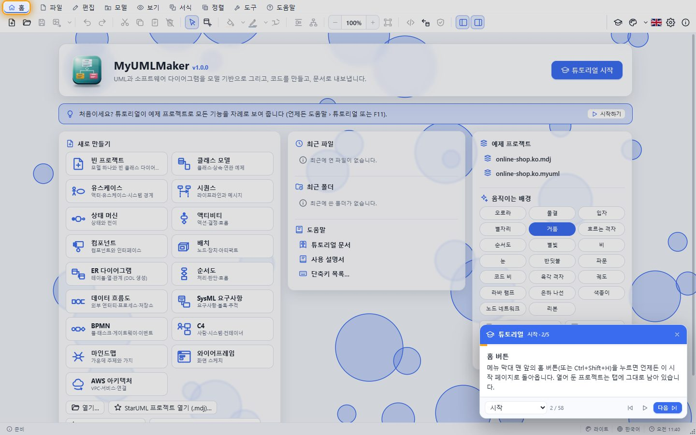
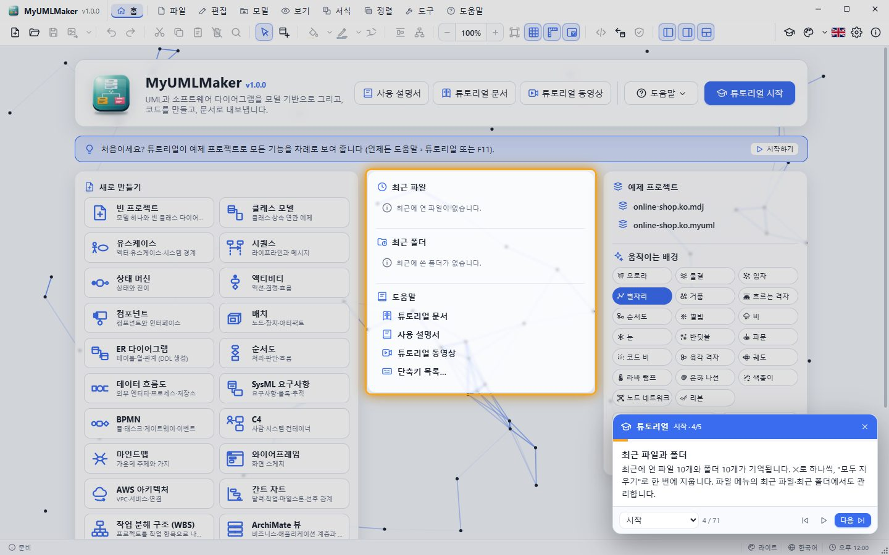
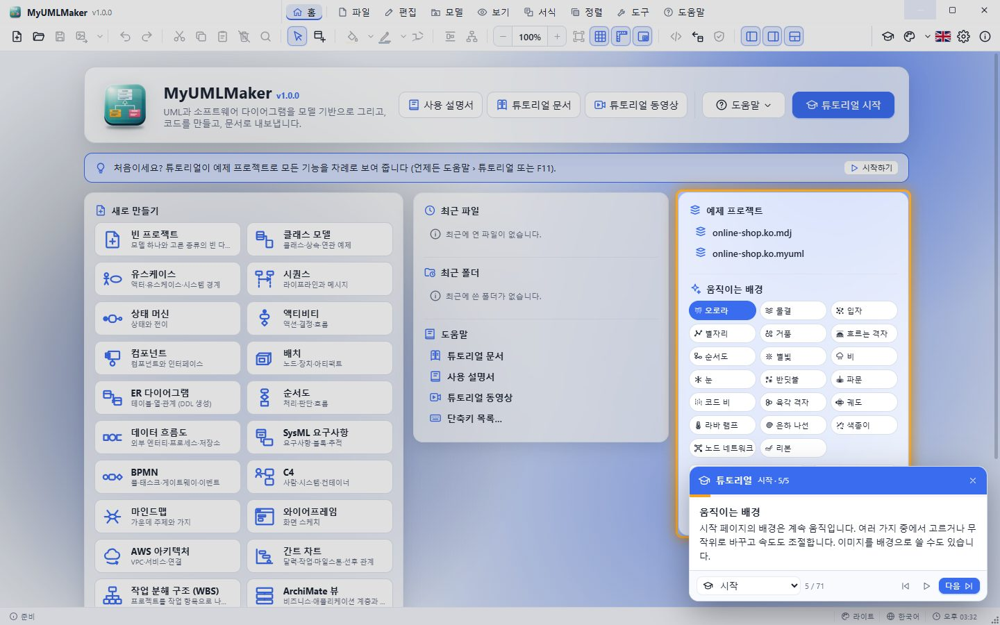
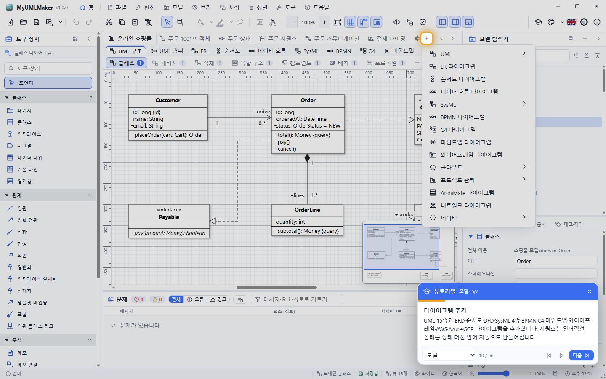
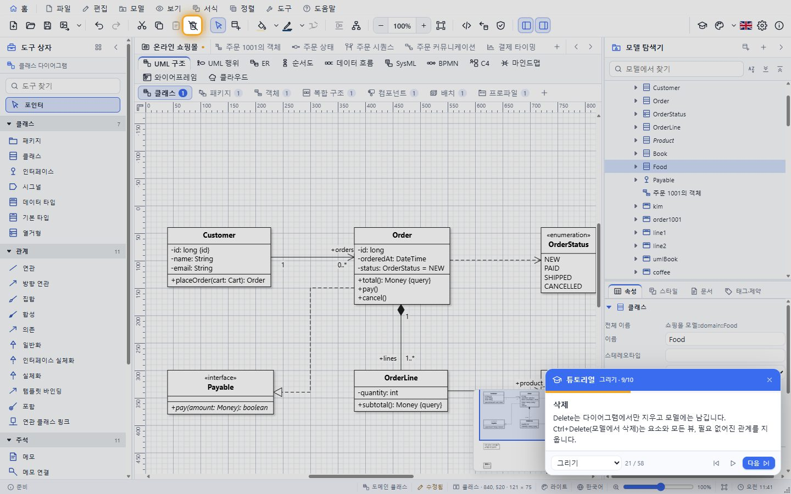
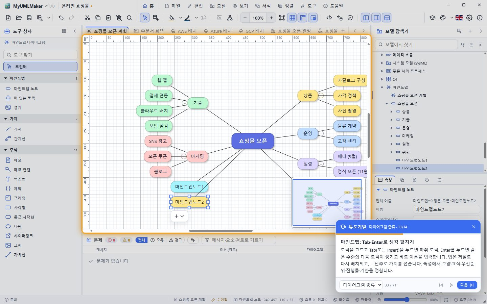
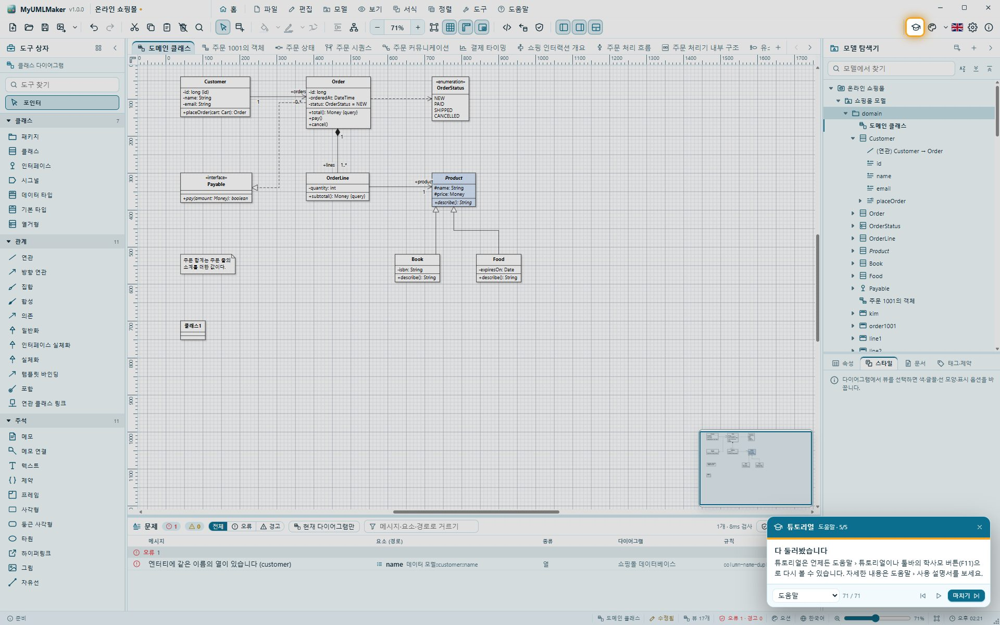

# MyUMLMaker 튜토리얼

이 문서는 앱 안의 **튜토리얼**과 같은 내용을 단계별 화면과 함께 보여 줍니다. 그림은 실제 앱에서 튜토리얼을 실행하며 찍은 것입니다 (`npm run tutorial:docs` 로 다시 만듭니다).

## 튜토리얼 실행하기

- **시작 페이지 › 튜토리얼 시작**, 툴바의 **튜토리얼** 버튼, **도움말 › 튜토리얼** 또는 **F11**을 누릅니다.
- 카드의 **다음 / 이전**으로 한 단계씩, **자동 재생**으로 끝까지 봅니다. 장 목록으로 원하는 장으로 바로 가고, **✕** 또는 **Esc**로 언제든 끝냅니다.
- 튜토리얼은 자기 예제 탭에서만 작업합니다. 열어 둔 계획은 바뀌지 않고, 바꾼 테마·언어·보기 설정은 끝날 때 원래대로 돌아갑니다.
- 전체 과정을 녹화한 동영상: **시작 화면 › 튜토리얼 동영상** 또는 **도움말 › 튜토리얼 동영상** 이 별도의 창에서 재생합니다 (장 표시·속도·전체 화면). 파일은 `docs/video/MyUMLMaker-Tutorial.mp4` 이며 `npm run tutorial:video` 로 만듭니다.

## 차례

1. [시작](#1-시작)
2. [모델](#2-모델)
3. [그리기](#3-그리기)
4. [다이어그램 종류](#4-다이어그램-종류)
5. [서식·정렬](#5-서식정렬)
6. [모델 도구](#6-모델-도구)
7. [파일·내보내기](#7-파일내보내기)
8. [꾸미기](#8-꾸미기)
9. [도움말](#9-도움말)

## 1. 시작

### 1. MyUMLMaker에 오신 것을 환영합니다

이 튜토리얼은 예제 프로젝트로 MyUMLMaker의 모든 기능을 차례로 보여 줍니다. 다음(또는 자동 재생)을 누르세요. 내 파일은 바뀌지 않고, 바꾼 설정은 끝날 때 원래대로 돌아갑니다.

### 2. 홈 버튼

메뉴 막대 맨 앞의 홈 버튼(또는 Ctrl+Shift+H)을 누르면 언제든 이 시작 페이지로 돌아옵니다. 열어 둔 프로젝트는 탭에 그대로 남아 있습니다.

### 3. 새 프로젝트 만들기

빈 프로젝트나 클래스·유스케이스·시퀀스·상태·액티비티·컴포넌트·배치·ER·순서도·데이터 흐름·SysML·BPMN·C4·마인드맵·와이어프레임·AWS 템플릿으로 시작합니다. StarUML 프로젝트(.mdj)를 열거나 소스 코드를 역공학할 수도 있습니다.

### 4. 최근 파일과 폴더

최근에 연 파일 10개와 폴더 10개가 기억됩니다. ✕로 하나씩, "모두 지우기"로 한 번에 지웁니다. 파일 메뉴의 최근 파일·최근 폴더에서도 관리합니다.

### 5. 움직이는 배경

시작 페이지의 배경은 계속 움직입니다. 여러 가지 중에서 고르거나 무작위로 바꾸고 속도도 조절합니다. 이미지를 배경으로 쓸 수도 있습니다.

## 2. 모델

### 6. 예제 프로젝트

온라인 쇼핑몰 예제를 열었습니다. 왼쪽은 도구 상자, 가운데는 다이어그램과 작업 중인 다이어그램 탭, 오른쪽 위는 모델 탐색기, 오른쪽 아래는 편집기(속성·스타일·문서·태그)입니다.

### 7. 모델 탐색기

프로젝트의 모든 요소가 트리로 나옵니다: 모델·패키지·클래스와 그 속성·오퍼레이션, 관계, 다이어그램. 끌어서 다른 패키지로 옮기고, F2로 이름을 바꾸고, 오른쪽 클릭으로 요소나 다이어그램을 추가합니다.

### 8. 모델과 뷰

다이어그램의 상자는 모델 요소의 "뷰"입니다. 같은 요소를 여러 다이어그램에 보여 줄 수 있고, 이름을 바꾸면 모든 곳이 바뀝니다. Delete는 다이어그램에서만, Ctrl+Delete는 모델에서 지웁니다.

### 9. 다이어그램 탭

프로젝트의 다이어그램마다 위쪽에 탭이 하나씩 있습니다. 탭을 누르거나 Ctrl+Tab, Ctrl+PageUp/PageDown으로 오가고, 탭이 많으면 ‹ ›로 밉니다. 탭을 두 번 누르면 이름을 바꿉니다. 프로젝트는 한 번에 하나만 열립니다.

### 10. 다이어그램 추가

UML 15종과 ERD·순서도·DFD·SysML 4종·BPMN·C4·마인드맵·와이어프레임·AWS·Azure·GCP 다이어그램을 추가합니다. 시퀀스는 인터랙션, 상태는 상태 머신 안에 자동으로 만들어집니다.

### 11. 다이어그램 고르기

위 줄에서 묶음(UML 구조·UML 행위·ER·SysML·BPMN …)을, 아래 줄에서 종류를 고릅니다. 그 종류의 다이어그램이 열리고(없으면 새로 만들고) 도구 상자에는 그 다이어그램에 필요한 도구만 나옵니다. 숫자는 그 종류의 다이어그램 수입니다.

### 12. 편집기

선택한 요소의 속성(가시성·타입·다중성·관계 끝 …), 뷰의 스타일, 문서, 태그와 제약을 편집합니다. 모든 변경은 실행 취소 한 단계입니다.

## 3. 그리기

### 13. 도구 상자

현재 다이어그램 종류에 맞는 도구가 나옵니다. 도구를 누른 뒤 다이어그램을 누르거나 끌어 요소를 만들고, 관계 도구는 한 요소에서 다른 요소로 끕니다. Shift를 누르면 도구가 유지됩니다.

### 14. 요소 만들기

클래스를 만들면 바로 이름을 쓸 수 있습니다. 도구를 다이어그램으로 끌어다 놓아도 되고, 빈 곳을 두 번 누르면 이 자리에 추가할 요소를 고르는 메뉴가 나옵니다.

### 15. 빠른 편집

클래스를 두 번 누르면 이름·속성·오퍼레이션을 글로 한 번에 고칩니다. "+name: String = 1", "+getName(): String {query}"처럼 UML 표기를 그대로 쓰면 가시성·타입·기본값·매개변수가 채워집니다.

### 16. 빠른 단추

선택한 요소 아래의 단추로 속성·오퍼레이션·리터럴·열을 더하고, 관련 요소(하위 클래스·연관 클래스·인터페이스 …)를 관계와 함께 바로 만듭니다.

### 17. 관계

연관·방향 연관·집합·합성·의존·일반화·인터페이스 실체화 …. 선을 선택하면 끝점을 다른 요소로 옮기고, 중간 점을 끌어 꺾고, 꺾임점을 두 번 눌러 지웁니다.

### 18. 관련 요소 추가

상위·하위 클래스, 연관·합성 클래스, 실체화하는 인터페이스, 포함 유스케이스, 다음 상태, 다음 액션 등을 한 번에 만듭니다.

### 19. 옮기기와 크기

끌어서 옮기고 모서리로 크기를 바꿉니다. 격자에 맞춰지고(Alt로 끔), 패키지 같은 컨테이너는 안의 요소와 함께 움직입니다. 요소를 패키지 안에 놓으면 모델에서도 그 패키지로 옮겨집니다.

### 20. 탐색기에서 끌어 놓기

모델 탐색기의 요소를 다이어그램에 끌어다 놓으면 그 요소의 뷰가 생기고, 이미 있는 요소와의 관계도 함께 보입니다. 시퀀스 다이어그램에 클래스를 놓으면 라이프라인이 됩니다.

### 21. 삭제

Delete는 다이어그램에서만 지우고 모델에는 남깁니다. Ctrl+Delete(모델에서 삭제)는 요소와 모든 뷰, 필요 없어진 관계를 지웁니다.

### 22. 실행 취소·다시 실행

모든 편집은 실행 취소(Ctrl+Z)와 다시 실행(Ctrl+Y)으로 되돌립니다.

## 4. 다이어그램 종류

### 23. 유스케이스 다이어그램

액터·유스케이스·시스템 경계와 연관·포함(«include»)·확장(«extend»)·일반화.

### 24. 시퀀스 다이어그램

라이프라인 사이에 동기·비동기·응답·생성·삭제 메시지를 그리면 번호와 활성 막대가 자동으로 붙습니다. 메시지를 위아래로 끌어 순서를 바꿉니다.

### 25. 결합 프래그먼트

alt·opt·loop·par·break·critical 등 12가지 프래그먼트, 인터랙션 사용(ref), 상태 불변, 연속, 끝점과 게이트가 있습니다.

### 26. 상태 머신 다이어그램

상태(진입·do·탈출 활동), 복합 상태, 시작·종료·선택·접합·분기·합류·이력 의사 상태, "트리거 [가드] / 효과" 전이.

### 27. 액티비티 다이어그램

액션·시그널·시간 이벤트, 결정·병합·분기·합류, 오브젝트 노드와 핀, 수영 레인(파티션)과 구조적·확장·중단 가능 영역.

### 28. 컴포넌트 다이어그램

컴포넌트·인터페이스(롤리팝 아이콘)·포트·아티팩트와 제공/필요 인터페이스, 조립·위임 커넥터.

### 29. 배치 다이어그램

노드·장치·실행 환경 안에 아티팩트를 배치하고 통신 경로로 잇습니다.

### 30. ER 다이어그램

엔터티와 열(PK·FK·타입·길이), 까마귀발 표기의 관계. 도구 › SQL DDL 생성으로 MySQL·PostgreSQL·SQLite·SQL Server·Oracle 스크립트를 만듭니다.

### 31. 그 밖의 다이어그램

순서도·데이터 흐름·SysML·BPMN·C4·마인드맵·와이어프레임·AWS/Azure/GCP 클라우드 다이어그램도 같은 방식으로 그립니다.

### 32. 간트·WBS·ArchiMate·네트워크·데이터

프로젝트 일정(간트 차트·WBS·타임라인), ArchiMate 3 전사 아키텍처, 네트워크, JSON·YAML 데이터, EBNF·정규식 철도 다이어그램도 그립니다. 모두 PlantUML로 가져오고 내보낼 수 있습니다.

### 33. 마인드맵: Tab·Enter로 생각 펼치기

토픽을 고르고 Tab(또는 Insert)을 누르면 하위 토픽, Enter를 누르면 같은 수준의 다음 토픽이 생기고 바로 이름을 입력합니다. 맵은 저절로 다시 배치되고, − 단추로 가지를 접습니다. 속성에서 모양·표식·우선순위·진행률·기한을 정합니다.

### 34. 마인드맵 개요

오른쪽 패널의 개요 탭에 토픽이 목록으로 보입니다. 줄을 누르면 그 토픽으로 가고, 텍스트·Markdown으로 복사하며, 들여쓴 글을 붙여 넣으면 선택한 토픽 아래에 하위 토픽이 한꺼번에 생깁니다.

### 35. 사용자 스토리 맵

위에 사용자 활동과 단계를, 아래에 사용자 스토리 카드를 늘어놓고 릴리스 띠로 묶습니다. 카드에는 우선순위(MoSCoW)·스토리 포인트·상태가 표시되고, 스토리 사이의 의존을 화살표로 잇습니다.

### 36. 고객 여정 지도

페르소나와 여정 단계(열), 고객 행동·터치포인트·감정·고통 지점·기회(행)를 한눈에 그립니다. 감정 점을 감정 곡선으로 이어 경험의 높낮이를 보여 줍니다.

## 5. 서식·정렬

### 37. 스타일

채우기·선·글자 색, 글꼴, 선 두께와 모양, 스테레오타입 표시, 속성·오퍼레이션 숨기기, 가시성·서명 표시, 그림자, 자동 크기를 뷰마다 정합니다.

### 38. 색

툴바의 채우기 색·선 색 단추로 선택한 뷰의 색을 바꿉니다. 왼쪽 반은 마지막 색을 바로 칠합니다.

### 39. 다이어그램 배경

서식 › 다이어그램 배경… 에서 다이어그램마다 배경을 정합니다: 색, 그림(채우기·맞춤·바둑판·가운데·늘이기), 무늬 10가지와 무늬 색·크기, 그리고 각각의 불투명도. 미리 보기를 보며 고르고, 확인은 실행 취소 한 단계입니다. 선택이 없을 때 편집기 패널의 배경 항목에서도 바꿀 수 있습니다.

### 40. 선 모양

직각·직선·둥근 직각·곡선 중에서 고릅니다. 새 선의 기본 모양은 보기 메뉴나 설정에서 정합니다.

### 41. 맞춤과 분배

여러 뷰를 왼쪽·가운데·오른쪽·위·중간·아래로 맞추고, 간격을 균등하게 분배하고, 같은 크기로 만듭니다.

### 42. 자동 레이아웃

계층형 레이아웃으로 요소를 위→아래, 왼쪽→오른쪽 등 네 방향으로 다시 배치합니다. 상속은 부모가 위로 갑니다. 시퀀스 다이어그램은 라이프라인과 메시지 간격을 고릅니다.

### 43. 확대와 이동

Ctrl+휠로 확대하고, 가운데 단추나 Space+끌기로 이동합니다. 위와 왼쪽의 눈금자가 위치를 보여 주고, 격자는 5칸마다 진한 선으로 나뉩니다(5×5). 오른쪽 아래의 미니맵으로 큰 다이어그램을 둘러봅니다.

## 6. 모델 도구

### 44. 모델 검증

이름 누락·중복, 상속 순환, 잘못된 다중성, 시작 상태 없는 영역, 기본 키 없는 엔터티 등 20여 규칙으로 모델을 검사합니다. 결과를 누르면 그 요소로 갑니다.

### 45. BPMN 프로세스 시뮬레이션

도구 › BPMN 프로세스 시뮬레이션은 토큰이 시퀀스 흐름을 따라 움직이는 모습을 보여 줍니다. 재생·한 단계·속도를 고르고, 100회 분석으로 교착·끝나지 않는 반복·도달하지 않는 요소를 찾습니다.

### 46. 문제 패널

캔버스 아래 문제 패널은 편집할 때마다 UML·ERD 모델을 뒤에서 검증해 오류·경고를 보여 줍니다 (여기서는 customer 테이블에 같은 이름의 열이 하나 더 생겼습니다). 줄을 누르면 그 요소의 다이어그램이 열리고 뷰가 선택되며, 캔버스에는 ! 표시가 붙습니다. Ctrl+J·툴바 단추·× 로 켜고 끕니다.

### 47. 찾기

이름·문서·종류로 모델 전체에서 요소를 찾고, 결과를 눌러 그 요소와 다이어그램으로 갑니다.

### 48. 코드 생성

Java·C#·C++·Python·TypeScript·Kotlin·PHP와 SQL DDL을 미리 보고 폴더나 ZIP으로 만듭니다. 패키지는 폴더·네임스페이스가 되고, 상속·구현·연관·문서 주석이 들어갑니다.

### 49. 요구사항 목록

요구사항마다 ID·종류·상태·우선순위·위험·검증 방법을 관리합니다. 목록에서 정렬·거르기·상태 바꾸기를 하고, 만족·검증·파생 관계 수를 보며, CSV로 내보냅니다.

### 50. 추적 매트릭스

행과 열의 요소 종류·패키지와 관계 종류를 고르면 관계가 격자로 보입니다. 칸을 누르면 관계를 만들거나 지우고(실행 취소 가능), 관계 없는 행은 표시됩니다.

### 51. 기준선과 비교

지금 모델의 스냅샷(기준선)을 프로젝트 안에 저장해 두고, 나중에 현재 모델과 비교합니다. 추가·삭제·변경된 요소를 보고 기준선에서 되돌릴 수 있습니다. 다른 파일과도 비교합니다.

### 52. 역공학

Java·C#·Python·TypeScript 소스나 SQL CREATE TABLE을 읽어 클래스·속성·오퍼레이션·관계(또는 엔터티)를 만들고 다이어그램을 그려 줍니다. 폴더 전체나 끌어 놓은 파일도 됩니다.

### 53. Mermaid·PlantUML 가져오기

Mermaid(클래스·시퀀스·순서도·ER·상태)와 PlantUML(모든 UML 다이어그램·ER·마인드맵) 텍스트를 모델과 다이어그램으로 가져옵니다. 다이어그램은 Mermaid·PlantUML로 내보낼 수도 있습니다.

## 7. 파일·내보내기

### 54. 저장

프로젝트는 .myuml 파일 하나에 저장되고(템플릿은 .mumlt), 데이터베이스(SQLite·MariaDB·MySQL·PostgreSQL)에도 저장할 수 있습니다.

### 55. 파일 메뉴

열기·저장·템플릿, 최근 파일·폴더, 가져오기(StarUML·모델 조각·Mermaid/PlantUML·역공학)와 내보내기, 인쇄, 데이터베이스가 있습니다.

### 56. 그림으로 내보내기

현재 다이어그램이나 선택한 뷰를 PNG·JPEG·WebP·BMP·TIFF·SVG로, 배율과 투명 배경을 골라 내보냅니다.

### 57. 문서와 다른 형식

모든 다이어그램 PDF, 그림 ZIP, 검색 가능한 HTML 문서, Markdown 문서, StarUML .mdj, 모델 조각, Mermaid, PlantUML로 내보냅니다.

### 58. 문서 생성

템플릿(전체 모델·요구사항 명세·설계·유스케이스 명세·데이터 사전)으로 표지·목차·다이어그램 그림·요소 상세를 담은 Word(.docx)·PDF·HTML 문서를 만듭니다.

### 59. XMI와 PlantUML

파일 › 가져오기·내보내기에서 Enterprise Architect 등과 주고받는 XMI 2.x(다이어그램 위치 포함)와 PlantUML(모든 UML 다이어그램)을 다룹니다.

### 60. StarUML 호환

StarUML 프로젝트(.mdj)를 그대로 열어 모델과 다이어그램을 가져오고, .mdj로 다시 내보낼 수 있습니다. 모델 조각(.mfj)도 주고받습니다.

### 61. 인쇄와 미리 보기

모든 다이어그램·현재 다이어그램·범위를 고르고, 용지에 맞춤·실제 크기(여러 장에 나눠)·배율, 용지·방향·여백·머리글·바닥글을 미리 보며 인쇄합니다.

## 8. 꾸미기

### 62. 테마

테마 버튼은 누를 때마다 무작위로 다른 테마를 고릅니다. 옆의 ▾는 다크 20개와 라이트 20개를 두 줄로 보여 주고, 사용자 정의 테마는 설정의 테마 탭에서 색을 직접 고칩니다.

### 63. 다이어그램 색 구성

다이어그램 전체의 색 구성을 클래식·파스텔·청사진·어두운 중에서 고릅니다. 내보내기와 인쇄에도 같은 색이 쓰입니다.

### 64. 언어

국기 버튼으로 한국어와 영어를 바꿉니다. 한국어일 때는 영국 국기, 영어일 때는 태극기가 보입니다.

### 65. 패널 접기

도구 모음과 속성 패널은 접으면 아이콘과 제목만 남은 좁은 줄이 되고, 맨 위의 펼치기 버튼으로 다시 엽니다. 패널 사이 구분자를 끌어 너비를 바꿉니다.

### 66. 설정

일반·시작 페이지·테마·글꼴·배경·다이어그램(색 구성·선 모양·격자·맞추기·그림자·빠른 단추·자동 저장)·데이터베이스·최근 기록·단축키 탭이 있습니다.

## 9. 도움말

### 67. 프레젠테이션 모드

F5를 누르면 다이어그램을 전체 화면으로 차례로 보여 줍니다. 방향키·클릭으로 넘기고 Esc로 끝냅니다.

### 68. 단축키

설정 › 단축키에 모든 단축키가 있습니다. 메뉴에도 단축키가 함께 표시됩니다.

### 69. 프로그램 정보

툴바의 ⓘ 버튼은 버전, 빌드 정보, 제작자(SHKWON, knix008@naver.com)를 보여 줍니다. 오류가 나면 자세한 내용이 팝업으로 뜨고 그대로 복사할 수 있습니다.

### 70. 튜토리얼 문서 읽기

이 튜토리얼의 모든 단계를 화면과 함께 정리한 문서가 별도의 창에서 열립니다. 시작 화면의 튜토리얼 문서 단추나 도움말 메뉴에서 엽니다. 위쪽 막대에서 장으로 이동하고, 한국어/English를 바꾸고, 문서 안을 찾고(Ctrl+F), 인쇄하거나 브라우저로 열 수 있습니다. 사용 설명서와 튜토리얼 동영상도 시작 화면에서 각자의 창으로 엽니다.

### 71. 다 둘러봤습니다

튜토리얼은 언제든 도움말 › 튜토리얼이나 툴바의 학사모 버튼(F11)으로 다시 볼 수 있습니다. 자세한 내용은 도움말 › 사용 설명서를 보세요.

