# MyWorkPlan User's Guide

Version 1.0.0

MyWorkPlan plans tasks, schedules, resources and costs and tracks progress, much like Microsoft Project. It runs as a desktop app on Windows, macOS and Linux and, with the same screens, in a web browser.

This guide follows the order in which you usually work: start the program, build a plan, schedule it, add resources and costs, track progress, look at it in different views and reports, then save, print and customize. Menu and command names are written exactly as the program shows them; **Task › Insert task** means the "Insert task" command of the "Task" menu, and **File › Import and export › …** means a command in a submenu. The pictures were taken from the program in English.

> 한국어 설명서: [UsersGuide.md](UsersGuide.md)

## Getting started

### What you need

| Platform | Package |
|---|---|
| Windows 10 / 11 | `MyWorkPlan-Setup-1.0.0.exe` (installs for the current user, no administrator rights) |
| macOS 11 or later | `MyWorkPlan-1.0.0-<arch>.dmg` |
| Linux | `.deb`, `.rpm` or `.AppImage` |
| Web browser | The web build (`dist/`) on any static web server |

See [Installing and removing](#installing-and-removing) for the details.

### First start

On the very first start the **Welcome to MyWorkPlan** window opens over the start page.

| Button | What it does |
|---|---|
| **Start the tutorial** | Starts the tutorial, which shows every feature step by step on a sample project |
| **Open the sample** | Opens the "Website Redesign" sample project |
| **Later** | Closes the window. The tutorial is always at **Help › Tutorial** (`F11`) |

Only one MyWorkPlan runs at a time per user. Starting it again while it is running shows an error and the new copy closes (see [Troubleshooting](#troubleshooting)).

### Your first plan in five minutes

1. On the start page, click a template in the **New** card (or **Blank project**).
2. Type task names into the table; type durations such as `5d` or `2w` in the **Duration** column.
3. Select tasks and press **Link tasks** (`Ctrl+F2`) to chain them; dates follow automatically.
4. Select tasks and press **Indent (make subtask)** (`Alt+Shift+→`) to group them under a summary task.
5. Press **Save** (`Ctrl+S`) and give the plan a file name (`.mwp`).

If you would rather look first, open one of the [40 sample projects](#sample-projects) or start the [tutorial](#tutorial-and-help).

## The start page

The start page shows when the program starts (if **Show the start page when starting** is on) and whenever no project is open. The **Home** button on the menu bar (`Ctrl+Shift+H`) brings it back at any time; open projects stay in their tabs. Home is a toggle: pressed again on the start page it returns to the plan you were on, and with no plan open it creates a new blank plan.

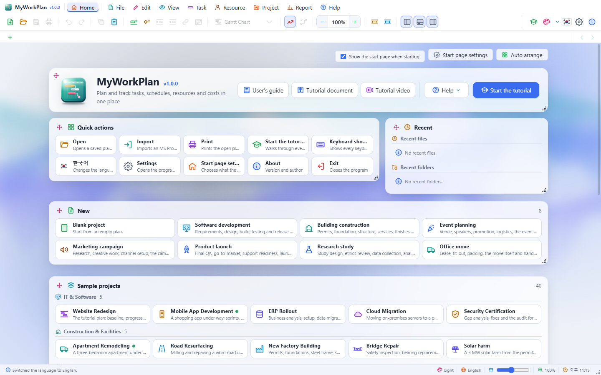

The page is a board of translucent cards on a moving background, laid out in three columns. Scroll it with the mouse wheel or the scroll bar on the right.

### The top row

Above the cards are three controls:

| Control | What it does |
|---|---|
| **Show the start page when starting** | Check box. When off, the program opens straight to an empty window (or to the files it reopens) |
| **Start page settings** | Opens **Settings › Start page** (see [Start page settings](#start-page-settings)) |
| **Auto arrange** | Puts every card back in its first arrangement |

Until you have finished the tutorial once, a hint banner under this row says "New here? …" with a **Start** button. It can be turned off in the start page settings.

### The cards

| Card | Width | Contents |
|---|---|---|
| Hero (no title) | 3 columns | Program icon, **MyWorkPlan** and its version, the tagline, and the buttons **User's guide**, **Tutorial document**, **Tutorial video**, **Help** ▾ and **Start the tutorial** |
| **Quick actions** | 2 columns | Ten tiles for everyday jobs (below) |
| **Recent** | 1 column | **Recent files** and **Recent folders** |
| **New** | 3 columns | **Blank project** and 7 templates |
| **Sample projects** | 3 columns | 40 sample plans in 8 groups (see [Sample projects](#sample-projects)) |
| **Moving background** | 3 columns | 21 animations and the background controls |

There is no theme card on the start page: themes are chosen with the theme buttons on the toolbar or in **Settings › Theme** (see [Themes](#themes)).

### The hero card

| Button | What it does |
|---|---|
| **User's guide** | Opens this guide in its own window |
| **Tutorial document** | Opens the tutorial document (every step with its screen) in its own window |
| **Tutorial video** | Plays the recording of the whole tutorial in its own window |
| **Help** ▾ | Drops down the same items as the **Help** menu: Tutorial · Tutorial document · Tutorial video · User's guide · Keyboard shortcuts… · Settings… · About… |
| **Start the tutorial** | Starts the interactive tutorial |

### Quick actions

The ten tiles sit in two rows of five. Each tile shows a short hint under its name; the full hint is in its tooltip.

| Tile | What it does |
|---|---|
| **Open** | Opens a saved plan (.mwp) or template (.mwpt) |
| **Import** | Imports an MS Project XML or CSV file |
| **Print** | Prints the open plan. When no plan is open it says "Pick the plan file to print.", asks for a file first, opens it and then opens the print preview |
| **Start the tutorial** | Walks through every feature on a sample plan |
| **Keyboard shortcuts** | Shows every keyboard shortcut |
| **한국어** / **English** | Switches the program language (the tile shows the flag and name of the other language) |
| **Settings** | Opens the program settings |
| **Start page settings** | Chooses what the start page shows |
| **About** | Version and author |
| **Exit** | Closes the program (unsaved plans are asked about first) |

### Recent

- **Recent files** lists the last files you opened (8 by default; 1–10 in the start page settings). Click one to open it; ✕ removes it from the list; **Clear all** removes them all.
- **Recent folders** lists the folders you opened files from. Click one to open the file dialog in that folder; ✕ removes it; **Clear all folders** removes them all.
- When a list is empty it says "No recent files." or "No recent folders.".

### New

Click a tile to start a new plan:

| Template | Contents |
|---|---|
| **Blank project** | Start from an empty plan |
| **Software development** | Requirements, design, build, testing and release of a software product |
| **Building construction** | Permits, foundation, structure, services, finishes and handover of a small building |
| **Event planning** | Venue, speakers, promotion, logistics, the event day and the wrap-up |
| **Marketing campaign** | Research, creative work, channel setup, the campaign itself and the results |
| **Product launch** | Final QA, go-to-market, support readiness, launch day and early feedback |
| **Research study** | Study design, ethics review, data collection, analysis and the final report |
| **Office move** | Lease, fit-out, packing, the move itself and handing back the old office |

Templates come with phases (summary tasks), tasks, links, milestones and resources. A plan made from a template asks for a new file name the first time it is saved.

### Moving background

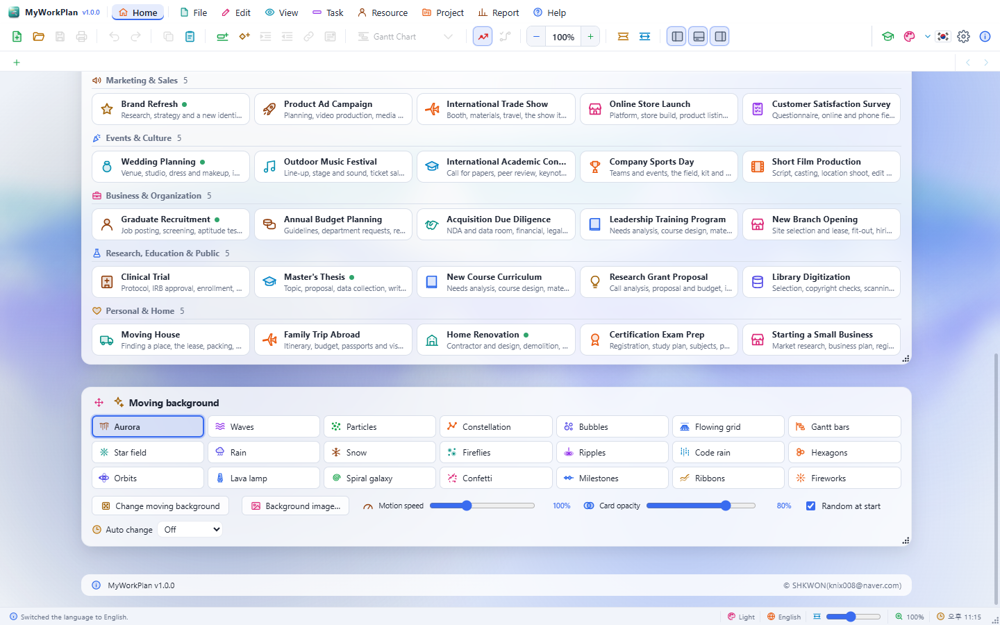

| Control | What it does |
|---|---|
| Animation tiles | Pick one of 21 animations: Aurora · Waves · Particles · Constellation · Bubbles · Flowing grid · Gantt bars · Star field · Rain · Snow · Fireflies · Ripples · Code rain · Hexagons · Orbits · Lava lamp · Spiral galaxy · Confetti · Milestones · Ribbons · Fireworks |
| **Change moving background** | Switches to another animation at random (`Ctrl+Shift+B`) |
| **Background image…** | Uses a picture as the background instead |
| **Motion speed** | 0–300% |
| **Card opacity** | How solid the cards are, 20–100% (80% by default) |
| **Random at start** | Picks a different animation every time the program starts |
| **Auto change** | While the start page is open, switches to another animation after Off · 15 s · 30 s · 1 min · 2 min · 5 min (30 s by default) |

### Moving and resizing cards

- **Move** a card by dragging the four-arrow handle at the left of its header (on the hero card it is in the top-left corner). A see-through copy follows the pointer, an outline shows where the card will land, and the other cards slide out of the way. Near the top or bottom edge the page scrolls by itself.
- **Resize** a card by dragging the dotted corner at its bottom right: sideways in whole columns (1–3), down in rows.
- **Double-click** the dotted corner to fit the card to its content again.
- Cards never overlap; they always move up as far as they can.
- The arrangement is saved and comes back on the next start. **Auto arrange** (top row, or **Settings › Start page › Card layout**) restores the first arrangement.

### Start page settings

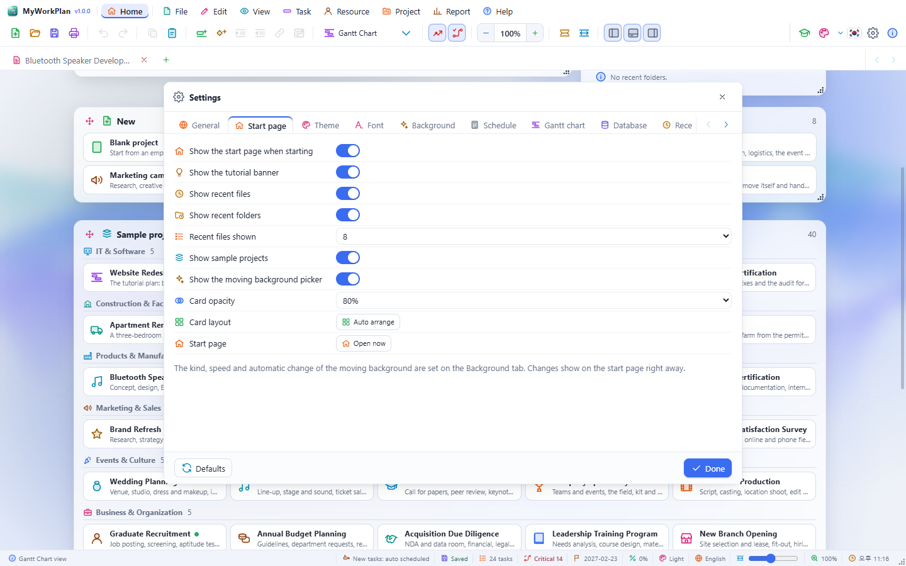

**Start page settings** (top row or Quick actions) opens the **Start page** tab of the Settings window:

| Setting | Meaning |
|---|---|
| **Show the start page when starting** | Same as the check box on the start page |
| **Show the tutorial banner** | The "New here?" banner (shown only until the tutorial is finished) |
| **Show recent files** · **Show recent folders** | The two parts of the Recent card; with both off the card disappears |
| **Recent files shown** | 1–10 (8 by default), for files and folders |
| **Show sample projects** | The Sample projects card |
| **Show the moving background picker** | The Moving background card |
| **Card opacity** | 20–100% |
| **Card layout** | **Auto arrange** |
| **Start page** | **Open now** goes to the start page |

The kind, speed and automatic change of the moving background are set on the **Background** tab. Changes show on the start page right away.

## Sample projects

The **Sample projects** card holds 40 ready-made plans, five in each of eight fields. They are ordinary plans with phases, tasks, links, milestones, resources and costs, so every view and report has something to show.

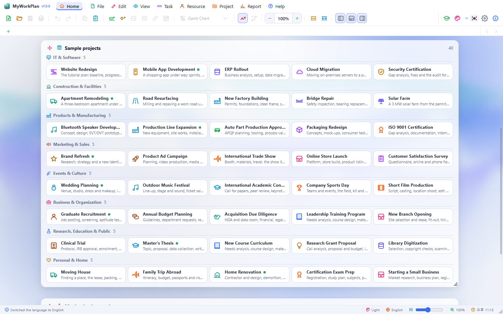

- **Click** a tile to open the sample as a new, unsaved tab in the current program language (a Korean UI opens the Korean version). The status bar says "Opened the sample …". Saving asks for a file name, so the original sample is never changed.
- A **green dot** after the name marks a plan that is already **under way**: it has a baseline, progress up to a status date a few weeks after its start, and late or on-track tasks, so the Tracking Gantt, progress line, variances and reports show real numbers.
- **Website Redesign** is the tutorial's own plan; it also has a baseline, progress, late work and an overallocated person.
- The same samples are installed as files in the `samples` folder of the installation, named `<id>.en.mwp` and `<id>.ko.mwp` (for example `wedding.en.mwp`), together with `event-template.en.mwpt` / `event-template.ko.mwpt`. Open them with **Open…** like any plan.

| Group | Sample | Description |
|---|---|---|
| IT & Software | Website Redesign | The tutorial plan: baseline, progress, late work and an overbooked person |
| IT & Software | Mobile App Development ● | A shopping app under way: sprints, QA and app store review |
| IT & Software | ERP Rollout | Business analysis, setup, data migration, training and go-live of an ERP |
| IT & Software | Cloud Migration | Moving on-premises servers to a public cloud in waves |
| IT & Software | Security Certification | Gap analysis, fixes and the audit for an ISO 27001 certificate |
| Construction & Facilities | Apartment Remodeling ● | A three-bedroom apartment under way: demolition, trades and finishes |
| Construction & Facilities | Road Resurfacing | Milling and repaving a worn road under traffic control |
| Construction & Facilities | New Factory Building | Permits, foundations, steel frame, services and the occupancy permit |
| Construction & Facilities | Bridge Repair | Safety inspection, bearing replacement, crack repair and repainting |
| Construction & Facilities | Solar Farm | A 3 MW solar farm from the permits to grid connection |
| Products & Manufacturing | Bluetooth Speaker Development | Concept, design, EVT/DVT prototypes, certification and production approval |
| Products & Manufacturing | Production Line Expansion ● | New equipment, site works, installation and ramp-up, already under way |
| Products & Manufacturing | Auto Part Production Approval | APQP planning, tooling, process validation and PPAP approval |
| Products & Manufacturing | Packaging Redesign | Concepts, mock-ups, consumer test, printing and the switch-over |
| Products & Manufacturing | ISO 9001 Certification | Gap analysis, documentation, internal audit and the certification audits |
| Marketing & Sales | Brand Refresh ● | Research, strategy and a new identity rolled out to every channel, under way |
| Marketing & Sales | Product Ad Campaign | Planning, video production, media buying, the flight and the results |
| Marketing & Sales | International Trade Show | Booth, materials, travel, the show itself and buyer follow-up |
| Marketing & Sales | Online Store Launch | Platform, store build, product listings and operations up to opening day |
| Marketing & Sales | Customer Satisfaction Survey | Questionnaire, online and phone fieldwork, analysis, report and actions |
| Events & Culture | Wedding Planning ● | Venue, studio, dress and makeup, invitations, the ceremony and the honeymoon |
| Events & Culture | Outdoor Music Festival | Line-up, stage and sound, ticket sales, two days of shows and the teardown |
| Events & Culture | International Academic Conference | Call for papers, peer review, keynotes, three conference days and the proceedings |
| Events & Culture | Company Sports Day | Teams and events, the field, kit and catering, the day of games and the prizes |
| Events & Culture | Short Film Production | Script, casting, location shoot, edit and sound, then festival submissions |
| Business & Organization | Graduate Recruitment ● | Job posting, screening, aptitude tests, interviews, offers and onboarding |
| Business & Organization | Annual Budget Planning | Guidelines, department requests, review rounds, board approval and allocation |
| Business & Organization | Acquisition Due Diligence | NDA and data room, financial, legal, tax and IT review, valuation and signing |
| Business & Organization | Leadership Training Program | Needs analysis, course design, materials, a pilot, three cohorts and evaluation |
| Business & Organization | New Branch Opening | Site selection and lease, fit-out, hiring, systems go-live and the opening day |
| Research, Education & Public | Clinical Trial | Protocol, IRB approval, enrollment, database lock and the study report |
| Research, Education & Public | Master's Thesis ● | Topic, proposal, data collection, writing, the defense and final submission |
| Research, Education & Public | New Course Curriculum | Needs analysis, course design, materials and videos, a pilot run and launch |
| Research, Education & Public | Research Grant Proposal | Call analysis, proposal and budget, institutional sign-off, submission and pitch |
| Research, Education & Public | Library Digitization | Selection, copyright checks, scanning, metadata and an online collection |
| Personal & Home | Moving House | Finding a place, the lease, packing, moving day and settling in |
| Personal & Home | Family Trip Abroad | Itinerary, budget, passports and visas, bookings, packing and the trip itself |
| Personal & Home | Home Renovation ● | Contractor and design, demolition, services, tiles, wallpaper, floors and move-in |
| Personal & Home | Certification Exam Prep | Registration, study plan, subjects, past papers, written and practical exams |
| Personal & Home | Starting a Small Business | Market research, business plan, registration, brand, online store and opening |

● = already under way (green dot on the tile).

**Settings › Start page › Show sample projects** hides the card if you do not need it.

## Tutorial and help

### The interactive tutorial

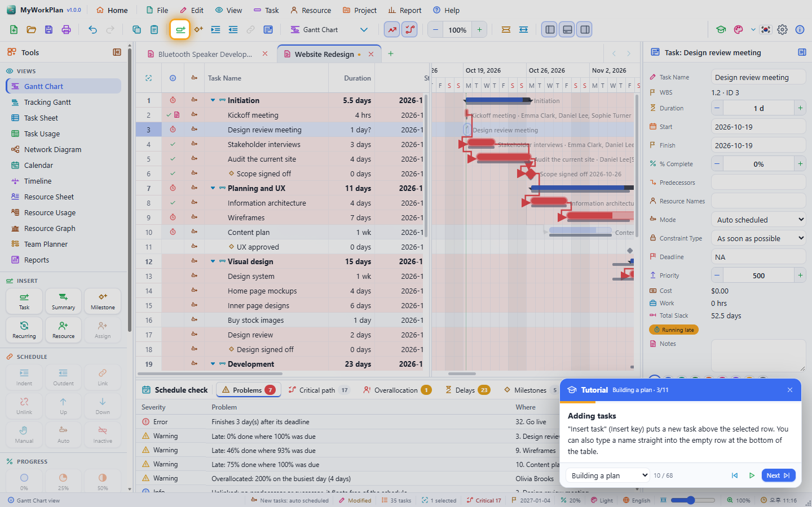

Start it with **Help › Tutorial** (`F11`), the graduation-cap button at the right of the toolbar, **Start the tutorial** on the start page, or **Settings › General › Start the tutorial**. It opens the Website Redesign sample and shows every feature one by one in 68 steps, highlighting the button or area each step is about.

- Move with **Next** and **Previous step**, or press **Auto play** (▶) and **Pause auto play**.
- **Choose a chapter** jumps to Start page · Building a plan · Scheduling · Resources and costs · Tracking · Views · Reports · Files and printing · Customizing · Help. The box shows the chapter and the step number (for example "10 / 68").
- Drag the tour box by its title to move it out of the way. `Esc` or ✕ ends the tutorial.
- Your files are not changed, and the settings the tutorial changes (theme, language, background…) are put back at the end: "The tutorial has ended. Your settings were put back."

### Document windows

The **User's guide**, the **Tutorial document** and the **Tutorial video** each open in a window of their own, next to the main window, so you can read or watch while you work.

| Where you run MyWorkPlan | The document opens in |
|---|---|
| Desktop app | Its own window with the normal system title bar. Its size and place are remembered; choosing the same document again brings that window back to the front instead of opening another |
| Web version | A new browser tab |
| While the tutorial runs | A frame over the program, closed with ✕ |

Open them from the **Help** menu, the three buttons in the start page's hero card, or the **Help** ▾ button there.

### User's guide and tutorial document

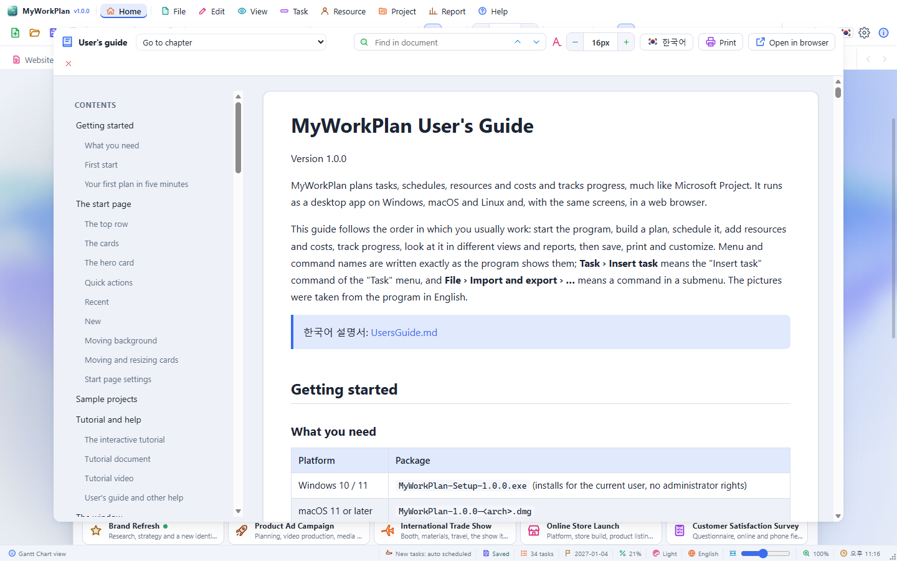

**Help › User's guide** opens this guide; **Help › Tutorial document** opens a document with every tutorial step and its screen. Both windows have the same bar on top:

| Control | What it does |
|---|---|
| **Go to chapter** | Jumps to a chapter (a table of contents is also shown at the left of the page) |
| **Find in document** | Type a word: the matches are highlighted and the count shown ("3 found" / "Not found"). ▲ ▼ go to the previous / next match; `Enter` / `Shift+Enter` and `F3` / `Shift+F3` do the same; `Esc` clears the box. `Ctrl+F` jumps to the box |
| **Text size** | `A − 16px +`: 12–26 px. `Ctrl +` larger, `Ctrl −` smaller, `Ctrl 0` back to 16 px. The size is remembered for all document windows and kept when you switch language |
| Language button | Shows the flag and name of the other language — 🇰🇷 **한국어** on the English page, 🇬🇧 **English** on the Korean page — and switches the document to it |
| **Print** | Prints the document (`Ctrl+P`) |
| **Open in browser** | Opens the document in your web browser |

### Tutorial video

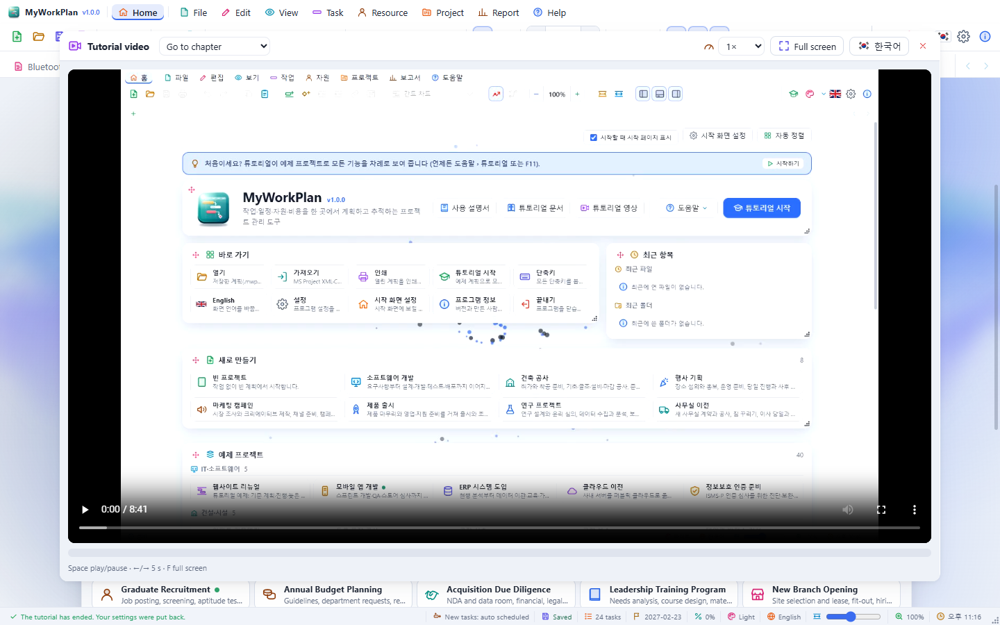

**Help › Tutorial video** plays a recording of the whole tutorial in its own window, with the usual video controls (play, pause, seek, volume).

| Control | What it does |
|---|---|
| **Go to chapter** | Jumps the video to the start of a chapter |
| **Playback speed** | 0.5× · 0.75× · 1× · 1.25× · 1.5× · 2× |
| **Full screen** | Fills the screen (`F`; `Esc` leaves) |
| Language button | The same flag-and-name button as in the documents: switches the window's language |
| **Open in player** | Opens the video in the system's default video player (desktop) |

Keys (shown under the video): `Space` or `K` play / pause · `←` / `→` 5 seconds back / forward · `F` full screen.

The video file is `MyWorkPlan-Tutorial.mp4`. It is made with `npm run tutorial:video` in the project folder, which writes it to the project root and copies it, with its chapter list, into `docs/video`. When the video has not been made yet, the window says "The tutorial video has not been made yet. Run npm run tutorial:video in the project folder."

### Other help

| Command | What it does |
|---|---|
| **Help › Keyboard shortcuts…** | The Settings window on the **Shortcuts** tab |
| **Help › Settings…** | The Settings window (`Ctrl+,`) |
| **Help › About…** | Version, build date, commit, target, runtime, platform and author; **Copy** copies them (`F1`) |

Every button and menu item has a tooltip, and the menus show each command's shortcut.

## The window

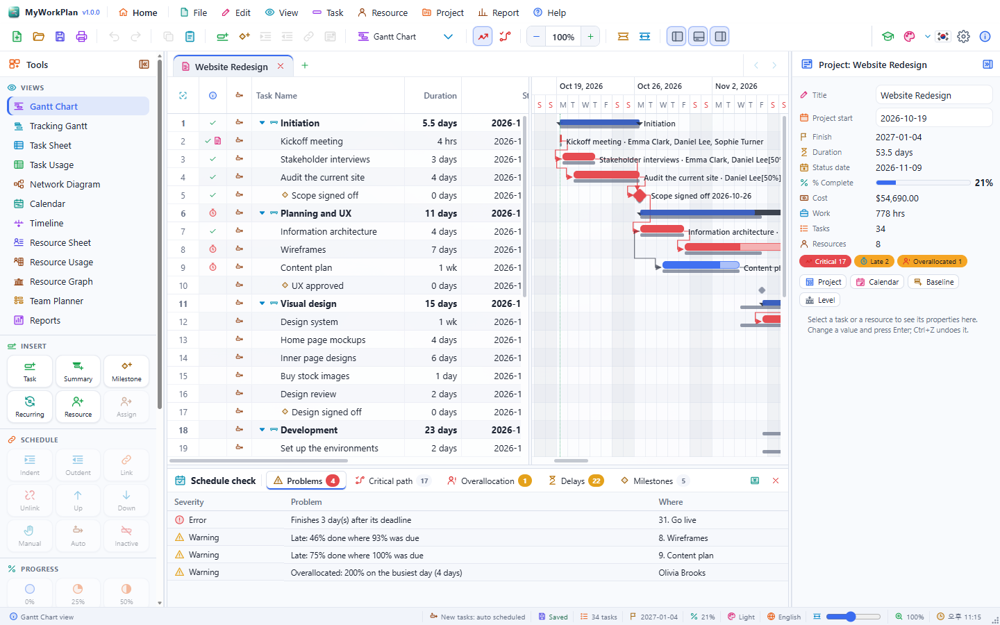

From the top: the **menu bar** (which is also the title bar) and the **toolbar** (one line); right under them the **Tools** panel on the left and the **Properties** panel on the right. Between the two panels are the **project tabs** with the **view** below them and, under the view, the **bottom panel** (Schedule check); the **status bar** is at the bottom. Drag the separators between the panels to resize them.

### Window size

- Drag the six dots in a triangle at the bottom-right corner (or any window edge) to resize the window.
- The window never gets narrower than the toolbar and menu bar need, so no toolbar button is ever hidden and the toolbar always stays on one line. Even when Windows Snap or another program makes the window smaller, it comes back to that minimum width.

### Menu bar (title bar)

The desktop app has no separate system title bar: the menu bar does that job.

| Part | What it is |
|---|---|
| Left end | The program icon, **MyWorkPlan** and the version (v1.0.0) |
| **Home** | Toggles the start page (below) |
| Menus | **File** · **Edit** · **View** · **Task** · **Resource** · **Project** · **Report** · **Help** |
| Right end | **Minimize** · **Maximize** (**Restore down** while maximised) · **Close**. Close asks about unsaved plans, like **File › Exit** |

- Drag an empty part of the menu bar to move the window; double-click it to maximise or restore. Windows Snap works as usual (drag to a screen edge, or `Win+arrow`).
- In the web version the menu bar shows the icon, name and version but no window buttons; the browser has its own.

**Home** (`Ctrl+Shift+H`) is a toggle:

- From a plan it opens the start page; open plans stay in their tabs.
- Pressed again on the start page, it goes back to the plan you were on.
- With no plan open, it creates a new blank plan.

Long menus are grouped into submenus: click an item with › on the right (or press →) and its submenu opens beside it.

| Menu | Commands |
|---|---|
| **File** | New project · Open… · Start page · Recent files… · Recent folders · Clear all recent files and folders · Save · Save as… · Save all · Save as template… · Open from database… · Save to database (desktop) · **Import and export** › (Import (MS Project XML · CSV)… · Export to MS Project XML… · Export to CSV… · Export Gantt chart as picture (PNG)…) · Print… · Close tab · Close all tabs · Exit |
| **Edit** | Undo · Redo · Cut · Copy · Paste · Fill down · Delete · Select all · Clear selection · Find… · Replace… · Go to… |
| **View** | **Switch view** › (the 12 views) · Switch view · **Table, filter and group** › (Table (column set) · Choose columns… · Filter · Clear filter, group and sort · Group · Sort · Highlight instead of filter · Show summary tasks only (collapse all) · Show all subtasks (expand all)) · **Zoom and timescale** › (Zoom in · Zoom out · Zoom to 100% · Zoom in timescale · Zoom out timescale · Entire project · Scroll to task · Go to today) · **Show** › (Show critical path · Show slack · Show baseline bars · Show progress line · Show/hide tool panel · Show/hide properties panel · Bottom panel (schedule check) · Fold / unfold the bottom panel · Status bar) · **Theme, language and background** › (Random theme · Choose theme · Switch language · Change moving background · Background image… · Turn background off) |
| **Task** | Insert task · Insert summary task · Insert milestone · Recurring task… · Indent (make subtask) · Outdent · Move up · Move down · Link tasks · Unlink tasks · Information… · Notes… · Add to timeline · **Progress** › (0% complete … 100% complete · Mark on track · Update tasks…) · Manually schedule · Auto schedule · Inactivate task |
| **Resource** | Add resource · Resource information… · Assign resources… · Level all · Clear leveling · Leveling options… · Next overallocation · Resource Sheet · Resource Usage · Resource Graph · Team Planner |
| **Project** | Project information… · Change working time… · Project statistics… · Set baseline… · Clear baseline… · Update project… · Status date… · Calculate now · Find critical path · Insert another project… |
| **Report** | The 10 reports (including Labor cost) · **Export report** › (HTML · Markdown · Word · PDF) · Copy report · Print… |
| **Help** | Tutorial · Tutorial document · Tutorial video · User's guide · Keyboard shortcuts… · Settings… · About… (the documents and the video open in their own windows) |

Every menu item shows an icon and its shortcut, and menus may extend outside the main window. Commands that cannot be used right now are dimmed.

### Toolbar

| Where | Buttons |
|---|---|
| Left | New project · Open · Save · Print │ Undo · Redo │ Copy · Paste │ Insert task · Insert milestone · Indent · Outdent · Link tasks · Information │ Switch view (current view name ▾) │ Show critical path · Find critical path │ Zoom `[−] 100% [+]` │ Zoom out / in timescale │ Tool panel · Bottom panel · Properties panel |
| Right | Tutorial (graduation cap) · Random theme + ▾ (Choose theme) · Switch language (flag) · Settings · About (ⓘ) |

Every button has a tooltip. The Undo and Redo tooltips say what will be undone (for example "Undo: Change duration").

### Colour icons

Every icon in every window — toolbar, menus, Tools and Properties panels, tabs, popups and the start page — has its own colour by meaning: delete, close and critical items are red, new/add and zoom/find green, open and recent amber, save and database indigo, import/export teal, copy/paste cyan, help and information blue, settings slate, print purple, cost brown, and so on. Views, reports, templates and samples each keep a steady colour of their own, so one icon looks the same wherever it appears. The colours are deeper on light themes and brighter on dark themes, so they stay readable with any theme.

### Project tabs

Each project gets a tab. When there are many, scroll them with the arrows at the right end or the mouse wheel; `Ctrl+Tab` goes to the next tab and `Ctrl+Shift+Tab` to the previous one. Double-click the empty part of the tab strip, or press **+**, to create a new project. A project with unsaved changes shows ● after its name.

### Tools panel (left)

| Section | Contents |
|---|---|
| **Views** | The 12 view buttons |
| **Insert** | Task · Summary · Milestone · Recurring · Resource · Assign |
| **Schedule** | Indent · Outdent · Link · Unlink · Up · Down · Manual · Auto · Inactive |
| **Progress** | 0% · 25% · 50% · 75% · 100% · On track |
| **Data** | Search box (task names, notes and resources), Filter · Group · Sort · Table lists, **Highlight instead of filter**, the number of tasks shown and **Clear** |
| **Show on chart** | Show critical path · Show slack · Show baseline bars · Show progress line |

### Properties panel (right)

Shows the properties of the selection and lets you change them in place. Change a value and press `Enter`; `Ctrl+Z` undoes it.

Numbers are edited with steppers, `[−] value [+]`, with the value and its unit in the middle; all fields line up in one column.

| Selection | Stepper | Range and step |
|---|---|---|
| Task | **Duration** | In the task's own unit (d, wk, h …), step 1 |
| Task | **% Complete** | 0–100%, step 5 |
| Task | **Priority** | 0–1000, step 50 |
| Resource | **Max. Units** | %, step 10 |
| Resource | **Std. Rate** | Per hour, step ₩1,000 (or $1 and so on in other currencies) |
| Resource | **Cost/Use** | Amount per use |
| Link | **Lag** | Days, −365 to 365. A lag written as a percentage (e.g. `50%`) stays a text field |

Click − or + to step once, or hold the button to keep stepping. You can also type a value and press `Enter`, or press `↑` / `↓` in the field to step.

| Selection | Shown |
|---|---|
| Nothing | The project: title, project start, finish, duration, status date, % complete, cost, work, number of tasks and resources, Critical / Late / Overallocated badges, buttons **Project** · **Calendar** · **Baseline** · **Level** |
| One task | Task name, WBS, duration, start, finish, % complete, predecessors, resource names, mode, constraint type and date, deadline, priority, cost, work, total slack, badges (critical · running late · overallocated · finish variance), notes, bar color, **More…** · **Assign** · **Scroll to** |
| Several tasks | Count, start and finish, cost, Link · Unlink · Indent · Outdent · 0% · 50% · 100% · Inactive · Info |
| A resource | Name, type, initials, group, max. units, std. rate, cost/use, work, cost, assigned tasks |
| A link | Predecessor, successor, type, lag, **Delete link** |

### Bottom panel: schedule check

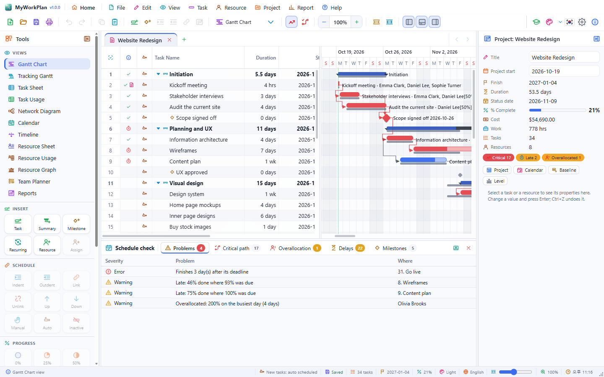

Under the view of the open plan sits the **Schedule check** panel. It lists what needs attention in the schedule and keeps itself up to date as you edit. It does not show on the start page.

The header has the panel icon, the title **Schedule check** and five tabs, each with a badge counting its entries (red for errors, amber for warnings):

| Tab | What it lists |
|---|---|
| **Problems** | Every problem with a **Severity** (**Error** · **Warning** · **Info**), the **Problem** and **Where** it is. Errors: link loops ("the task waits for itself"), calendar errors (a calendar with no working time), missed deadlines ("Finishes 3 day(s) after its deadline"). Warnings: constraint conflicts, overallocated people, late work ("Late: 46% done where 93% was due"). Info: unlinked tasks (no predecessor or successor), tasks without resources, manual tasks with no duration. Errors come first. When there are none: "The schedule has no problems." |
| **Critical path** | A summary line (critical tasks, how many still to do, number of paths, finish and duration) and a table of the critical tasks (ID, Name, Start, Finish, Duration, Total Slack, % Complete). **Show on the chart** turns on [Find critical path](#critical-path-and-slack) |
| **Overallocation** | Each overallocated person with Peak, Max. Units, **Days over**, **Period** and the **Overlapping tasks**, plus the buttons **Next overallocation** and **Level all** |
| **Delays** | Tasks that are late, have missed their deadline or finish after the baseline, with the **Reason** and finish variance; tasks on the critical path are marked "On the critical path" |
| **Milestones** | Every milestone with its date and **Status**: **Done** · **Deadline missed** · **Slipping** · **On track** |

- **Click a row** to go to it: a task is selected and scrolled into view (the view switches to the Gantt Chart unless a task table view is already shown); a person is selected in the Resource Sheet.
- **Fold / unfold**: the button at the right of the header folds the panel to its header line, which still shows the icon, the title and the tab counts. Clicking a tab unfolds it again.
- **×** turns the panel off. The **Bottom panel** toolbar button (between the Tool panel and Properties panel buttons), `Ctrl+Shift+3` and **View › Show › Bottom panel (schedule check)** turn it on and off; **View › Show › Fold / unfold the bottom panel** folds it.
- **Height**: drag the top edge of the panel. The height, the chosen tab and the folded state are kept for the next start.

### Status bar

From the left: the result of the last command (e.g. "Marked 3 tasks 50% complete."), **New tasks: auto scheduled / manually scheduled** (click to change), Saved / Modified, task count, selection count, Critical count (while the critical path is on), project finish date, % complete, conflicts, Filter on, theme name, language, timescale slider, zoom and a clock. **View › Show › Status bar** hides or shows it.

### Right-click menus

Each place has its own menu.

| Where | Menu |
|---|---|
| Task row | Information… · Notes… · Assign resources… · Cut · Copy · Paste · Fill down · Delete · Insert task / milestone / summary task · Indent · Outdent · Move up / down · Link tasks · Unlink tasks · Add to timeline · Inactivate task (summary tasks: collapse / expand subtasks) |
| Gantt bar | Information… · Notes… · Update tasks… · 0% / 50% / 100% complete · Mark on track · Link · Scroll to task · Add to timeline · Manually / Auto schedule · Inactivate · Cut · Copy · Delete |
| Link line | Edit link… · Finish-to-Start (FS) · Start-to-Start (SS) · Finish-to-Finish (FF) · Start-to-Finish (SF) · Delete link |
| Empty chart area | Zoom in / out timescale · Entire project · Go to today · what the chart shows · Export as picture · Print · Change moving background |
| Column header | Sort by this column · By ID (default) · Choose columns… · Table (column set) · Hide this column · Reset column width |
| Resource row | Resource information… · Cut · Copy · Paste · Delete · Add resource · Level all · Next overallocation · Resource Graph · Resource Usage |
| Tab | Save · Save as… · Save as template… · Project information… · Print… · Close tab · Close all tabs · New project |
| Report | The 10 reports (including Labor cost) · Export report · Copy report · Print… |
| Status bar | Status bar · Zoom in · Zoom out · Zoom to 100% · Zoom in / out timescale · Theme · Language |
| Text field | Undo typing · Cut · Copy · Paste · Select all |

### Popup windows

Windows such as Task information, Settings and Print preview are separate windows in the desktop app. They can be moved outside the main window and close with it. In the web version and during the tutorial they float inside the main window.

## Building a plan

### Adding tasks

- **Task › Insert task** (`Insert`) puts a new task above the selected row and lets you type its name right away.
- Typing a name into the empty row at the bottom of the table ("Type a new task name here") also creates a task.
- **Insert summary task** (`Ctrl+Shift+K`) makes a summary task over the selected tasks.
- Double-click a cell or press `F2` / `Enter` to edit it. While editing, `Enter` moves down, `Tab` moves right and `Esc` cancels.
- Click a row number to select (`Ctrl`+click: several, `Shift`+click: a range) and drag rows up or down to move them; dragging left or right changes the outline level.
- **Delete** (`Delete`) removes the selected tasks and their subtasks, after asking (**Settings › General › Ask before deleting**).

### Durations

Type a number and a unit in the **Duration** column. Start and finish dates are calculated on the calendar automatically.

| Input | Meaning |
|---|---|
| `5d`, `5 days` | 5 working days |
| `3w`, `3 weeks` | 3 weeks |
| `4h`, `4 hrs` | 4 hours |
| `30m`, `30 min` | 30 minutes |
| `1mo`, `1 month` | 1 month |
| `2ed`, `3eh` | Elapsed time (nights and days off count): 2 elapsed days, 3 elapsed hours |
| `5d?` | Estimated duration (shown with a question mark) |
| `0d` | Milestone |
| `5` | A bare number means days |

How many hours make a day, a week and a month comes from **Settings › Schedule**: **Hours per day** (8) · **Hours per week** (40) · **Days per month** (20).

### Milestones

A task with a duration of 0 is a milestone (a diamond). Use **Task › Insert milestone** (`Ctrl+Shift+M`), type `0` as the duration, or turn on **Mark as milestone** in Task information. Use milestones for the end of a phase or an important date.

### Outline (summary tasks)

- **Indent (make subtask)** (`Alt+Shift+→`) makes a task a subtask of the one above, which becomes a summary task that adds up duration, work, cost and % complete.
- **Outdent** (`Alt+Shift+←`) undoes it. **Move up** · **Move down** (`Alt+Shift+↑/↓`) move a task together with its subtasks.
- The triangle before a summary task collapses and expands it. **Show summary tasks only (collapse all)** and **Show all subtasks (expand all)** (View › Table, filter and group) do it for all of them.
- WBS codes (1, 1.1, 1.2 …) follow the outline automatically.

### Links and lags

- Select two or more tasks and press **Link tasks** (`Ctrl+F2`) to chain them finish-to-start from top to bottom. **Unlink tasks** (`Ctrl+Shift+F2`) removes the links of the selected tasks.
- Dragging a Gantt bar up or down onto another bar links them too.
- The **Predecessors** column can be typed: task IDs with an optional link type and lag, separated by commas — `3`, `5SS+2d`, `7FF-1d`, `4FS+50%`.
- Double-click a link line for the **Task dependency** window; right-click it for a menu that changes the type at once.

| Link type | Meaning |
|---|---|
| **Finish-to-Start (FS)** | The successor starts when the predecessor finishes (default) |
| **Start-to-Start (SS)** | The successor starts when the predecessor starts |
| **Finish-to-Finish (FF)** | The successor finishes when the predecessor finishes |
| **Start-to-Finish (SF)** | The successor finishes when the predecessor starts |

Write the **Lag** as `2d` (2 days later), `-1d` (a 1-day lead) or `50%` (half the predecessor's duration). A link on a summary task applies to every task inside it. Links that would make a loop, or link a summary task with its own subtask, are refused.

### Dragging bars

| Drag | Changes |
|---|---|
| The middle of a bar | The start date (the task gets a "Start no earlier than" constraint) |
| The right end of a bar | The duration |
| The progress handle at the left | % complete |
| A bar up or down onto another bar | Links the two tasks |
| An empty chart area (or `Ctrl+drag`) | Moves the chart |

Double-click a bar for Task information.

### Undo, copy and paste

- Every edit is undone with `Ctrl+Z` and redone with `Ctrl+Y` (or `Ctrl+Shift+Z`). Each tab (project) has its own history.
- `Ctrl+C` · `Ctrl+X` · `Ctrl+V` copy and move tasks (with their subtasks, links and assignments) or resources.
- Lists copied from Excel or a text editor paste as tasks: indentation (two spaces or a tab) is the outline level and a value after a tab is the duration. Copied tasks paste into Excel as Name, Duration, Start and Finish columns.
- **Fill down** (`Ctrl+D`): select several tasks, then a cell; the first task's value in that column is copied to the others.

### Task information

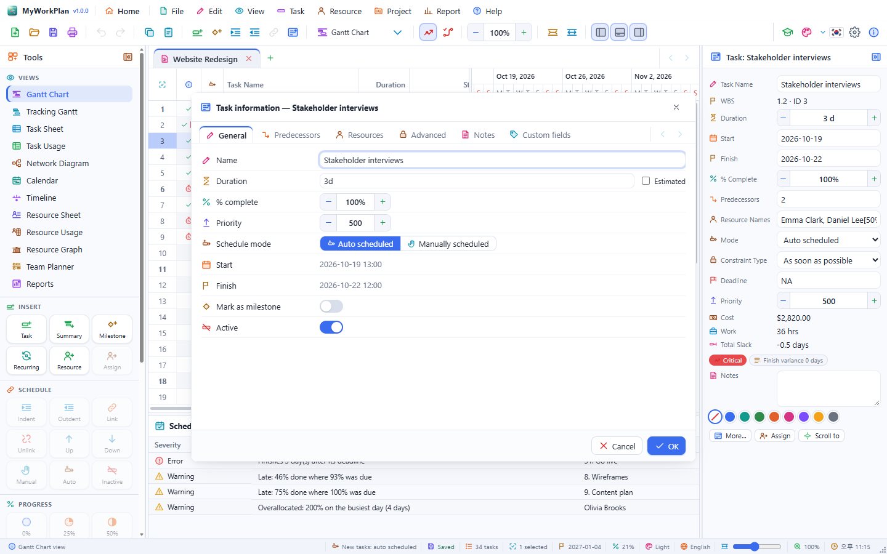

Double-click a task or use **Task › Information…** (`Shift+F2`). With several tasks selected it becomes **Multiple task information**: only the fields you change are applied to all of them.

| Tab | Fields |
|---|---|
| **General** | Name, duration and **Estimated**, % complete, priority (0–1000), schedule mode (auto / manual), start and finish (typed for manually scheduled tasks), **Mark as milestone**, **Active** |
| **Predecessors** | The predecessors (task · type · lag), **Add predecessor**, remove link |
| **Resources** | Assigned resources and units (work: %, material: quantity, cost: amount), **Assign resource**, remove assignment |
| **Advanced** | Constraint type and date, deadline, task type, effort driven, task calendar, fixed cost, WBS code |
| **Notes** | Notes, hyperlink (web address or file) |
| **Custom fields** | Text1–3, Number1, Flag1, bar color, Hide the Gantt bar, Show on the timeline |

**Notes…** opens this window on the Notes tab.

### Recurring tasks

**Task › Recurring task…** creates repeating tasks such as a weekly meeting at once.

| Field | Contents |
|---|---|
| **Name** · **Duration · time** | e.g. Weekly meeting, `1h`, start time `10:00` |
| **Recurs** | Daily · Weekly · Monthly · Yearly, **Every** (how many days, weeks or months) |
| **On** / **Day** | Weekly: the weekdays; monthly and yearly: the day of the month |
| **Working days only** | Daily: skip non-working days |
| **Start** · **End** | Start date; end **After** a number of **Occurrences** or **By date** (end date) |

The result is one summary task with a task per occurrence, each pinned to its day with a "Start no earlier than" constraint. The indicators column shows a recurring-task icon.

### Other task commands

| Command | What it does |
|---|---|
| **Inactivate task** | Keeps the task but leaves it out of the schedule and costs (grayed). Press again to activate it |
| **Add to timeline** | Shows the task on the Timeline view |
| Bar color | Pick a bar color with the swatches in the properties panel or in Task information › Custom fields |
| **Project › Insert another project…** | Inserts the tasks of another file (.mwp · .mwpt · XML · CSV) under one summary task; resources with the same name are merged |

## Scheduling

### Auto and manual scheduling

- **Auto scheduled** tasks get their dates from links, constraints and calendars.
- **Manually scheduled** tasks stay on the start and finish you typed (drawn with a different bar).
- Switch the selected tasks with **Task › Manually schedule** · **Auto schedule**. New tasks follow **New tasks: auto / manually scheduled** on the status bar (click it) or **Settings › Schedule › Mode of new tasks**.

### Constraints

Set the **Constraint type** and **Constraint date** in Task information › **Advanced** (or the properties panel).

| Constraint type | Meaning |
|---|---|
| **As soon as possible** | Default. The earliest date the links allow |
| **As late as possible** | The latest date that delays neither successors nor the project finish |
| **Start no earlier than** | Does not start before the date |
| **Start no later than** | Starts by the date |
| **Finish no earlier than** | Does not finish before the date |
| **Finish no later than** | Finishes by the date |
| **Must start on** | Starts on the date |
| **Must finish on** | Finishes on the date |

When links and constraints disagree (e.g. a predecessor makes "Must start on" impossible), the status bar shows a **conflicts** count and the indicators column a warning. With **Project information › Tasks always honor their constraint dates** on, the constraint wins; off, the links win.

### Deadlines

A **Deadline** does not move the task, but it limits the late dates, and a task finishing after its deadline gets "The deadline has been missed" in the indicators column. The Gantt chart marks the deadline.

### Calendars and working time

Edit calendars with **Project › Change working time…**.

- Built-in calendars: **Standard** (Mon–Fri 08:00-12:00, 13:00-17:00), **24 Hours** and **Night Shift**.
- **New calendar** · **Rename** · **Delete** · **Use as project calendar** manage them.
- **Work week** tab: a **Working day** switch and working times per weekday (e.g. `08:00-12:00, 13:00-17:00`, 24-hour clock).
- **Exceptions (holidays, extra work)** tab: name, start, end and times, then **Add**. Empty times make a day off, times make extra working time.
- A task uses its own **Task calendar**, else the calendar of its assigned work resource, else the project calendar.

### Critical path and slack

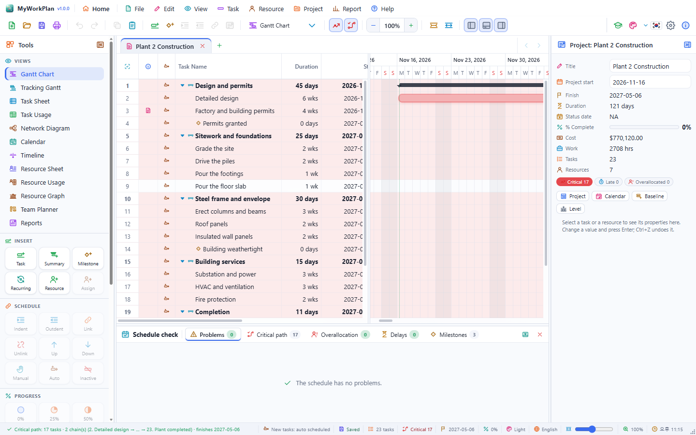

- **Critical tasks** (red bars) have no slack: any delay delays the project finish. **Show critical path** (toolbar, **View › Show**) turns the colouring on and off.
- **Show slack** draws free slack (how far a task can slip without delaying others) as a thin line after the bar.
- **Total Slack**, **Free Slack** and **Early / Late Start / Finish** are in the **Schedule** table.
- **Project information › Critical when slack is at most (days)** widens the critical path (default 0 days).

**Find critical path** — the toolbar button next to Show critical path (`Ctrl+Shift+P`, also **Project › Find critical path**) is a toggle. Pressing it recalculates the schedule front to back (earliest start and finish) and back to front (latest start and finish), then traces the tasks without slack into start-to-finish chains. Critical tasks and links turn red, everything else fades, and the chart scrolls to where the path begins. The status bar shows **Critical** with the count, and the message gives the chain (for example "Critical path: 17 tasks · 2 chain(s) (2. Detailed design → … → 23. Plant completed) · finishes 2027-05-06"). Press it again, or click the Critical item on the status bar, to turn it off.

### Schedule from and project information

**Project › Project information…**

| Tab | Fields |
|---|---|
| **General** | Title, **Schedule from** (Project start date / Project finish date), start date or finish date, project calendar, priority, currency (₩ · $ · € · ¥ · £), critical slack, honor constraint dates |
| **Status** | Status date, today, % complete, late / critical / conflict counts |
| **Statistics** | Current · baseline · actual · remaining start, finish, duration, work, cost and labor cost; labor share; numbers of tasks, milestones and resources |
| **Properties** | Subject, author, manager, company, category, keywords, comments |

With **Schedule from** set to "Project finish date" the schedule is calculated backwards from the finish date and every task is placed as late as possible. **Project statistics…** opens this window on the Statistics tab, **Status date…** on the Status tab.

### Calculate now

The schedule is recalculated after every edit. **Project › Calculate now** (`F9`) refreshes the values that depend on today's date (late tasks and so on).

### Checking the schedule

The **Problems** tab of the [bottom panel](#bottom-panel-schedule-check) gathers link loops, calendar errors, constraint conflicts and missed deadlines in one list, and its **Critical path** tab lists the critical tasks. Click an entry to jump to the task.

## Resources and costs

### Resource Sheet

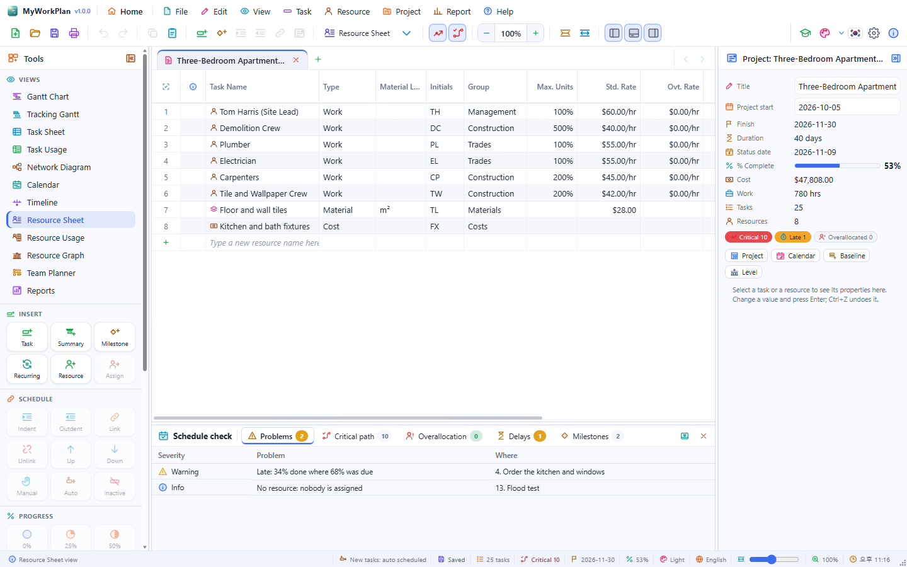

Enter resources in the **Resource › Resource Sheet** view: type a name into the empty bottom row or press **Add resource** (`Ctrl+Shift+R`).

| Type | Used for | Cost |
|---|---|---|
| **Work** | People and equipment. Max. units (100% = one person full time), calendar | Work (hours) × Std. rate + Cost/Use |
| **Material** | Things used by quantity, like cement or paper. Material label (e.g. tons) | Quantity × Std. rate + Cost/Use |
| **Cost** | Amounts only, like travel or rent | The amount entered on the assignment |

Double-click a resource for the **Resource information** window (General · Costs · Assignments · Notes tabs). Overallocated resources show in red.

### Assigning resources

Select tasks and open **Resource › Assign resources…** (`Alt+F10`). Tick resources and set their units (work resources in %, 50% = half time); work and cost are calculated. Type a new resource name at the bottom and press **Add and assign** to create and assign it at once.

The **Resource Names** column can also be typed, e.g. `Kim, Lee[50%]`; unknown names become new work resources. Summary tasks get no resources.

### Task types and effort driven

Set them in Task information › **Advanced**.

| Task type | When the duration changes |
|---|---|
| **Fixed units** (default) | Work follows |
| **Fixed duration** | Only the duration changes |
| **Fixed work** | Work stays, the units change |

With **Effort driven (more resources shorten the task)** on, adding work resources shortens the task so that the total work stays the same (not for fixed-duration tasks).

### Costs

- Task cost = the cost of its assignments + **Fixed cost**. Summary tasks and the project add up their subtasks.
- The **Cost** table shows fixed cost, labor cost, cost, baseline cost, cost variance, actual cost and remaining cost. Actual cost follows % complete.
- Pick the currency symbol in **Project information › Currency**.

### Wages and labor cost

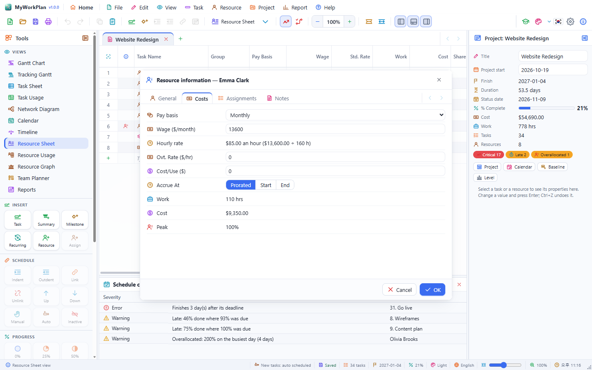

Each person (work resource) can be paid by the hour, day, week, month or year. The schedule always costs work by the hour, so the wage is turned into an hourly **Std. Rate** using the project's working time.

**Setting a wage**

1. Double-click the person in the Resource Sheet (or **Resource › Resource information…**) and open the **Costs** tab.
2. Pick the **Pay basis**: Hourly · Daily · Weekly · Monthly · Yearly.
3. Type the **Wage** for that period (the label shows the unit, e.g. "Wage ($/month)").
4. **Hourly rate** shows the result as you type, for example "$85.00 an hour ($13,600.00 ÷ 160 h)".
5. Press **OK**: the hourly rate becomes the person's Std. Rate, and work and costs are recalculated.

| Pay basis | Hours in one period |
|---|---|
| **Hourly** | 1 |
| **Daily** | Hours per day (8) |
| **Weekly** | Hours per week (40) |
| **Monthly** | Days per month × hours per day (20 × 8 = 160) |
| **Yearly** | 12 × the monthly hours (1,920) |

The numbers come from **Settings › Schedule** (**Hours per day**, **Hours per week**, **Days per month**). When you change them, the hourly rates of everyone paid daily, weekly, monthly or yearly are recalculated from their wages.

**In the Resource Sheet** — choose the **Labor** table (**Table** list in the Tools panel or **View › Table, filter and group › Table (column set)**). It shows Name, Group, **Pay Basis**, **Wage**, **Std. Rate**, **Work**, **Cost** and **Share of Cost** (the person's share of the total project cost). Pay Basis and Wage can be edited right in the table; typing a Std. Rate directly makes the person hourly again. Material and cost resources leave these cells empty.

**Where labor cost shows**

| Place | What you see |
|---|---|
| Task **Cost** table | The **Labor Cost** column: the cost of the work resources on the task |
| **Project information › Statistics** | A **Labor cost** line (current · baseline · actual · remaining) and **Labor share**, e.g. "97.5% — labor $53,310.00 of $54,690.00 (materials …, other costs …)" |
| **Report › Labor cost** | The full breakdown (see [Reports](#reports-1)) |

Labor cost = for every person, hours worked × hourly rate + cost per use.

### Overallocation

A resource is overallocated when more work overlaps on a day than it can do (max. units × that day's working time).

- It is red in the Resource Sheet, and its tasks get "A resource is overallocated" in the indicators column.
- The **Resource Usage** view shows the days over the limit in red.
- The **Resource Graph** view shows one resource's work per day as columns against its availability as a line.
- **Resource › Next overallocation** jumps to the next overallocated task.
- The project's **Overallocated** badge in the properties panel counts them.

### Resource leveling

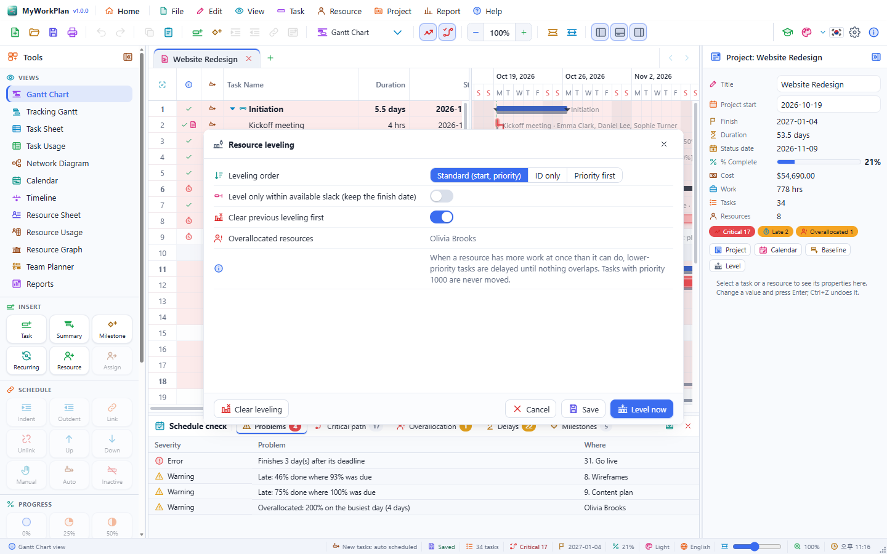

**Resource › Level all** delays lower-priority tasks until no resource is overallocated. The delay goes into the **Leveling Delay** field; **Clear leveling** puts the tasks back (only the selected ones when tasks are selected).

The **Leveling options…** window:

| Field | Contents |
|---|---|
| **Leveling order** | Standard (start, priority) · ID only · Priority first |
| **Level only within available slack (keep the finish date)** | No move that would delay the project finish |
| **Clear previous leveling first** | On by default |
| **Overallocated resources** | The resources overallocated now |
| Buttons | Clear leveling · Save (options only) · **Level now** |

Tasks with priority 1000, manually scheduled tasks, tasks already started and "Must start / finish on" tasks are never moved. When some overallocation cannot be solved, the remaining resources are named on the status bar.

### Team Planner

**Resource › Team Planner** shows one lane per person with their task blocks. Drag a block to another person's lane to reassign it, or from the **Unassigned tasks** lane at the bottom to assign it. Overallocated lanes are marked red. See [Team Planner](#team-planner-1) under Views for a picture.

## Tracking progress

### Baselines

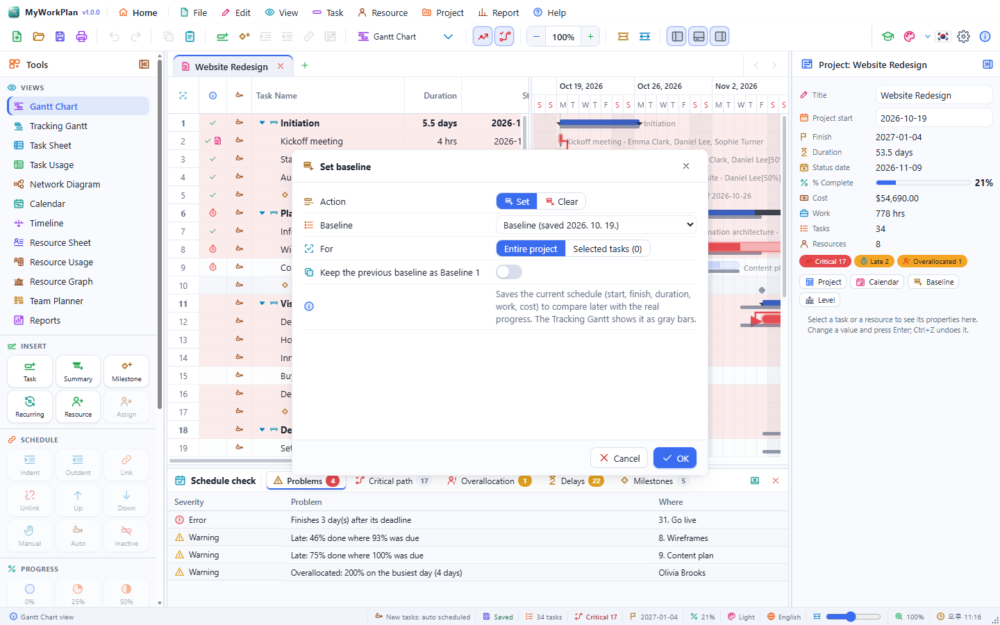

When the plan is agreed, **Project › Set baseline…** saves the current schedule (start · finish · duration · work · cost) to compare later with the real progress.

- **Action**: **Set** or **Clear**.
- **Baseline**: up to 11 — **Baseline** and **Baseline 1–10**. The list shows when each was saved.
- **For**: **Entire project** or **Selected tasks**.
- When saving the Baseline again, **Keep the previous baseline as Baseline 1** keeps the old one.
- **Clear baseline…** removes a saved baseline (the schedule does not change).
- Variances (start, finish, duration, work, cost) and the gray Tracking Gantt bars compare with **Baseline** (number 0).

### % complete

Select tasks and press **0% complete** · **25% complete** · **50% complete** · **75% complete** · **100% complete** (**Task › Progress**, Progress section of the Tools panel). Actual start and finish are recorded automatically and the dark part inside the bar shows the progress. The bar's progress handle and the % Complete stepper in the properties panel (step 5%) change it too.

**Mark on track** sets the selected tasks to the progress they should have at the status date.

### Update tasks

**Task › Progress › Update tasks…** (one task selected) enters % complete, actual duration, remaining duration, actual start and actual finish in detail.

### Update project

**Project › Update project…**

| Field | Contents |
|---|---|
| **Through (status date)** | This date becomes the project's status date |
| **Set complete as scheduled through this date** | Tasks that should have finished by the date become 100%; tasks spanning it are marked complete for the time passed |
| **Reschedule uncompleted work after this date** | Tasks not started that should have started before the date move to start after it |
| **For** | Entire project or the selected tasks |

### Status date

The status date is the day progress is judged against (late tasks, progress line, reports, update project). Set it with **Project › Status date…** (the Status tab of Project information); without one, today is used. A task that should be further along by the status date is a **late task** and shows "Running late" in the indicators column.

### Tracking Gantt and progress line

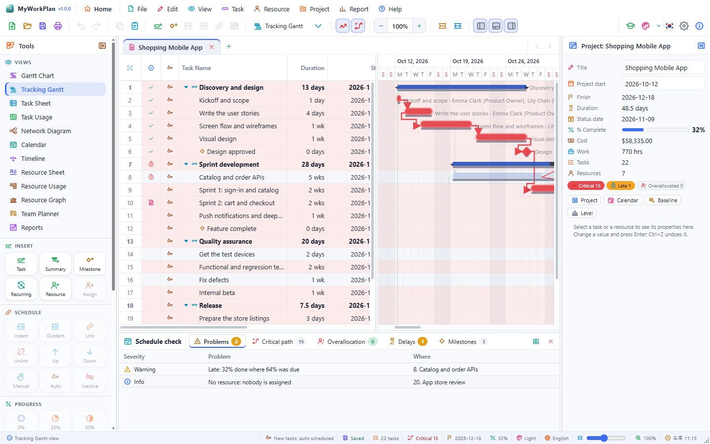

The **Tracking Gantt** view draws the current schedule on top and the baseline as a gray bar below. **View › Show › Show progress line** connects how far each task got at the status date; a line bending to the left marks a late task. In the Gantt Chart, **Show baseline bars** shows the baseline too.

The samples marked with a green dot on the start page (for example Mobile App Development) are already under way, so they are a quick way to see all of this.

### Delays and milestones at a glance

The **Delays** tab of the [bottom panel](#bottom-panel-schedule-check) lists late tasks, missed deadlines and tasks finishing after the baseline, marking those on the critical path; the **Milestones** tab shows each milestone as Done, Deadline missed, Slipping or On track. Overallocated people are on its **Overallocation** tab.

## Views

Switch between the 12 views with the toolbar view button (current view name ▾), the **Views** section of the Tools panel or **View › Switch view**. Each tab remembers its view; the first view of new projects is set in **Settings › General › Default view of new projects**.

### Gantt Chart

The task table on the left, the Gantt chart on the right, a splitter between them. The chart has a two-tier timescale, shaded non-working time, the today and status-date lines, link arrows, deadlines, baseline bars and slack lines. Black brackets are summary tasks, diamonds are milestones and red bars are critical tasks. **Settings › Gantt chart › Text next to bars** picks Name · Resources · % complete · None. See [The window](#the-window) for a picture.

### Tracking Gantt

Compares the current schedule with the baseline. See [Tracking Gantt and progress line](#tracking-gantt-and-progress-line).

### Task Sheet

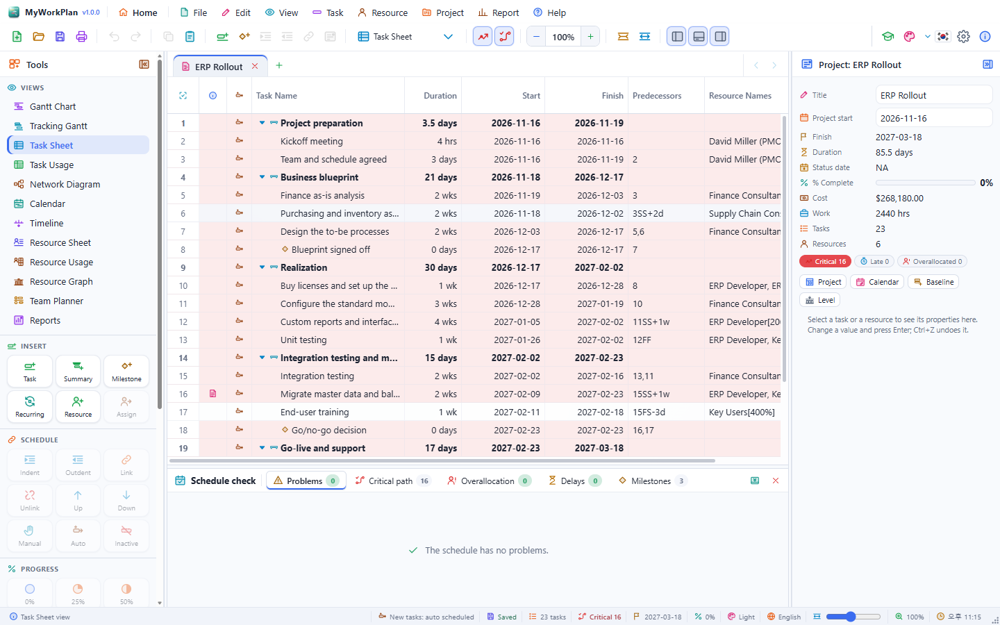

The table alone, full width — handy for wide tables (Cost, Tracking, Variance…).

### Task Usage

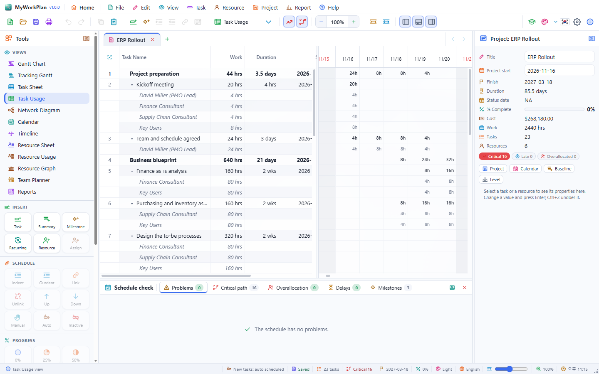

Each task with its resources below it and the hours per day on the right. Zooming the timescale switches between days, weeks and months.

### Network Diagram

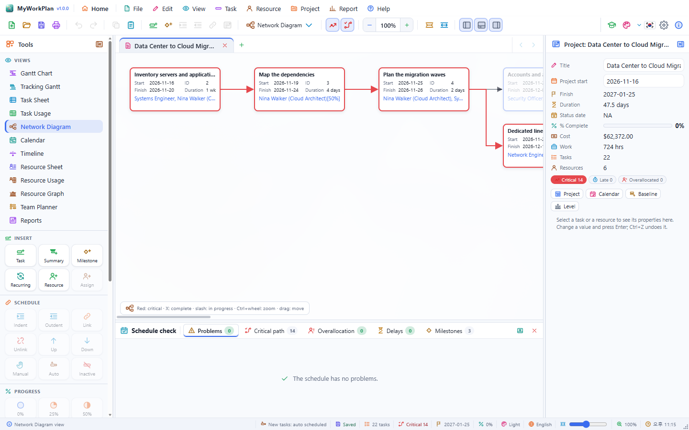

Tasks as boxes (ID, name, dates, duration, resources), links as arrows. Red boxes are critical, X marks a finished task, a slash one in progress. Drag to move around, `Ctrl+wheel` to zoom, double-click a box for Task information.

### Calendar

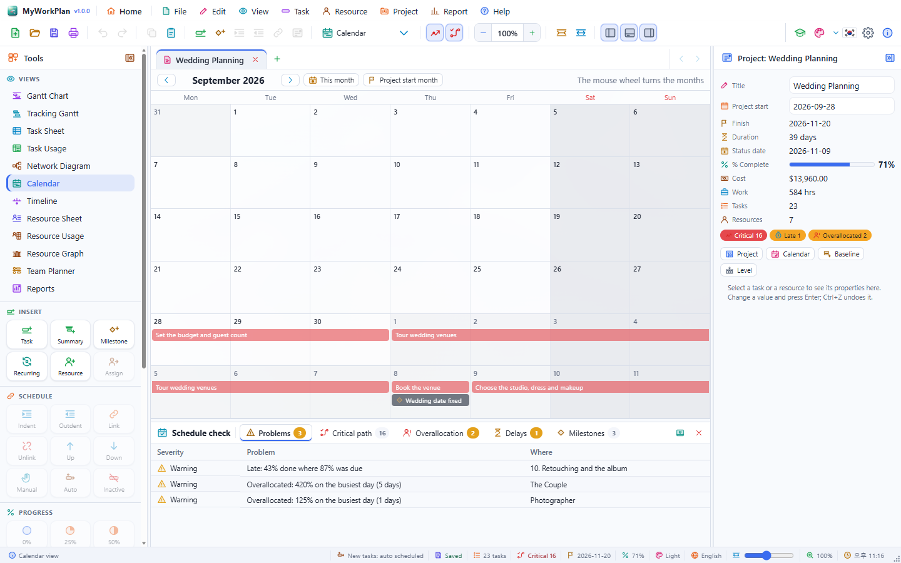

A month calendar with bars over the days each task runs. **Previous month** · **Next month** · **This month** · **Project start month** or the mouse wheel turn the months. Weeks with too many tasks show "+N".

### Timeline

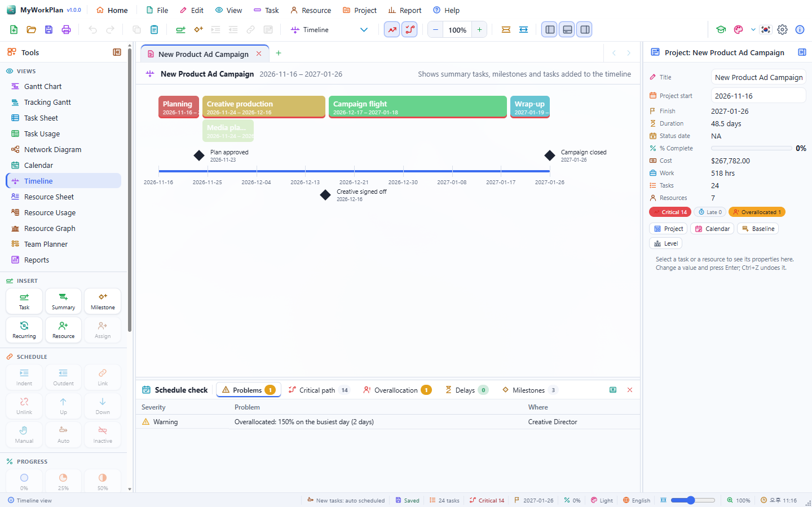

The whole project on one line: top-level summary tasks (phases) as bars, milestones as diamonds and tasks added with **Add to timeline** as call-outs — good for reporting.

### Resource Sheet

The resource table. See [Resource Sheet](#resource-sheet).

### Resource Usage

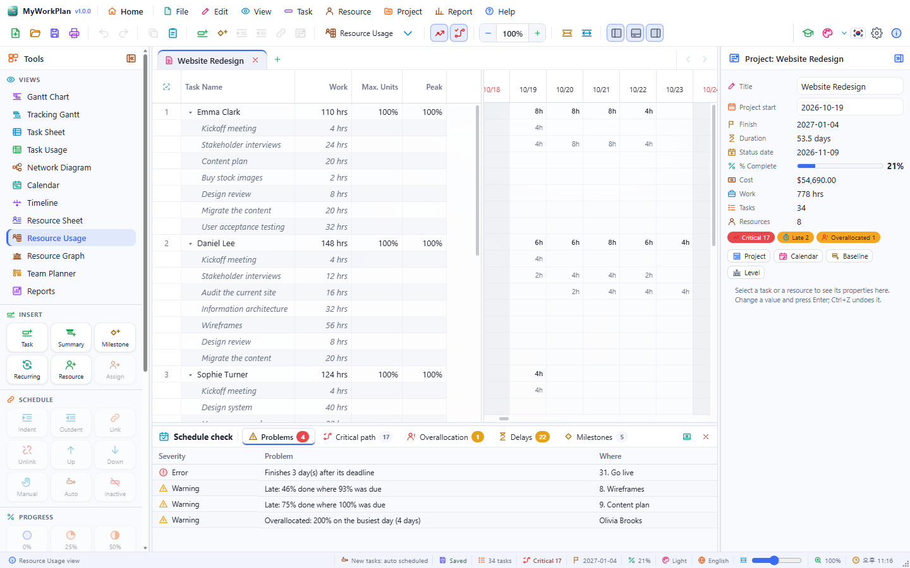

Each resource with its assignments and hours per day; periods over the limit are red. See [Overallocation](#overallocation).

### Resource Graph

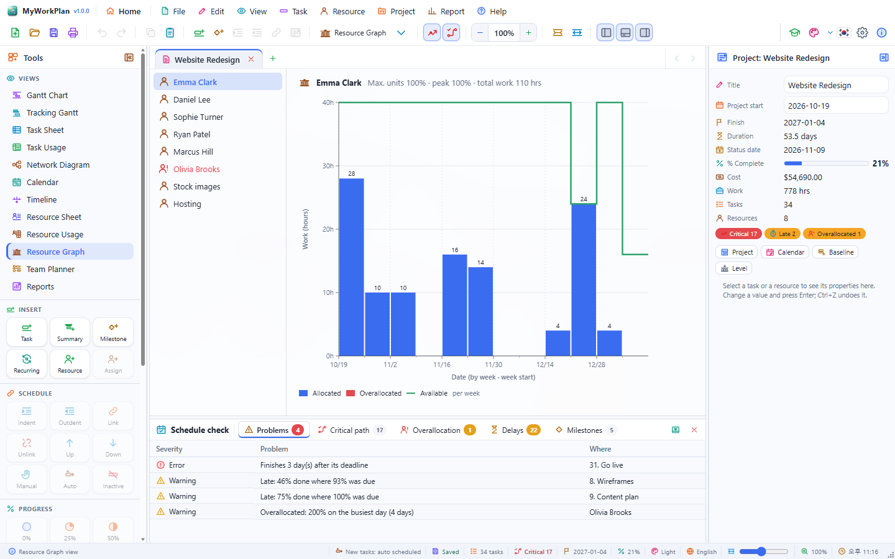

Pick a resource on the left to see its work per day (columns) against its availability (line); red above the line is overallocation. Max. units · peak · total work are summed up at the top, and **per day** · **per week** switch the scale. Only work resources are graphed.

### Team Planner

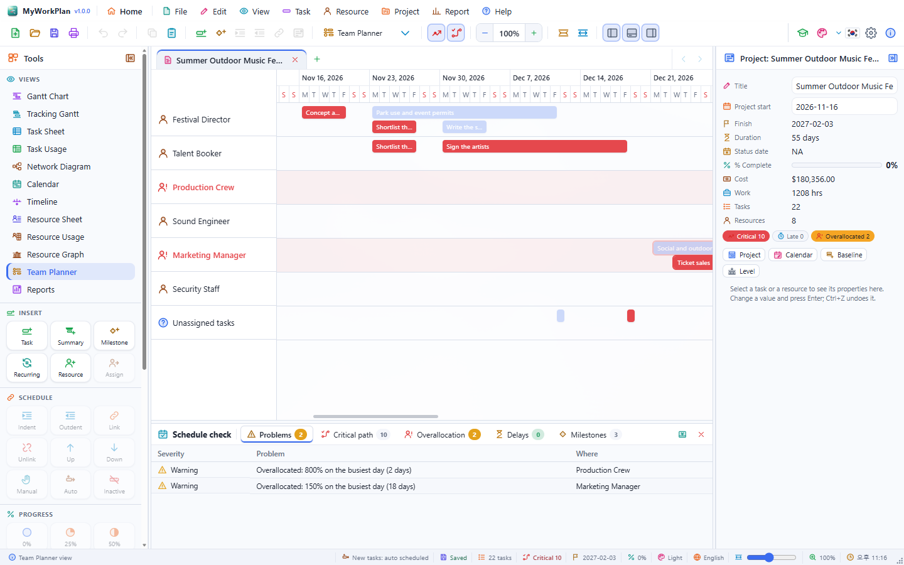

Task blocks in one lane per person; drag them to reassign. The bottom lane holds unassigned tasks. See [Team Planner](#team-planner) under Resources and costs.

### Reports

Dashboards built from the schedule. See [Reports](#reports-1).

## Tables, columns, filters, groups, sorting and find

### Tables (column sets)

Switch the column set with **View › Table, filter and group › Table (column set)** or the **Table** list in the Tools panel.

| Table | Columns |
|---|---|
| **Entry** | Indicators, Mode, Task Name, Duration, Start, Finish, Predecessors, Resource Names |
| **Schedule** | Start, Finish, Late Start, Late Finish, Free Slack, Total Slack |
| **Cost** | Fixed Cost, Labor Cost, Cost, Baseline Cost, Cost Variance, Actual Cost, Remaining Cost |
| **Work** | Work, Baseline Work, Work Variance, Actual Work, Remaining Work, % Complete |
| **Tracking** | Actual Start, Actual Finish, % Complete, Actual Duration, Remaining Duration, Actual Cost, Actual Work |
| **Variance** | Start, Finish, Baseline Start, Baseline Finish, Start Variance, Finish Variance |
| **Baseline** | Baseline Duration, Baseline Start, Baseline Finish, Baseline Work, Baseline Cost |
| **Summary** | WBS, Duration, Start, Finish, % Complete, Cost, Work |
| **Constraint dates** | Duration, Constraint Type, Constraint Date, Deadline, Priority, Task Type |

The Resource Sheet has Entry · Cost · Labor · Work · Summary tables (Labor: Pay Basis, Wage, Std. Rate, Work, Cost, Share of Cost — see [Wages and labor cost](#wages-and-labor-cost)).

### Choosing columns

- **Choose columns…**: reorder (Move up / Move down) and hide the **Columns shown** on the left, add from the **Available columns** on the right, or go back with **Default columns**. Each table keeps its own columns.
- Right-click a column header to sort, **Hide this column** or **Reset column width**.
- Drag a column border to resize it; double-click it to fit the content.

### Filters and highlighting

**Filter** (View › Table, filter and group, or the **Filter** list in the Tools panel):

All tasks · Active tasks · Completed tasks · Incomplete tasks · Critical tasks · Milestones · Summary tasks · Late tasks · Overallocated tasks · Unstarted tasks · Tasks in progress · Tasks with deadlines · Tasks with constraints · Manually scheduled tasks · Date range… · Using resource…

- The summary tasks above every match stay, so the outline still reads.
- **Highlight instead of filter** keeps every task visible and colours the matches.
- The **Search** box in the Tools panel filters by task name, notes and resource names as you type.
- While a filter is on, the status bar shows **Filter on**. **Clear filter, group and sort** removes them all.

### Groups and sorting

- **Group**: No group · Critical · Milestones · Priority · Resource · Status · Duration · % Complete · Constraint type · Task mode. Each group heading shows its count.
- **Sort**: By ID (default) · By name · By start date · By finish date · By duration · By priority · By cost · By work · By slack.

### Find, replace, go to

The **Find** window has four tabs.

| Tab | Shortcut | Contents |
|---|---|---|
| **Find** | `Ctrl+F` | Find what, Field (Task Name · Notes · Resource Names · Text1–3 · Hyperlink), Match case, Whole words, **Previous** · **Find next** |
| **Replace** | `Ctrl+H` | Replace with and **Replace all** (undone in one step) |
| **Go to** | `Ctrl+G` | Go to a task ID or a date |
| **Date range filter** | | Show only the tasks spanning From–To |

The window can stay open while you keep searching.

## Reports

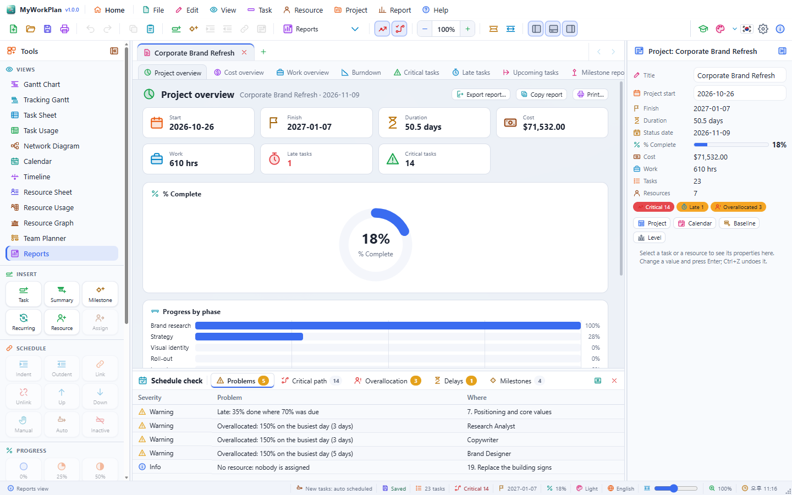

Pick a report from the **Report** menu or the list in the Reports view. Reports are judged at the status date.

| Report | Contents |
|---|---|
| **Project overview** | % complete, late and critical task counts, progress by phase, upcoming milestones |
| **Cost overview** | Cumulative cost (baseline · scheduled · actual), cost by phase (lower bar: baseline), cost by resource |
| **Work overview** | Work by resource, work by week |
| **Burndown** | Remaining work: remaining as scheduled (blue line) and actually remaining (green line) |
| **Critical tasks** | Tasks with no slack: a delay in any of them delays the project finish |
| **Late tasks** | Tasks behind their schedule at the status date |
| **Upcoming tasks** | Tasks starting within two weeks of the status date |
| **Milestone report** | All milestones and their variance against the baseline |
| **Resource overview** | Work, cost, peak and overallocation per resource |
| **Labor cost** | What the people cost and their share of the total (below) |

**Copy report** puts the report on the clipboard as text, ready to paste into a spreadsheet or document. **Print…** on the report screen opens the [print preview](#printing-and-preview) (it prints the task table and Gantt chart).

### Labor cost report

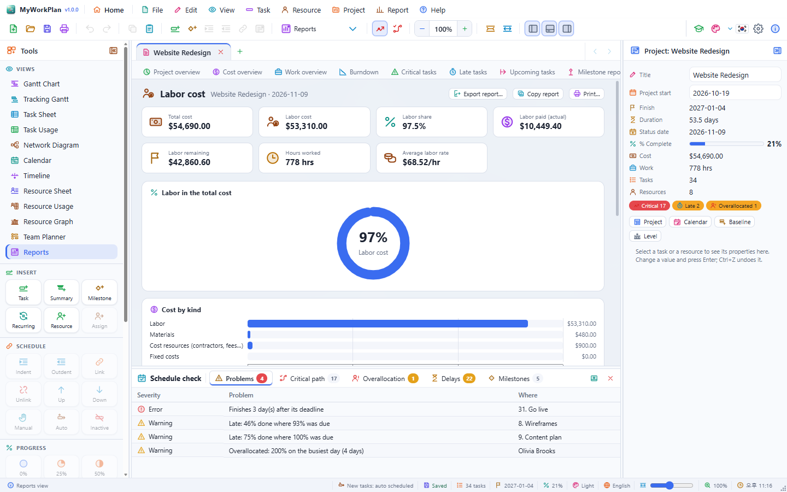

**Report › Labor cost** shows how much of the plan is people's pay (see [Wages and labor cost](#wages-and-labor-cost)).

| Part | Contents |
|---|---|
| Summary cards | **Total cost**, **Labor cost**, **Labor share**, **Labor paid (actual)**, **Labor remaining**, **Hours worked**, **Average labor rate** (per hour) |
| **Labor in the total cost** | A donut with the labor share in the middle |
| **Cost by kind** | Bars for **Labor**, **Materials**, **Cost resources (contractors, fees…)** and **Fixed costs** |
| **Labor by phase** | Labor cost of each top-level phase; the bar below is the whole phase cost |
| **Labor by person** | A table: Name, Group, Pay Basis, Wage, Std. Rate, Work, Cost, Actual Cost and Share of labor, with a **Total** row |

Like every report it can be exported, copied and printed.

### Exporting a report

**Export report** saves the report you are looking at as a file. Pick the format from the **Report › Export report** submenu, the **Export report…** button in the report header, or the right-click menu on an empty part of the report.

| Format | What you get |
|---|---|
| **HTML (.html)** | A single-file web page that opens in any browser. Charts are SVG pictures; open **Value** under a chart to see its numbers. Good for mail attachments and wikis |
| **Markdown (.md)** | Headings and GitHub tables; charts become tables of their numbers. For Git repositories, issues and note apps |
| **Word (.docx)** | An A4 Word document with headings, bordered tables (the header row repeats on every page) and the charts as pictures plus their numbers, in Malgun Gothic. Edit it in Word, Hancom Office or LibreOffice |
| **PDF (.pdf)** | The report drawn on A4 pages. The pages are stored as pictures so Korean text looks the same everywhere without embedding a font, which also means the text cannot be selected or copied |

The suggested file name is "project title - report name", and a progress window appears when building the file takes a while.

## Files

### Saving

- **Save** (`Ctrl+S`) writes a MyWorkPlan project file (`.mwp`). The first save, and plans started from a template, a sample or an import, ask for a file name.
- **Save as…** (`Ctrl+Shift+S`), **Save all** (`Ctrl+Alt+S`: every modified tab).
- When a database is set up (see [Database](#database)), **Save** writes the file and the database together.
- Files are written to a temporary file first and then swapped in, so a problem while saving never breaks the original. Large files show a progress window.
- With **Settings › General › Reopen last files when starting** on, the files that were open are opened again on the next start.

### Templates

**File › Save as template…** writes a `.mwpt` file without progress (% complete, actual dates), baselines, status date and leveling delays. Opening a template creates a new untitled project that asks for a new `.mwp` name when saved.

### Import and export

All four commands are in **File › Import and export**.

| Command | Format | Notes |
|---|---|---|
| **Import (MS Project XML · CSV)…** | `.xml` (MS Project XML), `.csv` · `.tsv` · `.txt` | Reads tasks, outline, links, lags, constraints, calendars, resources, assignments and baselines. CSV headers may be English or MS Project's Korean names. An imported project becomes a `.mwp` when saved |
| **Export to MS Project XML…** | `.xml` | MSPDI, opens in Microsoft Project 2010 and later |
| **Export to CSV…** | `.csv` | UTF-8 (BOM), English headers: ID, WBS, Name, Outline Level, Duration, Start, Finish, Predecessors, Resource Names, % Complete, Cost, Work, Milestone, Notes |
| **Export Gantt chart as picture (PNG)…** | `.png` · `.jpg` · `.webp` · `.bmp` · `.tiff` · `.svg` | Opens the **Export as image** window (below) |

**Open…** (`Ctrl+O`) opens XML and CSV files too.

The **Export as image** window:

| Field | Choices |
|---|---|
| **File format** | PNG · JPEG · WebP · BMP · TIFF · SVG |
| **Background** | **Transparent** or **White**. JPEG has no transparency, so it always gets a white background. A transparent image sits straight on top of documents and slides |
| **Content** | **Table and chart** · **Chart only** · **Table only** |
| **Scale** | 1× · 2× · 3× (SVG is a vector format and stays sharp at any size) |
| **Quality** | 40–100% (JPEG and WebP) |
| **Image size** | The resulting size in pixels; no side goes over 16,000 px |

### Recent files and folders

- **File › Recent files…** (`Ctrl+R`) opens a window with **Recent files** and **Recent folders** tabs, up to 10 of each.
- Each entry has **Open** (folders: **Open from this folder**) and **Remove from the list**; **Clear all** · **Clear all folders** remove them all.
- Files that no longer exist are marked **Missing**; opening one asks whether to remove it from the list.
- **File › Recent folders** lists the folders as a menu, and **Clear all recent files and folders** clears both lists.
- The start page's Recent card and **Settings › Recent** manage the same lists.

### Drag and drop

Drag files from the file manager onto the window:

| Dropped | Result |
|---|---|
| `.mwp` · `.mwpt` · `.json` | Opened as a project |
| `.xml` · `.csv` · `.tsv` · `.txt` | Imported |
| Images (png · jpg · gif · webp · bmp · svg …) | Become the background image |
| Text (web version) | Added as tasks, one per line |

Double-clicking a `.mwp` or `.mwpt` file opens it in MyWorkPlan too (the installer registers the file types). Opening a file that is already open switches to its tab.

### Unsaved changes

- Closing a tab (`Ctrl+W`) with unsaved changes asks **Save** · **Don't save** · **Cancel**.
- Exiting (**File › Exit**, the **Exit** tile, closing the window) lists the unsaved projects and asks the same.
- Only collapsing or expanding summary tasks does not count as a change.

## Database

Plans can be kept in a database as well as in files (desktop app only — a web browser cannot connect to a database server or an SQLite file, so the web version hides these commands).

### Connection settings

Choose in **Settings › Database**.

| Setting | Meaning |
|---|---|
| **Database type** | None · SQLite · MariaDB · MySQL · PostgreSQL |
| **SQLite file** | For SQLite. **Browse…** picks an existing file or names a new one, which is created on the first connection |
| **Server (host)** · **Port** · **Database name** · **User** | For a database server. MariaDB and MySQL use port 3306 and PostgreSQL 5432 unless you enter another. The database itself must exist; its name may only use letters, digits, `_`, `$` and `-` |
| **Password** | Not saved by default: remembered until the app closes. Turn on **Save the password in the settings** to store it with the settings |
| **Test connection** | Connects, shows the server version ("Connected — …") and creates the table `myworkplan_plans` when it is missing. A failure shows the reason (never the password) |

### Saving and opening

- Once a database type is chosen, **Save** (`Ctrl+S`) writes the file and the database together; the file stays your local copy.
- **File › Save to database** stores the active plan in the database only, with exactly the content of its `.mwp` file. Saving the same plan (same project ID) again replaces it. A plan opened from the database without a file counts as saved afterwards.
- **File › Open from database…** lists the stored plans (title · last saved · size, newest first). **Open** opens one in a new tab; **Delete from database** removes it (after asking; this cannot be undone); **Refresh** reads the list again.
- Without a connection set up, both commands say "Set up the connection in Settings › Database first" and open that tab.

## Printing and preview

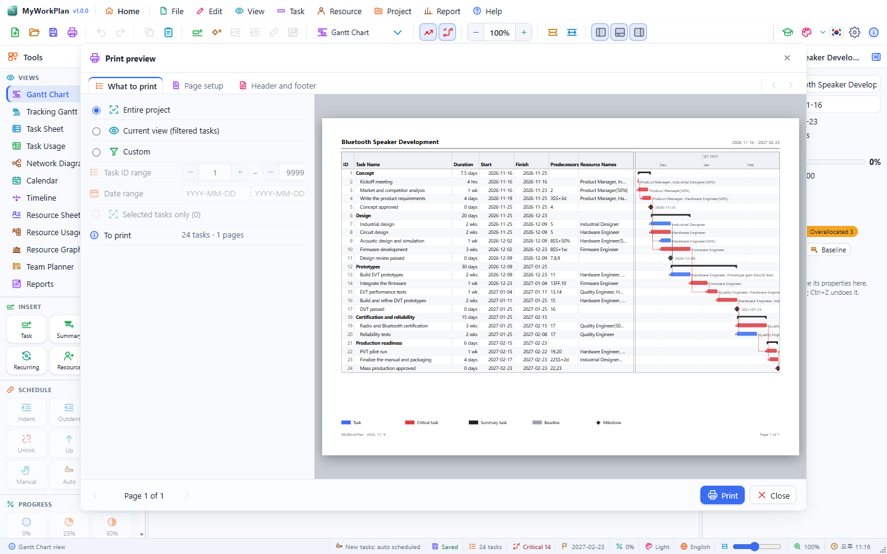

**File › Print…** (`Ctrl+P`), the Print toolbar button or the **Print** tile on the start page opens the **Print preview** window. The preview on the right follows every change; **Previous page** · **Next page** at the bottom turn the pages.

| Tab | Fields |
|---|---|
| **What to print** | **Entire project** · **Current view (filtered tasks)** · **Custom** (Task ID range, Date range, Selected tasks only), and **To print** (tasks and pages) |
| **Page setup** | Paper, orientation (portrait / landscape), margins (narrow · normal · wide), scale (50–150%), content (Table + Gantt chart · Table only · Gantt chart only), legend |
| **Header and footer** | Header and footer on/off and their text |

**Print** opens the system print dialog (Save as PDF lives there too). Prints are black on white whatever the theme; the timescale fits the page width and rows continue on the following pages. The page setup is kept for the next time.

Printing from the start page with no plan open first asks for the plan file, opens it, and then shows the preview.

## Customizing

### Themes

- The **Random theme** toolbar button picks a different theme at random on every press; its tooltip names the current theme.
- The ▾ next to it (**Choose theme**) opens a window with **Dark (20)** and **Light (20)** in two columns, plus **System setting** (follows the OS) and **Custom** at the top.
- **Settings › Theme** tab: Dark · Light · Custom groups and **System setting**. Custom lets you change Background · Surface · Panel · Text · Dim text · Border · Accent · Text on accent · Striped rows · Chart background · Toolbar · Status bar one by one, with **Copy the current theme's colors** and a **Dark theme** switch. Low contrast shows the warning "Text may be hard to read".

The start page follows the theme too; it has no theme card of its own.

### Language

The flag button on the toolbar (**Switch language**, `Ctrl+Shift+L`) switches between Korean and English: the UK flag shows while the UI is Korean, the Korean flag while it is English (press it to switch to that language). The **한국어** / **English** tile on the start page and **Settings › General › Language** work too. Menus, popups, reports, error messages and backend messages all switch. Samples you open afterwards open in the new language.

### Font

**Settings › Font** picks any font installed on the system and sets **Size**, **Weight** (Light … Extra bold), **Style** (Normal / Italic), **Row height** and **Zoom**. The font applies to the tables and charts and the sample below shows it at once.

### Background and moving background

**Settings › Background** tab:

| Field | Contents |
|---|---|
| **Background** | Moving · Image · None |
| **Moving background** | The 21 animations, **Change moving background** (`Ctrl+Shift+B`, random) |
| **Motion speed** | 0–300% |
| **Random background at start** | A different animation on every start |
| **Start page background changes** | Off · Every 15 s · 30 s · 1 min · 2 min · 5 min, while the start page is open |
| **Moving background on the start page only** | When on, nothing moves behind the views |
| **Background image** | **Choose…** · **Remove**. Images of any size can be used; dropping an image file on the window also makes it the background |
| **Background opacity (behind views)** | How strongly the background shows behind the views |
| **Fit** | Fill · Fit · Tile · Center · Stretch |

**View › Theme, language and background › Turn background off** removes the background image. Background colours follow the theme.

### Panels

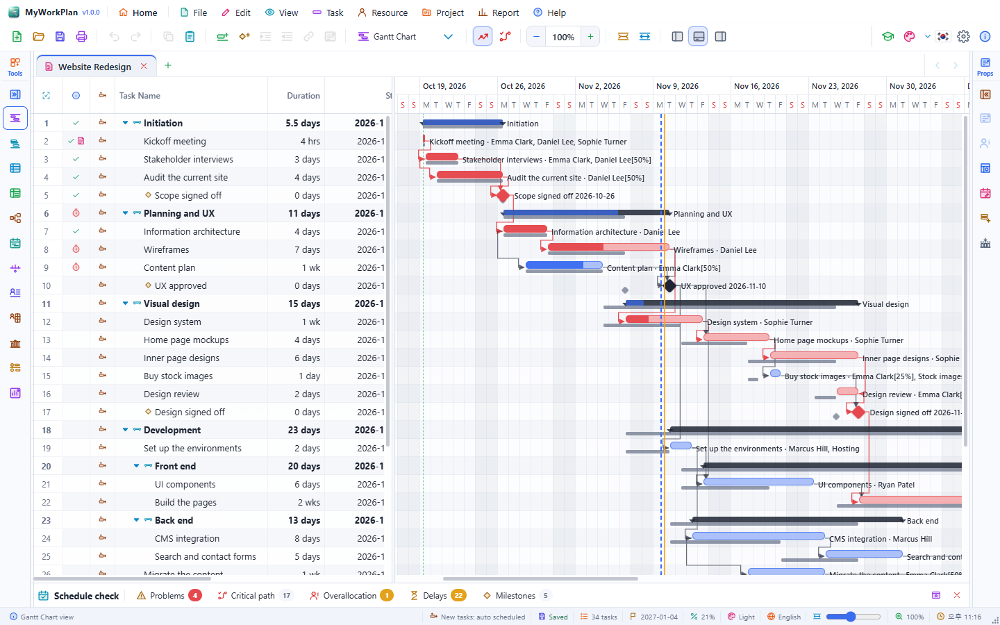

- Fold and unfold the Tools and Properties panels with the double-arrow button at the outer edge of their header, **Show/hide tool panel** (`Ctrl+Shift+1`) · **Show/hide properties panel** (`Ctrl+Shift+2`) or the toolbar buttons.
- Folded, a side panel becomes a narrow rail (44 px): at the top the panel's icon and short title (**Tools** or **Props**), then the **Expand** button, then icon-only buttons whose names are in their tooltips. The Tools rail still switches views; the Properties rail runs the main commands (Info, Resource, Project, Calendar, Baseline, Level).
- The bottom panel folds to one header line (see [Bottom panel: schedule check](#bottom-panel-schedule-check)); `Ctrl+Shift+3` turns it off and on.
- Drag the separators to change the panel widths, and the bottom panel's top edge to change its height.

### Zoom and timescale

- **Zoom** (50–200%): `Ctrl+mouse wheel`, `Ctrl+=` · `Ctrl+-` · `Ctrl+0`, or the toolbar `[−] 100% [+]` (the value can be typed).
- **Timescale**: `Ctrl+mouse wheel` over the chart, `Ctrl+Shift+=` · `Ctrl+Shift+-`, the toolbar buttons or the status bar slider; it moves between days, weeks, months and quarters.
- **Entire project** fits the whole project to the chart width; **Go to today** scrolls to today.
- Move the chart by dragging an empty area or with `Ctrl+drag`.

### The Settings window

**Help › Settings…** (`Ctrl+,`), the Settings button on the toolbar or the **Settings** tile on the start page. Settings apply at once and are kept for the next start. **Defaults** puts every setting back (the language and the background image stay); **Done** closes the window.

| Tab | Fields |
|---|---|
| **General** | Language, date format (ISO · Korean · US · European), Show times with dates, Default view of new projects, Show the start page when starting, Reopen last files when starting, Ask before deleting, Clock on the status bar, Status bar, Last folder used, Start the tutorial |
| **Start page** | What the start page shows, card opacity, card layout (see [Start page settings](#start-page-settings)) |
| **Theme** | Dark · Light · Custom, System setting |
| **Font** | Font, size, weight, style, row height, zoom |
| **Background** | Background, moving background, motion speed, random at start, automatic change, start page only, background image, background opacity, fit |
| **Schedule** | Hours per day, Hours per week, Days per month (also used to turn wages into hourly rates), Mode of new tasks |
| **Gantt chart** | Show critical path · slack · baseline bars · progress line, Show link lines, Show the today line, Shade non-working days, Text next to bars |
| **Database** | Connection settings (see [Database](#database)) |
| **Recent** | Recent files and folders, clearing them |
| **Shortcuts** | Every keyboard shortcut |

## Keyboard shortcuts

The same list is in **Settings › Shortcuts** (or **Help › Keyboard shortcuts…** and the **Keyboard shortcuts** tile on the start page), and the menus show the shortcuts next to each command. On macOS use `Cmd` instead of `Ctrl`.

| Shortcut | Command |
|---|---|
| `Ctrl+N` | New project |
| `Ctrl+O` | Open |
| `Ctrl+S` | Save |
| `Ctrl+Shift+S` | Save as |
| `Ctrl+Alt+S` | Save all |
| `Ctrl+R` | Recent files |
| `Ctrl+W` | Close tab |
| `Ctrl+P` | Print |
| `Ctrl+Z` | Undo |
| `Ctrl+Y` | Redo (`Ctrl+Shift+Z` works too) |
| `Ctrl+X` | Cut |
| `Ctrl+C` | Copy |
| `Ctrl+V` | Paste |
| `Ctrl+D` | Fill down |
| `Delete` | Delete |
| `Ctrl+A` | Select all |
| `Esc` | Clear selection |
| `Insert` | Insert task |
| `Ctrl+Shift+M` | Insert milestone |
| `Ctrl+Shift+K` | Insert summary task |
| `Alt+Shift+→ / ←` | Indent (make subtask) / Outdent |
| `Alt+Shift+↑ / ↓` | Move up / Move down |
| `Ctrl+F2` | Link tasks |
| `Ctrl+Shift+F2` | Unlink tasks |
| `Shift+F2` | Information (task, resource, link) |
| `Alt+F10` | Assign resources |
| `F2 / Enter` | Edit cell |
| `Ctrl+F` | Find |
| `Ctrl+H` | Replace |
| `Ctrl+G` | Go to |
| `Ctrl+= / Ctrl+-` | Zoom in / Zoom out |
| `Ctrl+0` | Zoom to 100% |
| `Ctrl+mouse wheel` | Zoom in / out (the timescale over a chart) |
| `Ctrl+Shift+= / -` | Zoom in timescale / Zoom out timescale |
| `Ctrl+drag` | Move charts and diagrams |
| `F9` | Calculate now |
| `Ctrl+Tab` | Next tab (`Ctrl+Shift+Tab`: previous tab) |
| `Ctrl+Shift+L` | Switch language |
| `Ctrl+Shift+B` | Change moving background |
| `Ctrl+Shift+H` | Start page (Home: pressed again, back to the plan; with no plan, a new blank plan) |
| `Ctrl+,` | Settings |
| `F11` | Tutorial |
| `F1` | About |

Shortcuts that work but are not in the Settings list:

| Shortcut | Command |
|---|---|
| `Ctrl+Shift+P` | Find critical path (on / off) |
| `Ctrl+Shift+R` | Add resource |
| `Ctrl+Shift+1` · `Ctrl+Shift+2` | Show/hide tool panel · properties panel |
| `Ctrl+Shift+3` | Bottom panel (schedule check) on / off |
| `Ctrl+Shift+F5` | Scroll to task |
| `Ctrl+Q` (macOS) · `Alt+F4` (Windows) | Exit |
| `Tab` · `Shift+Tab` (editing a cell) | Next · previous cell |
| `Ctrl+Home` · `Ctrl+End` | First · last row of the table |
| `Esc` (during the tutorial) | End the tutorial |

## Troubleshooting

### Error windows

Errors open an **Error** window with the message, **Time**, **Where** (what was being done), App (version and platform) and **Details**. **Copy details** copies everything, ready to report or keep.

| Error title | Common causes |
|---|---|
| The file could not be opened | Not a MyWorkPlan file, made by a newer version, not a Microsoft Project XML file, a CSV without tasks |
| Could not save · Could not export | A folder without write permission, another program holds the file |
| Could not save to the database · The database operation failed | Wrong server, port, database name, user or password; the server is not running; no permission to create the table |
| Input error | A duration, date or predecessor in the wrong form (the message gives examples), a link loop |
| Could not print | A printer or print dialog problem |
| The user's guide could not be opened | The `docs` folder of the installation was removed |

### Serious errors and crash.log

A serious error inside the program (the backend) opens **Serious error (backend)** with the location, thread, backtrace and the **Log file** path. The same text is appended to `crash.log`.

| OS | crash.log |
|---|---|
| Windows | `%APPDATA%\com.shkwon.myworkplan\crash.log` |
| macOS | `~/Library/Application Support/com.shkwon.myworkplan/crash.log` |
| Linux | `~/.local/share/com.shkwon.myworkplan/crash.log` |

### "Already running" error

Only one MyWorkPlan runs per user. Starting it again shows **MyWorkPlan — Start error** with "MyWorkPlan is already running." and the new copy closes. Find the open window on the taskbar (Dock); **File › Open…** there opens other projects as tabs. Even after a crash the OS releases the lock, so the next start is never blocked.

### Other problems

| Symptom | Fix |
|---|---|
| The schedule looks wrong | Check the indicators column and the conflicts on the status bar, review constraints in the **Constraint dates** table, and check that the task is not manually scheduled |
| Tasks are missing | Check filters, the search box and collapsed summary tasks; press **Clear filter, group and sort** |
| Everything is too big or too small | `Ctrl+0` (Zoom to 100%) |
| The start page cards are in a mess | **Auto arrange** on the start page (or **Settings › Start page › Card layout**) |
| A start page card is missing | Turn it back on in **Settings › Start page** (Recent, Sample projects, Moving background) |
| The start page does not show at startup | Turn on **Show the start page when starting**; the Home button (`Ctrl+Shift+H`) shows it any time |
| The Tutorial video window shows only a message | The video has not been made yet: run `npm run tutorial:video` in the project folder |
| Back to the original settings | **Settings › Defaults** |
| A recent file does not open in the web version | The browser may require picking the file again with **Open** |

## Installing and removing

### Windows

Run `MyWorkPlan-Setup-1.0.0.exe`.

1. Choose the installer language (한국어 / English).
2. **Settings from a previous installation go back to their defaults; your data stays.** At the first start after installing, theme, fonts, zoom, panels, view options, window and popup places, column widths and print choices start fresh, while recent files and folders, the list of open plans, the database connection, the background image and the tutorial history are kept. Plan files (.mwp) are never touched.
3. A previous installation is removed completely before the new one goes in.
4. `.mwp` (project) and `.mwpt` (template) files are registered with their own document icons and open with a double-click.
5. The **MyWorkPlan** Start-menu folder gets the program and a **MyWorkPlan User's Guide** shortcut (this guide). The guides, the tutorial document and video are in the `docs` folder of the installation, and the 40 sample projects (in English and Korean) and the event template are in the `samples` folder.

It installs for the current user, without administrator rights. Remove it in **Settings › Apps** (or Control Panel › Uninstall a program).

| Data | Location (Windows) |
|---|---|
| Settings (including the start page arrangement), recent files and folders | `%LOCALAPPDATA%\com.shkwon.myworkplan` (WebView2 storage) |
| Window position and size, background image, crash.log | `%APPDATA%\com.shkwon.myworkplan` |

### macOS

Open `MyWorkPlan-1.0.0-<arch>.dmg` and drag MyWorkPlan into Applications. Remove it by moving it to the Trash. macOS 11 or later is required.

### Linux

Use the `.deb` (Debian, Ubuntu), `.rpm` (Fedora…) or `.AppImage`. The deb and rpm packages register the `.mwp` and `.mwpt` file types and icons. Remove it with the package manager.

### Web version

Put the web build (`dist/`) on any static web server and use the same features in a browser. Differences:

- Files are opened with the browser's file picker; saving goes back to the same file in browsers with File System Access (Edge, Chrome) and is a download elsewhere.
- Popups float inside the page.
- Features that need the OS — file type registration, the "already running" check, the database — are desktop only. The system font list is read only when the browser allows it.
- Settings, the start page arrangement and recent history stay in the browser's storage.
