# MyWorkPlan 사용 설명서

MyWorkPlan은 Microsoft Project와 비슷한 방식으로 작업·일정·자원·비용을 계획하고 진행을 추적하는 프로그램입니다. Windows · macOS · Linux 데스크톱 앱과 웹 브라우저에서 같은 화면으로 동작합니다.

이 설명서는 하는 일 순서로 정리되어 있습니다. 화면의 메뉴·명령 이름은 프로그램에 표시되는 이름 그대로 적었습니다(예: **작업 › 작업 삽입**은 "작업" 메뉴의 "작업 삽입" 명령). 그림은 튜토리얼 화면을 캡처한 것입니다.

> English version: [UsersGuide.en.md](UsersGuide.en.md)

## 시작하기

### 처음 실행

처음 실행하면 **MyWorkPlan에 오신 것을 환영합니다** 창이 뜹니다.

| 버튼 | 하는 일 |
|---|---|
| **튜토리얼 시작** | 예제 프로젝트로 모든 기능을 차례로 보여 주는 튜토리얼을 시작합니다 |
| **예제 열기** | "웹사이트 리뉴얼 (예제)" 프로젝트를 엽니다 |
| **나중에** | 창을 닫습니다. 튜토리얼은 언제든 **도움말 › 튜토리얼**(F11)로 볼 수 있습니다 |

MyWorkPlan은 한 번에 하나만 실행됩니다. 이미 실행 중일 때 다시 실행하면 오류 창이 뜨고 새 실행은 끝납니다([문제 해결](#문제-해결) 참고).

### 시작 페이지

프로젝트를 열지 않았을 때(또는 툴바의 집 모양 버튼 **시작 페이지**, `Ctrl+Shift+H`) 보이는 화면입니다. 뒤에서는 배경이 계속 움직입니다.

| 영역 | 내용 |
|---|---|
| 위쪽 | 프로그램 이름·버전, **튜토리얼 시작** 버튼. 튜토리얼을 아직 마치지 않았다면 안내 띠가 함께 보입니다 |
| **새로 만들기** | 빈 프로젝트와 7가지 템플릿(소프트웨어 개발 · 건축 공사 · 행사 기획 · 마케팅 캠페인 · 제품 출시 · 연구 프로젝트 · 사무실 이전), **열기…**, **가져오기 (MS Project XML · CSV)…** |
| **최근 파일** · **최근 폴더** | 최근에 연 파일 10개와 폴더 10개. ✕로 하나씩, **모두 지우기** · **폴더 기록 모두 지우기**로 한 번에 지웁니다 |
| **예제 프로젝트** | 설치된 예제(웹사이트 리뉴얼 · 소프트웨어 · 건축 · 행사 계획 · 행사 템플릿) |
| **움직이는 배경** | 8가지 애니메이션 고르기, **움직이는 배경 바꾸기**(무작위), **배경 이미지…**, **움직임 속도** |
| **도움말** | **사용 설명서**, **단축키 목록…** |
| 아래쪽 | **시작할 때 시작 페이지 표시** 체크 상자 |

템플릿에는 단계(요약 작업), 작업, 연결, 마일스톤, 자원이 미리 들어 있습니다. 템플릿으로 만든 프로젝트는 처음 저장할 때 새 파일 이름을 묻습니다.

### 예제 프로젝트

**예제 프로젝트**의 "웹사이트 리뉴얼"을 열면 왼쪽에 작업 표, 오른쪽에 간트 차트가 보입니다. 검은 괄호 모양 막대는 요약 작업, 마름모는 마일스톤, 빨간 막대는 주 공정 작업입니다.

### 튜토리얼

**도움말 › 튜토리얼**(F11), 툴바의 학사모 버튼, 시작 페이지의 **튜토리얼 시작**으로 시작합니다. 예제 프로젝트를 띄워 놓고 58단계로 기능을 하나씩 보여 줍니다.

- **다음** · **이전 단계** 버튼, **자동 재생**(▶)으로 넘깁니다.
- **장 고르기** 목록으로 시작 페이지 · 계획 만들기 · 일정 잡기 · 자원과 비용 · 진행 추적 · 보기 · 보고서 · 파일과 인쇄 · 꾸미기 · 도움말 중 원하는 장으로 갑니다.
- 안내 상자는 끌어서 옮길 수 있습니다. **Esc**나 ✕로 끝냅니다.
- 내 파일은 바뀌지 않고, 튜토리얼이 바꾼 설정(테마·언어·배경 등)은 끝날 때 원래대로 돌아갑니다.

## 화면 구성

위에서부터 **메뉴 막대**와 **툴바**(한 줄)가 있고, 바로 그 아래에 왼쪽 **도구 모음** 패널과 오른쪽 **속성** 패널이 있습니다. 두 패널 사이 가운데에는 위쪽에 **프로젝트 탭**, 그 아래에 **보기**가 있고, 맨 아래는 **상태 표시줄**입니다. 패널 사이의 구분자를 끌면 너비가 바뀌고, 창 오른쪽 아래 모서리를 끌면 창 크기가 바뀝니다. 창은 툴바 버튼이 가려지지 않는 폭보다 좁아지지 않습니다.

### 메뉴 막대

메뉴 막대 맨 앞의 **홈** 버튼(`Ctrl+Shift+H`)은 언제든 시작 페이지로 돌아갑니다. 열어 둔 프로젝트는 탭에 그대로 남습니다.

| 메뉴 | 들어 있는 명령 |
|---|---|
| **파일** | 새 프로젝트 · 열기… · 시작 페이지 · 최근 파일… · 최근 폴더 · 최근 파일·폴더 기록 모두 지우기 · 저장 · 다른 이름으로 저장… · 모두 저장 · 템플릿으로 저장… · 가져오기 (MS Project XML · CSV)… · MS Project XML로 내보내기… · CSV로 내보내기… · 간트 차트 그림으로 내보내기 (PNG)… · 인쇄… · 탭 닫기 · 모든 탭 닫기 · 끝내기 |
| **편집** | 실행 취소 · 다시 실행 · 잘라내기 · 복사 · 붙여넣기 · 아래로 채우기 · 삭제 · 모두 선택 · 선택 해제 · 찾기… · 바꾸기… · 이동… |
| **보기** | 보기 전환과 12가지 보기 · 표 (열 묶음) · 열 선택… · 필터 · 필터·그룹·정렬 지우기 · 그룹 · 정렬 · 필터 대신 강조 표시 · 요약 작업만 보기 (모두 접기) · 모든 하위 작업 보기 (모두 펼치기) · 확대 · 축소 · 100%로 보기 · 시간 눈금 확대 · 시간 눈금 축소 · 프로젝트 전체 보기 · 작업으로 스크롤 · 오늘로 이동 · 주 공정(Critical Path) 표시 · 여유 시간 표시 · 기준 계획 막대 표시 · 진행선 표시 · 도구 패널 펼치기/접기 · 속성 패널 펼치기/접기 · 상태 표시줄 · 테마 무작위로 바꾸기 · 테마 고르기 · 언어 전환 · 움직이는 배경 바꾸기 · 배경 이미지… · 배경 끄기 |
| **작업** | 작업 삽입 · 요약 작업 삽입 · 마일스톤 삽입 · 반복 작업… · 들여쓰기 (하위 작업으로) · 내어쓰기 · 위로 이동 · 아래로 이동 · 작업 연결 · 연결 끊기 · 정보… · 메모… · 시간 표시 막대에 추가 · 0% 완료 ~ 100% 완료 · 예정대로 진행으로 표시 · 작업 업데이트… · 수동 일정 · 자동 일정 · 작업 비활성화 |
| **자원** | 자원 추가 · 자원 정보… · 자원 할당… · 모두 평준화 · 평준화 지우기 · 평준화 옵션… · 다음 초과 할당 · 자원 시트 · 자원 사용 · 자원 그래프 · 팀 플래너 |
| **프로젝트** | 프로젝트 정보… · 작업 시간 변경… · 프로젝트 통계… · 기준 계획 설정… · 기준 계획 지우기… · 프로젝트 업데이트… · 상태 날짜… · 지금 계산 · 다른 프로젝트 삽입… |
| **보고서** | 프로젝트 개요 · 비용 개요 · 작업량 개요 · 번다운 · 주 공정 작업 · 늦은 작업 · 다가오는 작업 · 마일스톤 보고서 · 자원 개요 · 보고서 내보내기(HTML·Markdown·Word·PDF) · 보고서 복사 · 인쇄… |
| **도움말** | 튜토리얼 · 사용 설명서 · 단축키 목록… · 설정… · 프로그램 정보… |

메뉴에는 모든 항목에 아이콘과 단축키가 함께 표시되고, 메뉴는 메인 창 밖까지 펼쳐집니다. 지금 쓸 수 없는 명령은 흐리게 보입니다.

### 툴바

| 위치 | 버튼 |
|---|---|
| 왼쪽 | 새 프로젝트 · 열기 · 저장 · 인쇄 │ 실행 취소 · 다시 실행 │ 복사 · 붙여넣기 │ 작업 삽입 · 마일스톤 삽입 · 들여쓰기 · 내어쓰기 · 작업 연결 · 정보 │ 보기 전환(지금 보기 이름 ▾) │ 확대/축소 `[−] 100% [+]` │ 시간 눈금 축소 · 확대 │ 도구 패널 · 속성 패널 |
| 오른쪽 | 시작 페이지 · 튜토리얼(학사모) · 테마(무작위) + ▾ · 언어(국기) · 설정 · 프로그램 정보(ⓘ) |

모든 버튼에 툴팁이 있습니다. 실행 취소·다시 실행 버튼의 툴팁은 무엇을 되돌리는지 알려 줍니다(예: "실행 취소: 기간 변경").

### 프로젝트 탭

프로젝트마다 탭이 하나씩 생깁니다. 탭이 많으면 양 끝의 화살표나 마우스 휠로 넘기고, `Ctrl+Tab`으로 다음 탭으로 갑니다. 탭 줄의 빈 곳을 두 번 클릭하면 새 프로젝트가 생깁니다. 저장하지 않은 변경이 있으면 메뉴 막대 오른쪽의 프로젝트 이름 뒤에 ●가 붙습니다.

### 도구 모음 (왼쪽 패널)

| 영역 | 내용 |
|---|---|
| **보기** | 12가지 보기 버튼 |
| **삽입** | 작업 · 요약 · 마일스톤 · 반복 · 자원 · 할당 |
| **일정** | 들여쓰기 · 내어쓰기 · 연결 · 연결 끊기 · 위로 · 아래로 · 수동 · 자동 · 비활성 |
| **진행** | 0% · 25% · 50% · 75% · 100% · 일정대로 |
| **데이터** | 검색 칸(작업 이름·메모·자원 검색), 필터 · 그룹 · 정렬 · 표 목록, **필터 대신 강조 표시**, 표시 중인 작업 수와 **지우기** |
| **차트에 표시** | 주 공정(Critical Path) 표시 · 여유 시간 표시 · 기준 계획 막대 표시 · 진행선 표시 |

### 속성 패널 (오른쪽)

선택한 것의 속성을 보여 주고 바로 고치게 합니다. 값을 고치고 Enter를 누르면 반영되고, `Ctrl+Z`로 되돌릴 수 있습니다.

| 선택 | 보이는 내용 |
|---|---|
| 없음 | 프로젝트: 제목, 프로젝트 시작, 완료, 기간, 상태 날짜, 완료율, 비용, 작업량, 작업 수, 자원 수, 주 공정·늦음·초과 할당·일정 충돌 개수, 버튼(프로젝트 · 달력 · 기준 계획 · 평준화) |
| 작업 하나 | 작업 이름, WBS, 기간, 시작, 완료, 완료율 슬라이더, 선행 작업, 자원 이름, 모드, 제약 유형·날짜, 마감일, 우선순위, 비용, 작업량, 총 여유 시간, 상태 표시(주 공정·늦어지고 있습니다·초과 할당·완료 차이), 메모, 막대 색, **자세히…** · **할당** · **찾아가기** |
| 작업 여러 개 | 선택 개수, 시작·완료, 비용, 연결 · 연결 끊기 · 들여쓰기 · 내어쓰기 · 0% · 50% · 100% · 비활성 · 정보 |
| 자원 | 이름, 종류, 약어, 그룹, 최대 단위, 표준 단가, 사용당 비용, 작업량, 비용, 할당된 작업 목록 |
| 연결선 | 선행 작업, 후속 작업, 연결 유형, 지연, **연결 삭제** |

### 상태 표시줄

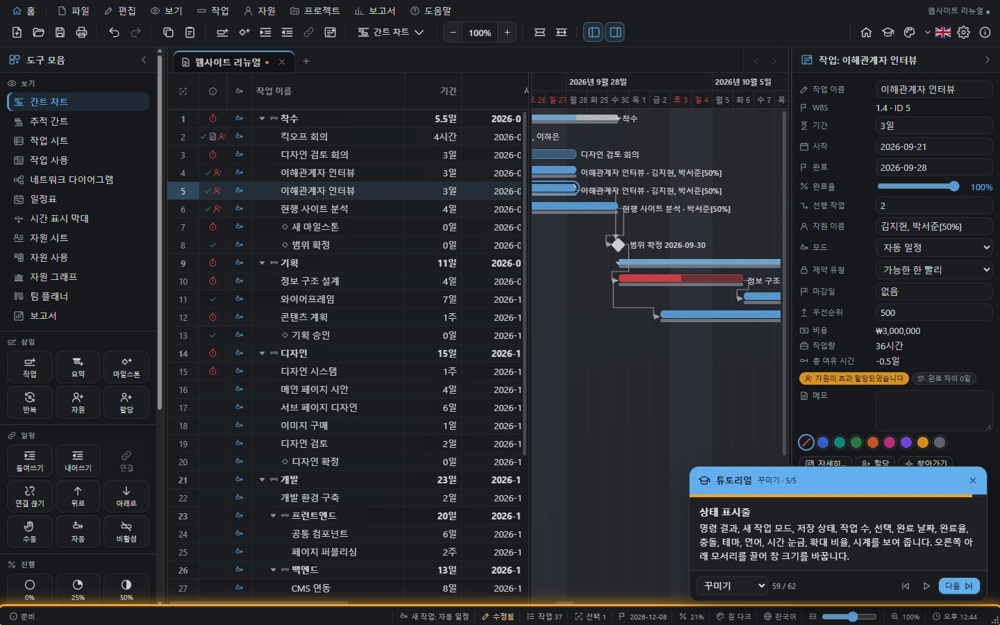

왼쪽부터 명령 결과(예: "작업 3개를 50% 완료로 표시했습니다."), **새 작업: 자동 일정/수동 일정**(클릭해서 바꾸기), 저장됨/수정됨, 작업 수, 선택 수, 프로젝트 완료 날짜, 완료율, 충돌 수, 필터 적용 중, 테마 이름, 언어, 시간 눈금 슬라이더, 확대 비율, 시계가 보입니다. **보기 › 상태 표시줄**로 숨기거나 보입니다.

### 오른쪽 클릭 메뉴

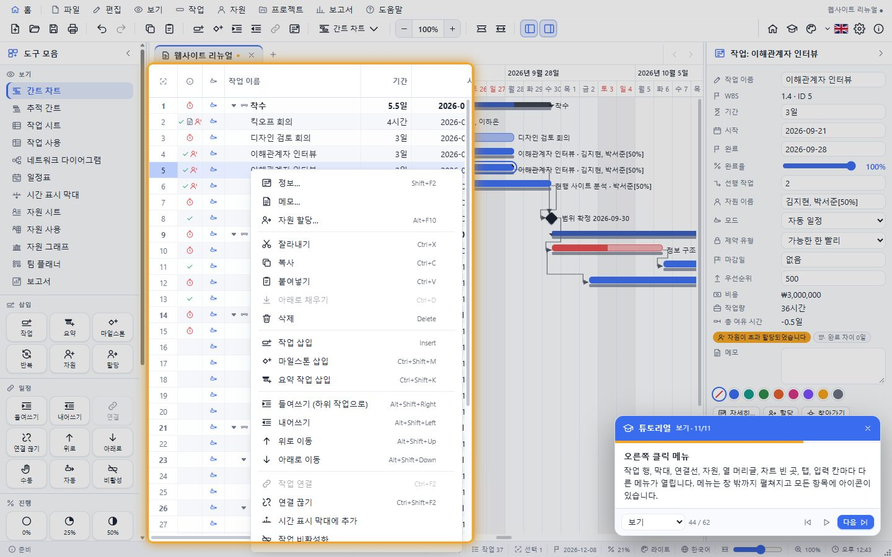

누른 곳마다 다른 메뉴가 열립니다.

| 누른 곳 | 메뉴 |
|---|---|
| 작업 행 | 정보… · 메모… · 자원 할당… · 잘라내기 · 복사 · 붙여넣기 · 아래로 채우기 · 삭제 · 작업/마일스톤/요약 작업 삽입 · 들여쓰기 · 내어쓰기 · 위로/아래로 이동 · 작업 연결 · 연결 끊기 · 시간 표시 막대에 추가 · 작업 비활성화 (요약 작업이면 하위 작업 접기/펼치기) |
| 간트 막대 | 정보… · 메모… · 작업 업데이트… · 0%/50%/100% 완료 · 예정대로 진행으로 표시 · 연결 · 작업으로 스크롤 · 시간 표시 막대에 추가 · 수동/자동 일정 · 비활성화 · 잘라내기 · 복사 · 삭제 |
| 연결선 | 연결 편집… · 완료-시작 (FS) · 시작-시작 (SS) · 완료-완료 (FF) · 시작-완료 (SF) · 연결 삭제 |
| 차트 빈 곳 | 시간 눈금 확대/축소 · 프로젝트 전체 보기 · 오늘로 이동 · 차트 표시 항목 · 그림으로 내보내기 · 인쇄 · 움직이는 배경 바꾸기 |
| 열 머리글 | 이 열 기준 정렬 · ID 순 (기본) · 열 선택… · 표 (열 묶음) · 이 열 숨기기 · 열 너비 원래대로 |
| 자원 행 | 자원 정보… · 잘라내기 · 복사 · 붙여넣기 · 삭제 · 자원 추가 · 모두 평준화 · 다음 초과 할당 · 자원 그래프 · 자원 사용 |
| 탭 | 저장 · 다른 이름으로 저장… · 템플릿으로 저장… · 프로젝트 정보… · 인쇄… · 탭 닫기 · 모든 탭 닫기 · 새 프로젝트 |
| 보고서 | 9가지 보고서 · 보고서 내보내기 · 보고서 복사 · 인쇄… |
| 상태 표시줄 | 상태 표시줄 · 확대 · 축소 · 100%로 보기 · 시간 눈금 확대/축소 · 테마 · 언어 |
| 입력 칸 | 입력 취소 · 잘라내기 · 복사 · 붙여넣기 · 모두 선택 |

### 팝업 창

작업 정보, 설정, 인쇄 미리 보기 같은 창은 데스크톱 앱에서 각자 독립된 창으로 열립니다. 메인 창 밖으로 옮길 수 있고, 메인 창을 닫으면 함께 닫힙니다. 웹 버전과 튜토리얼 중에는 메인 창 안에 떠 있는 창으로 열립니다.

## 계획 만들기

### 작업 추가

- **작업 › 작업 삽입**(`Insert`)은 선택한 행 위에 새 작업을 넣고 이름을 바로 입력하게 합니다.
- 표 맨 아래의 빈 행("여기에 새 작업 이름을 입력하세요")에 이름을 입력해도 작업이 생깁니다.
- **요약 작업 삽입**(`Ctrl+Shift+K`)은 선택한 작업들을 하위 작업으로 묶는 요약 작업을 만듭니다.
- 셀은 두 번 클릭하거나 `F2`·`Enter`로 편집합니다. 편집 중 `Enter`는 아래 칸, `Tab`은 오른쪽 칸으로 넘어가고 `Esc`는 취소합니다.
- 행 번호를 클릭해 선택하고(`Ctrl`+클릭: 여러 개, `Shift`+클릭: 범위), 행을 위아래로 끌어 옮깁니다. 좌우로 끌면 개요 수준이 바뀝니다.
- **작업 › 삭제**(`Delete`)는 선택한 작업과 그 하위 작업을 지웁니다. 삭제 전에 물어봅니다(설정 › 일반 › **삭제하기 전에 묻기**).

### 기간

기간 칸에 숫자와 단위를 입력합니다. 시작·완료 날짜는 달력에 맞춰 자동으로 계산됩니다.

| 입력 | 뜻 |
|---|---|
| `5d`, `5일`, `5 days` | 작업일 5일 |
| `3w`, `3주` | 3주 |
| `4h`, `4시간` | 4시간 |
| `30m`, `30분` | 30분 |
| `1mo`, `1개월` | 1개월 |
| `2ed`, `3eh` | 경과 시간(쉬는 날·밤도 셈): 경과 2일, 경과 3시간 |
| `5d?` | 예상 기간(물음표가 붙어 표시됨) |
| `0d` | 마일스톤 |
| `5` | 단위 없는 숫자는 일 |

하루·한 주·한 달이 몇 시간인지는 **설정 › 일정**의 **하루 작업 시간**(8) · **한 주 작업 시간**(40) · **한 달 작업일**(20)을 따릅니다.

### 마일스톤

기간이 0인 작업이 마일스톤(마름모)입니다. **작업 › 마일스톤 삽입**(`Ctrl+Shift+M`)으로 넣거나, 기간에 `0`을 입력하거나, 작업 정보의 **마일스톤으로 표시**를 켭니다.

### 개요 (요약 작업)

- **들여쓰기 (하위 작업으로)**(`Alt+Shift+→`)는 작업을 위 작업의 하위 작업으로 만듭니다. 위 작업은 요약 작업이 되어 하위 작업의 기간·작업량·비용·완료율을 합칩니다.
- **내어쓰기**(`Alt+Shift+←`)로 되돌립니다. **위로 이동** · **아래로 이동**(`Alt+Shift+↑/↓`)은 하위 작업과 함께 옮깁니다.
- 요약 작업 이름 앞의 삼각형으로 접고 펼칩니다. **보기 › 요약 작업만 보기 (모두 접기)** · **모든 하위 작업 보기 (모두 펼치기)**로 한 번에 할 수 있습니다.
- WBS 코드(1, 1.1, 1.2 …)는 개요에 따라 자동으로 매겨집니다.

### 연결과 지연

- 작업을 둘 이상 선택하고 **작업 연결**(`Ctrl+F2`)을 누르면 위에서 아래 순서로 완료-시작(FS)으로 이어집니다. **연결 끊기**(`Ctrl+Shift+F2`)는 선택한 작업의 연결을 지웁니다.
- 간트 막대를 위아래로 끌어 다른 막대 위에 놓아도 연결됩니다.
- **선행 작업** 칸에 직접 입력할 수 있습니다: `3`, `5SS+2d`, `7FF-1d`, `4FS+50%`처럼 작업 ID 뒤에 연결 유형과 지연을 붙이고 쉼표로 구분합니다.
- 연결선을 두 번 클릭하면 **작업 연결** 창이 열리고, 오른쪽 클릭하면 유형을 바로 바꾸는 메뉴가 나옵니다.

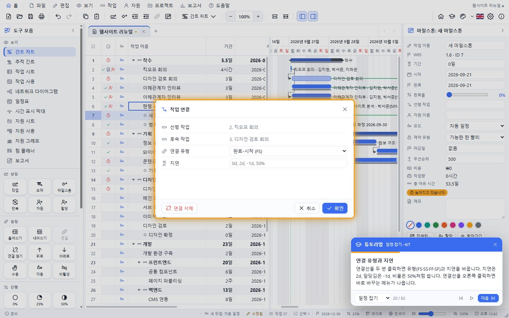

| 연결 유형 | 뜻 |
|---|---|
| **완료-시작 (FS)** | 선행 작업이 끝나야 후속 작업이 시작 (기본) |
| **시작-시작 (SS)** | 선행 작업이 시작하면 후속 작업도 시작 |
| **완료-완료 (FF)** | 선행 작업이 끝나야 후속 작업이 끝남 |
| **시작-완료 (SF)** | 선행 작업이 시작해야 후속 작업이 끝남 |

**지연**은 `2d`(2일 뒤), `-1d`(1일 앞당김), `50%`(선행 작업 기간의 절반)처럼 씁니다. 요약 작업에 건 연결은 그 안의 모든 작업에 적용됩니다. 순환이 생기는 연결이나 요약 작업과 그 하위 작업 사이의 연결은 만들지 않습니다.

### 막대 끌기

| 끄는 곳 | 바뀌는 것 |
|---|---|
| 막대 가운데 | 시작 날짜 (작업에 "다음 날짜 이후에 시작" 제약이 걸립니다) |
| 막대 오른쪽 끝 | 기간 |
| 막대 왼쪽의 진행 손잡이 | 완료율 |
| 막대를 위아래로 다른 막대 위에 | 두 작업 연결 |
| 차트 빈 곳 (또는 `Ctrl+끌기`) | 차트 이동 |

막대를 두 번 클릭하면 작업 정보 창이 열립니다.

### 실행 취소와 복사·붙여넣기

- 모든 편집은 `Ctrl+Z`로 되돌리고 `Ctrl+Y`(또는 `Ctrl+Shift+Z`)로 다시 실행합니다. 탭(프로젝트)마다 기록이 따로 있습니다.
- `Ctrl+C` · `Ctrl+X` · `Ctrl+V`로 작업(하위 작업·연결·할당 포함)이나 자원을 복사·이동합니다.
- 엑셀이나 메모장에서 복사한 목록도 작업으로 붙여넣어집니다. 들여쓰기(공백 두 칸 또는 탭)는 개요 수준, 탭 뒤의 값은 기간이 됩니다. 반대로 복사한 작업은 엑셀에 이름·기간·시작·완료 열로 붙여넣어집니다.
- **아래로 채우기**(`Ctrl+D`): 여러 작업을 선택한 뒤 셀 하나를 고르면 첫 작업의 그 값이 아래 작업들에 복사됩니다.

### 작업 정보 창

작업을 두 번 클릭하거나 **작업 › 정보…**(`Shift+F2`)를 누르면 열립니다. 작업을 여러 개 선택하고 열면 **여러 작업 정보** 창이 되어, 바꾼 항목만 선택한 모든 작업에 적용됩니다.

| 탭 | 항목 |
|---|---|
| **일반** | 이름, 기간과 **예상**, 완료율, 우선순위(0~1000), 일정 모드(자동/수동), 시작·완료(수동 일정일 때 직접 입력), **마일스톤으로 표시**, **활성** |
| **선행 작업** | 선행 작업 목록(작업 · 연결 유형 · 지연), **선행 작업 추가**, 연결 삭제 |
| **자원** | 할당된 자원과 단위(작업 자원 %, 재료 수량, 비용 자원 금액), **자원 할당**, 할당 해제 |
| **고급** | 제약 유형과 제약 날짜, 마감일, 작업 유형, 노력 기반, 작업 달력, 고정 비용, WBS 코드 |
| **메모** | 메모, 하이퍼링크 (웹 주소나 파일) |
| **사용자 지정 필드** | 텍스트1~3, 숫자1, 플래그1, 막대 색, 간트 막대 숨기기, 시간 표시 막대에 표시 |

**메모…** 명령은 이 창을 메모 탭으로 엽니다.

### 반복 작업

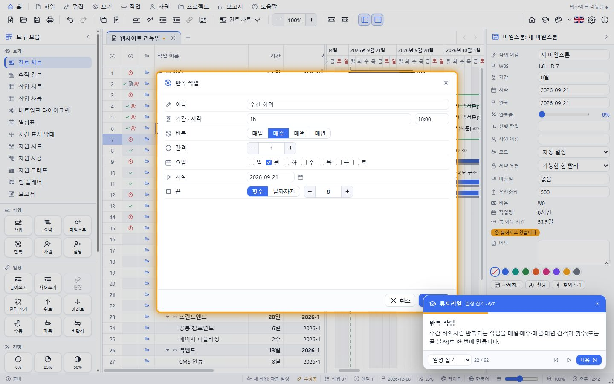

**작업 › 반복 작업…**은 주간 회의처럼 되풀이되는 작업을 한 번에 만듭니다.

| 항목 | 내용 |
|---|---|
| **이름** · **기간 · 시각** | 예: 주간 회의, `1h`, 시작 시각 `10:00` |
| **반복** | 매일 · 매주 · 매월 · 매년, **간격**(몇 일·주·달마다) |
| **요일** / **날짜** | 매주: 요일 체크, 매월·매년: 날짜 |
| **작업일에만** | 매일 반복에서 쉬는 날 건너뛰기 |
| **시작** · **끝** | 시작 날짜, 끝은 **횟수**(반복 횟수) 또는 **날짜까지**(끝 날짜) |

결과는 요약 작업 하나와 그 아래 회차별 작업이며, 회차마다 "다음 날짜 이후에 시작" 제약으로 날짜가 고정됩니다. 표시기 열에 반복 작업 아이콘이 붙습니다.

### 그 밖의 작업 명령

| 명령 | 하는 일 |
|---|---|
| **작업 비활성화** | 작업을 지우지 않고 일정·비용 계산에서 뺍니다(회색 표시). 다시 누르면 활성 |
| **시간 표시 막대에 추가** | 작업을 시간 표시 막대 보기에 표시 |
| 막대 색 | 속성 패널의 색 견본이나 작업 정보 › 사용자 지정 필드에서 막대 색을 고름 |
| **프로젝트 › 다른 프로젝트 삽입…** | 다른 파일(.mwp · .mwpt · XML · CSV)의 작업을 요약 작업 하나 아래에 넣음. 같은 이름의 자원은 합쳐짐 |

## 일정

### 자동 일정과 수동 일정

- **자동 일정** 작업은 연결·제약·달력에 따라 날짜가 계산됩니다.
- **수동 일정** 작업은 입력한 시작·완료 날짜에 그대로 머뭅니다(막대가 다른 모양으로 표시).
- 선택한 작업은 **작업 › 수동 일정** · **자동 일정**으로 바꿉니다. 새 작업의 모드는 상태 표시줄의 **새 작업: 자동 일정/수동 일정**을 클릭하거나 **설정 › 일정 › 새 작업의 일정 모드**에서 정합니다.

### 제약 조건

작업 정보 › **고급** 탭(또는 속성 패널)의 **제약 유형**과 **제약 날짜**로 정합니다.

| 제약 유형 | 뜻 |
|---|---|
| **가능한 한 빨리** | 기본. 연결이 허락하는 가장 이른 날짜 |
| **가능한 한 늦게** | 후속 작업과 프로젝트 완료를 늦추지 않는 가장 늦은 날짜 |
| **다음 날짜 이후에 시작** | 제약 날짜보다 일찍 시작하지 않음 |
| **다음 날짜 이전에 시작** | 제약 날짜까지는 시작 |
| **다음 날짜 이후에 완료** | 제약 날짜보다 일찍 끝나지 않음 |
| **다음 날짜 이전에 완료** | 제약 날짜까지는 끝남 |
| **반드시 시작해야 하는 날짜** | 그 날짜에 시작 |
| **반드시 완료해야 하는 날짜** | 그 날짜에 완료 |

연결과 제약이 맞지 않으면(예: 선행 작업 때문에 "반드시 시작해야 하는 날짜"를 지킬 수 없음) 상태 표시줄에 **충돌** 개수가 뜨고 표시기 열에 경고가 붙습니다. **프로젝트 정보 › 작업이 제약 날짜를 항상 따름**이 켜져 있으면 제약 날짜가, 꺼져 있으면 연결이 이깁니다.

### 마감일

**마감일**은 작업을 옮기지는 않지만 늦은 날짜 계산에 들어가고, 작업이 마감일을 넘기면 표시기 열에 "마감일을 넘겼습니다" 경고가 뜹니다. 간트 차트에는 마감일 표시가 그려집니다.

### 달력과 작업 시간

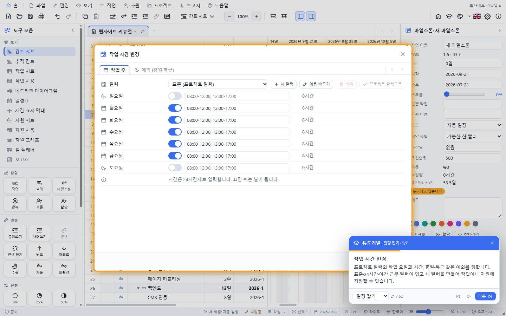

**프로젝트 › 작업 시간 변경…**에서 달력을 고칩니다.

- 기본 달력: **표준**(월~금 08:00-12:00, 13:00-17:00), **24시간**, **야간 근무**.
- **새 달력** · **이름 바꾸기** · **삭제** · **프로젝트 달력으로** 버튼으로 달력을 관리합니다.
- **작업 주** 탭: 요일마다 **작업하는 날** 스위치와 작업 시간(예: `08:00-12:00, 13:00-17:00`, 24시간제).
- **예외 (휴일·특근)** 탭: 이름, 시작, 끝과 시간을 넣고 **추가**. 시간을 비우면 쉬는 날, 시간을 쓰면 특근입니다.
- 작업은 자기 **작업 달력** → 할당된 작업 자원의 달력 → 프로젝트 달력 순서로 달력을 씁니다.

### 주 공정과 여유 시간

- **주 공정 작업**(빨간 막대)은 여유 시간이 없어서 늦어지면 프로젝트 완료가 늦어지는 작업입니다. **보기 › 주 공정(Critical Path) 표시**로 켜고 끕니다.
- **여유 시간 표시**를 켜면 막대 뒤에 가는 선으로 자유 여유 시간(다른 작업을 늦추지 않고 미룰 수 있는 시간)이 보입니다.
- **총 여유 시간** · **자유 여유 시간** · **빠른/늦은 시작·완료**는 **일정** 표에서 볼 수 있습니다.
- **프로젝트 정보 › 여유 시간이 이 일수 이하면 주 공정**으로 기준을 넓힐 수 있습니다(기본 0일).

### 일정 기준과 프로젝트 정보

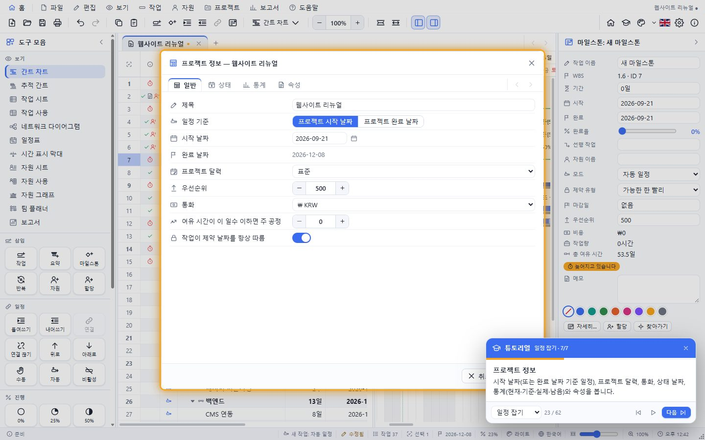

**프로젝트 › 프로젝트 정보…**

| 탭 | 항목 |
|---|---|
| **일반** | 제목, **일정 기준**(프로젝트 시작 날짜 / 프로젝트 완료 날짜), 시작 날짜 또는 완료 날짜, 프로젝트 달력, 우선순위, 통화(₩ · $ · € · ¥ · £), 주 공정 여유 기준, 제약 날짜 따르기 |
| **상태** | 상태 날짜, 오늘, 완료율, 늦은 작업·주 공정·충돌 개수 |
| **통계** | 시작·완료·기간·작업량·비용의 현재 · 기준 계획 · 실제 · 남음, 작업·마일스톤·자원 수 |
| **속성** | 주제, 작성자, 관리자, 회사, 범주, 키워드, 설명 |

**일정 기준**을 "프로젝트 완료 날짜"로 하면 완료 날짜에서 거꾸로 계산해 모든 작업이 가능한 한 늦게 놓입니다. **프로젝트 통계…**는 이 창을 통계 탭으로, **상태 날짜…**는 상태 탭으로 엽니다.

### 지금 계산

일정은 편집할 때마다 자동으로 다시 계산됩니다. **프로젝트 › 지금 계산**(`F9`)은 오늘 날짜 기준 값(늦은 작업 등)을 새로 고칠 때 씁니다.

## 자원과 비용

### 자원 시트

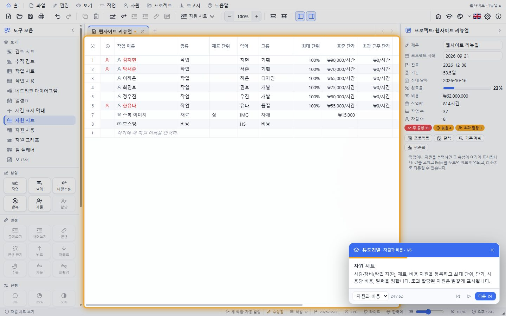

**자원 › 자원 시트** 보기에서 자원을 등록합니다. 맨 아래 빈 행에 이름을 입력하거나 **자원 추가**(`Ctrl+Shift+R`)를 누릅니다.

| 종류 | 쓰임 | 비용 계산 |
|---|---|---|
| **작업** | 사람·장비. 최대 단위(100% = 한 사람 전일), 달력 | 작업량(시간) × 표준 단가 + 사용당 비용 |
| **재료** | 시멘트·종이처럼 수량으로 쓰는 것. 재료 단위(예: 톤) | 수량 × 표준 단가 + 사용당 비용 |
| **비용** | 출장비·임대료처럼 금액만 있는 것 | 할당할 때 입력한 금액 |

자원을 두 번 클릭하면 **자원 정보** 창(일반 · 비용 · 할당 · 메모 탭)이 열립니다. 초과 할당된 자원은 빨갛게 표시됩니다.

### 자원 할당

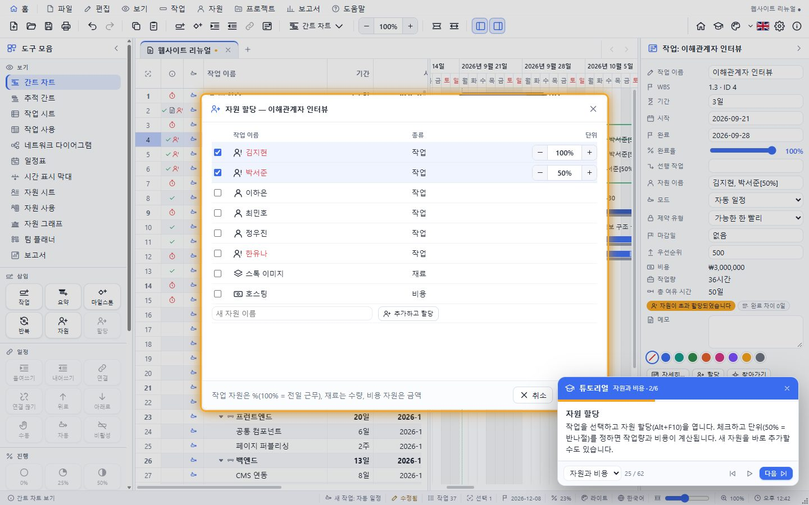

작업을 선택하고 **자원 › 자원 할당…**(`Alt+F10`)을 엽니다. 자원을 체크하고 단위(작업 자원은 %, 50% = 반나절)를 정하면 작업량과 비용이 계산됩니다. 아래 칸에 새 자원 이름을 쓰고 **추가하고 할당**을 누르면 자원을 만들면서 할당합니다.

**자원 이름** 칸에 직접 `김철수, 이영희[50%]`처럼 입력해도 됩니다. 없는 이름은 새 작업 자원으로 만들어집니다. 요약 작업에는 자원을 할당하지 않습니다.

### 작업 유형과 노력 기반

작업 정보 › **고급**에서 정합니다.

| 작업 유형 | 기간을 바꾸면 |
|---|---|
| **단위 고정** (기본) | 작업량이 따라 바뀜 |
| **기간 고정** | 기간만 바뀜 |
| **작업량 고정** | 작업량은 그대로, 단위가 바뀜 |

**노력 기반 (자원을 늘리면 기간이 줄어듦)**을 켜면, 작업 자원을 더 할당할 때 전체 작업량이 유지되도록 기간이 줄어듭니다(기간 고정 작업 제외).

### 비용

- 작업 비용 = 할당된 자원의 비용 + **고정 비용**. 요약 작업과 프로젝트는 하위 작업 비용을 합칩니다.
- **비용** 표에서 고정 비용, 비용, 기준 비용, 비용 차이, 실제 비용, 남은 비용을 봅니다. 실제 비용은 완료율만큼 계산됩니다.
- 통화 기호는 **프로젝트 정보 › 통화**에서 고릅니다.

### 초과 할당

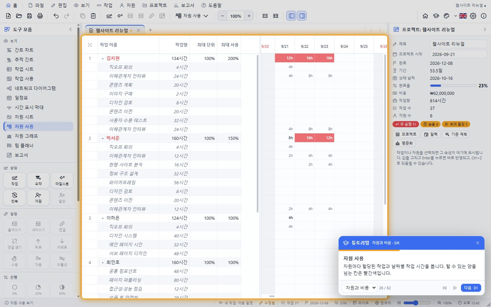

자원이 하루에 할 수 있는 양(최대 단위 × 그날 작업 시간)보다 많은 일이 겹치면 초과 할당입니다.

- 자원 시트에서 빨간색, 작업의 표시기 열에 "자원이 초과 할당되었습니다" 아이콘이 붙습니다.
- **자원 사용** 보기에서 넘치는 날이 빨간 칸으로 보입니다.
- **자원 그래프** 보기는 한 자원의 날짜별 작업량을 막대로, 사용 가능한 양을 선으로 보여 줍니다(일 단위/주 단위).
- **자원 › 다음 초과 할당**은 초과 할당된 다음 작업으로 이동합니다.

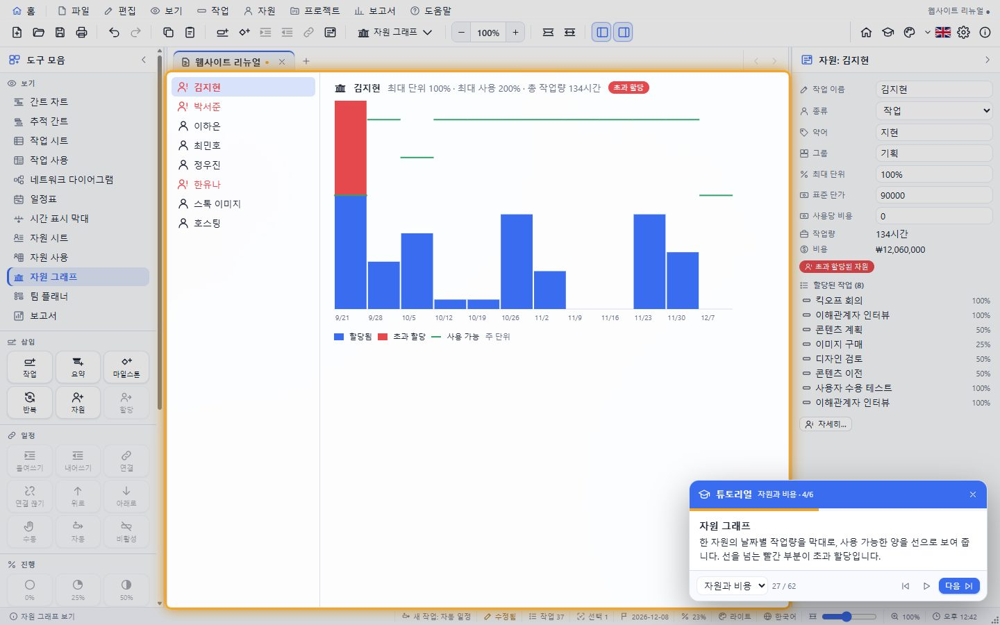

### 자원 평준화

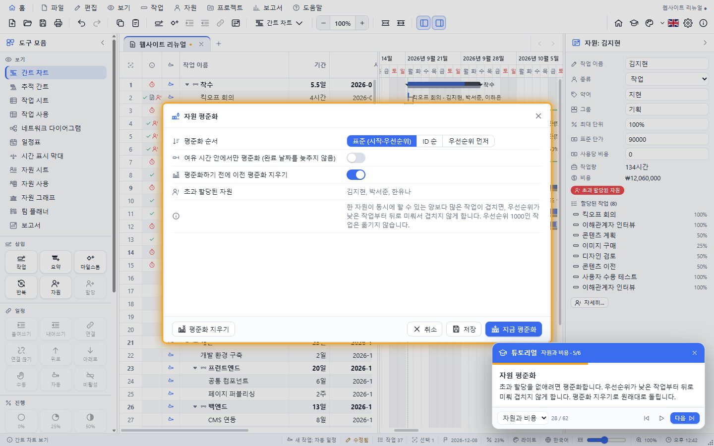

**자원 › 모두 평준화**는 초과 할당이 없어질 때까지 우선순위가 낮은 작업부터 뒤로 미룹니다. 미룬 양은 **평준화 지연** 필드에 들어가며 **평준화 지우기**로 원래대로 돌립니다(작업을 선택했으면 그 작업만).

**평준화 옵션…** 창:

| 항목 | 내용 |
|---|---|
| **평준화 순서** | 표준 (시작·우선순위) · ID 순 · 우선순위 먼저 |
| **여유 시간 안에서만 평준화 (완료 날짜를 늦추지 않음)** | 켜면 프로젝트 완료를 늦추는 이동은 하지 않음 |
| **평준화하기 전에 이전 평준화 지우기** | 기본 켜짐 |
| **초과 할당된 자원** | 지금 초과 할당된 자원 목록 |
| 버튼 | 평준화 지우기 · 저장(옵션만) · **지금 평준화** |

우선순위 1000인 작업, 수동 일정 작업, 이미 시작한 작업, "반드시 시작/완료해야 하는 날짜" 작업은 옮기지 않습니다. 다 풀지 못하면 남은 자원 이름이 상태 표시줄에 표시됩니다.

### 팀 플래너

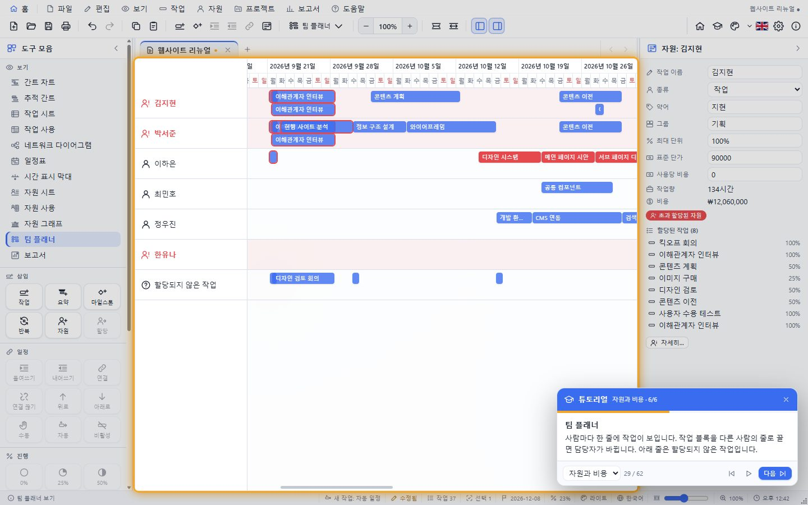

**자원 › 팀 플래너**는 사람마다 한 줄에 작업 블록을 보여 줍니다. 블록을 다른 사람의 줄로 끌면 담당자가 바뀌고, 맨 아래 **할당되지 않은 작업** 줄에서 끌어오면 할당됩니다. 초과 할당된 줄은 빨갛게 표시됩니다.

## 진행 추적

### 기준 계획

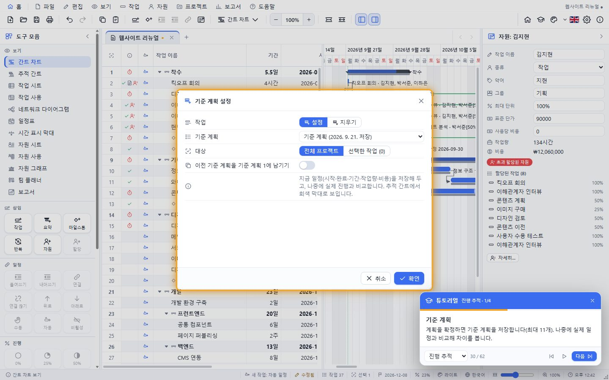

계획을 확정하면 **프로젝트 › 기준 계획 설정…**으로 지금 일정(시작 · 완료 · 기간 · 작업량 · 비용)을 저장해 둡니다.

- **기준 계획**과 **기준 계획 1~10**, 모두 11개까지 저장합니다. 저장한 날짜가 목록에 표시됩니다.
- **대상**: 전체 프로젝트 또는 선택한 작업.
- 기준 계획을 다시 저장할 때 **이전 기준 계획을 기준 계획 1에 남기기**로 이전 것을 보관할 수 있습니다.
- **기준 계획 지우기…**는 저장한 기준 계획을 지웁니다(일정은 바뀌지 않음).
- 차이(시작 차이, 완료 차이, 기간·작업량·비용 차이)와 추적 간트의 회색 막대는 **기준 계획**(0번)과 비교합니다.

### 완료율

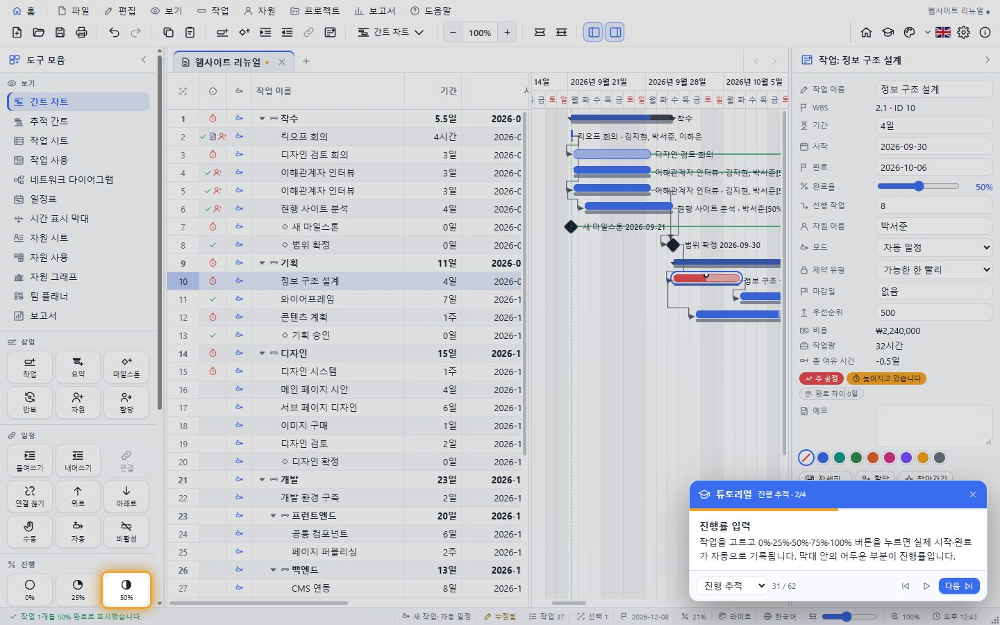

작업을 고르고 **0% 완료** · **25% 완료** · **50% 완료** · **75% 완료** · **100% 완료**를 누릅니다(작업 메뉴, 도구 모음의 진행 영역). 실제 시작·완료 날짜가 자동으로 기록되고 막대 안의 어두운 부분으로 진행률이 보입니다. 막대의 진행 손잡이를 끌거나 속성 패널의 슬라이더로도 바꿉니다.

**예정대로 진행으로 표시**는 선택한 작업을 상태 날짜까지 일정대로 진행한 것으로 표시합니다.

### 작업 업데이트

**작업 › 작업 업데이트…**(작업 하나 선택)는 완료율, 실제 기간, 남은 기간, 실제 시작, 실제 완료를 자세히 입력하는 창입니다.

### 프로젝트 업데이트

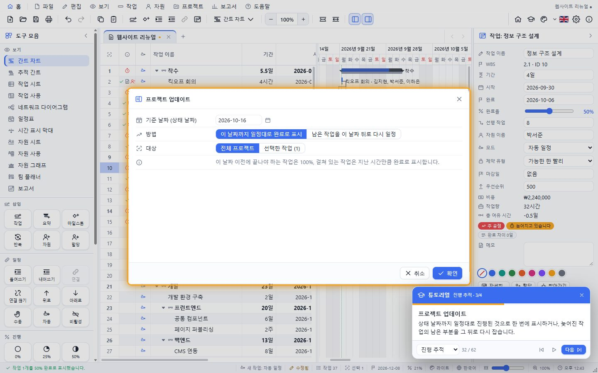

**프로젝트 › 프로젝트 업데이트…**

| 항목 | 내용 |
|---|---|
| **기준 날짜 (상태 날짜)** | 이 날짜가 프로젝트의 상태 날짜가 됩니다 |
| **이 날짜까지 일정대로 완료로 표시** | 이 날짜 전에 끝나야 하는 작업은 100%, 걸쳐 있는 작업은 지난 시간만큼 완료로 표시 |
| **남은 작업을 이 날짜 뒤로 다시 일정** | 아직 시작하지 않았는데 이 날짜 전에 시작하기로 된 작업을 이 날짜 이후로 옮김 |
| **대상** | 전체 프로젝트 또는 선택한 작업 |

### 상태 날짜

상태 날짜는 진행 상황을 판단하는 기준일입니다(늦은 작업, 진행선, 보고서, 프로젝트 업데이트). **프로젝트 › 상태 날짜…**(프로젝트 정보의 상태 탭)에서 정합니다. 정하지 않으면 오늘을 씁니다. 상태 날짜까지 끝났어야 하는데 덜 된 작업은 **늦은 작업**이 되어 표시기 열에 "늦어지고 있습니다"가 붙습니다.

### 추적 간트와 진행선

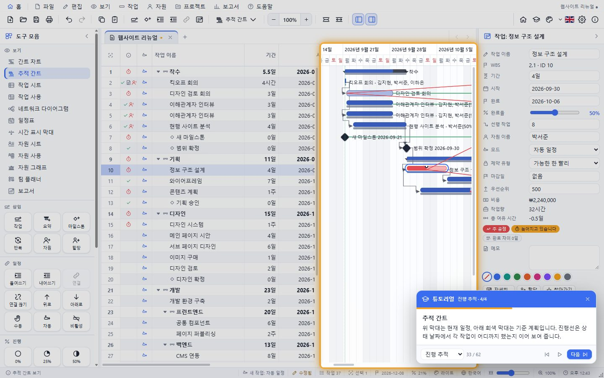

**추적 간트** 보기는 위에 현재 일정 막대, 아래에 기준 계획 회색 막대를 그립니다. **보기 › 진행선 표시**를 켜면 상태 날짜에서 각 작업이 어디까지 진행했는지 이은 선이 보입니다. 선이 왼쪽으로 꺾이면 늦은 작업입니다. 간트 차트에서도 **기준 계획 막대 표시**를 켜면 기준 계획이 보입니다.

## 보기

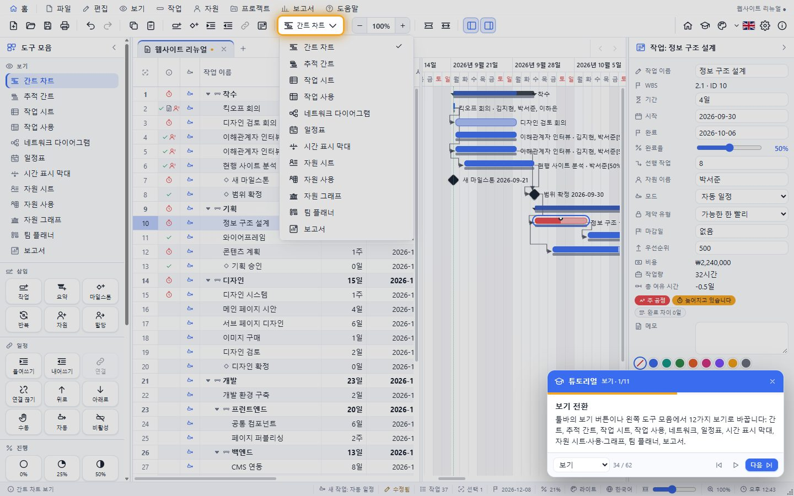

툴바의 보기 버튼(지금 보기 이름 ▾), 왼쪽 도구 모음, **보기** 메뉴에서 12가지 보기로 바꿉니다. 보기는 탭마다 따로 기억되고, 새 프로젝트의 처음 보기는 **설정 › 일반 › 새 프로젝트의 기본 보기**에서 정합니다.

### 간트 차트

왼쪽은 작업 표, 오른쪽은 간트 차트입니다. 가운데 구분자로 너비를 나눕니다. 차트에는 2단 시간 눈금, 쉬는 날 음영, 오늘 선, 상태 날짜 선, 연결 화살표, 마감일, 기준 계획 막대, 여유 시간 선이 그려집니다. 막대 옆 글자는 **설정 › 간트 차트 › 막대 옆 글자**(이름 · 자원 · 완료율 · 없음)로 고릅니다. 그림은 [예제 프로젝트](#예제-프로젝트)를 보세요.

### 추적 간트

현재 일정과 기준 계획을 위아래로 비교합니다. [추적 간트와 진행선](#추적-간트와-진행선)을 보세요.

### 작업 시트

간트 차트 없이 표만 창 너비 전체로 보여 줍니다. 열이 많은 표(비용·추적·차이 등)를 볼 때 편합니다.

### 작업 사용

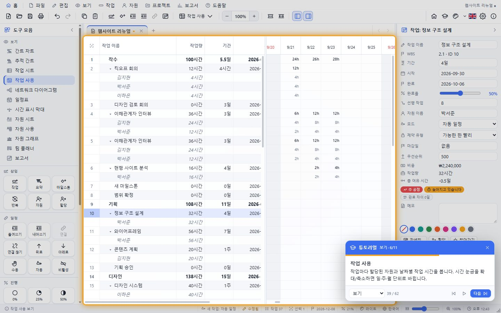

작업마다 할당된 자원을 아래에 펼치고, 오른쪽에 날짜별 작업 시간을 보여 줍니다. 시간 눈금을 확대/축소하면 일·주·월 단위로 바뀝니다.

### 네트워크 다이어그램

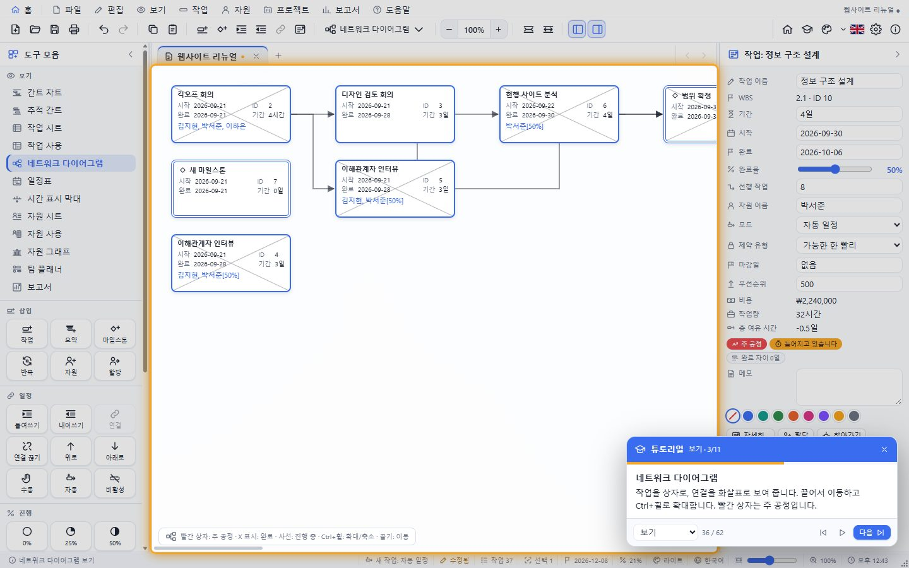

작업을 상자(ID, 이름, 날짜, 기간, 자원)로, 연결을 화살표로 그립니다. 빨간 상자는 주 공정, X 표시는 완료, 사선은 진행 중입니다. 끌어서 이동하고 `Ctrl+휠`로 확대/축소하며, 상자를 두 번 클릭하면 작업 정보가 열립니다.

### 일정표

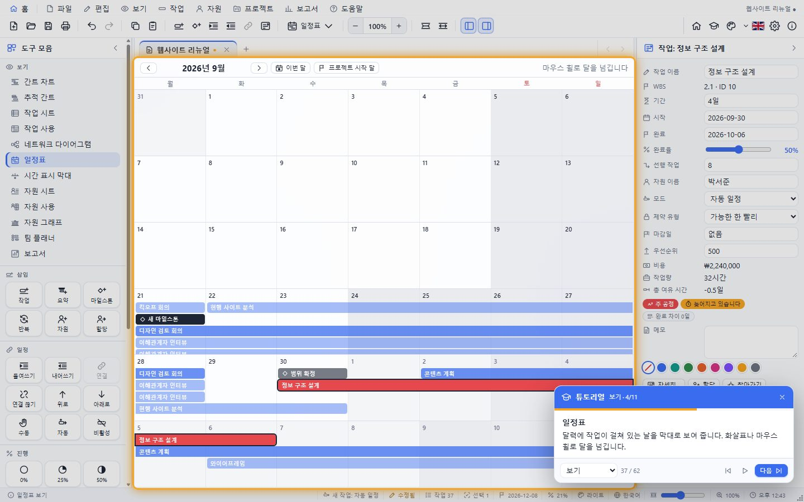

달력에 작업이 걸쳐 있는 날을 막대로 보여 줍니다. **이전 달** · **다음 달** · **이번 달** · **프로젝트 시작 달** 버튼이나 마우스 휠로 달을 넘깁니다. 한 주에 다 들어가지 않으면 "+N"으로 표시됩니다.

### 시간 표시 막대

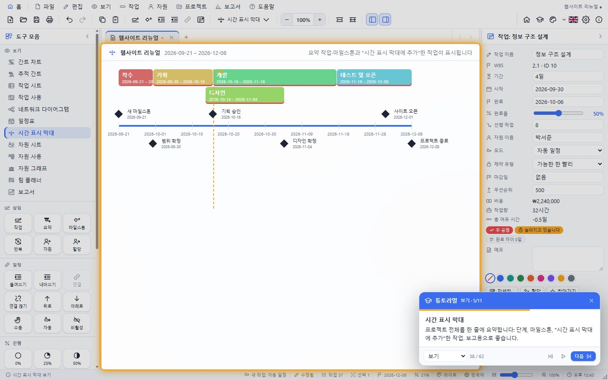

프로젝트 전체를 한 줄에 요약합니다. 최상위 요약 작업(단계)은 막대, 마일스톤은 마름모, **시간 표시 막대에 추가**한 작업은 말풍선으로 보입니다. 보고용으로 좋습니다.

### 자원 시트

자원 목록 표입니다. [자원 시트](#자원-시트)를 보세요.

### 자원 사용

자원마다 할당된 작업과 날짜별 작업 시간을 보여 주고, 할 수 있는 양을 넘는 칸은 빨간색입니다. [초과 할당](#초과-할당)을 보세요.

### 자원 그래프

왼쪽에서 자원을 고르면 날짜별 작업량(막대)과 사용 가능한 양(선)을 보여 줍니다. 위에 최대 단위 · 최대 사용 · 총 작업량이 요약되고 **일 단위** · **주 단위**를 바꿀 수 있습니다. 작업 자원만 그래프로 그립니다.

### 팀 플래너

사람별 줄에 작업 블록을 놓고 끌어서 담당자를 바꿉니다. [팀 플래너](#팀-플래너)를 보세요.

### 보고서

여러 가지 보고서를 대시보드로 보여 줍니다. [보고서](#보고서-1)를 보세요.

## 표·열·필터·그룹·정렬·찾기

### 표 (열 묶음)

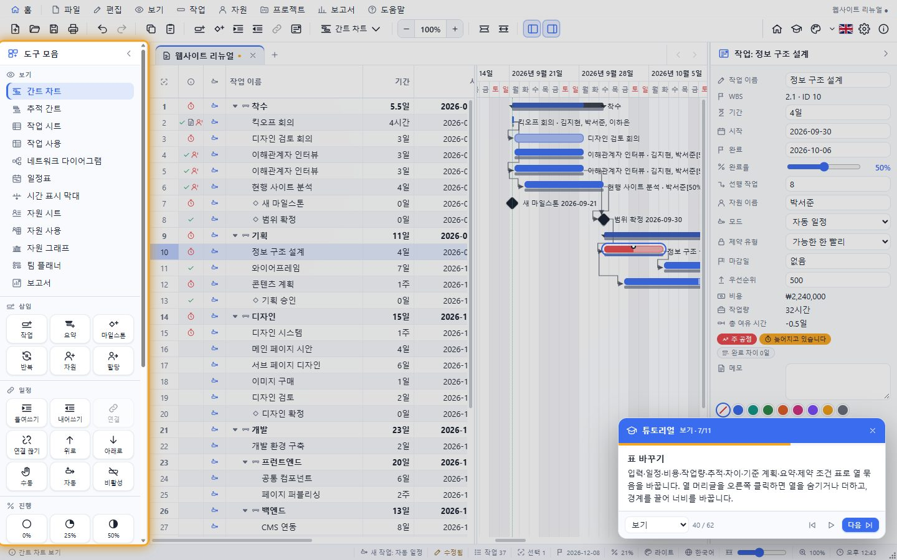

**보기 › 표 (열 묶음)** 또는 도구 모음의 **표** 목록으로 열 묶음을 바꿉니다.

| 표 | 열 |
|---|---|
| **입력** | 표시기, 모드, 작업 이름, 기간, 시작, 완료, 선행 작업, 자원 이름 |
| **일정** | 시작, 완료, 늦은 시작, 늦은 완료, 자유 여유 시간, 총 여유 시간 |
| **비용** | 고정 비용, 비용, 기준 비용, 비용 차이, 실제 비용, 남은 비용 |
| **작업량** | 작업량, 기준 작업량, 작업량 차이, 실제 작업량, 남은 작업량, 완료율 |
| **추적** | 실제 시작, 실제 완료, 완료율, 실제 기간, 남은 기간, 실제 비용, 실제 작업량 |
| **차이** | 시작, 완료, 기준 시작, 기준 완료, 시작 차이, 완료 차이 |
| **기준 계획** | 기준 기간, 기준 시작, 기준 완료, 기준 작업량, 기준 비용 |
| **요약** | WBS, 기간, 시작, 완료, 완료율, 비용, 작업량 |
| **제약 조건** | 기간, 제약 유형, 제약 날짜, 마감일, 우선순위, 작업 유형 |

자원 시트에는 입력 · 비용 · 작업량 · 요약 표가 있습니다.

### 열 선택

- **보기 › 열 선택…**: 왼쪽 **표시할 열**에서 순서를 바꾸고(위로/아래로) 숨기며, 오른쪽 **사용할 수 있는 열**에서 더합니다. **기본 열로** 되돌릴 수 있습니다. 표마다 따로 저장됩니다.
- 열 머리글을 오른쪽 클릭하면 정렬, 이 열 숨기기, 열 너비 원래대로가 있습니다.
- 열 경계를 끌어 너비를 바꾸고, 두 번 클릭하면 내용에 맞춥니다.

### 필터와 강조 표시

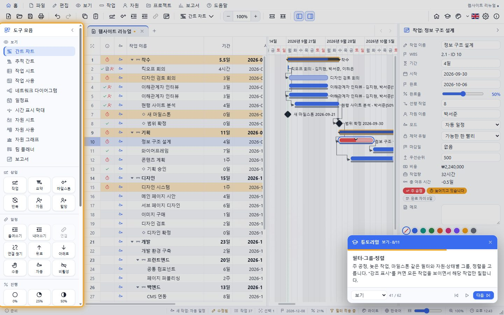

**보기 › 필터** 또는 도구 모음의 **필터** 목록:

모든 작업 · 활성 작업 · 완료된 작업 · 완료되지 않은 작업 · 주 공정 작업 · 마일스톤 · 요약 작업 · 늦은 작업 · 초과 할당된 작업 · 시작하지 않은 작업 · 진행 중인 작업 · 마감일이 있는 작업 · 제약 조건이 있는 작업 · 수동 일정 작업 · 날짜 범위… · 자원 사용 작업…

- 필터를 걸어도 맞는 작업 위의 요약 작업은 남아서 개요가 유지됩니다.
- **필터 대신 강조 표시**를 켜면 모든 작업을 보이면서 맞는 작업만 칠합니다.
- 도구 모음의 **검색** 칸은 작업 이름 · 메모 · 자원 이름을 바로 걸러 줍니다.
- 필터가 걸려 있으면 상태 표시줄에 **필터 적용 중**이 뜹니다. **필터·그룹·정렬 지우기**로 모두 풉니다.

### 그룹과 정렬

- **그룹**: 그룹 없음 · 주 공정 여부 · 마일스톤 여부 · 우선순위 · 자원 · 상태 · 기간 · 완료율 · 제약 조건 · 일정 모드. 그룹마다 머리 행에 개수가 보입니다.
- **정렬**: ID 순 (기본) · 이름순 · 시작 날짜순 · 완료 날짜순 · 기간순 · 우선순위순 · 비용순 · 작업량순 · 여유 시간순.

### 찾기·바꾸기·이동

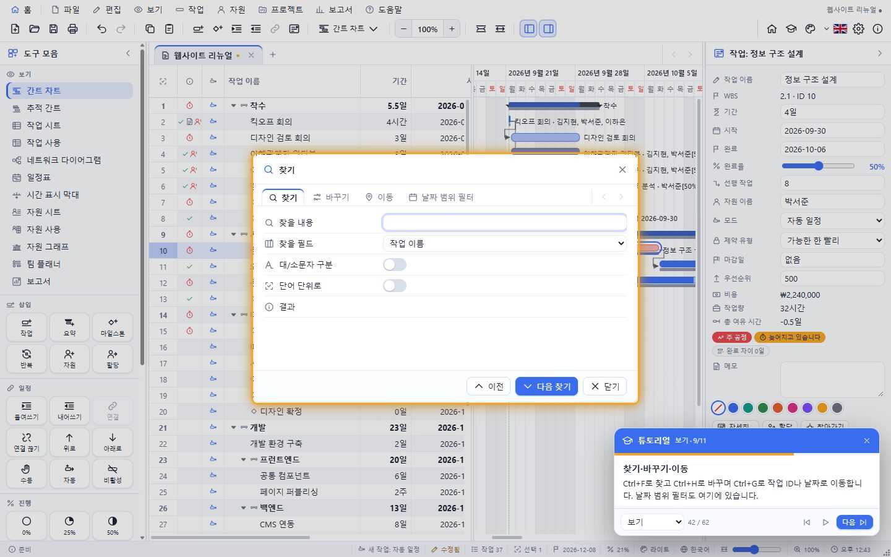

**찾기** 창에는 네 탭이 있습니다.

| 탭 | 단축키 | 내용 |
|---|---|---|
| **찾기** | `Ctrl+F` | 찾을 내용, 찾을 필드(작업 이름 · 메모 · 자원 이름 · 텍스트1~3 · 하이퍼링크), 대/소문자 구분, 단어 단위로, **이전** · **다음 찾기** |
| **바꾸기** | `Ctrl+H` | 바꿀 내용과 **모두 바꾸기** (한 번에 실행 취소 가능) |
| **이동** | `Ctrl+G` | 작업 ID 또는 날짜로 이동 |
| **날짜 범위 필터** | | 시작~끝 기간에 걸친 작업만 보이기 |

창은 열어 둔 채로 계속 찾을 수 있습니다.

## 보고서

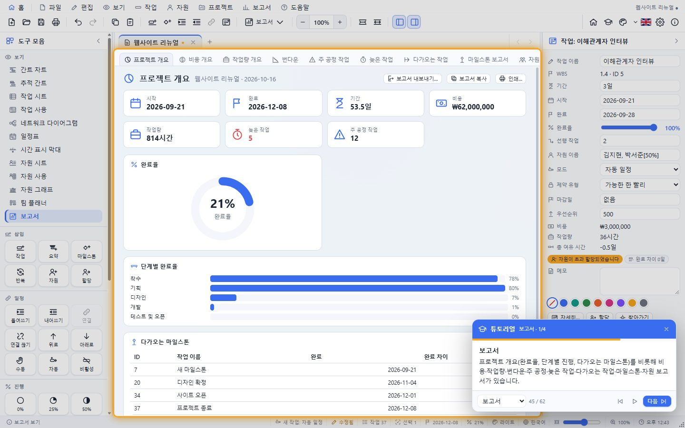

**보고서** 메뉴나 보고서 보기의 목록에서 고릅니다. 기준은 상태 날짜입니다.

| 보고서 | 내용 |
|---|---|
| **프로젝트 개요** | 완료율, 늦은 작업·주 공정 작업 수, 단계별 완료율, 다가오는 마일스톤 |
| **비용 개요** | 누적 비용(기준 계획 · 현재 일정 · 실제), 단계별 비용(막대 아래: 기준 계획), 자원별 비용 |
| **작업량 개요** | 자원별 작업량, 주별 작업량 |
| **번다운** | 남은 작업량: 일정대로 남은 작업량(파란 선)과 실제 남은 작업량(초록 선) |
| **주 공정 작업** | 여유 시간이 없어 늦어지면 프로젝트 완료가 늦어지는 작업 |
| **늦은 작업** | 상태 날짜 기준으로 계획보다 진행이 늦은 작업 |
| **다가오는 작업** | 상태 날짜부터 2주 안에 시작하는 작업 |
| **마일스톤 보고서** | 모든 마일스톤과 기준 계획 대비 차이 |
| **자원 개요** | 자원별 작업량·비용·최대 사용·초과 할당 |

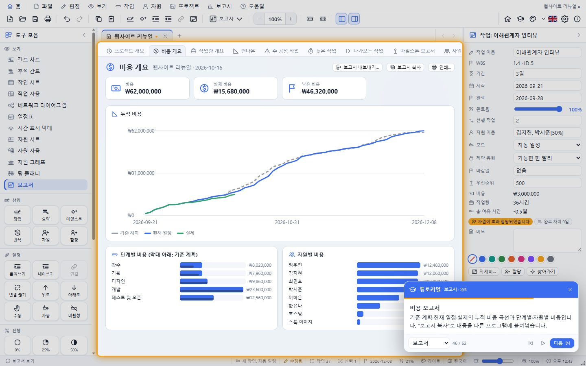

**보고서 복사**는 보고서 내용을 글자로 클립보드에 넣어 엑셀이나 문서에 붙여넣게 합니다. 보고서 화면의 **인쇄…**는 [인쇄 미리 보기](#인쇄와-미리-보기)를 엽니다(작업 표와 간트 차트가 인쇄됩니다).

**보고서 내보내기**는 지금 보고 있는 보고서를 파일로 저장합니다. **보고서 › 보고서 내보내기** 하위 메뉴, 보고서 화면 머리글의 **보고서 내보내기…** 단추, 보고서 빈 곳의 오른쪽 클릭 메뉴에서 형식을 고릅니다.

| 형식 | 내용 |
|---|---|
| **HTML (.html)** | 브라우저에서 바로 여는 한 파일짜리 웹 페이지. 차트는 SVG 그림이고, 각 차트 아래 **값**을 펼치면 숫자 표가 보입니다. 메일에 첨부하거나 사내 위키에 올리기 좋습니다. |
| **Markdown (.md)** | 제목과 GitHub 표. 차트는 숫자 표로 바뀝니다. Git 저장소·이슈·노트 앱에 붙여넣을 때 씁니다. |
| **Word (.docx)** | A4 Word 문서. 제목·표(테두리, 머리글 행이 페이지마다 반복)·차트 그림과 그 숫자 표가 들어 있고, 글꼴은 맑은 고딕입니다. Word·한컴오피스·LibreOffice에서 고쳐 쓸 수 있습니다. |
| **PDF (.pdf)** | A4 쪽마다 보고서를 그린 PDF. 한글 글꼴을 넣지 않아도 어디서나 똑같이 보이도록 쪽을 그림으로 담았기 때문에 글자를 골라 복사할 수는 없습니다. |

파일 이름은 "프로젝트 제목 - 보고서 이름"으로 제안되고, 만드는 데 시간이 걸리면 진행 팝업이 뜹니다.

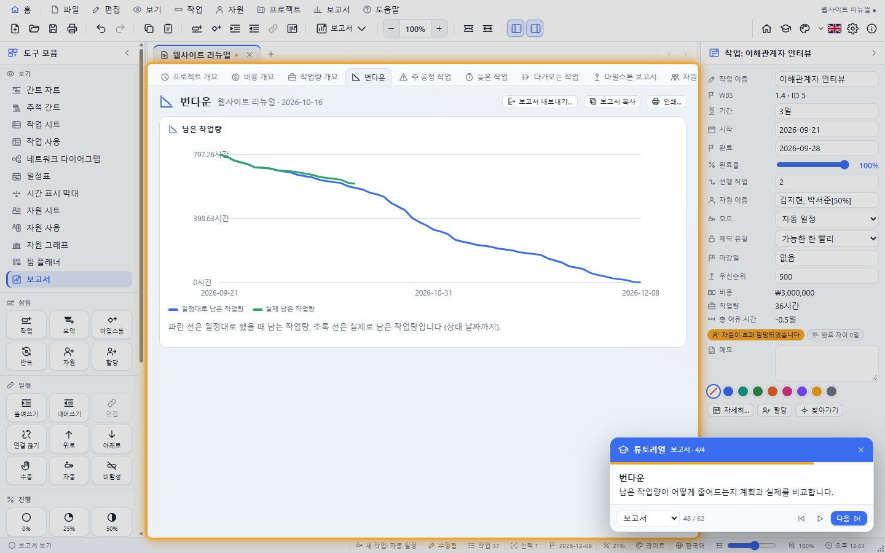

## 파일

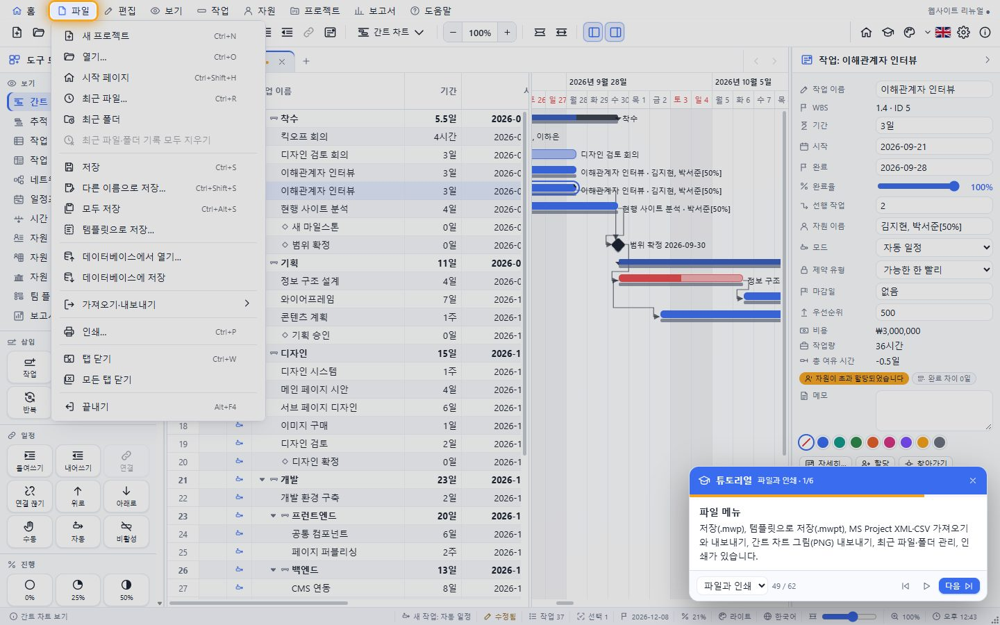

### 저장

- **저장**(`Ctrl+S`)은 MyWorkPlan 프로젝트 파일(`.mwp`)로 저장합니다. 처음 저장하거나 템플릿·가져온 파일에서 시작했으면 파일 이름을 묻습니다.
- **다른 이름으로 저장…**(`Ctrl+Shift+S`), **모두 저장**(`Ctrl+Alt+S`: 수정된 탭을 모두 저장).
- 파일은 임시 파일에 다 쓴 뒤 바꿔치기하므로 저장 도중 문제가 생겨도 원래 파일이 깨지지 않습니다. 큰 파일은 진행 창이 표시됩니다.
- **설정 › 일반 › 시작할 때 지난번에 연 파일 다시 열기**를 켜면 다음 실행 때 열려 있던 파일을 다시 엽니다.

### 템플릿

**파일 › 템플릿으로 저장…**은 진행 상황(완료율·실제 날짜), 기준 계획, 상태 날짜, 평준화 지연을 뺀 `.mwpt` 파일을 만듭니다. 템플릿을 열면 제목 없는 새 프로젝트가 되고, 저장할 때 새 `.mwp` 이름을 묻습니다.

### 가져오기와 내보내기

| 명령 | 형식 | 비고 |
|---|---|---|
| **가져오기 (MS Project XML · CSV)…** | `.xml`(MS Project XML), `.csv` · `.tsv` · `.txt` | 작업·개요·연결·지연·제약·달력·자원·할당·기준 계획을 읽습니다. CSV 머리글은 영어·한국어(MS Project 이름) 모두 알아봅니다. 가져온 프로젝트는 저장하면 `.mwp`가 됩니다 |
| **MS Project XML로 내보내기…** | `.xml` | Microsoft Project 2010 이후 버전에서 열 수 있는 MSPDI 형식 |
| **CSV로 내보내기…** | `.csv` | UTF-8(BOM), 영어 머리글: ID, WBS, Name, Outline Level, Duration, Start, Finish, Predecessors, Resource Names, % Complete, Cost, Work, Milestone, Notes |
| **간트 차트 그림으로 내보내기 (PNG)…** | `.png` | 표(이름·기간·시작·완료)와 간트 차트 전체를 한 장의 그림으로 |

**열기…**(`Ctrl+O`)로도 XML과 CSV를 열 수 있습니다.

### 최근 파일과 폴더

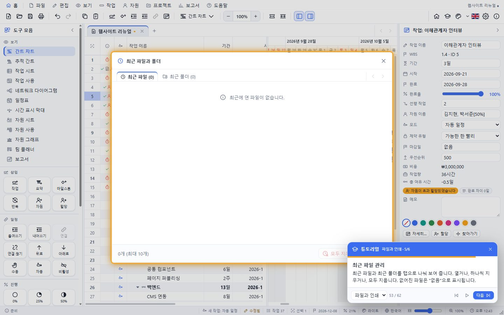

- **파일 › 최근 파일…**(`Ctrl+R`)은 **최근 파일**과 **최근 폴더** 탭이 있는 창을 엽니다. 각각 10개까지 기억합니다.
- 항목마다 **열기**(폴더는 **이 폴더에서 열기**)와 **목록에서 지우기**가 있고, **모두 지우기** · **폴더 기록 모두 지우기**로 한 번에 지웁니다.
- 없어진 파일은 **없음**으로 표시되고, 열려고 하면 목록에서 지울지 묻습니다.
- **파일 › 최근 폴더**는 폴더 목록을 메뉴로 보여 주고, **최근 파일·폴더 기록 모두 지우기**는 두 목록을 함께 지웁니다.
- 시작 페이지와 **설정 › 최근 기록** 탭에서도 같은 목록을 관리합니다.

### 끌어다 놓기

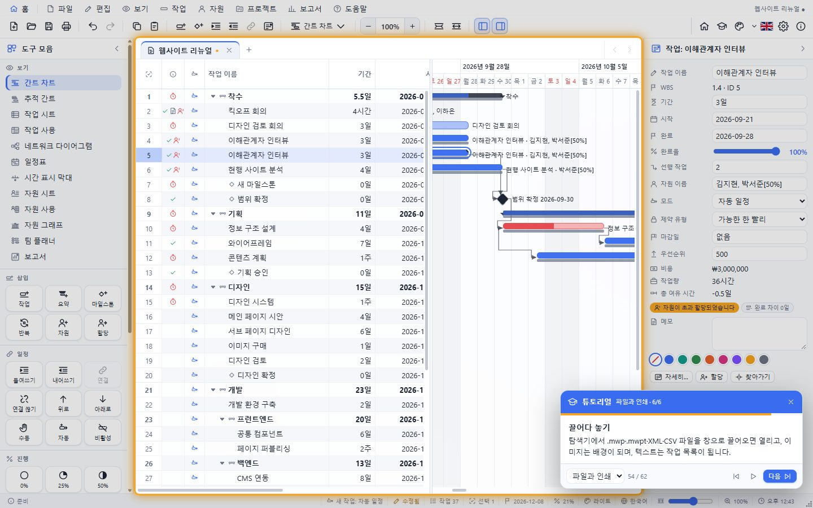

탐색기(Finder)에서 파일을 창으로 끌어오면:

| 끌어온 것 | 결과 |
|---|---|
| `.mwp` · `.mwpt` · `.json` | 프로젝트로 엽니다 |
| `.xml` · `.csv` · `.tsv` · `.txt` | 가져옵니다 |
| 이미지(png · jpg · gif · webp · bmp · svg …) | 배경 이미지가 됩니다 |
| 텍스트 (웹 버전) | 한 줄에 작업 하나로 추가됩니다 |

`.mwp` · `.mwpt` 파일을 두 번 클릭해도 MyWorkPlan에서 열립니다(설치 프로그램이 파일 형식을 등록함). 이미 열려 있는 파일을 다시 열면 그 탭으로 갑니다.

### 저장하지 않은 변경 확인

- 탭을 닫을 때(`Ctrl+W`) 저장하지 않은 변경이 있으면 **저장** · **저장 안 함** · **취소**를 묻습니다.
- 프로그램을 끝낼 때(**파일 › 끝내기**, 창 닫기) 저장하지 않은 프로젝트가 있으면 목록을 보여 주고 같은 질문을 합니다.
- 접고 펼친 상태만 바뀐 것은 변경으로 치지 않습니다.

## 데이터베이스

파일 대신 데이터베이스에 계획을 보관할 수 있습니다(데스크톱 앱 전용 — 웹 버전은 DB에 직접 연결할 수 없어 메뉴가 보이지 않습니다).

### 연결 설정

**설정 › 데이터베이스** 탭에서 고릅니다.

| 항목 | 설명 |
|---|---|
| **DB 종류** | 사용 안 함 · SQLite · MariaDB · MySQL · PostgreSQL |
| **SQLite 파일** | SQLite일 때. **찾아보기…**로 기존 파일을 고르거나 새 파일 이름을 정하면 처음 연결할 때 만들어집니다 |
| **서버 주소 · 포트 · 데이터베이스 이름 · 사용자** | 서버 DB일 때. 포트를 바꾸지 않으면 MariaDB/MySQL 3306, PostgreSQL 5432. 데이터베이스는 미리 만들어 두어야 합니다 |
| **비밀번호** | 기본으로는 저장하지 않고 프로그램을 닫을 때까지만 기억합니다. **비밀번호를 설정에 저장**을 켜면 설정에 함께 저장됩니다 |
| **연결 테스트** | 접속해 서버 버전을 보여 주고, 계획을 담는 표 `myworkplan_plans`가 없으면 만듭니다. 실패하면 이유(비밀번호는 빼고)를 보여 줍니다 |

### 저장하고 열기

- **파일 › 데이터베이스에 저장**은 지금 탭의 계획을 `.mwp` 파일과 똑같은 내용으로 저장합니다. 같은 계획(프로젝트 ID가 같음)을 다시 저장하면 덮어씁니다. 파일 없이 데이터베이스에서 연 계획은 이것으로 저장되어 "저장하지 않은 변경"이 사라집니다.
- **파일 › 데이터베이스에서 열기…**는 저장된 계획 목록(제목 · 마지막 저장 시각 · 크기, 최근 것부터)을 보여 줍니다. **열기**로 새 탭에 열고, 휴지통 단추로 데이터베이스에서 지웁니다(확인을 묻고, 되돌릴 수 없음).
- 연결이 설정되지 않았으면 두 명령 모두 설정의 데이터베이스 탭을 엽니다.

## 인쇄와 미리 보기

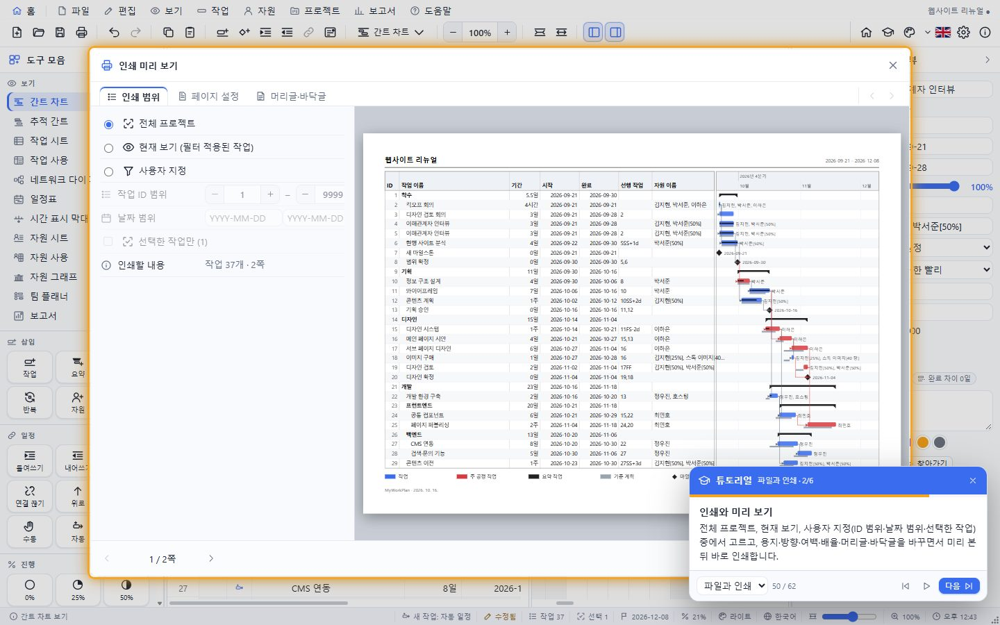

**파일 › 인쇄…**(`Ctrl+P`)는 **인쇄 미리 보기** 창을 엽니다. 설정을 바꾸면 오른쪽 미리 보기가 바로 바뀌고, 아래 화살표로 쪽을 넘깁니다.

| 탭 | 항목 |
|---|---|
| **인쇄 범위** | 전체 프로젝트 · 현재 보기 (필터 적용된 작업) · 사용자 지정(작업 ID 범위, 날짜 범위, 선택한 작업만), 인쇄할 내용(작업 수·쪽 수) |
| **페이지 설정** | 용지, 방향(세로·가로), 여백(좁게·보통·넓게), 배율(50~150%), 내용(표 + 간트 차트 · 표만 · 간트 차트만), 범례 |
| **머리글·바닥글** | 머리글·바닥글 켜기와 문구 |

**인쇄** 버튼은 운영체제의 인쇄 대화 상자를 엽니다(PDF로 저장도 여기서). 인쇄물은 테마와 상관없이 흰 바탕에 검은 글자로 나오고, 시간 눈금은 쪽 너비에 맞춰지며 행이 많으면 다음 쪽으로 이어집니다. 페이지 설정은 다음 인쇄 때도 유지됩니다.

## 꾸미기

### 테마

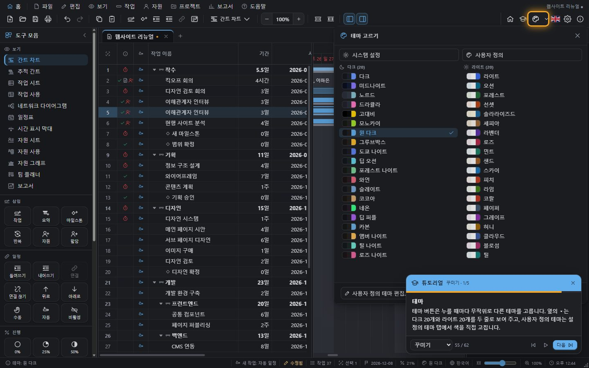

- 툴바의 **테마 무작위로 바꾸기** 버튼은 누를 때마다 다른 테마를 무작위로 고릅니다. 툴팁에 지금 테마 이름이 보입니다.
- 옆의 ▾(**테마 고르기**)는 **다크 (20)**와 **라이트 (20)**를 두 줄로 보여 주는 창을 엽니다. 위쪽에는 **시스템 설정**(운영체제의 밝기를 따름)과 **사용자 정의**가 있습니다.
- **설정 › 테마** 탭: 다크 20 · 라이트 20 · 사용자 정의 그룹. 사용자 정의에서는 바탕 · 표면 · 패널 · 글자 · 흐린 글자 · 테두리 · 강조 · 강조 위 글자 · 줄무늬 행 · 차트 바탕 · 툴바 · 상태 표시줄 색을 하나씩 고치고, **지금 테마의 색 가져오기**, **어두운 테마** 스위치가 있습니다. 글자 대비가 낮으면 "글자가 잘 안 보일 수 있습니다" 경고가 뜹니다.

### 언어

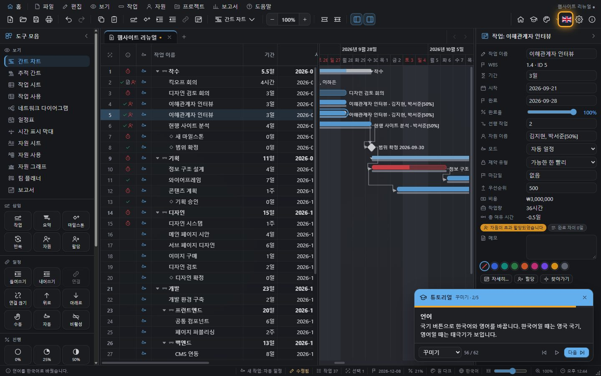

툴바의 국기 버튼(**언어 전환**, `Ctrl+Shift+L`)으로 한국어와 영어를 바꿉니다. 한국어일 때는 영국 국기, 영어일 때는 태극기가 보입니다(누르면 그 언어로 바뀜). **설정 › 일반 › 언어**에서도 바꿉니다. 메뉴, 팝업, 보고서, 오류 메시지, 백엔드 메시지까지 모두 바뀝니다.

### 글꼴

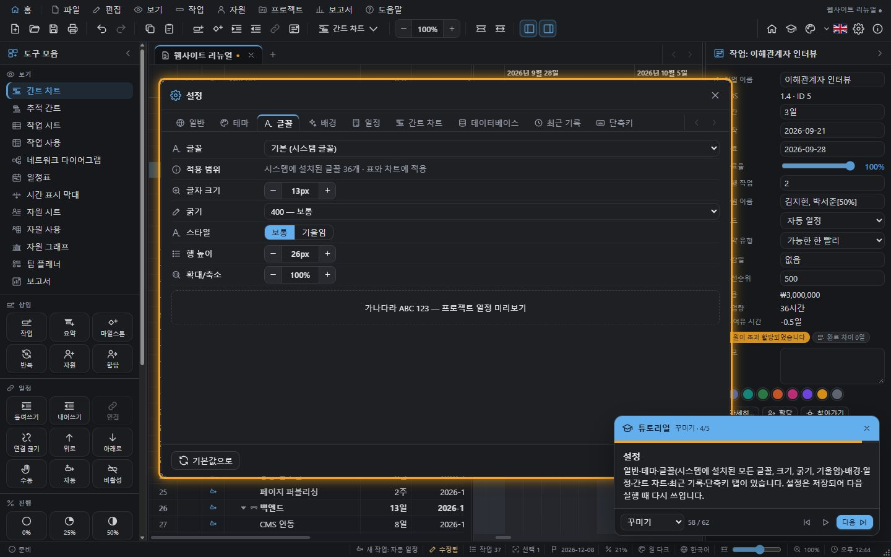

**설정 › 글꼴** 탭에서 시스템에 설치된 모든 글꼴 중 하나를 고르고 **글자 크기**, **굵기**(가늘게 ~ 아주 굵게), **스타일**(보통·기울임), **행 높이**, **확대/축소**를 정합니다. 글꼴은 표와 차트에 적용되고 아래 미리 보기에 바로 보입니다.

### 배경과 움직이는 배경

**설정 › 배경** 탭:

| 항목 | 내용 |
|---|---|
| **배경 종류** | 움직이는 배경 · 이미지 · 없음 |
| **움직이는 배경** | 오로라 · 물결 · 입자 · 별자리 · 거품 · 흐르는 격자 · 간트 막대 · 별빛, **움직이는 배경 바꾸기**(`Ctrl+Shift+B`, 무작위) |
| **움직임 속도** | 0~300% |
| **움직이는 배경은 시작 페이지에서만** | 켜면 보기 뒤에서는 움직이지 않음 |
| **배경 이미지** | **고르기…** · **지우기**. 이미지 크기 제한은 없고, 이미지 파일을 창으로 끌어다 놓아도 배경이 됩니다 |
| **배경 불투명도 (보기 뒤)** | 보기 뒤 배경의 진하기 |
| **맞춤** | 채우기 · 맞추기 · 바둑판 · 가운데 · 늘이기 |

**보기 › 배경 끄기**는 배경 이미지를 지웁니다. 배경색은 테마를 따릅니다.

### 패널

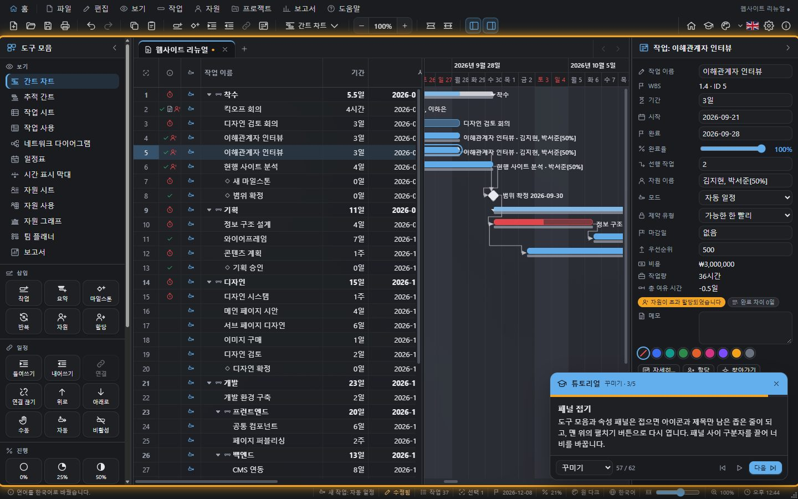

- 도구 모음과 속성 패널은 머리글의 화살표, **보기 › 도구 패널 펼치기/접기**(`Ctrl+Shift+1`) · **속성 패널 펼치기/접기**(`Ctrl+Shift+2`), 툴바 버튼으로 접고 펼칩니다.
- 접으면 아이콘과 제목만 남은 좁은 줄이 되고, 맨 위의 **펼치기** 버튼으로 다시 엽니다. 접힌 줄에서도 보기 전환과 주요 명령을 쓸 수 있습니다.
- 패널 사이 구분자를 끌어 너비를 바꿉니다.

### 확대와 시간 눈금

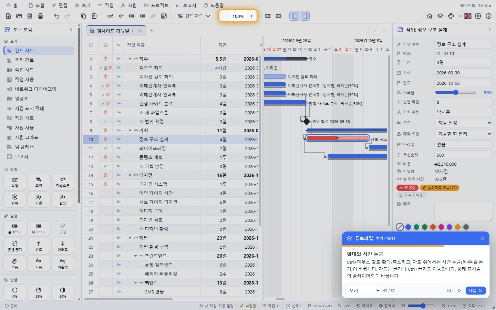

- **확대/축소**(50~200%): `Ctrl+마우스 휠`, `Ctrl+=` · `Ctrl+-` · `Ctrl+0`, 툴바의 `[−] 100% [+]`(값을 직접 입력해도 됨).
- **시간 눈금**: 차트 위에서 `Ctrl+마우스 휠`, `Ctrl+Shift+=` · `Ctrl+Shift+-`, 툴바 버튼, 상태 표시줄 슬라이더. 일 · 주 · 월 · 분기 단위로 바뀝니다.
- **프로젝트 전체 보기**는 프로젝트가 차트 너비에 맞게 시간 눈금을 맞추고, **오늘로 이동**은 오늘 날짜로 스크롤합니다.
- 차트는 빈 곳을 끌거나 `Ctrl+끌기`로 이동합니다.

### 상태 표시줄

**보기 › 상태 표시줄** 또는 **설정 › 일반**에서 숨기거나 보입니다. 시계는 **설정 › 일반 › 상태 표시줄에 시계 표시**로 끕니다.

### 설정 창

**도움말 › 설정…**(`Ctrl+,`). 설정은 바로 적용되고 저장되어 다음 실행 때 다시 쓰입니다. **기본값으로**는 모든 설정을 처음 값으로 돌립니다(언어와 배경 이미지는 유지).

| 탭 | 항목 |
|---|---|
| **일반** | 언어, 날짜 형식(국제 표준 · 한국식 · 미국식 · 유럽식), 날짜에 시각 표시, 새 프로젝트의 기본 보기, 시작할 때 시작 페이지 표시, 시작할 때 지난번에 연 파일 다시 열기, 삭제하기 전에 묻기, 상태 표시줄에 시계 표시, 상태 표시줄, 마지막으로 쓴 폴더, 튜토리얼 시작 |
| **테마** | 다크 · 라이트 · 사용자 정의, 시스템 설정 |
| **글꼴** | 글꼴, 글자 크기, 굵기, 스타일, 행 높이, 확대/축소 |
| **배경** | 배경 종류, 움직이는 배경, 움직임 속도, 배경 이미지, 배경 불투명도, 맞춤 |
| **일정** | 하루 작업 시간, 한 주 작업 시간, 한 달 작업일, 새 작업의 일정 모드 |
| **간트 차트** | 주 공정 · 여유 시간 · 기준 계획 막대 · 진행선 표시, 연결선 표시, 오늘 선 표시, 쉬는 날 음영, 막대 옆 글자 |
| **최근 기록** | 최근 파일·폴더 목록과 지우기 |
| **단축키** | 모든 단축키 목록 |

## 단축키

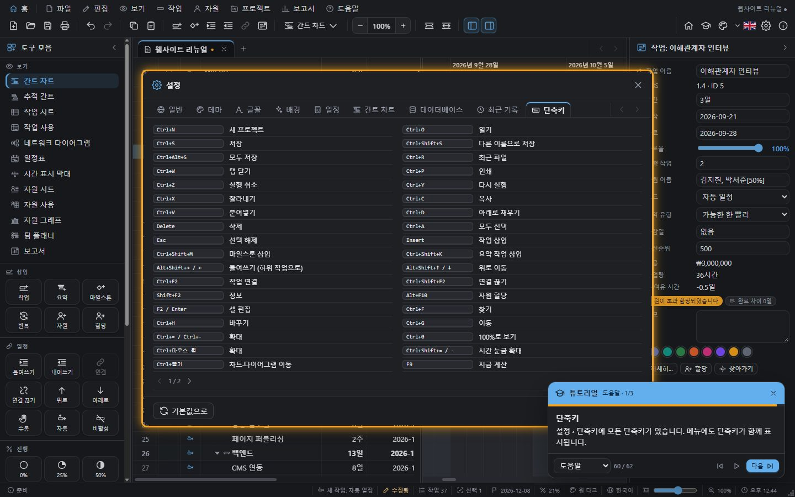

**설정 › 단축키** 탭(또는 **도움말 › 단축키 목록…**)에 같은 목록이 있고, 메뉴에도 단축키가 함께 표시됩니다. macOS에서는 `Ctrl` 대신 `Cmd`를 씁니다.

| 단축키 | 명령 |
|---|---|
| `Ctrl+N` | 새 프로젝트 |
| `Ctrl+O` | 열기 |
| `Ctrl+S` | 저장 |
| `Ctrl+Shift+S` | 다른 이름으로 저장 |
| `Ctrl+Alt+S` | 모두 저장 |
| `Ctrl+R` | 최근 파일 |
| `Ctrl+W` | 탭 닫기 |
| `Ctrl+P` | 인쇄 |
| `Ctrl+Z` | 실행 취소 |
| `Ctrl+Y` | 다시 실행 (`Ctrl+Shift+Z`도 됨) |
| `Ctrl+X` | 잘라내기 |
| `Ctrl+C` | 복사 |
| `Ctrl+V` | 붙여넣기 |
| `Ctrl+D` | 아래로 채우기 |
| `Delete` | 삭제 |
| `Ctrl+A` | 모두 선택 |
| `Esc` | 선택 해제 |
| `Insert` | 작업 삽입 |
| `Ctrl+Shift+M` | 마일스톤 삽입 |
| `Ctrl+Shift+K` | 요약 작업 삽입 |
| `Alt+Shift+→ / ←` | 들여쓰기 (하위 작업으로) / 내어쓰기 |
| `Alt+Shift+↑ / ↓` | 위로 이동 / 아래로 이동 |
| `Ctrl+F2` | 작업 연결 |
| `Ctrl+Shift+F2` | 연결 끊기 |
| `Shift+F2` | 정보 (작업·자원·연결) |
| `Alt+F10` | 자원 할당 |
| `F2 / Enter` | 셀 편집 |
| `Ctrl+F` | 찾기 |
| `Ctrl+H` | 바꾸기 |
| `Ctrl+G` | 이동 |
| `Ctrl+= / Ctrl+-` | 확대 / 축소 |
| `Ctrl+0` | 100%로 보기 |
| `Ctrl+마우스 휠` | 확대 / 축소 (차트 위에서는 시간 눈금) |
| `Ctrl+Shift+= / -` | 시간 눈금 확대 / 축소 |
| `Ctrl+끌기` | 차트·다이어그램 이동 |
| `F9` | 지금 계산 |
| `Ctrl+Tab` | 다음 탭 (`Ctrl+Shift+Tab`: 이전 탭) |
| `Ctrl+Shift+L` | 언어 전환 |
| `Ctrl+Shift+B` | 움직이는 배경 바꾸기 |
| `Ctrl+Shift+H` | 시작 페이지 |
| `Ctrl+,` | 설정 |
| `F11` | 튜토리얼 |
| `F1` | 프로그램 정보 |

설정 창 목록에는 없지만 동작하는 단축키:

| 단축키 | 명령 |
|---|---|
| `Ctrl+Shift+R` | 자원 추가 |
| `Ctrl+Shift+1` · `Ctrl+Shift+2` | 도구 패널 · 속성 패널 펼치기/접기 |
| `Ctrl+Shift+F5` | 작업으로 스크롤 |
| `Ctrl+Q` (macOS) · `Alt+F4` (Windows) | 끝내기 |
| `Tab` · `Shift+Tab` (셀 편집 중) | 오른쪽 · 왼쪽 칸으로 |
| `Ctrl+Home` · `Ctrl+End` | 표의 첫 행 · 마지막 행 |
| `Esc` (튜토리얼 중) | 튜토리얼 끝내기 |

## 문제 해결

### 오류 창

오류가 나면 **오류** 창이 뜹니다. 메시지, **시각**, **위치**(무슨 작업 중이었는지), App(버전·플랫폼)과 **자세한 내용**이 있고, **내용 복사** 버튼으로 전부 복사해 문제를 알리거나 기록할 수 있습니다.

| 오류 제목 | 흔한 원인 |
|---|---|
| 파일을 열 수 없습니다 | MyWorkPlan 파일이 아님, 더 새 버전에서 만든 파일, MS Project XML이 아님, CSV에 작업이 없음 |
| 저장할 수 없습니다 · 내보낼 수 없습니다 | 쓰기 권한이 없는 폴더, 다른 프로그램이 파일을 잡고 있음 |
| 입력 오류 | 기간·날짜·선행 작업 형식이 틀림(메시지에 예가 나옴), 순환 연결 |
| 인쇄할 수 없습니다 | 프린터나 인쇄 대화 상자 문제 |
| 사용 설명서를 열 수 없습니다 | 설치 폴더의 `docs` 폴더가 지워짐 |

### 심각한 오류와 crash.log

프로그램 내부(백엔드)에서 심각한 오류가 나면 **심각한 오류 (백엔드)** 창에 위치·스레드·백트레이스와 **기록 파일** 경로가 표시됩니다. 같은 내용이 `crash.log`에 쌓입니다.

| OS | crash.log 위치 |
|---|---|
| Windows | `%APPDATA%\com.shkwon.myworkplan\crash.log` |
| macOS | `~/Library/Application Support/com.shkwon.myworkplan/crash.log` |
| Linux | `~/.local/share/com.shkwon.myworkplan/crash.log` |

### "이미 실행 중" 오류

MyWorkPlan은 사용자마다 하나만 실행됩니다. 이미 실행 중일 때 다시 실행하면 **MyWorkPlan — 실행 오류** 창에 "MyWorkPlan 이 이미 실행 중입니다."가 뜨고 새 실행은 끝납니다. 작업 표시줄(Dock)에서 열려 있는 창을 찾아 쓰세요. 이미 열린 창에서 **파일 › 열기…**로 다른 프로젝트를 탭으로 열 수 있습니다. 프로그램이 비정상 종료되었더라도 잠금은 운영체제가 풀어 주므로 다음 실행이 막히지 않습니다.

### 그 밖에

| 증상 | 해결 |
|---|---|
| 일정이 이상하게 계산됨 | 표시기 열과 상태 표시줄의 충돌 개수를 확인하고, **제약 조건** 표로 제약을 살펴봅니다. 수동 일정 작업이 아닌지 확인합니다 |
| 작업이 안 보임 | 필터·검색·접힌 요약 작업을 확인하고 **필터·그룹·정렬 지우기**를 누릅니다 |
| 화면이 너무 크거나 작음 | `Ctrl+0`(100%로 보기) |
| 설정을 처음으로 | **설정 › 기본값으로** |
| 웹 버전에서 최근 파일이 안 열림 | 브라우저 보안 때문에 **열기**로 파일을 다시 골라야 할 수 있습니다 |

## 설치와 제거

### Windows

`MyWorkPlan-Setup-1.0.0.exe`를 실행합니다.

1. 설치 언어(한국어/English)를 고릅니다.
2. 이전에 설치한 MyWorkPlan이 저장한 데이터(설정, 최근 파일·폴더, 배경 이미지)가 있으면 지울지 묻습니다. **아니요**를 고르면 그대로 씁니다.
3. 이전 설치가 있으면 완전히 제거한 뒤 새로 설치합니다.
4. 설치가 끝나면 `.mwp`(프로젝트)와 `.mwpt`(템플릿)가 각자의 문서 아이콘으로 등록되어 두 번 클릭으로 열립니다.
5. 시작 메뉴의 **MyWorkPlan** 폴더에 프로그램과 **MyWorkPlan User's Guide**(이 설명서) 바로 가기가 생깁니다. 설명서와 튜토리얼 문서, 예제 프로젝트는 설치 폴더의 `docs`, `samples` 폴더에 들어 있습니다.

현재 사용자용으로 설치되므로 관리자 권한이 필요 없습니다. 제거는 **설정 › 앱**(또는 제어판 › 프로그램 제거)에서 MyWorkPlan을 고릅니다.

| 데이터 | 위치 (Windows) |
|---|---|
| 설정, 최근 파일·폴더 | `%LOCALAPPDATA%\com.shkwon.myworkplan` (WebView2 저장소) |
| 창 위치·크기, 배경 이미지, crash.log | `%APPDATA%\com.shkwon.myworkplan` |

### macOS

`MyWorkPlan-1.0.0-<arch>.dmg`를 열고 MyWorkPlan을 응용 프로그램 폴더로 끌어 놓습니다. 제거는 응용 프로그램 폴더에서 휴지통으로 옮깁니다. macOS 11 이상이 필요합니다.

### Linux

`.deb`(Debian·Ubuntu), `.rpm`(Fedora 등), `.AppImage` 중 하나를 씁니다. deb·rpm은 `.mwp` · `.mwpt` 파일 형식과 아이콘을 등록합니다. 제거는 패키지 관리자로 합니다.

### 웹 버전

웹 빌드(`dist/`)를 아무 정적 웹 서버에 올리면 브라우저에서 같은 기능을 씁니다. 차이점:

- 파일은 브라우저의 파일 선택 창으로 열고, 저장은 파일 시스템 접근을 지원하는 브라우저(Edge·Chrome)에서는 같은 파일에, 그 밖에는 내려받기로 합니다.
- 팝업 창은 페이지 안에 떠 있는 창으로 열립니다.
- 파일 형식 등록, "이미 실행 중" 검사처럼 운영체제 기능이 필요한 것은 데스크톱 앱에서만 됩니다. 시스템 글꼴 목록은 브라우저가 허락할 때만 읽습니다.
- 설정과 최근 기록은 브라우저 저장소에 남습니다.
