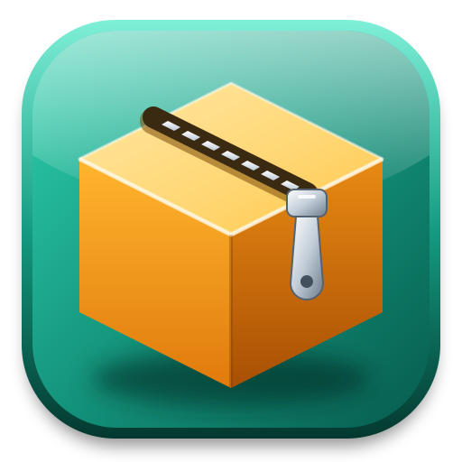

# MyZipMaster



WinZip, WinRAR, 7-Zip처럼 압축 파일을 **만들고, 열고, 풀고, 고치는** 프로그램입니다. 원하는 크기로 나누어 압축할 수 있고, 같은 엔진으로 **Web / Windows / macOS / Linux** 에서 동작합니다. (Tauri + React + Rust)

## 지원 형식

| 형식 | 열기·풀기 | 만들기 | 분할 | 암호 |
|---|---|---|---|---|
| ZIP (ZIPX, JAR, DOCX 등 ZIP 기반 포함) | ○ | ○ | `.z01…​.zip` 또는 `.zip.001…` | AES-256, AES-128, ZipCrypto |
| 7z | ○ | ○ | `.7z.001…` | AES-256, 파일 이름 암호화 |
| RAR 1.3 ~ 7 | ○ | ○ (RAR 4, RAR 5) | `.part1.rar…`, 읽기는 `.r00…`도 | AES, 파일 이름 암호화 |
| TAR, TAR.GZ, TAR.BZ2, TAR.XZ, TAR.ZST | ○ | ○ | `.001…` | |
| GZ, BZ2, XZ, ZST (파일 하나) | ○ | ○ | `.001…` | |
| CAB, ISO | ○ | | | |

자동 풀림 파일(ZIP 기반, 데스크톱)과 7-Zip·WinRAR의 자동 풀림 파일 읽기도 지원합니다.

## 주요 기능

- **정해진 크기로 분할**: 1.44 MB부터 25 GB까지 미리 정한 크기, 또는 바이트 단위까지 직접 입력. 어느 조각을 골라도 전체를 열고, 조각이 빠지면 알려 줍니다.
- **압축 파일 탐색**: 폴더 트리, 정렬, 이름 찾기(`*`, `?`), 텍스트·그림·16진수 미리 보기.
- **풀기**: 전체·선택, 덮어쓰기·건너뛰기·이름 바꾸기·더 새로운 것만, 경로 없이 풀기. 압축 파일 밖으로 나가는 경로와 링크는 막습니다.
- **고치기**: 파일 추가·삭제·이름 바꾸기, 새 폴더, 설명 수정.
- **테스트·복구**: 손상 검사, ZIP 복구(중앙 디렉터리 재구성), RAR 복구 레코드로 복구.
- **변환**: 어떤 형식에서든 쓰기 가능한 형식으로.
- **도구**: 체크섬(CRC32, CRC64, MD5, SHA-1, SHA-256, SHA-512, BLAKE3), 임의 파일 분할·합치기, 벤치마크.
- **파일 탐색**(데스크톱): 드라이브·폴더 탐색, 끌어다 놓기, 최근 파일.
- **파일 연결**: 설치하면 지원 형식이 시스템에 등록되고, 형식마다 자기 아이콘을 갖습니다.
- **모양**: 움직이는 배경 20종(투명도·속도 조절)이 있는 시작 화면, 테마 40종(Dark 20·Light 20)과 사용자 설정 테마, 한국어/English. 숫자는 모두 감소·값 단위·증가 단추로 조절합니다(분할 크기는 MB에서 10 MB씩).

웹판은 모든 처리를 브라우저 안에서 합니다. 파일이 어디로도 전송되지 않으며, 메모리에서 처리하므로 약 1.5 GB를 넘는 작업은 데스크톱판을 쓰세요.

## 빌드

준비물: Node.js 20.19 이상, Rust. Linux에서는 Tauri 시스템 라이브러리(`libwebkit2gtk-4.1-dev` 등).

```sh
npm install

npm start            # 데스크톱 앱 개발 실행
npm run dev:web      # 웹판 개발 실행

npm run build:web    # 웹판: dist-web/ (아무 정적 웹 서버에 올리면 됩니다)
npm run build:win    # Windows 설치 파일 (.exe)
npm run build:mac    # macOS 설치 파일 (.dmg)
npm run build:linux  # Linux 패키지 (.AppImage, .deb)
npm run build:all    # 웹판 + 이 운영 체제의 설치 파일

npm run clean        # 빌드로 만들어진 파일 정리 (dist, target, 설치 파일 등)
npm run clean:all    # node_modules까지
```

설치 파일은 프로젝트 루트로 복사됩니다. Tauri는 교차 컴파일을 하지 않으므로 macOS·Linux 패키지는 해당 운영 체제에서 빌드합니다.

### 파일 연결

| 운영 체제 | 등록 방식 |
|---|---|
| Windows | 설치 프로그램이 확장자마다 ProgId를 등록하고 형식별 아이콘을 지정합니다. 제거하면 함께 지워집니다. Windows 정책상 사용자가 이미 고른 기본 앱은 설치 프로그램이 바꿀 수 없으니, 그런 경우 파일의 "연결 프로그램"에서 고르면 됩니다. |
| macOS | 앱 번들의 문서 형식(`Info.plist`)으로 등록되며 Finder가 인식합니다. |
| Linux | `.deb`가 MIME 형식과 아이콘을 설치하고 데이터베이스를 갱신합니다. `.AppImage`는 설치 과정이 없어 등록되지 않습니다. |

아이콘을 고치면 `npm run icons`(앱)와 `node scripts/generate-file-icons.mjs`(파일 형식)로 다시 만듭니다.

## 테스트

```sh
npm test                 # 전부
node test/runner.mjs unit engine wasm web desktop   # 골라서
npm run test:long        # 4 GB를 넘는 실제 Zip64 포함
```

| 묶음 | 내용 |
|---|---|
| unit | 크기·이름 규칙, 트리, 번역, 아이콘 색, 테마, 설정, 파일 연결 구성, 문서 |
| engine | Rust 엔진: 형식·방식별 왕복, 분할 크기, 암호, 공격용 압축 파일, 손상·복구, 취소, 7-Zip 상호 호환, 실제 WinRAR 파일 |
| wasm | 브라우저가 쓰는 WebAssembly 엔진 그대로 |
| web | 헤드리스 Edge에서 실제 입력으로 웹판의 모든 기능 |
| desktop | 실제 앱을 격리해 띄워 모든 기능, OS 수준 창 크기 변경까지 |

상호 호환 시험에는 7-Zip이 필요합니다. 없으면 건너뛰지 않고 실패로 알립니다. 모든 시험은 `test-results/`와 `target/tmp/` 안에서만 파일을 만듭니다.

자세한 구조는 [Architecture.md](Architecture.md), 사용법은 [사용 설명서](doc/UsersGuide.md) ([English](doc/UsersGuide.en.md))를 보세요. 설명서는 앱 안에서도 F1로 열 수 있습니다.

## 라이선스

MIT. 포함된 라이브러리의 라이선스는 각 크레이트를 따릅니다. RAR 읽기·쓰기는 [rars](https://github.com/bitplane/rars) (Apache-2.0), 7z는 [sevenz-rust2](https://github.com/hasenbanck/sevenz-rust) (Apache-2.0)를 사용합니다.
