# MyZipMaster User's Guide

## Start screen

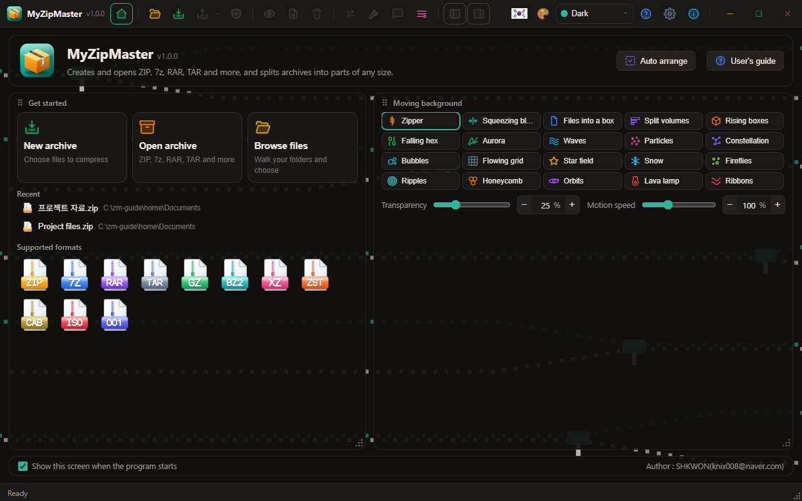

Starting the program by itself shows the start screen. Double-clicking an archive opens it straight away, with no start screen. The start-screen button right of the version number on the toolbar shows it; pressing again returns to what you were doing.

- **Top line** (fixed): the program's name, **Auto arrange** and **User's guide**.
- **Get started** card: **New archive**, **Open archive**, **Browse files**, recent files and the supported formats.
- **Moving background** card: choose from 20 icon cards; on one line below them set the transparency and motion speed with the drag bars or the − and + buttons.
- **Bottom line** (fixed): the box for showing this screen at start, and the author.

Move the two cards by their headings and resize them by the triangle of dots at the bottom right. When you let go they arrange themselves again: side by side the other card fills what is left, and dragging one above or below the other stacks them. **Auto arrange**, or the triangle pressed twice quickly, goes back to the first arrangement. With the focus on a heading's dots, Alt+arrows move a card and Alt+Shift+arrows resize it.

## The window

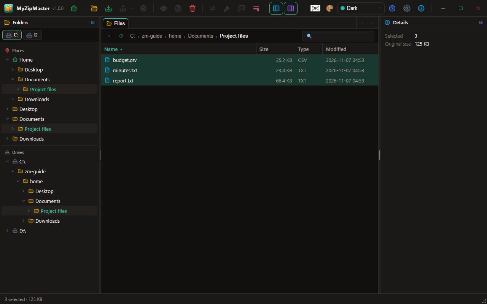

- **Toolbar**: at the far left the program's icon, name and version, then icon buttons: File, Compress, Extract, Test / View, Add, Delete / Convert, Repair, Info, Tools. On the right: language, next theme (the palette), the current theme's dropdown, guide, settings, about, and in the corner minimize, maximize and close. Rest the mouse on a button for its name. Drag an empty part of the toolbar to move the window.
- **Tabs**: at the top of the middle, between the panels. There is a Files tab, and one tab for each archive you open, so you can move between them. × closes one. When they do not all fit, the ‹ › buttons at the far right scroll them.
- **Address bar**: up, refresh, where you are, find by name.
- **Left panel**: the drive icons at its top switch drives. The tree below has **Places** (home, desktop, documents and so on) and **Drives**, with a line between them; once an archive is open, it shows the folders inside it.
- **List**: click a heading to sort. Double-click to enter a folder or open a file.
- **Left and right panels**: collapse and expand them with the button on their title bars or the panel buttons on the toolbar. Collapsed, they keep their icon and title, running down. Drag the separator between panels to resize. The right panel shows details of what is selected, item by item. Select an archive to see its format, file count, sizes, ratio, parts and encryption without opening it.
- **Status bar**: item count and size; the archive's format, parts and encryption. If names in an old ZIP look garbled, choose their encoding here. Drag the triangle of dots in its corner to resize the window.

## Deleting

Deleting a file you are browsing (Del, or Delete on the right-click menu) asks first, then sends it to the recycle bin. Deleting items inside an archive cannot be undone. Buttons and menu items you cannot use right now are grey.

## Compressing

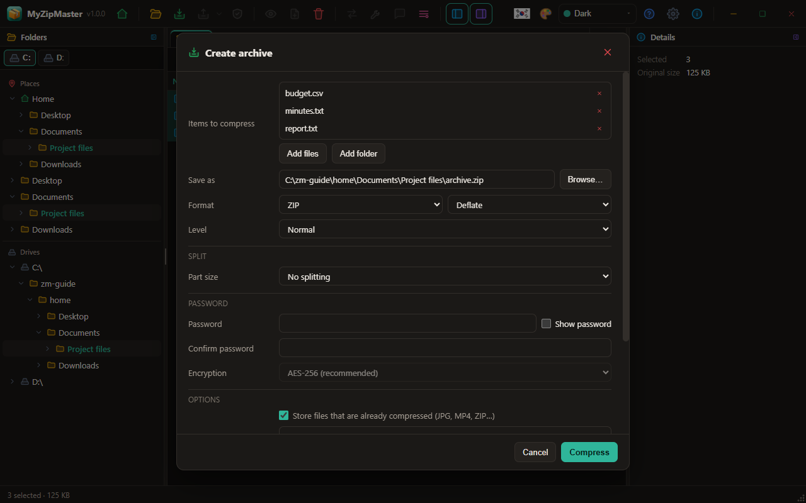

Select files or folders and press **Compress** (Ctrl+N), or drop files on the window.

| Option | What it does |
|---|---|
| Save as | Where the archive goes. Changing the format changes the extension. |
| Format | ZIP, 7Z, RAR, TAR, TAR.GZ, TAR.BZ2, TAR.XZ, TAR.ZST, GZ, BZ2, XZ, ZST. GZ, BZ2, XZ and ZST hold one file. |
| Method | ZIP: Deflate, Store, BZip2, LZMA, XZ, Zstandard. 7z: LZMA2, LZMA, BZip2, Deflate, PPMd, Copy. |
| Level | Store, Fastest, Fast, Normal, High, Maximum. Zstandard has levels too (one fast level on the web). |
| Part size | See below. |
| Password | Must match its confirmation. 7z and RAR can encrypt the file names too. |
| Encryption (ZIP) | AES-256 is recommended. ZipCrypto is weak: use it only for old programs. |
| Solid (7z, RAR) | Much smaller when many files are alike, but extracting one file means unpacking what precedes it. |
| Recovery record (RAR) | Spare data against damage, as a percentage. |
| Comment (ZIP, RAR) | Text attached to the archive. |
| Put in folder | Everything goes under this folder inside the archive. |
| Leave out | Patterns separated by semicolons: `*.tmp; node_modules`. |
| Store already compressed files (ZIP) | Spends no time on JPG, MP4, ZIP and the like. |
| Self-extracting (ZIP, desktop) | A program that unpacks itself, for this operating system. |
| Send the originals to the trash afterwards (desktop) | Only after the new archive has been read back whole. Unavailable when names are excluded or when the archive is made inside the originals. |
| Compress with the installed WinRAR (RAR, desktop) | Offered only when WinRAR is there. The password then appears on the command line while it runs. |

## Splitting

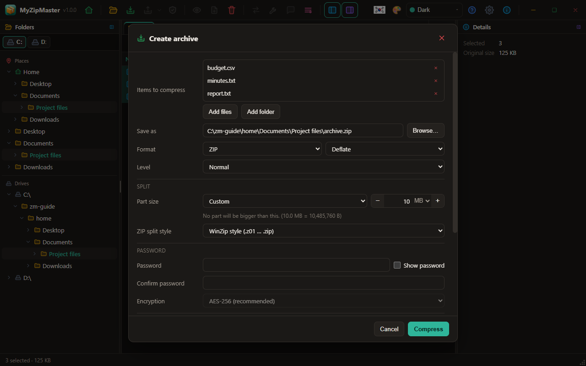

Pick a **Part size**, or choose **Custom** and set a number and unit (B, KB, MB, GB). The − and + buttons move 10 MB at a time in MB, or type in the box. No part will be larger.

| Format | Files made |
|---|---|
| ZIP, WinZip style | `name.z01`, `name.z02`, …, `name.zip` (64 KB or more) |
| ZIP, 7-Zip style | `name.zip.001`, `name.zip.002`, … |
| 7z, TAR family, GZ, BZ2, XZ, ZST | `name.7z.001`, `name.7z.002`, … |
| RAR | `name.part1.rar`, `name.part2.rar`, … |

WinZip-style ZIP and RAR parts can come out slightly under the size because of their headers. The others are exactly that size, except the last.

Opening **any** part opens the whole set. They must be in one folder; in the web version, select all the parts together. A split archive is read-only: convert it to one file to change it.

## Extracting

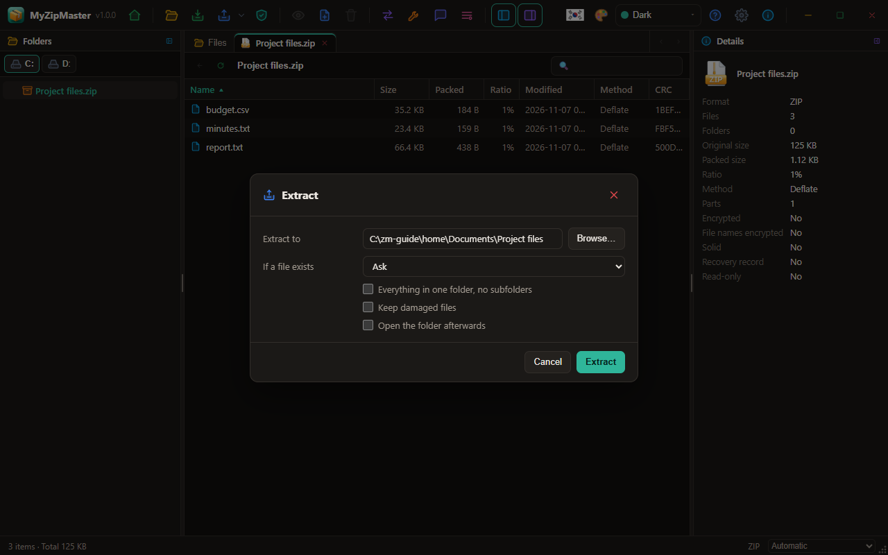

**Extract** (Ctrl+E) asks where and what. The ▾ beside it has **Extract here** and **Extract to named folder**. You can also select several archives in the file list and extract them all.

- **If a file exists**: ask, overwrite, skip, keep both renamed, or only with newer.
- **No subfolders**: everything into one folder.
- **Keep damaged files**: normally they are removed.

Paths trying to leave the destination are skipped and links are not created; the result window counts them.

## Changing an archive

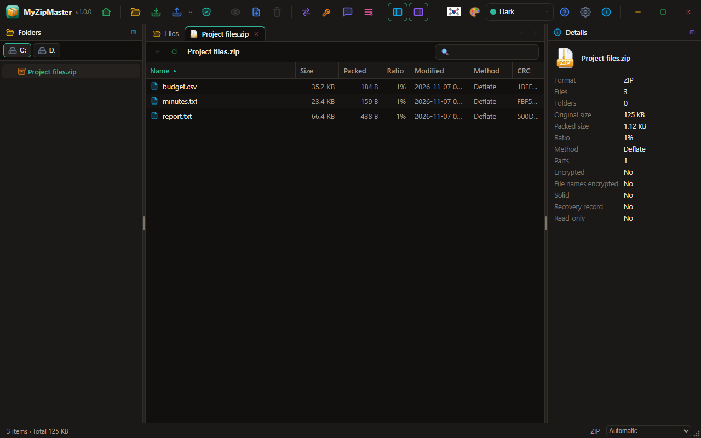

With an archive open: **Add**, **Delete** (Del), rename (F2), **New folder** on the right-click menu, and the comment under **Info**. The whole archive is rewritten, so big ones take a while. If that fails or you cancel, the original is untouched.

## Test and repair

- **Test** (Ctrl+T) unpacks everything to check it, writing nothing to disk.
- **Repair**: for ZIP, scans what is left and writes what it can save to `name.repaired.zip`. RAR needs a recovery record. The original is left alone.

## Convert

**Convert** remakes the open archive in another format. You can set new splitting and a new password.

## Tools

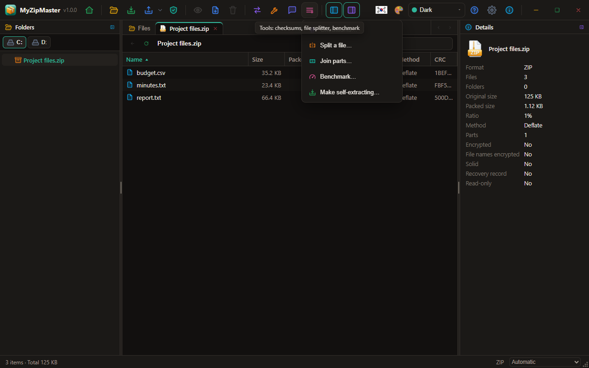

- **Checksums**: CRC32, CRC64, MD5, SHA-1, SHA-256, SHA-512, BLAKE3 for files or folders.
- **Split / join a file**: cuts any file into `.001`, `.002` … and back. 7-Zip can join them too.
- **Benchmark**: measures compression speed in memory.
- **Make self-extracting**.

## Keys

| Key | Action | Key | Action |
|---|---|---|---|
| Ctrl+O | Open | Enter | View |
| Ctrl+N | Compress | Backspace | Up |
| Ctrl+E | Extract | Del | Delete |
| Ctrl+T | Test | F2 | Rename |
| Ctrl+F | Find by name | F5 | Refresh |
| Ctrl+A | Select all | Alt+Enter | Info |
| F1 | User's guide | | |

## Settings

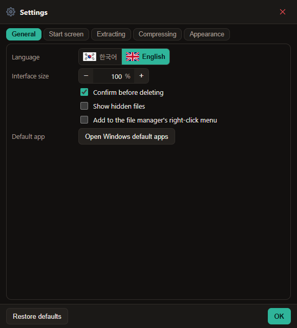

Settings is a window of its own, and changes apply at once. Every number is set with − value unit +, or typed into its box.

- **General**: language, interface size, confirm deletes, show hidden files, the file manager's right-click menu, open Windows default apps.
- **Start screen**: show it at start, reset the card arrangement, the moving background, transparency and motion speed.
- **Extracting**: when a file exists, name encoding, making a folder, opening it afterwards, keeping damaged files.
- **Compressing**: default format, level and part size, ZIP split style and encryption, solid, already compressed files.
- **Appearance**: the custom theme's colours and the 40 themes.

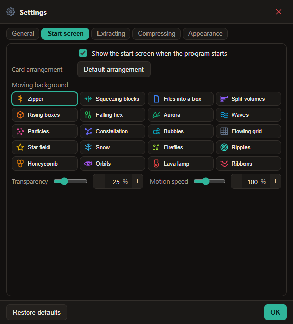

## Themes

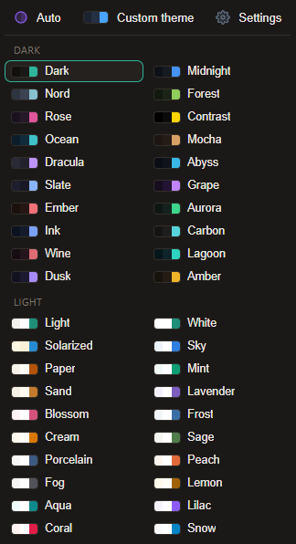

The palette button on the toolbar goes to the next theme. The dropdown beside it shows the current theme's name and opens the full list, which can reach past the window's edge. From the top: **Automatic** (follows the system), **Custom theme** and **Settings**, the 20 dark themes, the 20 light themes; dark and light each in two columns.

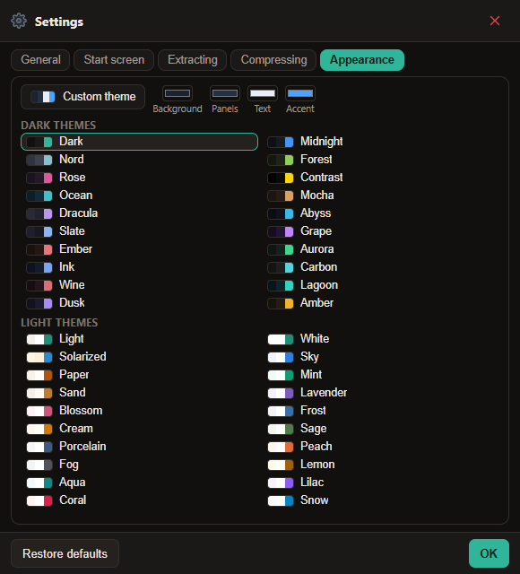

Choose the custom theme's background, panel, text and accent colours in the top row of **Settings → Appearance**. Each choice applies to every window at once.

## The web version

Your files never leave the browser. It works in memory, so jobs above about 1.5 GB may fail. Results are saved as downloads; extracted files can be downloaded as one ZIP or, in browsers that allow it, saved to a folder. Folder browsing and self-extracting archives are desktop only.

## File associations

Installing registers ZIP, 7Z, RAR, TAR, GZ, BZ2, XZ, ZST, CAB, ISO and 001, each with its own icon. If another program is already your default, Windows keeps that choice: right-click a file and use **Open with** to choose MyZipMaster.

## The right-click menu and default app

Installing adds **Compress with MyZipMaster** to the Windows File Explorer's right-click menu, and on archives a **MyZipMaster** item with Open, Extract here, Extract to a folder and Test. On Windows 11 they are under **Show more options**. Turn them off and on in **Settings → General**. On Linux (Dolphin, Nautilus) and macOS (Finder Quick Actions) they appear when that setting is turned on; turn it off before removing the program.

Windows does not let a program make itself the default. Press **Settings → General → Open Windows default apps** and choose it there.

## When something goes wrong

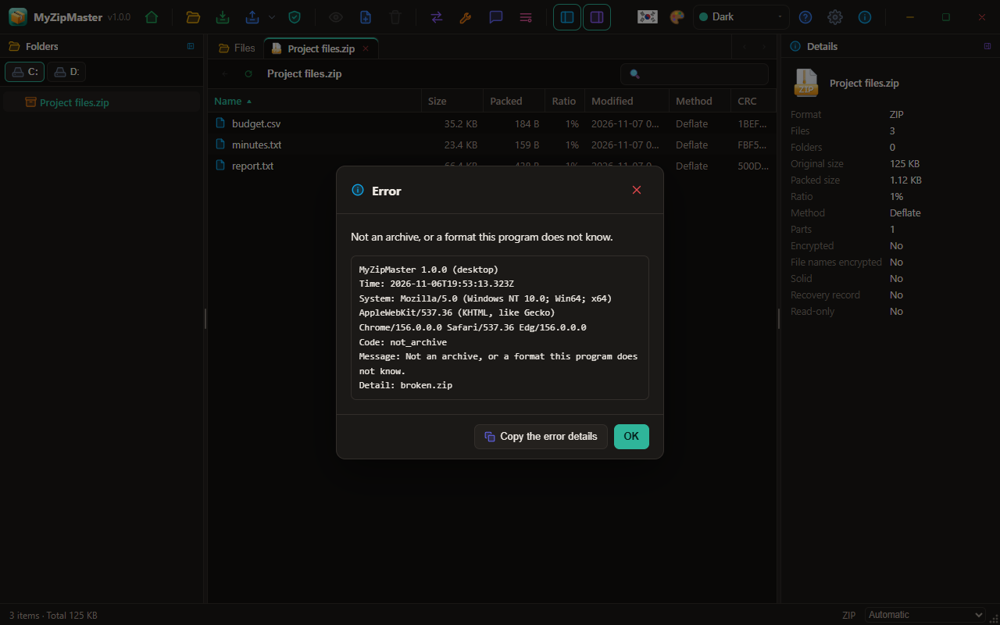

A window shows what happened in detail. **Copy the error details** copies the program version, the time, the system, the error code and the details, ready to paste.

## Not supported

PKWARE strong encryption in ZIP, some rare 7-Zip filters, and changing split sets without converting them first.
