# MyZipMaster 사용 설명서

## 시작 화면

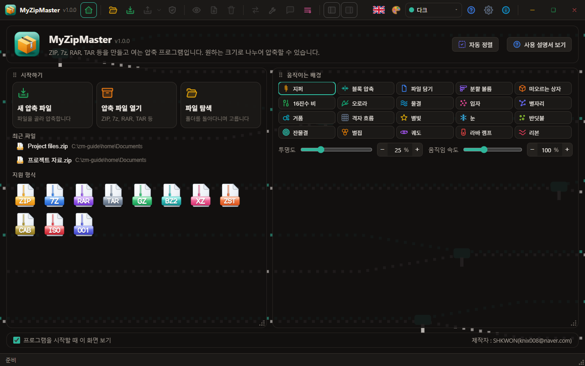

프로그램을 그냥 실행하면 시작 화면이 나옵니다. 압축 파일을 더블클릭해 실행하면 시작 화면 없이 바로 열립니다. 툴바의 버전 번호 오른쪽에 있는 시작 화면 단추를 누르면 시작 화면이 나오고, 다시 누르면 보던 화면으로 돌아갑니다.

- **맨 위 줄**(고정): 프로그램 이름, **자동 정렬**, **사용 설명서 보기**.
- **시작하기** 카드: **새 압축 파일**, **압축 파일 열기**, **파일 탐색**, 최근 파일, 지원 형식.
- **움직이는 배경** 카드: 아이콘 카드 20개 가운데 배경을 고르고, 그 아래 한 줄에서 투명도와 움직임 속도를 끌기 막대나 − + 단추로 정합니다.
- **맨 아래 줄**(고정): 프로그램을 시작할 때 이 화면을 볼지 정하는 확인란과 제작자.

두 카드는 제목 줄을 끌어 옮기고, 오른쪽 아래 점 삼각형을 끌어 크기를 바꿉니다. 놓으면 다시 정렬됩니다. 나란히 있을 때는 다른 카드가 남은 폭을 채우고, 한 카드를 다른 카드의 위나 아래로 끌면 위아래로 쌓입니다. **자동 정렬**을 누르거나 삼각형을 빠르게 두 번 누르면 처음 배치로 돌아갑니다. 제목 줄의 점 단추에 초점을 두고 Alt+화살표로 옮기고, Alt+Shift+화살표로 크기를 바꿀 수도 있습니다.

## 화면

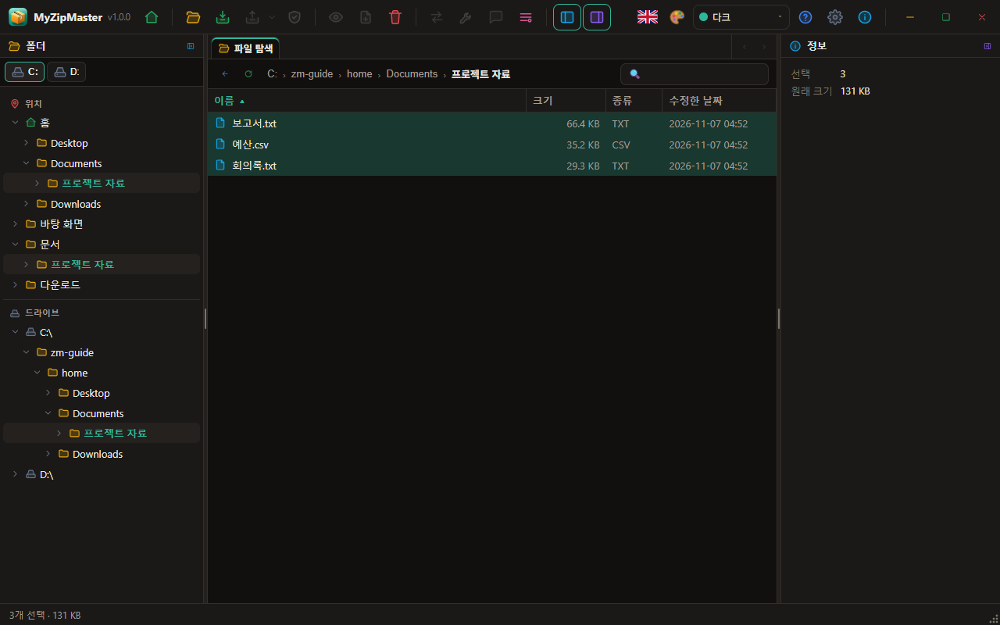

- **툴바**: 맨 왼쪽에 프로그램 아이콘·이름·버전, 그 옆에 아이콘 단추가 있습니다. 왼쪽부터 파일, 압축, 풀기, 테스트 / 보기, 추가, 삭제 / 변환, 복구, 정보, 도구이고, 오른쪽에 언어, 다음 테마(팔레트), 현재 테마 드롭다운, 설명서, 설정, 프로그램 정보, 그리고 맨 오른쪽에 최소화·최대화·닫기가 있습니다. 단추에 마우스를 올리면 이름이 나옵니다. 툴바의 빈 곳을 끌면 창이 움직입니다.
- **탭**: 왼쪽과 오른쪽 패널 사이의 맨 위에 있습니다. 파일 탐색 탭과, 연 압축 파일마다 탭이 하나씩 생겨 여러 압축 파일을 오갈 수 있습니다. ×로 닫습니다. 탭이 많아 다 보이지 않으면 오른쪽 끝의 ‹ › 단추로 넘깁니다.
- **경로 표시줄**: 위로, 새로 고침, 현재 위치, 이름 찾기.
- **왼쪽 패널**: 맨 위의 드라이브 아이콘으로 드라이브를 바꿉니다. 그 아래 트리에는 **위치**(홈, 바탕 화면, 문서 등)와 **드라이브**가 구분선으로 나뉘어 있고, 압축 파일을 열면 그 안의 폴더가 나옵니다.
- **목록**: 제목을 누르면 정렬합니다. 더블클릭으로 폴더에 들어가거나 파일을 엽니다.
- **왼쪽 패널 / 오른쪽 패널**: 제목줄의 접기 단추나 툴바의 패널 단추로 접고 펼 수 있습니다. 접으면 아이콘과 제목만 세로로 남습니다. 패널 사이의 구분자를 끌어 폭을 바꿉니다. 오른쪽 패널에는 고른 항목의 정보가 항목과 내용으로 나옵니다. 압축 파일을 고르면 열지 않아도 형식, 파일 수, 크기, 압축률, 분할 수, 암호화 여부를 보여 줍니다.
- **상태 표시줄**: 항목 수와 크기, 압축 파일의 형식·분할 수·암호화 여부. 오래된 ZIP의 파일 이름이 깨지면 여기서 인코딩을 고르세요. 오른쪽 아래의 점 삼각형을 끌면 창 크기가 바뀝니다.

## 지우기

탐색 중인 파일을 지우면(Del, 또는 오른쪽 클릭의 삭제) 확인을 거쳐 휴지통으로 갑니다. 압축 파일 안의 항목을 지우면 되돌릴 수 없습니다. 지금 쓸 수 없는 단추와 메뉴 항목은 회색으로 표시됩니다.

## 압축하기

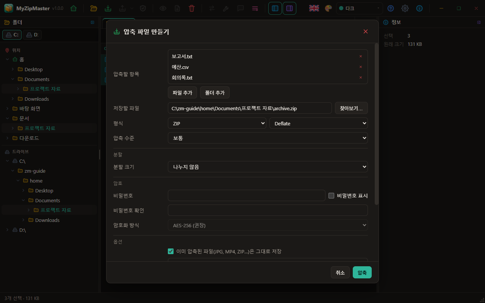

파일이나 폴더를 고르고 **압축**(Ctrl+N)을 누릅니다. 창에 파일을 끌어다 놓아도 됩니다.

| 항목 | 설명 |
|---|---|
| 저장할 파일 | 만들 파일의 위치와 이름. 형식을 바꾸면 확장자가 따라 바뀝니다. |
| 형식 | ZIP, 7Z, RAR, TAR, TAR.GZ, TAR.BZ2, TAR.XZ, TAR.ZST, GZ, BZ2, XZ, ZST. GZ·BZ2·XZ·ZST는 파일 하나만 담습니다. |
| 압축 방식 | ZIP: Deflate, 저장, BZip2, LZMA, XZ, Zstandard. 7z: LZMA2, LZMA, BZip2, Deflate, PPMd, 복사. |
| 압축 수준 | 저장, 가장 빠르게, 빠르게, 보통, 높게, 최대. Zstandard도 수준을 고를 수 있습니다(웹판은 빠른 수준 하나). |
| 분할 크기 | 아래를 보세요. |
| 비밀번호 | 확인란과 같아야 시작됩니다. 7z와 RAR는 파일 이름까지 암호화할 수 있습니다. |
| 암호화 방식(ZIP) | AES-256을 권장합니다. ZipCrypto는 약하므로 오래된 프로그램과 주고받을 때만 쓰세요. |
| 솔리드(7z, RAR) | 비슷한 파일이 많을 때 훨씬 작아집니다. 대신 한 파일을 풀 때도 앞부분을 함께 풀어야 합니다. |
| 복구 레코드(RAR) | 손상에 대비한 여분 데이터의 비율입니다. |
| 설명(ZIP, RAR) | 압축 파일에 붙는 글입니다. |
| 넣을 폴더 | 압축 파일 안에 이 폴더를 만들어 그 아래에 넣습니다. |
| 제외할 이름 | `*.tmp; node_modules`처럼 세미콜론으로 나눕니다. |
| 이미 압축된 파일은 그대로 저장(ZIP) | JPG, MP4, ZIP처럼 더 줄지 않는 파일에 시간을 쓰지 않습니다. |
| 자동 풀림 파일(ZIP, 데스크톱) | 실행하면 스스로 풀리는 파일을 만듭니다. 이 운영 체제용입니다. |
| 압축 후 원본을 휴지통으로 보내기(데스크톱) | 새 압축 파일을 끝까지 읽어 이상이 없을 때만 보냅니다. 제외할 이름을 정했거나 압축 파일이 원본 폴더 안에 만들어지면 쓸 수 없습니다. |
| 설치된 WinRAR로 압축(RAR, 데스크톱) | WinRAR가 있을 때만 나옵니다. 이때 비밀번호는 실행 중에 명령줄에 나타납니다. |

## 나누어 압축하기

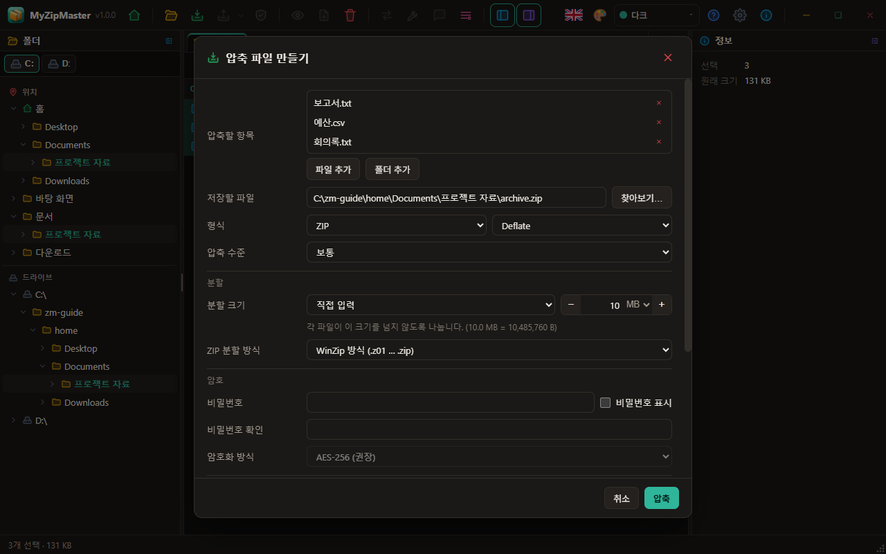

**분할 크기**에서 고르거나 **직접 입력**으로 숫자와 단위(B, KB, MB, GB)를 정합니다. − + 단추를 누르면 MB에서는 10 MB씩 바뀌고, 칸에 직접 입력해도 됩니다. 어떤 조각도 이 크기를 넘지 않습니다.

| 형식 | 만들어지는 파일 |
|---|---|
| ZIP, WinZip 방식 | `이름.z01`, `이름.z02`, …, `이름.zip` (64 KB 이상) |
| ZIP, 7-Zip 방식 | `이름.zip.001`, `이름.zip.002`, … |
| 7z, TAR 계열, GZ·BZ2·XZ·ZST | `이름.7z.001`, `이름.7z.002`, … |
| RAR | `이름.part1.rar`, `이름.part2.rar`, … |

ZIP(WinZip 방식)과 RAR는 헤더 때문에 조각이 지정 크기보다 약간 작을 수 있습니다. 나머지는 마지막을 빼고 정확히 그 크기입니다.

조각은 **어느 것을 열어도** 전체가 열립니다. 모두 같은 폴더에 있어야 하며, 웹판에서는 조각을 전부 함께 선택하세요. 나뉜 압축 파일은 읽기 전용입니다. 고치려면 먼저 하나로 변환하세요.

## 풀기

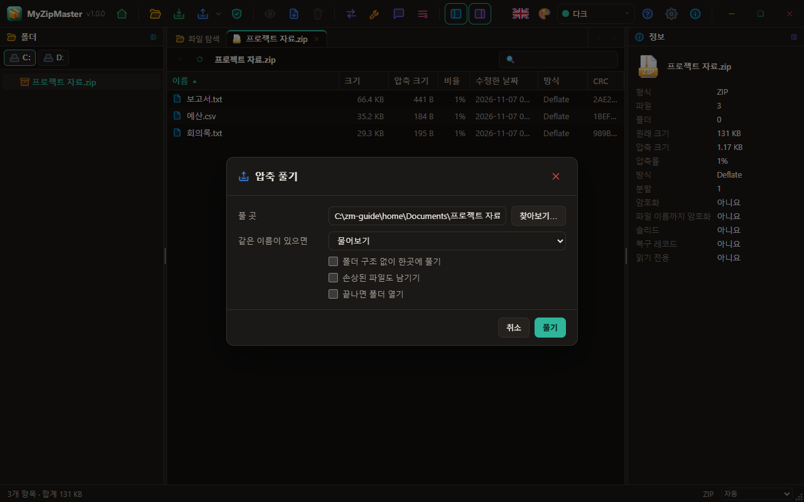

**풀기**(Ctrl+E)에서 풀 곳과 범위를 고릅니다. 옆의 ▾에는 **여기에 풀기**와 **폴더 이름으로 풀기**가 있습니다. 파일 목록에서 압축 파일 여러 개를 골라 한 번에 풀 수도 있습니다.

- **같은 이름이 있으면**: 물어보기, 덮어쓰기, 건너뛰기, 이름을 바꿔 둘 다 보관, 더 새로운 것만.
- **폴더 구조 없이**: 모든 파일을 한 폴더에 풉니다.
- **손상된 파일도 남기기**: 기본은 지웁니다.

압축 파일 밖으로 나가려는 경로는 건너뛰고, 링크는 만들지 않으며, 결과 창에 그 수를 알려 줍니다.

## 압축 파일 고치기

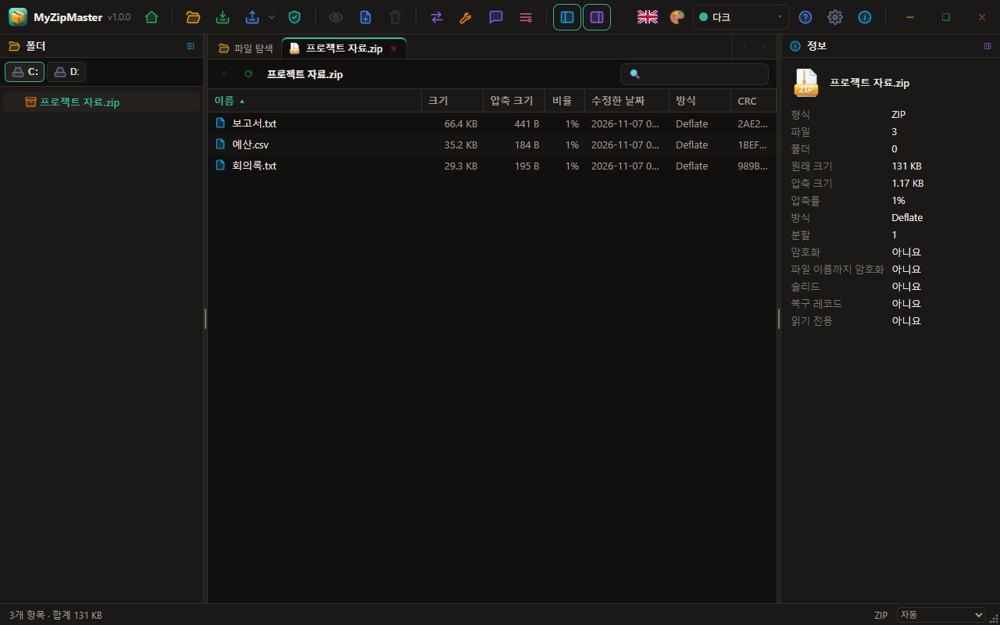

연 압축 파일에서 **추가**, **삭제**(Del), 이름 바꾸기(F2), 오른쪽 클릭의 **새 폴더**, **정보**의 설명 수정을 쓸 수 있습니다. 내용 전체를 다시 쓰므로 큰 파일은 시간이 걸립니다. 실패하거나 취소하면 원본은 그대로입니다.

## 테스트와 복구

- **테스트**(Ctrl+T): 모든 파일을 풀어 보며 검사합니다. 디스크에는 아무것도 쓰지 않습니다.
- **복구**: ZIP은 남은 데이터를 훑어 살릴 수 있는 항목으로 `이름.repaired.zip`을 만듭니다. RAR는 복구 레코드가 있어야 합니다. 원본은 건드리지 않습니다.

## 변환

**변환**은 지금 압축 파일을 다른 형식으로 다시 만듭니다. 분할과 암호도 새로 정할 수 있습니다.

## 도구

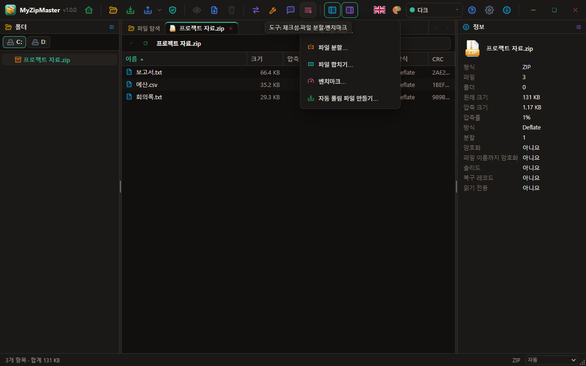

- **체크섬**: 파일이나 폴더의 CRC32, CRC64, MD5, SHA-1, SHA-256, SHA-512, BLAKE3.
- **파일 분할 / 합치기**: 어떤 파일이든 `.001`, `.002` …로 자르고 다시 합칩니다. 7-Zip으로도 합칠 수 있습니다.
- **벤치마크**: 메모리에서 압축·해제 속도를 잽니다.
- **자동 풀림 파일 만들기**.

## 단축키

| 키 | 동작 | 키 | 동작 |
|---|---|---|---|
| Ctrl+O | 열기 | Enter | 보기 |
| Ctrl+N | 압축 | Backspace | 위로 |
| Ctrl+E | 풀기 | Del | 삭제 |
| Ctrl+T | 테스트 | F2 | 이름 바꾸기 |
| Ctrl+F | 이름 찾기 | F5 | 새로 고침 |
| Ctrl+A | 모두 선택 | Alt+Enter | 정보 |
| F1 | 사용자 설명서 | | |

## 설정

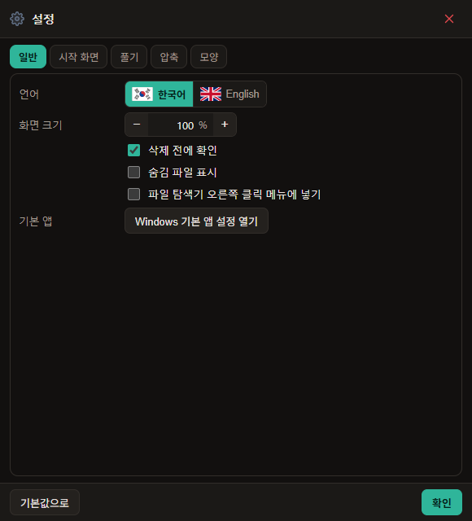

설정은 독립된 창이며 바꾸는 즉시 적용됩니다. 숫자는 모두 − 값 단위 + 단추로 정하고, 칸에 직접 입력해도 됩니다.

- **일반**: 언어, 화면 크기, 삭제 전 확인, 숨김 파일 표시, 파일 탐색기 오른쪽 클릭 메뉴, Windows 기본 앱 설정 열기.
- **시작 화면**: 시작할 때 보기, 카드 배치 되돌리기, 움직이는 배경, 투명도, 움직임 속도.
- **풀기**: 같은 이름 처리, 파일 이름 인코딩, 폴더 만들기, 끝나면 폴더 열기, 손상된 파일 남기기.
- **압축**: 기본 형식·수준·분할 크기, ZIP 분할 방식과 암호화, 솔리드, 이미 압축된 파일 처리.
- **모양**: 사용자 설정 테마의 색과 테마 40종.

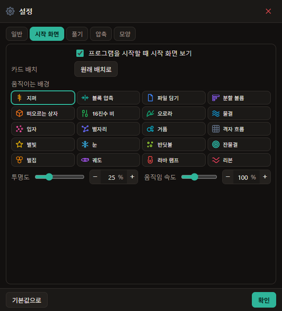

## 테마

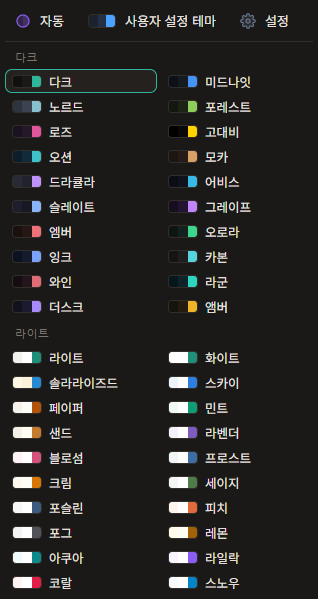

툴바의 팔레트 단추를 누르면 다음 테마로 바뀝니다. 그 옆 드롭다운에 현재 테마 이름이 보이고, 누르면 전체 목록이 열립니다. 목록은 창을 벗어나서도 보입니다. 위에서부터 **자동**(시스템 밝기를 따름)·**사용자 설정 테마**·**설정**, Dark 20종, Light 20종 순서이고 Dark와 Light는 각각 세로 두 줄입니다.

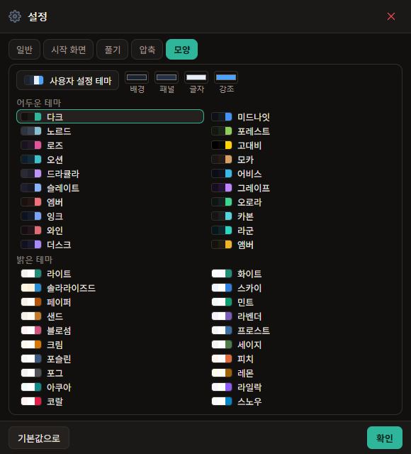

사용자 설정 테마는 **설정 → 모양** 맨 위 줄에서 배경, 패널, 글자, 강조 색을 고릅니다. 고르면 모든 창에 곧바로 적용됩니다.

## 웹판

파일은 브라우저 밖으로 나가지 않습니다. 대신 메모리에서 처리하므로 약 1.5 GB를 넘으면 실패할 수 있습니다. 결과는 내려받기로 저장하며, 풀린 파일은 ZIP으로 받거나(지원 브라우저에서) 폴더에 저장할 수 있습니다. 폴더 탐색과 자동 풀림 파일은 데스크톱에서만 됩니다.

## 파일 연결

설치하면 ZIP, 7Z, RAR, TAR, GZ, BZ2, XZ, ZST, CAB, ISO, 001이 등록되고 형식마다 자기 아이콘을 갖습니다. 다른 프로그램이 이미 기본으로 지정되어 있으면 Windows는 그 선택을 유지합니다. 파일을 오른쪽 클릭해 **연결 프로그램**에서 MyZipMaster를 고르세요.

## 오른쪽 클릭 메뉴와 기본 앱

설치하면 Windows 파일 탐색기의 오른쪽 클릭 메뉴에 **MyZipMaster로 압축**이 생기고, 압축 파일에는 **MyZipMaster** 아래에 열기, 여기에 풀기, 폴더로 풀기, 검사가 생깁니다. Windows 11에서는 **추가 옵션 표시** 안에 있습니다. **설정 → 일반**에서 끄고 켤 수 있습니다. Linux(Dolphin, Nautilus)와 macOS(Finder 빠른 동작)는 같은 설정을 켜면 생기며, 프로그램을 지우기 전에 꺼 주세요.

Windows는 프로그램이 스스로 기본 앱이 되는 것을 막습니다. **설정 → 일반 → Windows 기본 앱 설정 열기**를 눌러 직접 고르세요.

## 오류가 났을 때

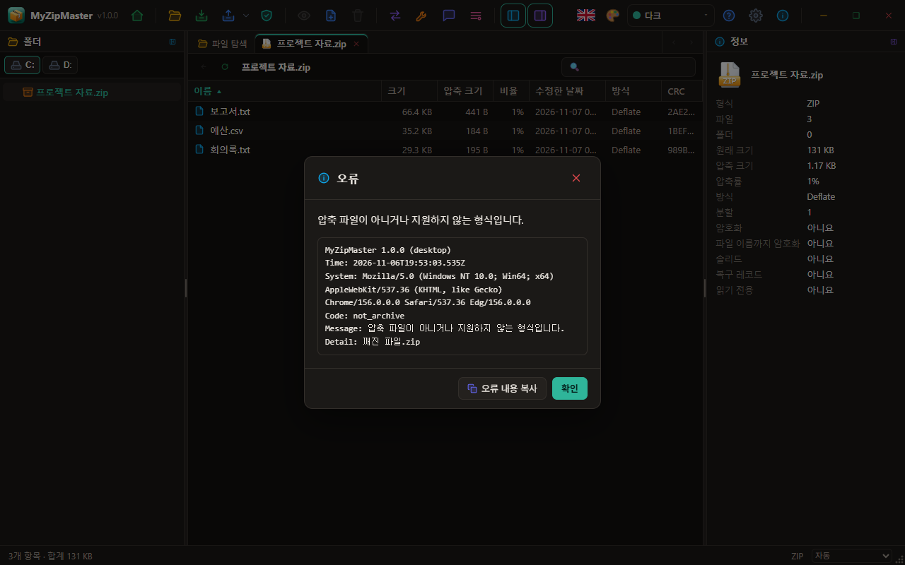

오류가 나면 창에 내용이 자세히 나옵니다. **오류 내용 복사**를 누르면 프로그램 버전, 시각, 시스템, 오류 코드와 자세한 내용이 복사되어 그대로 붙여 넣을 수 있습니다.

## 지원하지 않는 것

PKWARE 강력 암호화 ZIP과 일부 드문 7z 필터, 나뉜 압축 파일을 합치지 않은 상태로 고치기는 지원하지 않습니다.
